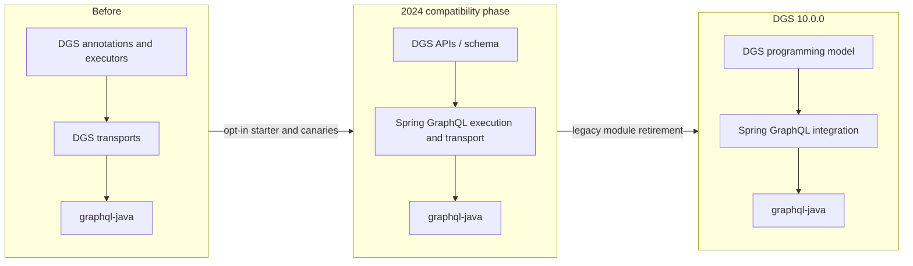

# Netflix — DGS and Spring GraphQL: compatibility before duplicated-framework removal

**Case ID:** `case.netflix.dgs-spring-graphql-convergence` · **Owner:** M9 E16-02 #115 · **Status:** evidence-backed draft; human review pending  
**Period:** April 2024 plan → December 17, 2024 reported release/adoption.  
**Primary:** N09 (Srinivasan and Bakker, 2024-04-08), N10 (official DGS 8.5.0 and 10.0.0 release notes). Do not blend proposed and subsequently completed states.

## Architecture question

Netflix's open-source DGS provided Java application teams a Spring Boot programming model, schema and test helpers around `graphql-java`. A separate Spring GraphQL framework matured to overlapping functionality. Permanently maintaining two HTTP and query-execution stacks would duplicate maintenance effort, but simply deleting DGS would impose a costly rewrite on hundreds of services relying on DGS APIs and instrumentation. The modernization problem was **compatibility-preserving consolidation**, not replacing GraphQL itself. [N09: "Why not retire the DGS Framework or Spring GraphQL?"].

## Three temporal architecture states

**Text alternative:** application-facing DGS programming constructs are preserved while HTTP transport/execution internals shift to Spring GraphQL. Once compatibility is demonstrated, the retired DGS-specific modules can disappear. This flow intentionally simplifies several modules and is independently drawn; refer to N09 for exact implementation diagrams.

The April 2024 article identifies a modular DGS schema provider that wires data fetchers and an executor API also used by tests. During integration the DGS query executor delegates to Spring GraphQL and the web MVC/WebFlux handling switches to Spring GraphQL transports. This keeps the application's annotation model stable while removing duplicated underlying mechanisms. The new starter made adoption opt-in during a transition. [N09: "Framework Architecture with Spring GraphQL", "What does this mean for my applications?", "Going Forward"].

## A revealing failed performance assumption

Early canary comparisons against existing services were **worse**, not automatically equivalent: Netflix authors reported more than **50% CPU degradation** and around **20% slower request latency**. Framework improvements helped, but a residual **10–20% CPU degradation** remained. They traced an important source of overhead to automatic asynchronous HTTP processing: existing service filters were not designed with the new async lifecycle, so they executed repeatedly. Disabling async request processing returned the integrated path to reported baseline parity for the measured services; opting into async remained possible. [N09: "Performance"].

| Step | Source-reported result | Interpretation |
|---|---|---|
| Initial Spring GraphQL transport integration canary | CPU >50% worse; latency ~20% worse | Compatibility at API level did not imply execution-semantic parity |
| After intermediate fixes | CPU still 10–20% worse | More than a simple JVM optimization issue |
| Disable implicit async processing | Performance comparable to former DGS baseline | Preserve synchronous semantics until applications are explicitly async-aware |
| DGS 10.0.0, 2024-12-17 | Removed legacy modules; maintainers report Netflix services migrated with little application code change | Release-owner fleet claim; not an independently audited per-service success rate |

The December 2024 announcement is **later evidence** than the April target dates: it states legacy code removal and Netflix migration in 10.0.0. Therefore it would be incorrect to say the April roadmap alone proves the fleet was migrated. [N10: "DGS Framework 10.0.0 released!"].

## Transfer: choose compatibility as a first-class architecture artifact

A framework consolidation roadmap should inventory user-facing APIs, test harnesses, query context, instrumentation and web transport semantics. Build an adapter layer that preserves application entrypoints; use old and new builds side by side under equivalent real traffic; compare CPU, latency, error rates, data-fetcher behavior, distributed traces, and auth. Check request lifecycle subtleties such as async filter reentry rather than benchmarking only the GraphQL query executor.

These are **Tycho recommendations** distilled from the case, not a claim the teams evaluated every alternative listed here:

| Alternative | Attraction | Risk / when not to choose |
|---|---|---|
| Retire DGS and make users rewrite | One codebase | Migration cost and compatibility breakage with huge installed base |
| Maintain fully separate implementations | No near-term user disruption | Long-term duplicate support and missed shared fixes |
| Integrate Spring GraphQL behind DGS API | Lower application migration surface | Requires behavioral parity tests, adapter deprecation and migration ownership |
| Rewrite immediately to asynchronous HTTP | Potential I/O benefit | Changes filter lifecycle and can regress CPU/p99, as shown here |

## Operational gates, unknowns and temporal discipline

Treat opt-in adoption, performance canary and removal of legacy modules as separate gates. A proposed rollback before legacy retirement can restore the old starter, but this document does not establish Netflix's exact rollback implementation, threshold or percentage of adopting services. Claims about 2026 DGS or Spring Boot internals need newer source revisions. Do not infer upstream Spring contributor rankings from collaboration alone.

**Source pointers:** [N09 — Netflix first-party integration account](https://netflixtechblog.com/a-tale-of-two-frameworks-the-domain-graph-service-framework-meets-spring-graphql-f8237f09c389), sections "Framework Architecture with Spring GraphQL", "Performance", "Going Forward"; [N10 — DGS official announcements](https://netflix.github.io/dgs/announcements/), sections "8.5.0 with Spring GraphQL" and "10.0.0 released!".

**Review state:** draft; acceptance requires independent verification of numerics and current semantic correctness in #121, no invented deployment measurements.
