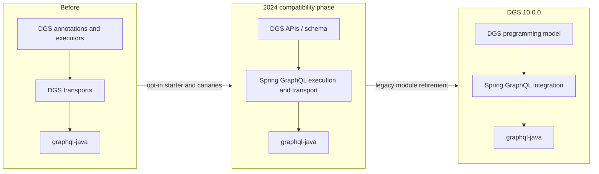

# Netflix — DGS and Spring GraphQL: compatibility before duplicated-framework removal

**Case ID:** `case.netflix.dgs-spring-graphql-convergence` · **Owner:** M9 E16-02 #115 · **Status:** evidence-backed draft; human review pending  
**Period:** April 2024 plan → December 17, 2024 reported release/adoption.  
**Primary:** N09 (Srinivasan and Bakker, 2024-04-08), N10 (official DGS 8.5.0 and 10.0.0 release notes). Do not blend proposed and subsequently completed states.

## Architecture question

Netflix's open-source DGS provided Java application teams a Spring Boot programming model, schema and test helpers around `graphql-java`. A separate Spring GraphQL framework matured to overlapping functionality. Permanently maintaining two HTTP and query-execution stacks would duplicate maintenance effort, but simply deleting DGS would impose a costly rewrite on hundreds of services relying on DGS APIs and instrumentation. The modernization problem was **compatibility-preserving consolidation**, not replacing GraphQL itself. [N09: "Why not retire the DGS Framework or Spring GraphQL?"].

## Three temporal architecture states

**Text alternative:** application-facing DGS programming constructs are preserved while HTTP transport/execution internals shift to Spring GraphQL. Once compatibility is demonstrated, the retired DGS-specific modules can disappear. This flow intentionally simplifies several modules and is independently drawn; refer to N09 for exact implementation diagrams.

The April 2024 article identifies a modular DGS schema provider that wires data fetchers and an executor API also used by tests. During integration the DGS query executor delegates to Spring GraphQL and the web MVC/WebFlux handling switches to Spring GraphQL transports. This keeps the application's annotation model stable while removing duplicated underlying mechanisms. The new starter made adoption opt-in during a transition. [N09: "Framework Architecture with Spring GraphQL", "What does this mean for my applications?", "Going Forward"].

## A revealing failed performance assumption

Early canary comparisons against existing services were **worse**, not automatically equivalent: Netflix authors reported more than **50% CPU degradation** and around **20% slower request latency**. Framework improvements helped, but a residual **10–20% CPU degradation** remained. They traced an important source of overhead to automatic asynchronous HTTP processing: existing service filters were not designed with the new async lifecycle, so they executed repeatedly. Disabling async request processing returned the integrated path to reported baseline parity for the measured services; opting into async remained possible. [N09: "Performance"].

| Step | Source-reported result | Interpretation |
|---|---|---|
| Initial Spring GraphQL transport integration canary | CPU >50% worse; latency ~20% worse | Compatibility at API level did not imply execution-semantic parity |
| After intermediate fixes | CPU still 10–20% worse | More than a simple JVM optimization issue |
| Disable implicit async processing | Performance comparable to former DGS baseline | Preserve synchronous semantics until applications are explicitly async-aware |
| DGS 10.0.0, 2024-12-17 | Removed legacy modules; maintainers report Netflix services migrated with little application code change | Release-owner fleet claim; not an independently audited per-service success rate |

The December 2024 announcement is **later evidence** than the April target dates: it states legacy code removal and Netflix migration in 10.0.0. Therefore it would be incorrect to say the April roadmap alone proves the fleet was migrated. [N10: "DGS Framework 10.0.0 released!"].

## The migration surface: preserve semantics, not merely annotations

The April 2024 [engineering account](https://netflixtechblog.com/a-tale-of-two-frameworks-the-domain-graph-service-framework-meets-spring-graphql-f8237f09c389) (N09, **Framework Architecture with Spring GraphQL**) names the compatibility seam more precisely. DGS retained its schema provider and data-fetcher wiring. Its query executor became a compatibility interface delegating to Spring GraphQL; Spring GraphQL handled the HTTP/WebSocket request paths previously maintained by DGS. Applications could therefore preserve common DGS annotations and schema/code-generation workflows while changing the underlying transport and execution engine. This is narrower than “all GraphQL applications need no changes”: custom web filters, test configuration, direct use of deprecated classes and subscription clients may still cross altered boundaries.

In the publisher's **Performance** section, the team describes comparison by running **two builds** with production traffic against some of its largest services and observing CPU utilization, memory and request latency. The roughly **>50% CPU and 20% latency regressions** occurred in this preliminary comparison, **not** in the eventual December release. After framework fixes there was still **10–20%** CPU degradation. The identification of repeated non-async-aware filters under implicit asynchronous HTTP handling was a lifecycle correctness insight, not just a JVM hotspot. The adjustment was to **disable async processing by default for compatibility**, allowing an application to enable it deliberately. The full traffic mix, per-service confidence interval and long-run defect rates are not published; reported parity is scoped to the tested services.

## Specific module and protocol consequences after the 10.0 release

The official [December 17, 2024 release notice](https://netflix.github.io/dgs/announcements/) (N10, **DGS Framework 10.0.0 released!**, **Detailed list of changes**) is stronger evidence than the April schedule because it names removed modules and known compatibility changes:

| Compatibility seam | Publisher's 10.0.0 action | Test or migration implication |
|---|---|---|
| Dependency entry point | New preferred starter is **dgs-starter**, aliasing the Spring GraphQL integration starter; older web MVC/WebFlux/autoconfiguration starters removed | Check dependency graph, bootstrapping, web-stack selection and packaging before deleting compatibility adapters |
| Core test configuration | **DgsAutoConfiguration** removed; official guidance favors **EnableDgsTest** for tests that named the deleted configuration class | Test suites using an explicit old class need a change despite the “mostly no code changes” adoption report |
| Direct client API | Legacy **DefaultGraphQLClient** removed in favor of newer client choices | Audit direct use, not just annotation-based server endpoints |
| Subscription over Server-Sent Events | Spring GraphQL uses a newer SSE protocol and the **/graphql** endpoint, versus older DGS subscription behavior/path | Verify subscriptions, reconnect/resume semantics and endpoint routing across old clients; compatibility is not established by a query-only test |
| Query execution classes | Concrete legacy executor classes removed while supported interfaces remain | Test custom adapters and reflection/code-generated references that depend on implementation classes |

**Caveat:** the table lists selected **documented migration hazards**, not a claim that every Netflix application used each of those features. The official notice says Netflix services were migrated and most application code did not need changing; it does not prove that no application or downstream client needed any adjustment. Distinguish **runtime behavioral parity** in a measured canary from **API/source compatibility** of every optional integration.

## Historical chronology and unverified transitions

1. **Early 2021:** DGS was made public (N09 retrospective); installed application-specific instrumentation had grown thereafter.
2. **March 29, 2024:** the official release notes list **DGS 8.5.0** with Spring GraphQL integration (N10). The new starter was opt-in, not evidence of immediate global cutover.
3. **April 8, 2024:** the engineering post describes intended broad adoption through Q2, a later default switch in Q3, and legacy removal before end of year (**plans**, not observed results for those dates).
4. **December 17, 2024:** the official **10.0.0** announcement states legacy DGS transport modules were removed and Netflix had migrated its services, mostly without application changes. This is a **maintainer-reported outcome**, not an independently counted 100%-service migration.
5. **After December 2024:** the cited release notes do not validate 2025/2026 deployment characteristics, request mixes or framework performance across every consumer. Independent follow-up requires dated later sources, not interpolation.

The historical 2023 DGS 6.0.0 release (N10) had already required **Spring Boot 3 / JDK 17** and included its own context compatibility caveat. Avoid treating that prior baseline upgrade as a consequence of the 2024 DGS/Spring GraphQL transport merger.

## Decision criteria and reversible tests for a different platform

A team consolidating two frameworks can use an explicit sequence (Tycho **synthetic recommendation**, not Netflix's recorded exact runbook): first inventory public programming APIs, data-loader/context behavior, HTTP and subscription transports, auth/observability filters and test harnesses; next implement a shared engine behind compatibility APIs; then canary equal traffic across old and new builds; inspect CPU per request, p95/p99, errors, auth context, filter invocation count, memory and subscription paths; finally deprecate modules **only after** each adopted feature has compatibility tests and a rollback artifact.

**Negative test set:** a custom servlet filter executes twice; a GraphQL subscription client reconnects to the wrong route; a test depends on a deleted auto-configuration class; a data loader loses request identity; async error/cancellation semantics change while single-query happy-path checks pass. Stop rollout on any auth-context regression or unexplained CPU/latency penalty. An adopter without the ability to test old clients or compare production-representative workloads must return **insufficient evidence** rather than infer drop-in compatibility from the project's release headline.

## Transfer: choose compatibility as a first-class architecture artifact

A framework consolidation roadmap should inventory user-facing APIs, test harnesses, query context, instrumentation and web transport semantics. Build an adapter layer that preserves application entrypoints; use old and new builds side by side under equivalent real traffic; compare CPU, latency, error rates, data-fetcher behavior, distributed traces, and auth. Check request lifecycle subtleties such as async filter reentry rather than benchmarking only the GraphQL query executor.

These are **Tycho recommendations** distilled from the case, not a claim the teams evaluated every alternative listed here:

| Alternative | Attraction | Risk / when not to choose |
|---|---|---|
| Retire DGS and make users rewrite | One codebase | Migration cost and compatibility breakage with huge installed base |
| Maintain fully separate implementations | No near-term user disruption | Long-term duplicate support and missed shared fixes |
| Integrate Spring GraphQL behind DGS API | Lower application migration surface | Requires behavioral parity tests, adapter deprecation and migration ownership |
| Rewrite immediately to asynchronous HTTP | Potential I/O benefit | Changes filter lifecycle and can regress CPU/p99, as shown here |

## Operational gates, unknowns and temporal discipline

Treat opt-in adoption, performance canary and removal of legacy modules as separate gates. A proposed rollback before legacy retirement can restore the old starter, but this document does not establish Netflix's exact rollback implementation, threshold or percentage of adopting services. Claims about 2026 DGS or Spring Boot internals need newer source revisions. Do not infer upstream Spring contributor rankings from collaboration alone.

**Source pointers:** [N09 — Netflix first-party integration account](https://netflixtechblog.com/a-tale-of-two-frameworks-the-domain-graph-service-framework-meets-spring-graphql-f8237f09c389), sections "Framework Architecture with Spring GraphQL", "Performance", "Going Forward"; [N10 — DGS official announcements](https://netflix.github.io/dgs/announcements/), sections "8.5.0 with Spring GraphQL" and "10.0.0 released!".

**Review state:** draft; acceptance requires independent verification of numerics and current semantic correctness in #121, no invented deployment measurements.
