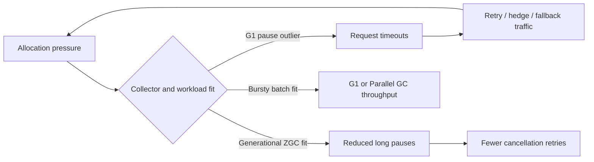

# Netflix — Generational ZGC as a workload-shaped latency choice, not a universal default

**Case ID:** `case.netflix.generational-zgc-vs-g1` | **M9:** E16-03 #116 | **Period:** Netflix article **2024-03-06**, JDK 21 | **Status:** drafted, technical review pending  
**Primary:** N05, Danny Thomas, Netflix JVM Ecosystem Team, [Bending pause times to your will with Generational ZGC](https://netflixtechblog.com/bending-pause-times-to-your-will-with-generational-zgc-256629c9386b), exact sections "Reduced tail latencies", "Efficiency", "Operational simplicity", "Memory overhead", "Transparent huge pages", "What workloads weren't a good fit?".

## Workload requirement changes the answer

Netflix was operating streaming Java services, including gRPC and DGS endpoints, where stop-the-world GC pauses were not merely slow individual responses. Timeouts triggered cancellations, retries, hedging and fallback work; this added load to a fleet even after the unlucky request failed. The company therefore optimized *tail-latency and operational simplicity* together, not peak allocation throughput alone. It reported adopting **Generational ZGC** as its default for JDK 21+ services and having more than half of its critical streaming video services on this combination by the article's 2024 date. Neither figure describes every Netflix application in 2026. [N05, introduction and "Reduced tail latencies"].

**Text alternative:** collector pauses can trigger request retries that increase pressure, forming an amplification loop. The alternate branch shows that throughput-oriented batch work may favor a different collector; this is a Tycho explanatory model, not a copy of Netflix graphs.

## Separate three collectors and four measurements

| Comparative observation | Source-reported outcome | Caveat |
|---|---|---|
| G1 versus earlier **non-generational ZGC** on a worst evaluated case | Older ZGC consumed **36% more CPU** | That finding discouraged older ZGC, not generational ZGC |
| G1 versus **Generational ZGC** for that workload | Near **10% CPU improvement** as reported | Applies to selected workload and observability window |
| Request-service p99/average | Netflix reports equal/better CPU and better latencies at equivalent CPU target | No universal benchmark or independent replication |
| Parallel collector versus G1 in one large precompute | **6–8% more throughput**, about **one hour** shorter batch | **Not** ZGC-versus-G1: distinct comparison for a batch workload |
| More than half critical streaming services using JDK 21 + Generational ZGC | Company-reported 2024 adoption | Not the entire Java fleet |

The company also described an overhead of **3% of heap size** for ZGC native memory and discussed loss of compressed references and direct-byte-buffer processing. Its transparent-huge-page changes depend on Linux's shared-memory THP setting; this is not evidence that every machine should copy the published values. [N05, "Memory overhead", "Transparent huge pages"].

## Genuine counterexample: spiky allocation and long-running batch

The article explicitly identifies workloads with volatile allocation, long-lived objects and unpredictable task duration where G1 performed better. The *Parallel collector* helped a particular throughput-oriented precompute job more than G1. These counterexamples disprove choosing the collector solely from a company name or a fashionable pause-time target. Latency-critical requests, batch data-processing workers and memory-constrained containers are separate contexts.

## Tycho decision procedure

1. Establish request SLO, p99/maximum GC pause distribution, cancellations and retry amplification; batch throughput jobs need a different objective.
2. Pin **JDK version**, collector flags, heap/native memory, THP configuration, allocation rate, GC cycle counts and workload shape for each candidate.
3. Run paired canaries at comparable CPU utilization and response mix. Keep GC pause *and* end-to-end p99/cancellation metrics; equal pause percentiles can mask memory or queueing changes.
4. Revisit direct-buffer deallocation and reference handling, and ensure container memory limits account for native overhead.
5. Preserve a rollback to the old JDK/collector configuration and predefined thresholds; this list is **Tycho guidance**, not Netflix's documented playbook.

**Alternative decisions:** latency-sensitive IO-heavy service → consider generational concurrent collection; bursty high-throughput batch → test G1 and Parallel; very small heap or runtime changes → measure native footprint; unknown traffic mix → **insufficient evidence**, do not rank collectors.

**Unknowns:** Netflix's full test hardware, exact per-service SLO thresholds and causal variance of retries are not reproduced here. No graphs copied. **Review:** pending #121 and detailed source-admission gate.
