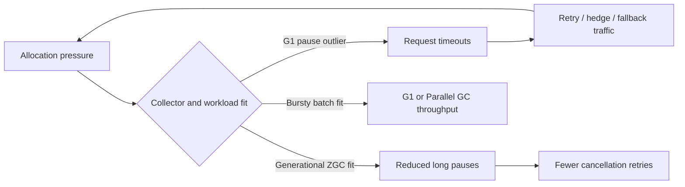

# Netflix — Generational ZGC as a workload-shaped latency choice, not a universal default

**Case ID:** `case.netflix.generational-zgc-vs-g1` | **M9:** E16-03 #116 | **Period:** Netflix article **2024-03-06**, JDK 21 | **Status:** drafted, technical review pending  
**Primary:** N05, Danny Thomas, Netflix JVM Ecosystem Team, [Bending pause times to your will with Generational ZGC](https://netflixtechblog.com/bending-pause-times-to-your-will-with-generational-zgc-256629c9386b), exact sections "Reduced tail latencies", "Efficiency", "Operational simplicity", "Memory overhead", "Transparent huge pages", "What workloads weren't a good fit?".

## Workload requirement changes the answer

Netflix was operating streaming Java services, including gRPC and DGS endpoints, where stop-the-world GC pauses were not merely slow individual responses. Timeouts triggered cancellations, retries, hedging and fallback work; this added load to a fleet even after the unlucky request failed. The company therefore optimized *tail-latency and operational simplicity* together, not peak allocation throughput alone. It reported adopting **Generational ZGC** as its default for JDK 21+ services and having more than half of its critical streaming video services on this combination by the article's 2024 date. Neither figure describes every Netflix application in 2026. [N05, introduction and "Reduced tail latencies"].

**Text alternative:** collector pauses can trigger request retries that increase pressure, forming an amplification loop. The alternate branch shows that throughput-oriented batch work may favor a different collector; this is a Tycho explanatory model, not a copy of Netflix graphs.

## Separate three collectors and four measurements

| Comparative observation | Source-reported outcome | Caveat |
|---|---|---|
| G1 versus earlier **non-generational ZGC** on a worst evaluated case | Older ZGC consumed **36% more CPU** | That finding discouraged older ZGC, not generational ZGC |
| G1 versus **Generational ZGC** for that workload | Near **10% CPU improvement** as reported | Applies to selected workload and observability window |
| Request-service p99/average | Netflix reports equal/better CPU and better latencies at equivalent CPU target | No universal benchmark or independent replication |
| Parallel collector versus G1 in one large precompute | **6–8% more throughput**, about **one hour** shorter batch | **Not** ZGC-versus-G1: distinct comparison for a batch workload |
| More than half critical streaming services using JDK 21 + Generational ZGC | Company-reported 2024 adoption | Not the entire Java fleet |

The company also described an overhead of **3% of heap size** for ZGC native memory and discussed loss of compressed references and direct-byte-buffer processing. Its transparent-huge-page changes depend on Linux's shared-memory THP setting; this is not evidence that every machine should copy the published values. [N05, "Memory overhead", "Transparent huge pages"].

## Genuine counterexample: spiky allocation and long-running batch

The article explicitly identifies workloads with volatile allocation, long-lived objects and unpredictable task duration where G1 performed better. The *Parallel collector* helped a particular throughput-oriented precompute job more than G1. These counterexamples disprove choosing the collector solely from a company name or a fashionable pause-time target. Latency-critical requests, batch data-processing workers and memory-constrained containers are separate contexts.

## Observable failure and recovery mechanisms behind the GC choice

The [March 2024 primary article](https://netflixtechblog.com/bending-pause-times-to-your-will-with-generational-zgc-256629c9386b) (N05, **Reduced tail latencies**) describes an **amplification mechanism**, not simply a local pause histogram: GC stalls on a request can trip client-side deadlines; cancellation, retries, hedging and fallbacks then increase the offered work. Eliminating long pauses can therefore improve end-to-end reliability even when the pause reduction alone seems small. The authors show one cluster's before/after cancellation-rate chart, but the case cannot legitimately derive fleet-wide numerical cancellation reductions from that figure alone.

The article reports unusually low ZGC pauses in its example and says that quieter GC behavior exposed other latency causes that pauses had masked. This observation changes an evaluation plan: a collector rollout should look at application and downstream response tails, cancellations, retry traffic and non-GC bottlenecks, **not** declare success because pause duration improved while customer outcomes stayed unknown.

## What the operational evidence actually distinguishes

| Issue | Publisher observation, March 2024 | Consequence / boundary for an adopter |
|---|---|---|
| Heap-refresh-induced outliers | On-heap metadata refresh in shared service frameworks could surprise G1 pause-time heuristics | Trace refresh cadence and object lifetime; this is not a general claim that G1 fails with old objects |
| Memory pooling workaround | Authors say their reduced pause concern allowed removal of pooling mitigations, recovering hundreds of MB for allocations in affected services | Not a measured reduction across the entire fleet, and only safe after measuring allocation and lifetime |
| Colored pointers and compressed references | The team initially expected loss of compressed references on smaller heaps to dominate; its tested ZGC cases often benefited overall | Heap-byte footprint and actual container RSS remain workload-specific; do not assume smaller heap simply because response time falls |
| Native footprint | ZGC required a **fixed additional native-memory overhead of about 3% of heap size** in the reported configuration | Budget heap + off-heap + collector native allocations against container limits; a 3% overhead is not a universal memory-saving claim |
| Reference processing | Direct-buffer reclamation required specific inspection; a JSON thread-dump performance problem was identified from accidental per-request executor creation | Include diagnostic paths and direct-buffer lifecycles in smoke/recovery tests, not only ordinary happy-path requests |
| Transparent huge pages (THP) | Linux shared-memory THP settings could silently prevent the chosen large-page behavior; one service's configuration change reduced CPU | Validate the actual kernel/runtime settings and 4 KB versus 2 MB page use; the figure is not a portable CPU percentage |

**Citations:** N05 sections **Operational simplicity**, **Memory overhead**, and **Transparent huge pages**. These are first-party reported observations and explanations, not measurements independently reproduced by Tycho.

## Separate observed rollout from an adoption runbook

Netflix's stated March 2024 default was **Generational ZGC on JDK 21+**, with more than half of *critical streaming video services* on that pairing. That is a scoped adoption statistic with a precise time and population. The original article does **not** give a change ticket history, a rollback cutoff, a randomly assigned G1 control group, long-horizon failure rate or all-service inventory. The following procedure is therefore **an original hypothetical test contract**, not an inferred Netflix runbook.

1. Record the current JDK build, collector flags, GC pause distribution, allocated bytes per request, old-object lifetime, page configuration and native/RSS headroom for each **workload class**.
2. Test **G1 versus Generational ZGC**, **G1 versus Parallel** for batch candidates, and where historically relevant **non-generational versus generational ZGC** as *three separate experiments*. Never collapse their denominators into one “ZGC gain”.
3. Under equivalent request mix and CPU-utilization targets, observe p50/p95/p99, timeout/cancellation and retries, completed-work goodput, allocation stalls, GC cycle pressure, direct-buffer behavior and memory-limit incidents. Preserve the same load window and deployable application revision.
4. Canary a representative long-lived service and one spiky-allocation service separately. Restore the prior collector/JDK if the regression exceeds predeclared SLO or operational limits; verify restoration on real metrics.
5. Record each workload's results and exceptions. Choose a collector *per operational objective* rather than assigning every runtime the same default.

**Fail-fast contraindications:** container native headroom is insufficient; spikes in allocation lead to unacceptable stalls; work is large batch throughput rather than tail-latency bounded; diagnostic tooling is not compatible with the candidate collector; or an independent baseline has not yet been measured. With none of these facts available, the defensible recommendation is **insufficient evidence**.

## Historical claim ledger: avoid fake precision

The article's **36% worse CPU** result concerns **older non-generational ZGC versus G1** for the team's worst tested case; its roughly **10% better CPU** concerns **generational ZGC in that case**. The **6–8% batch throughput** gain comes from **Parallel versus G1**, and **one hour** is the publisher's example batch-duration benefit. These are different workload classes and comparisons. The blog does not supply all sample sizes, cloud pricing, production baselines, p99 numerical values or variance needed to synthesize an independent cost-benefit distribution. A downstream agent must cite N05 at the specific section and refuse to infer any missing denominator.

## Tycho decision procedure

1. Establish request SLO, p99/maximum GC pause distribution, cancellations and retry amplification; batch throughput jobs need a different objective.
2. Pin **JDK version**, collector flags, heap/native memory, THP configuration, allocation rate, GC cycle counts and workload shape for each candidate.
3. Run paired canaries at comparable CPU utilization and response mix. Keep GC pause *and* end-to-end p99/cancellation metrics; equal pause percentiles can mask memory or queueing changes.
4. Revisit direct-buffer deallocation and reference handling, and ensure container memory limits account for native overhead.
5. Preserve a rollback to the old JDK/collector configuration and predefined thresholds; this list is **Tycho guidance**, not Netflix's documented playbook.

**Alternative decisions:** latency-sensitive IO-heavy service → consider generational concurrent collection; bursty high-throughput batch → test G1 and Parallel; very small heap or runtime changes → measure native footprint; unknown traffic mix → **insufficient evidence**, do not rank collectors.

**Unknowns:** Netflix's full test hardware, exact per-service SLO thresholds and causal variance of retries are not reproduced here. No graphs copied. **Review:** pending #121 and detailed source-admission gate.
