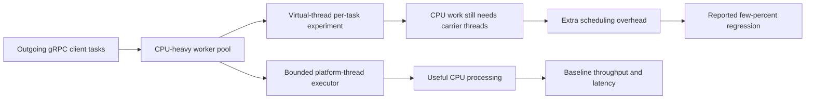

# Netflix — CPU-intensive gRPC worker pools: virtual threads were slower

**Case ID:** `case.netflix.grpc-cpu-workerpool-loom-regression` · **M9:** E16-03 #116 · **Status:** source-backed, original case draft; independent technical review pending.  
**Direct practitioner source:** N02, Paul Bakker (Netflix Java Platform), *How Netflix Really Uses Java*, QCon San Francisco, **2023-10-03**. The publisher-hosted [InfoQ talk and transcript](https://www.infoq.com/presentations/netflix-java/) appeared online later; cite the **talk date** as the observed engineering state. Specifically, locate the part of the transcript describing experimentation with virtual threads, the **outgoing gRPC clients' thread worker pool**, and CPU-intensive work. It reports a slowdown of **a few percent**, but provides no exact benchmark data. This case is not based on the 2024 JDK21 Tomcat deadlock investigation (N06), which is a separate failure mode.

## Why replacing a pool looked appealing

Virtual threads preserve direct-looking synchronous Java programming while allowing many *I/O-blocked* requests to yield their carrier platform threads. A migration from a bounded OS-thread executor to a per-task virtual-thread executor can therefore reduce the need for large platform-thread pools when tasks spend much of their lives waiting for sockets.

The Netflix practitioner account gives an immediate counterexample. A platform-team experiment replaced the worker pool used with **outgoing gRPC calls**, anticipating reduced scheduling overhead. Its work was **CPU intensive**, however; changing the thread abstraction introduced overhead without creating useful new compute capacity. Bakker reported that performance became **a few percent worse**, not better. He used the example to explain that virtual threads should be enabled only at points where their waiting behavior is advantageous. [N02, discussion of virtual threads following JDK17/JDK21 upgrades].

## Before/after and source-supported outcome

**Text alternative:** the outgoing gRPC worker queue could execute CPU-heavy tasks on bounded platform threads or try virtual threads. The latter path does not remove required CPU instructions; in the practitioner-reported experiment it performed somewhat worse. Diagram is an original architecture teaching sketch, **not** a reconstruction of Netflix's proprietary gRPC worker-pool code.

| Evidence question | Historical source | Qualification |
|---|---|---|
| What was modified? | N02: gRPC clients' thread worker pool | This is an outbound-client worker pool, not necessarily the entire gRPC service tier |
| What was the result? | N02: performance decreased by **a few percent** | **No exact number, hardware, load generator or p99 distribution provided**; never re-express as a precise percent |
| Why? | N02: the workers were CPU intensive | Mechanistic interpretation: virtual threads are cheaper to *block*, not faster at CPU instructions |
| Did Netflix abandon all virtual threads? | **Not established** by N02 | Bakker discusses finding appropriate adoption points rather than global prohibition |
| Was this the same as the 2024 Brave/Zipkin pinned-carrier outage? | **No**: separate N06 evidence, later time, different mechanism | Never mix CPU-contention overhead with synchronized carrier pinning |

## Three contrasting execution models

1. **Bounded platform-thread pool:** preferable for a CPU-intensive worker where the number of simultaneously useful executions is constrained by cores, and queue/admission limits need explicit operational control.
2. **Per-task virtual threads:** a candidate when many tasks block on network/disk I/O, provided the target JDK and tracing/dependency stack do not pin carriers in dangerous blocking regions. Virtual-thread count is **not** a downstream concurrency or rate limit.
3. **Asynchronous/reactive network event loops:** suitable for persistent-connection handling and certain fan-out workloads with guaranteed nonblocking callbacks. Netflix's Zuul 2 (N07) shows connection-scaling benefits but a CPU-heavy gateway cluster did **not** get a comparable CPU-efficiency win. Event-loop code must not run blocking database clients or expensive crypto on loop threads.

The three are **not interchangeable workloads**. The experiment described in N02 shows CPU pressure; the production failure in N06 shows carrier starvation from a tracing synchronization path; Zuul 2 in N07 targets network waiting and connection count. None proves a universal ranking.

## Migration and test design for a different legacy system

**Synthetic requirement:** a Java service handles high fan-out remote gRPC requests but also spends 70% of its CPU budget on protobuf transformation and authorization. *70% is hypothetical, not Netflix telemetry.*

Proposed reversible method: profile worker actual runnable/blocking time → pin JDK and gRPC/Netty/tracing versions → compare platform-thread, virtual-thread and nonblocking executors under the **same representative load** → preserve downstream concurrency budgets → record CPU/op, p95/p99 by request type, context propagation, queue time, cancellation, allocation and goodput → advance only on observed improvement. Avoid making a default framework upgrade the simultaneous cause of several confounded changes.

**Falsification criteria:** if virtual threads increase CPU per completed gRPC request with no reduction in p99 or I/O waits, keep the bounded platform-thread pool. If a later product changes to mostly slow network I/O, repeat the experiment with fresh traffic mix; the original historical result no longer necessarily applies.

## The nearby positive experiments do not cancel the negative one

The [QCon practitioner transcript](https://www.infoq.com/presentations/netflix-java/) (N02, **Virtual Threads**) describes **three distinct adoption points** in one discussion. A Tomcat **thread-per-request** execution pool and Spring asynchronous task execution were promising because service code frequently waits for other network calls; some large services were reportedly already using virtual threads with neutral or modest results. GraphQL per-field execution was discussed as a future opportunity for network fan-out, **not an already measured fleet migration**. Then the speaker gives the specific counterexample: outgoing **gRPC client worker pools** had enough CPU-intensive work that moving to virtual threads made them **a few percent slower**.

The speaker's conclusion is about **placement**, not a binary choice to adopt or ban Loom. Platform-level support can allow application teams to benefit without rewriting every service, but only where blocking wait dominates execution and the exact library/JDK stack is compatible. The later 2024 tracing-induced carrier starvation [incident](netflix-java21-virtual-thread-pinning.md) (N06) is independent: one is extra overhead on CPU-heavy workers, the other a scheduler starvation failure under synchronized locks.

## How to design an actual controlled comparison

For an unrelated Java application with a mixed outbound gRPC stack, hold constant the service version, JDK patch, gRPC/Netty and tracing dependencies, caller mix, reply sizes, deadline budget and downstream concurrency limit. Vary **only** the worker executor initially:

| Proposed measurement | What it isolates | Failure signal |
|---|---|---|
| CPU time per **completed** outgoing gRPC operation | Whether task scheduling improves useful compute efficiency | Increased CPU/work at unchanged I/O waits |
| Runnable vs blocked time by worker type | Whether the workload actually benefits from parking/unmounting | CPU saturation with almost no blocking fraction |
| Queue wait, goodput and p99 by request class | Scheduler overhead, cancellation and backpressure | More runnable tasks without more completed responses |
| Downstream in-flight RPC count and server error rate | Virtual-thread abundance does not override downstream capacity | Higher fan-out amplifies remote timeouts and retries |
| Trace/security context propagation | Executor change may alter request-local context | Missing auth/audit metadata despite successful calls |
| Heap/native allocation and carrier pinning | Later migration versions and integrations may regress differently | Material RSS increase, stuck carriers, or object churn |

These tests are **Tycho's synthetic protocol**, not an unpublished Netflix benchmark. The original speaker did not provide an exact percent, request count, hardware config, p99 distribution or executor code revision for the gRPC experiment; the word **few** must never be converted to a point estimate. If the target workload becomes I/O-heavy later, retest rather than freeze a historical 2023 choice forever.

## Explicit decision rejection criteria

A recommendation to change the executor is unsupported when no CPU-vs-wait profile exists, outbound client pooling already caps connections, or the target JDK/library semantics are not tested. A *larger number of cheap runnable threads* can simply create a larger backlog at the downstream service. For CPU-bound pools, a bounded platform-thread executor plus explicit queue/backpressure is the conservative comparator. For I/O-bound request orchestration, measure virtual threads and nonblocking I/O independently and preserve the security, cancellation and error contract. When neither versioned data nor a valid workload profile exists, return **insufficient evidence**.

## Workload decomposition: a scheduling change is not a compute optimization

The historical N02 source gives a **qualitative negative experiment**, not a complete benchmark. An outgoing gRPC client can perform both network waiting and CPU-heavy work, but merely labeling an executor “gRPC” does not establish which phase consumes its threads. What matters is the proportion of **runnable computation, socket waiting and synchronization** on the actual executor whose implementation is being changed.

For another Java platform, the correct unit of experimentation is the worker's *actual task class*, not a whole mixed gateway. Split end-to-end traces into serialization, authorization, local transformation, send/wait and response processing. Record carrier/platform-thread occupancy, CPU per *completed useful request*, queue age, downstream connection limits, p99 and cancellation. Hold transport/library/JDK versions fixed when changing the scheduling model.

| Synthetic test cohort | Candidate choice | Falsification condition |
|---|---|---|
| CPU-intensive protobuf transformations | Bounded platform pool sized to CPU and contention | Virtual threads do not reduce CPU work; more scheduler transitions with no p99 benefit |
| Large number of *genuinely blocked* remote requests | Virtual threads with bounded downstream connection permits | Carrier pinning, unbounded fan-out or no useful concurrency improvement |
| Fully async/network-driven fan-out | Nonblocking event loop plus bounded CPU offload | Event loop stalls from blocking calls, TLS/crypto or transformation work |
| Mixed incoming endpoint | Separate CPU lane and I/O lane rather than replacing all execution | Trace/identity lost across boundaries or request cancellation fails to stop work |

This matrix is **Tycho synthetic architecture analysis**, not a record of Netflix's exact benchmark participants. The talk does not publish core counts, allocations, load distributions or a precise regression percentage. Refuse to invent those values.

## Safe transition, backpressure and recovery

A safe migration begins in instrumentation-only mode. Identify which executor owns upstream transport callbacks, which code may block within locks or native libraries and where downstream budgets are enforced. During a small canary, inject a slow gRPC peer, a canceled client request, an overloaded CPU transformation stage and a tracing/reporting failure. Assert that new tasks do not grow without bound, error/context propagation remains correct, and the old executor remains selectable. Measure repeated workload windows at equal offered traffic; include both queued and completed tasks in denominators.

Virtual threads are **not** admission control. Even if waiting no longer holds OS threads, too many simultaneous downstream RPCs can overwhelm the peer or connection pool. The migration must preserve semaphores, deadlines, retry budgets and endpoint-specific circuit breakers independently of the thread type.

**Stop and rollback** if CPU cost increases for comparable successful work, p99 rises, downstream errors grow, or an instrumentation lock consumes carriers. The last failure mode is from the **different 2024 tracing incident** documented in [Java21 carrier starvation](netflix-java21-virtual-thread-pinning.md); it must not be retroactively attributed to N02's 2023 CPU-pool experiment. A future JDK/library upgrade may change results, requiring a new measured comparison.

## Evidence and non-claims

This is one engineer's **first-party qualitative performance report**, not a published peer-reviewed benchmark or a quantified Netflix fleet-wide rollout. Runtime version details for the specific outbound gRPC pool are not sufficiently pinned by this transcript; do not assert it used Java 21 production for that experiment. The transcript's later online publication date is distinct from its October 2023 presentation. No copied publisher diagrams, transcribed passages or company-private source code are included.

Related independently authored cases: [Java21 tracing-induced carrier starvation](netflix-java21-virtual-thread-pinning.md) (N06), [Zuul 2 I/O multiplexing](netflix-zuul2-nonblocking-gateway.md) (N07), and [Generational ZGC workload selectivity](netflix-generational-zgc-workloads.md) (N05). Comparative pattern selection: [Reactive versus virtual threads](decisions/reactive-vs-virtual-threads.md). Final acceptance still requires E16-08 #121 independent review and source-grounded claim verification.
