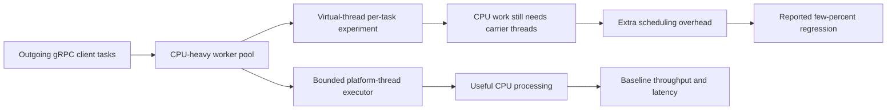

# Netflix — CPU-intensive gRPC worker pools: virtual threads were slower

**Case ID:** `case.netflix.grpc-cpu-workerpool-loom-regression` · **M9:** E16-03 #116 · **Status:** source-backed, original case draft; independent technical review pending.  
**Direct practitioner source:** N02, Paul Bakker (Netflix Java Platform), *How Netflix Really Uses Java*, QCon San Francisco, **2023-10-03**. The publisher-hosted [InfoQ talk and transcript](https://www.infoq.com/presentations/netflix-java/) appeared online later; cite the **talk date** as the observed engineering state. Specifically, locate the part of the transcript describing experimentation with virtual threads, the **outgoing gRPC clients' thread worker pool**, and CPU-intensive work. It reports a slowdown of **a few percent**, but provides no exact benchmark data. This case is not based on the 2024 JDK21 Tomcat deadlock investigation (N06), which is a separate failure mode.

## Why replacing a pool looked appealing

Virtual threads preserve direct-looking synchronous Java programming while allowing many *I/O-blocked* requests to yield their carrier platform threads. A migration from a bounded OS-thread executor to a per-task virtual-thread executor can therefore reduce the need for large platform-thread pools when tasks spend much of their lives waiting for sockets.

The Netflix practitioner account gives an immediate counterexample. A platform-team experiment replaced the worker pool used with **outgoing gRPC calls**, anticipating reduced scheduling overhead. Its work was **CPU intensive**, however; changing the thread abstraction introduced overhead without creating useful new compute capacity. Bakker reported that performance became **a few percent worse**, not better. He used the example to explain that virtual threads should be enabled only at points where their waiting behavior is advantageous. [N02, discussion of virtual threads following JDK17/JDK21 upgrades].

## Before/after and source-supported outcome

**Text alternative:** the outgoing gRPC worker queue could execute CPU-heavy tasks on bounded platform threads or try virtual threads. The latter path does not remove required CPU instructions; in the practitioner-reported experiment it performed somewhat worse. Diagram is an original architecture teaching sketch, **not** a reconstruction of Netflix's proprietary gRPC worker-pool code.

| Evidence question | Historical source | Qualification |
|---|---|---|
| What was modified? | N02: gRPC clients' thread worker pool | This is an outbound-client worker pool, not necessarily the entire gRPC service tier |
| What was the result? | N02: performance decreased by **a few percent** | **No exact number, hardware, load generator or p99 distribution provided**; never re-express as a precise percent |
| Why? | N02: the workers were CPU intensive | Mechanistic interpretation: virtual threads are cheaper to *block*, not faster at CPU instructions |
| Did Netflix abandon all virtual threads? | **Not established** by N02 | Bakker discusses finding appropriate adoption points rather than global prohibition |
| Was this the same as the 2024 Brave/Zipkin pinned-carrier outage? | **No**: separate N06 evidence, later time, different mechanism | Never mix CPU-contention overhead with synchronized carrier pinning |

## Three contrasting execution models

1. **Bounded platform-thread pool:** preferable for a CPU-intensive worker where the number of simultaneously useful executions is constrained by cores, and queue/admission limits need explicit operational control.
2. **Per-task virtual threads:** a candidate when many tasks block on network/disk I/O, provided the target JDK and tracing/dependency stack do not pin carriers in dangerous blocking regions. Virtual-thread count is **not** a downstream concurrency or rate limit.
3. **Asynchronous/reactive network event loops:** suitable for persistent-connection handling and certain fan-out workloads with guaranteed nonblocking callbacks. Netflix's Zuul 2 (N07) shows connection-scaling benefits but a CPU-heavy gateway cluster did **not** get a comparable CPU-efficiency win. Event-loop code must not run blocking database clients or expensive crypto on loop threads.

The three are **not interchangeable workloads**. The experiment described in N02 shows CPU pressure; the production failure in N06 shows carrier starvation from a tracing synchronization path; Zuul 2 in N07 targets network waiting and connection count. None proves a universal ranking.

## Migration and test design for a different legacy system

**Synthetic requirement:** a Java service handles high fan-out remote gRPC requests but also spends 70% of its CPU budget on protobuf transformation and authorization. *70% is hypothetical, not Netflix telemetry.*

Proposed reversible method: profile worker actual runnable/blocking time → pin JDK and gRPC/Netty/tracing versions → compare platform-thread, virtual-thread and nonblocking executors under the **same representative load** → preserve downstream concurrency budgets → record CPU/op, p95/p99 by request type, context propagation, queue time, cancellation, allocation and goodput → advance only on observed improvement. Avoid making a default framework upgrade the simultaneous cause of several confounded changes.

**Falsification criteria:** if virtual threads increase CPU per completed gRPC request with no reduction in p99 or I/O waits, keep the bounded platform-thread pool. If a later product changes to mostly slow network I/O, repeat the experiment with fresh traffic mix; the original historical result no longer necessarily applies.

## Evidence and non-claims

This is one engineer's **first-party qualitative performance report**, not a published peer-reviewed benchmark or a quantified Netflix fleet-wide rollout. Runtime version details for the specific outbound gRPC pool are not sufficiently pinned by this transcript; do not assert it used Java 21 production for that experiment. The transcript's later online publication date is distinct from its October 2023 presentation. No copied publisher diagrams, transcribed passages or company-private source code are included.

Related independently authored cases: [Java21 tracing-induced carrier starvation](netflix-java21-virtual-thread-pinning.md) (N06), [Zuul 2 I/O multiplexing](netflix-zuul2-nonblocking-gateway.md) (N07), and [Generational ZGC workload selectivity](netflix-generational-zgc-workloads.md) (N05). Comparative pattern selection: [Reactive versus virtual threads](decisions/reactive-vs-virtual-threads.md). Final acceptance still requires E16-08 #121 independent review and source-grounded claim verification.
