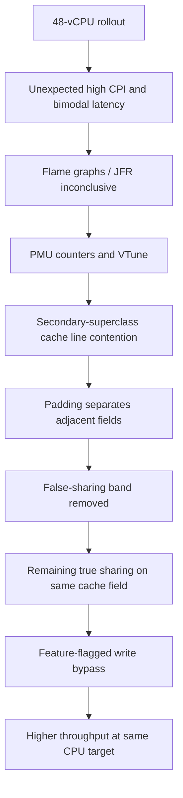

# Netflix — larger JVM instances exposed false sharing, then true sharing in HotSpot

**Case ID:** `case.netflix.hotspot-sharing-cpu-scaling` | **Owner:** M9 E16-03 #116 | **Period:** first-party article **2022-11-09**, workload GS2 | **Status:** source-backed draft  
**Primary:** src.m9-n18, Vadim Filanovsky and Harshad Sane, [Seeing through hardware counters: a journey to threefold performance increase](https://netflixtechblog.com/seeing-through-hardware-counters-a-journey-to-threefold-performance-increase-2721924a2822), sections "The problem", "First attempt at solving it", "False Sharing", "True Sharing", "Conclusion".

## The attractive migration that regressed performance

An anonymous Java microservice, GS2, performed CPU-intensive work. Netflix moved it from an AWS **m5.4xl 16-vCPU** configuration to **m5.12xl 48-vCPU** and expected roughly triple per-instance capacity. An equal-traffic initial canary appeared healthy, but at an autoscaling CPU target near **55%**, production throughput improved only about **25%**, and average latency degraded by more than **50%**. Nodes split into persistent fast and slow populations despite similar incoming request rates; about **12%** were fast. More hardware alone did not deliver useful throughput. [src.m9-n18: "The problem"].

## Diagnose what conventional profilers miss

Flame graphs, JFR and JIT probes showed similar code paths on fast and slow nodes. Intel performance counters and VTune instead showed extra cycles-per-instruction, cache churn, and machine clears. The team traced one HotSpot secondary-superclass-lookup routine: `_secondary_super_cache` writes and adjacent `_secondary_supers` reads could share an x86 cache line, causing false sharing between otherwise independent memory locations. The reported **one-in-eight** chance of non-overlapping alignment matched approximately the fast-node fraction. This is a diagnosis at the CPU cache-line/JVM-implementation layer, not merely 'inefficient Java code'. [src.m9-n18: "False Sharing"].

**Text alternative:** larger instances unveiled a JVM memory-layout bottleneck. Padding fixed false sharing but uncovered a different pressure on a shared field. A separate, flag-gated change removed the relevant writes, improving throughput. Diagram is original, not the source's assembly view.

## Two distinct fixes, not one miracle patch

First, the engineers padded the fields to avoid two unrelated data structures sharing a cache line. Slow nodes disappeared, but throughput remained around **150 requests/second per node**, below the **~250 RPS** goal. This led to identifying *true sharing*: multiple cores wrote the same cached state. A second change bypassed secondary-superclass-cache writes behind a JVM command-line flag. The article reports up to **~350 RPS** at the same CPU target, roughly **3.5×** the initial throughput observed after moving to the large instance; average and tail latency also improved. These numbers describe **one specific service and hardware/JDK configuration**. [src.m9-n18: "False Sharing", "True Sharing"].

| Decision gate | Failing shortcut | Better evidence |
|---|---|---|
| Capacity upgrade | Assume vCPU ratio equals throughput ratio | Normalize actual throughput to autoscaling CPU target |
| Canary | Equal requests to larger/smaller node | Also test expected *per-instance* scaled load |
| Profiling | Stop after unchanged flame graph/JFR | Hardware counters, CPI and cache coherence signals |
| First patch | Declare success after removing slow band | Retest at original throughput target; new bottleneck can emerge |
| JVM optimization | Permanently change cross-workload behavior | Version/flag gate, regressions and revert path |

## Competing diagnoses and falsifiable tests

| Hypothesis for a new service | Initial diagnostic | Evidence that would argue against it |
|---|---|---|
| Application method uses excessive CPU | Sampling profile by Java method and request class | Similar execution profiles across high/low latency cohorts despite different CPI |
| Garbage collector or allocation pressure | GC pause, allocation and safepoint events at matched load | No cohort-correlated GC behavior, with CPU pipeline stall counters diverging |
| Host placement or network variance | Per-host work, NUMA locality, cache, NIC and request classification | Host differences remain tied to process/VM initialization rather than traffic locality |
| **False sharing** | CPU cache-line invalidations and hot instruction disassembly on adjacent fields | Padding fields does not eliminate the cohort bimodality or coherence events |
| **True sharing** | Remaining writes to same shared mutable field after padding | Suppressing writes does not change CPI or goodput at equal CPU utilization |

These are **Tycho's analytical countertests**. The source specifically attributes the incident to HotSpot's secondary-superclass-cache layout and later shared-field updates; it does not establish that every high-CPI Java service has that cause. The original authors first tested conventional flame graphs/JFR and then hardware PMU counters and Intel VTune to isolate a JVM implementation path.

## Why the two patches need two separate quality gates

Padding the adjacent fields changed **memory layout**; bypassing the contentious cache update changed JDK *behavior*. The source team guarded the second change with a JVM flag. A safe adoption procedure must therefore test (1) unchanged Java behavior with altered memory layout and (2) altered cache behavior under representative class-hierarchy and concurrency patterns as **different interventions**; the numeric outcomes remain in the earlier fix table.

For another runtime, the test matrix must include class-loader changes, concurrent subtype checks, dynamically generated proxy types, long-running mixed workloads, end-to-end correctness and upstream/downstream latency; gather data for the exact JDK commit and target CPU architecture. A code patch that fixes one subtype-check benchmark may regress other workloads because the superclass cache serves as an optimization under different class shapes. Require a feature flag, a reversible JDK image and runtime class correctness tests; do not assume a blog's internal patch is still necessary or valid in a 2026 JDK.

## Reuse criteria and limits

The reusable design lesson is **compare useful performance at the new intended operating point and challenge conventional profilers when execution profiles do not explain real CPU stalls**. Before adding host capacity, record workloads by concurrency and tail-latency class. If a node's CPU is inflated by coherence stalls, adding cores may worsen contention. If the true constraint is a network queue or a cache miss unrelated to JVM field sharing, the appropriate remedy is different.

**Refuse an automatic HotSpot patch** when hardware counters are unavailable, the exact problematic source code is not present, or a production-representative correctness test cannot be executed. src.m9-n18 reports a specific service and historical JDK behavior; upstream bug history, current vendor fixes and complete replication remain unverified under M9 #121.

## Separate the true causes, fixes and observation windows

| Evidence phase in src.m9-n18 | Original diagnostic | What changed | Remaining issue |
|---|---|---|---|
| Standard profile | Fast and slow nodes had similar flame-graph/JFR/JIT stack distributions | No useful actionable difference discovered | CPU microarchitecture bottleneck still unexplained |
| Hardware counters | Slow nodes had **almost 3× CPI** and roughly **4× MACHINE_CLEARS** vs fast nodes | Investigators localized HotSpot subtype-check code with Intel VTune and assembly | Needs correct CPU counter interpretation, including sampling skid |
| False-sharing patch | 64-byte cache line held adjacent **`_secondary_super_cache`** and **`_secondary_supers`** | Added padding between fields, eliminating persistent slow-node band | Capacity still only around **150 RPS/node**, below **~250 RPS** target |
| True-sharing patch | Multiple cores wrote one secondary-superclass cache field | Optional flag-gated bypass of those writes | Workload and JDK behavior may not transfer to other JVM versions |
| Measured outcome | Up to **~350 RPS/node at 55% CPU**, improved mean/tail latency | Company-reported **3.5×** relative to initial 48-vCPU throughput | Not a fleet-wide runtime update or guaranteed performance multiplier |

The **one-in-eight** allocation alignment observation arises from a **64-byte line and 8-byte pointer**, matching the observed approximately **12% fast-node fraction**. This is evidence supporting *that* false-sharing diagnosis, not a probabilistic rule about every modern JVM heap layout. The authors also referenced **JDK-8180450**, but publication in 2022 does not prove that modern runtime builds still contain the same issue.

## Falsification and release gates for a different architecture

First preserve a versioned CPU/JDK/hardware baseline and vary one parameter at a time. If throughput fails to scale despite identical stack-level profiles, collect CPU counters before rewriting Java business logic. Validate the suspected field-layout issue with an isolated JVM patch on representative production traffic; then **repeat all latency and throughput checks after the first fix**, because a second bottleneck can become dominant. Never ship a globally enabled HotSpot behavior change solely on one service's apparent gain: maintain a versioned feature flag, a fallback JDK image and cross-workload regression coverage.

If the CPU profile, cache-line layout or runtime version differs materially, the src.m9-n18 diagnostic remains a **hypothesis**, not proof. Return **insufficient evidence** for claims about a different runtime's exact hot method or attainable RPS. This case is about scaling correctness within one service—not a recommendation to build graph-based infrastructure for Tycho.

## Applicability and safer modernization

Tycho's inferred procedure is to characterize CPU-bound service topology, shard placement, cache line layout and target throughput before selecting larger instances. Compare cost per successful request, p99 at equal CPU/throughput, and variation across nodes and cold vs warm JVM lifetimes. Investigate both false and true sharing, and be prepared for a second bottleneck to emerge after the first is resolved.

**Counterindication:** do **not** import the paper's HotSpot flag behavior into modern JVMs without checking whether the relevant upstream code and JDK bug remain applicable, and never assume this explains unrelated services' low CPU scaling. The authors refer to JDK-8180450; source-controlled patch identity, release inclusion and later OpenJDK status are not established here. No independent performance re-run or exact VM image is available.

**Transfer:** architecture modernization needs workload-derived acceptance tests at the CPU and JVM layer as well as service boundaries. A larger cluster can be worse than the old one if scaling assumptions ignore shared-memory microarchitecture. **Review:** pending #121.

## Related reading

- [Casebook and synthetic decision playbooks](../README.md).
- [Reactive versus virtual threads](../decisions/reactive-vs-virtual-threads.md).
- [Virtual-thread pinning case](netflix-java21-virtual-thread-pinning.md).
- [Generational ZGC workloads](netflix-generational-zgc-workloads.md).
