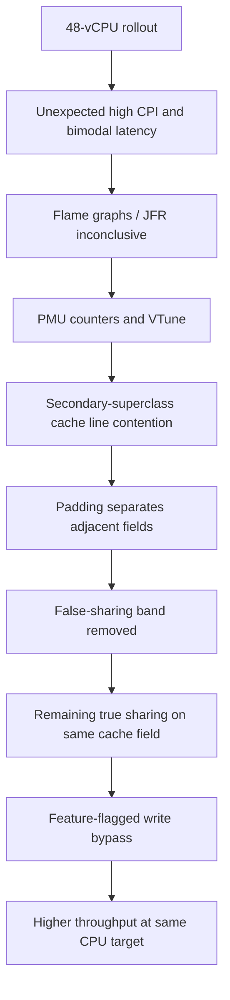

# Netflix — larger JVM instances exposed false sharing, then true sharing in HotSpot

**Case ID:** `case.netflix.hotspot-sharing-cpu-scaling` | **Owner:** M9 E16-03 #116 | **Period:** first-party article **2022-11-09**, workload GS2 | **Status:** source-backed draft  
**Primary:** N18, Vadim Filanovsky and Harshad Sane, [Seeing through hardware counters: a journey to threefold performance increase](https://netflixtechblog.com/seeing-through-hardware-counters-a-journey-to-threefold-performance-increase-2721924a2822), sections "The problem", "First attempt at solving it", "False Sharing", "True Sharing", "Conclusion".

## The attractive migration that regressed performance

An anonymous Java microservice, GS2, performed CPU-intensive work. Netflix moved it from an AWS **m5.4xl 16-vCPU** configuration to **m5.12xl 48-vCPU** and expected roughly triple per-instance capacity. An equal-traffic initial canary appeared healthy, but at an autoscaling CPU target near **55%**, production throughput improved only about **25%**, and average latency degraded by more than **50%**. Nodes split into persistent fast and slow populations despite similar incoming request rates; about **12%** were fast. More hardware alone did not deliver useful throughput. [N18: "The problem"].

## Diagnose what conventional profilers miss

Flame graphs, JFR and JIT probes showed similar code paths on fast and slow nodes. Intel performance counters and VTune instead showed extra cycles-per-instruction, cache churn, and machine clears. The team traced one HotSpot secondary-superclass-lookup routine: `_secondary_super_cache` writes and adjacent `_secondary_supers` reads could share an x86 cache line, causing false sharing between otherwise independent memory locations. The reported **one-in-eight** chance of non-overlapping alignment matched approximately the fast-node fraction. This is a diagnosis at the CPU cache-line/JVM-implementation layer, not merely 'inefficient Java code'. [N18: "False Sharing"].

**Text alternative:** larger instances unveiled a JVM memory-layout bottleneck. Padding fixed false sharing but uncovered a different pressure on a shared field. A separate, flag-gated change removed the relevant writes, improving throughput. Diagram is original, not the source's assembly view.

## Two distinct fixes, not one miracle patch

First, the engineers padded the fields to avoid two unrelated data structures sharing a cache line. Slow nodes disappeared, but throughput remained around **150 requests/second per node**, below the **~250 RPS** goal. This led to identifying *true sharing*: multiple cores wrote the same cached state. A second change bypassed secondary-superclass-cache writes behind a JVM command-line flag. The article reports up to **~350 RPS** at the same CPU target, roughly **3.5×** the initial throughput observed after moving to the large instance; average and tail latency also improved. These numbers describe **one specific service and hardware/JDK configuration**. [N18: "False Sharing", "True Sharing"].

| Decision gate | Failing shortcut | Better evidence |
|---|---|---|
| Capacity upgrade | Assume vCPU ratio equals throughput ratio | Normalize actual throughput to autoscaling CPU target |
| Canary | Equal requests to larger/smaller node | Also test expected *per-instance* scaled load |
| Profiling | Stop after unchanged flame graph/JFR | Hardware counters, CPI and cache coherence signals |
| First patch | Declare success after removing slow band | Retest at original throughput target; new bottleneck can emerge |
| JVM optimization | Permanently change cross-workload behavior | Version/flag gate, regressions and revert path |

## Applicability and safer modernization

Tycho's inferred procedure is to characterize CPU-bound service topology, shard placement, cache line layout and target throughput before selecting larger instances. Compare cost per successful request, p99 at equal CPU/throughput, and variation across nodes and cold vs warm JVM lifetimes. Investigate both false and true sharing, and be prepared for a second bottleneck to emerge after the first is resolved.

**Counterindication:** do **not** import the paper's HotSpot flag behavior into modern JVMs without checking whether the relevant upstream code and JDK bug remain applicable, and never assume this explains unrelated services' low CPU scaling. The authors refer to JDK-8180450; source-controlled patch identity, release inclusion and later OpenJDK status are not established here. No independent performance re-run or exact VM image is available.

**Transfer:** architecture modernization needs workload-derived acceptance tests at the CPU and JVM layer as well as service boundaries. A larger cluster can be worse than the old one if scaling assumptions ignore shared-memory microarchitecture. **Review:** pending #121.
