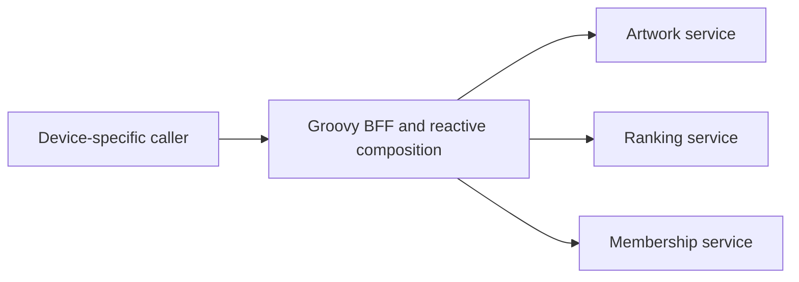
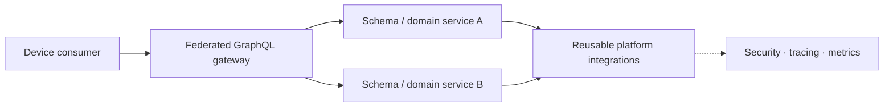

# Netflix — Java service-platform convergence without copying the former Netflix OSS stack

**Case ID:** `case.netflix.java-platform-convergence` · **Owner:** M9 E16-02 #115 · **Status:** source-backed draft; human technical review pending  
**Company / period:** Netflix, practitioner's account at QCon SF on 2023-10-03, contrasted with a March 2026 JavaOne *session abstract*.  
**Source IDs:** N02, N03 (scope only), N04. **Source disposition:** public reference/paraphrase; reproduction permissions for talk/slides not established.

## Decision and boundary

Netflix's platform story is not a simple technology flip from RxJava to Spring Boot. Paul Bakker describes a change of *where* composition complexity belongs: client-specific backends formerly did elaborate fan-out across microservices, often using Groovy and reactive primitives; later GraphQL federation introduced schema-guided composition boundaries while the Java platform became a more consistent paved road for services. At the same time, the system remains distributed, its gateway can still use reactive I/O, and individual transports still differ. The platform team is responsible for frameworks, libraries, upgrades and integration, not the business domain decisions of every service. [N02: "The Groovy Era", "GraphQL Federation", "What Does that Mean for Our Java Stack?"].

## Before — coupling hidden by fan-out

In the Groovy era, a presentation screen such as the list-of-lists interface required artwork, personalized recommendations and other independently owned data sources. Teams used device-tailored backend logic and fan-out. Reactive composition helped keep many concurrent downstream requests from tying up a platform thread per wait; it also moved error handling, context propagation and programming conventions into a complex layer. This does **not** imply that RxJava was a mistake or that all use of it vanished later. There is no independently measured global throughput baseline in the talk. [N02: "The Groovy Era", "Limitations"].

**Text alternative:** a device-specific backend invokes several domain microservices and must own fan-out, failure and compatibility logic. Netflix's diagram in the talk is illustrative; this graph is an independently drawn, simplified teaching representation.

## After — schema boundaries plus Java integration

The 2023 practitioner presentation explains a GraphQL federated gateway, shared domain-backed GraphQL services, and converging Java infrastructure around Spring Boot/JDK 17. The gateway still has a reactive client: replacing reactive fan-out everywhere is **not** the outcome. Netflix's Java Integration Framework (JIF) team states that it ships composable Spring Boot starters for REST, gRPC, GraphQL, security, observability and resilience. A platform starter makes infrastructure standards easy to assemble while domain owners can choose their application features. [N02: "GraphQL Federation", "Java at Netflix"; N04: "OUR work"].

**Text alternative:** clients ask the gateway for data assembled through domain services; those services share platform integrations, while the gateway's own async execution behavior remains a distinct decision.

A proposed transition for a **different** organization should retain API compatibility, map old BFF queries to federated fields, define ownership of schema fields, test authentication and tracing across both versions, and canary traffic before removing old endpoints. These are Tycho **recommended controls**, not reported steps Netflix necessarily performed in this exact order.

## Evidence ledger and time boundaries

| Claim | Period and original location | Type |
|---|---|---|
| About 2,800 Java apps and ~1,500 internal libraries, majority Java 17 | N02, 2023, "Java at Netflix"/"The Java 17 Upgrade" | Practitioner-reported inventory; not 2026 fleet |
| Backend evolution from Groovy BFF reactive fan-out to federated GraphQL | N02, 2023, "The Groovy Era", "GraphQL Federation" | Practitioner architecture account |
| Netflix JIF composable Spring Boot service starters | N04, "OUR work", undated living team page accessed 2026-10-19 | Team description, not independently measured adoption |
| More than 3,000 Java services and current upgrade themes | N03, March 2026 JavaOne session summary | Conference abstract, **scope only**; no detailed result admission |

## Decision transfer / alternatives

| Option for a hypothetical legacy platform | Strongest context | Disqualifying consideration |
|---|---|---|
| Keep bespoke BFF and RxJava | Few stable client types, high fan-out, already proficient team | Repeated schema logic, difficult migrations across device versions |
| Shared schema with federated domain services | Many independently released domains and heterogeneous consumers | Governance, field-level security, tracing and gateway operations needed |
| Standardized Boot starters across services | Large fleet with repeatable crosscutting requirements | Requires ownership/version compatibility and careful rollout; starter sprawl can recreate the old problem |
| Consolidate a small monolith first | Small domain set, low operational maturity | Does not solve independent organization-level release if that is the actual bottleneck |

**Counterexample:** Moving a CPU-bound data transformation into virtual threads offers no CPU throughput guarantee; the Java service runtime choice is orthogonal to whether a federated API is useful. A small product with one deployment boundary may prefer a modular monolith. [Compare SH01; N06].

## Explicit unknowns and checks

The source does not provide a controlled A/B comparison of developer productivity for this entire migration; do not invent one. The JavaOne 2026 abstract is insufficient to assert adoption details not recorded in a transcript. A new adopter should measure schema breakage, downstream fan-out, per-field cost, tracing propagation, p99, and deployment lead time, while maintaining a reversible client-facing API. Identity of every underlying library/upgrade revision is not established here.

**Original public references:** [N02 — QCon/InfoQ transcript](https://www.infoq.com/presentations/netflix-java/), [N03 — JavaOne 2026 abstract](https://dev.java/community/javaone-2026/sessions/lrn1058/), [N04 — JIF team](https://sites.google.com/netflix.com/javaplatformnetflix/jif). See [source admission](../../sources/REAL_WORLD_CASES_ADMISSION_WAVE_01.md) and [candidate audit](../../sources/REAL_WORLD_CASES_CANDIDATE_AUDIT.md).

**Review state:** drafted, not independent-peer-reviewed; pending #114 source admission completion and #121 cross-case review.
