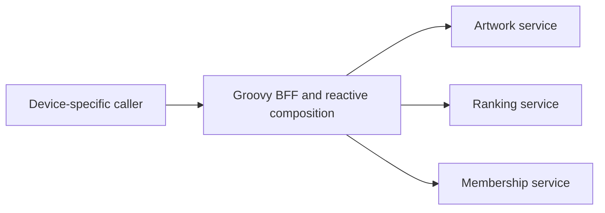
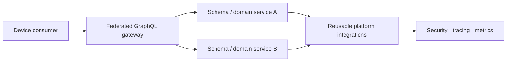

# Netflix — Java service-platform convergence without copying the former Netflix OSS stack

**Case ID:** `case.netflix.java-platform-convergence` · **Owner:** M9 E16-02 #115 · **Status:** source-backed draft; human technical review pending  
**Company / period:** Netflix, practitioner's account at QCon SF on 2023-10-03, contrasted with a March 2026 JavaOne *session abstract*.  
**Source IDs:** N02, N03 (scope only), N04. **Source disposition:** public reference/paraphrase; reproduction permissions for talk/slides not established.

## Decision and boundary

Netflix's platform story is not a simple technology flip from RxJava to Spring Boot. Paul Bakker describes a change of *where* composition complexity belongs: client-specific backends formerly did elaborate fan-out across microservices, often using Groovy and reactive primitives; later GraphQL federation introduced schema-guided composition boundaries while the Java platform became a more consistent paved road for services. At the same time, the system remains distributed, its gateway can still use reactive I/O, and individual transports still differ. The platform team is responsible for frameworks, libraries, upgrades and integration, not the business domain decisions of every service. [N02: "The Groovy Era", "GraphQL Federation", "What Does that Mean for Our Java Stack?"].

## Before — coupling hidden by fan-out

In the Groovy era, a presentation screen such as the list-of-lists interface required artwork, personalized recommendations and other independently owned data sources. Teams used device-tailored backend logic and fan-out. Reactive composition helped keep many concurrent downstream requests from tying up a platform thread per wait; it also moved error handling, context propagation and programming conventions into a complex layer. This does **not** imply that RxJava was a mistake or that all use of it vanished later. There is no independently measured global throughput baseline in the talk. [N02: "The Groovy Era", "Limitations"].

**Text alternative:** a device-specific backend invokes several domain microservices and must own fan-out, failure and compatibility logic. Netflix's diagram in the talk is illustrative; this graph is an independently drawn, simplified teaching representation.

## After — schema boundaries plus Java integration

The 2023 practitioner presentation explains a GraphQL federated gateway, shared domain-backed GraphQL services, and converging Java infrastructure around Spring Boot/JDK 17. The gateway still has a reactive client: replacing reactive fan-out everywhere is **not** the outcome. Netflix's Java Integration Framework (JIF) team states that it ships composable Spring Boot starters for REST, gRPC, GraphQL, security, observability and resilience. A platform starter makes infrastructure standards easy to assemble while domain owners can choose their application features. [N02: "GraphQL Federation", "Java at Netflix"; N04: "OUR work"].

**Text alternative:** clients ask the gateway for data assembled through domain services; those services share platform integrations, while the gateway's own async execution behavior remains a distinct decision.

A proposed transition for a **different** organization should retain API compatibility, map old BFF queries to federated fields, define ownership of schema fields, test authentication and tracing across both versions, and canary traffic before removing old endpoints. These are Tycho **recommended controls**, not reported steps Netflix necessarily performed in this exact order.

## A phased fleet migration, not one technology switch

The QCon account identifies **at least three distinct, interacting change axes**. They should not be merged into a fictional single release or simultaneous full-fleet cutover:

| Axis | Historical starting point and reason for change | Reported state in October 2023 | What remains unproven |
|---|---|---|---|
| JDK baseline | A large Java 8 fleet; older, unsupported dependencies obstructed early Java 11 trials | Most services on **Java 17**, Java 21 being actively tried | Exact application-by-application inventory, the upgrade calendar and 2026 rollout percentages |
| Service framework | Homegrown, Guice-based stack plus outdated Java EE libraries across roughly half the services about a year earlier | Platform described as standardized on **Spring Boot**, with infrastructure auto-configuration | Release-by-release schedule, how every exceptional service was treated |
| API composition | Screen/device-specific Groovy BFF fan-out needed custom RxJava and Hystrix orchestration | Progressive **GraphQL federation** with independent domain-owned schemas; older device APIs still served | A fleet-wide date for removal of BFF endpoints or reactive libraries |

**Primary evidence:** N02, transcript sections [The Java 17 Upgrade, Spring Boot Netflix, GraphQL Federation, The Road to Spring Boot 3, and Questions and Answers](https://www.infoq.com/presentations/netflix-java/). The speaker explicitly says that the **JDK upgrade's performance benefit** helped persuade service owners; the Spring Boot migration came later. Thus an architectural write-up claiming that a Guice-to-Spring framework change *caused* the Java 17 CPU result would invert the reported sequence.

The migration also had compatibility seams that a short “adopt Spring” summary misses. In the account, the Spring Boot 3 baseline requires Java 17 and moves parts of the ecosystem from javax namespaces to Jakarta equivalents. Netflix's platform team described an open-source **artifact-resolution bytecode translation plugin** to help with older libraries. This is a reported integration technique, **not** evidence that every incompatible library or behavioral difference can be corrected automatically. For a prospective adopter, bytecode transformation is a candidate bridge requiring tests, legal/operational review and a clear removal plan; it is not a replacement for maintaining supported dependencies. [N02: The Road to Spring Boot 3].

## Architecture ownership and the shared-runtime contract

N02 describes Gradle with Nebula plugins for library-version selection and locking. For a many-service fleet, reproducible dependency resolution is part of the transition architecture: without it, an apparent JDK or framework regression may instead arise from a drifting transitive dependency. This does not establish that Netflix published a reproducible snapshot of every production deployment.

The reported Spring Boot Netflix layer provided integrations for gRPC client/server communication, security and single sign-on, tracing, metrics, distributed logging, HTTP clients and mutual TLS. It used ordinary Spring Boot auto-configuration and embedded Tomcat. The organizational division matters: the platform team owns shared crosscutting defaults and upgrade tooling; service teams still own domain correctness, data, API compatibility and rollout behavior. [N02: Java at Netflix; Spring Boot Netflix; Why Spring Boot?].

This is **not** an argument to hide every architectural choice inside a starter. A starter upgrade can couple dependency versions, security defaults and instrumentation across services. A transferable guard is to publish a versioned compatibility matrix, test critical integration boundaries and canary one coherent workload cohort before broad distribution. These are **Tycho recommendations**, not a claim that Netflix followed these exact gates.

## Quantitative results, negative evidence and denominator discipline

Bakker reported **approximately 20% better CPU use** when moving Java 8 to Java 17 *without application code changes*, attributing it to G1 improvements; he stressed in the Q&A that the actual benefit depended on the service. The result motivated upgrades but the transcript does **not** publish a benchmark harness, CPU utilization distribution, fixed-throughput comparison, number of workloads sampled, p99 change or aggregate cost saving. Do not convert “20% better CPU use” to an audited 20% total cloud bill reduction or an invariant throughput gain. [N02: The Java 17 Upgrade; Questions and Answers].

Other choices were explicitly workload-selective. Most workloads used **G1** in that historical account, while **Zuul** was identified as an exception using **Shenandoah**. Java 21 generational ZGC was still a prospective experiment at the presentation date. These facts undercut a simplistic “one collector and one scheduling model for every service” roadmap. In the same talk, virtual threads slowed a **CPU-intensive outgoing gRPC worker pool** by a few percent; see the separate [CPU-bound counterexample](netflix-grpc-cpu-workerpool-virtual-thread-regression.md). Neither the 20% historical JVM result nor this negative virtual-thread result is a controlled A/B across the same cohort. [N02: The Java 17 Upgrade; Java 21+; Virtual Threads].

**Coexistence is also a negative result for simplistic completion metrics:** the talk acknowledges that older devices could continue to use the former endpoint architecture while the federation-based approach expanded. Therefore “the platform standardized” cannot legitimately be rewritten as “all legacy API paths disappeared”. [N02: The Groovy Era; GraphQL Federation].

## Transferable transition plan — synthetic, not Netflix's runbook

For a hypothetical Java fleet constrained by old dependencies and independently deployed domain services, a reversible program can separate technical causes:

1. **Inventory and snapshot:** record service owner, JDK, framework, javax/Jakarta imports, transitive library lock, API consumer cohort, GC, security integration and representative traffic class. Preserve the exact before state.
2. **Select migration slices:** move a small production-representative Java 8 workload to 17 with the same application code, collector policy and traffic replay; compare CPU per *completed request*, heap allocation, p95/p99, errors and cost, not raw thread count.
3. **Modernize framework independently:** use Spring Boot starters and bounded compatibility adapters for older libraries. Validate mTLS, identity propagation, authorization, context passing, retries, service discovery, log/tracing integrity and binary/API contracts before rollout.
4. **Move API composition independently:** register federated schemas alongside retained old BFF routes. Test field ownership, GraphQL authorization and query cost, old-client parity, fan-out timeout budgets, partial-response correctness and schema-change rollback.
5. **Apply explicit cohort gates:** canary by consumer/service ownership, compare golden signals, preserve a fast route back to the previous deployable artifact and keep a ledger of exceptions and deprecation prerequisites.
6. **Retire only with evidence:** old routes, framework adapters and dependencies can be removed only when the consumer inventory, observed usage, compatibility coverage and incident recovery criteria support their removal.

**Release-stop conditions (Tycho analytical proposal):** an unexplained CPU or p99 regression at representative load; a field-level authorization change; lost correlation/tracing; a legacy-client parity failure; unstable dependency resolution; or inability to recover a prior artifact within the stated recovery objective. The QCon talk **does not** document Netflix-specific stop thresholds, canary fractions, rollback timings or independent security audit outcomes. Mark all of those as unpublished, not successful by assumption.

## What can actually be concluded

The source supports a **historical practitioner account of platform standardization with incremental coexistence**, not a universally successful prescription to adopt federation, Spring Boot or Java 21. It reports a service-dependent JVM efficiency improvement, difficult framework compatibility work, a deliberate shift of API composition responsibility and multiple workload-specific runtime exceptions. The broader causal hypothesis—that reducing repeated integration and domain-specific fan-out helps a large multi-team fleet—must be tested against the actual team's topology, release independence, client mix, security boundaries and debugging capacity. For a small single-team application, a [modular monolith comparison](shopify-modular-monolith.md) may be the lower-risk alternative.

## Evidence ledger and time boundaries

| Claim | Period and original location | Type |
|---|---|---|
| About 2,800 Java apps and ~1,500 internal libraries, majority Java 17 | N02, 2023, "Java at Netflix"/"The Java 17 Upgrade" | Practitioner-reported inventory; not 2026 fleet |
| Backend evolution from Groovy BFF reactive fan-out to federated GraphQL | N02, 2023, "The Groovy Era", "GraphQL Federation" | Practitioner architecture account |
| Netflix JIF composable Spring Boot service starters | N04, "OUR work", undated living team page accessed 2026-10-19 | Team description, not independently measured adoption |
| More than 3,000 Java services and current upgrade themes | N03, March 2026 JavaOne session summary | Conference abstract, **scope only**; no detailed result admission |

## Decision transfer / alternatives

| Option for a hypothetical legacy platform | Strongest context | Disqualifying consideration |
|---|---|---|
| Keep bespoke BFF and RxJava | Few stable client types, high fan-out, already proficient team | Repeated schema logic, difficult migrations across device versions |
| Shared schema with federated domain services | Many independently released domains and heterogeneous consumers | Governance, field-level security, tracing and gateway operations needed |
| Standardized Boot starters across services | Large fleet with repeatable crosscutting requirements | Requires ownership/version compatibility and careful rollout; starter sprawl can recreate the old problem |
| Consolidate a small monolith first | Small domain set, low operational maturity | Does not solve independent organization-level release if that is the actual bottleneck |

**Counterexample:** Moving a CPU-bound data transformation into virtual threads offers no CPU throughput guarantee; the Java service runtime choice is orthogonal to whether a federated API is useful. A small product with one deployment boundary may prefer a modular monolith. [Compare SH01; N06].

## Explicit unknowns and checks

The source does not provide a controlled A/B comparison of developer productivity for this entire migration; do not invent one. The JavaOne 2026 abstract is insufficient to assert adoption details not recorded in a transcript. A new adopter should measure schema breakage, downstream fan-out, per-field cost, tracing propagation, p99, and deployment lead time, while maintaining a reversible client-facing API. Identity of every underlying library/upgrade revision is not established here.

**Original public references:** [N02 — QCon/InfoQ transcript](https://www.infoq.com/presentations/netflix-java/), [N03 — JavaOne 2026 abstract](https://dev.java/community/javaone-2026/sessions/lrn1058/), [N04 — JIF team](https://sites.google.com/netflix.com/javaplatformnetflix/jif). See [source admission](../../sources/REAL_WORLD_CASES_ADMISSION_WAVE_01.md) and [candidate audit](../../sources/REAL_WORLD_CASES_CANDIDATE_AUDIT.md).

**Review state:** drafted, not independent-peer-reviewed; pending #114 source admission completion and #121 cross-case review.
