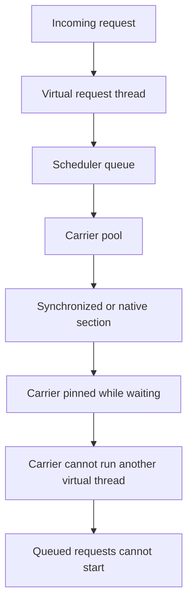

# Java 21 virtual-thread pinning at tracing and synchronization boundaries

**Case ID:** `case.netflix.java21-virtual-thread-carrier-starvation`

**Status:** generalized risk note, not incident evidence

**Primary sources:** JEP 444 and JEP 491. The publisher incident report
(src.m9-n06) was not retrieved during this audit and is an unresolved citation, not
evidence for any count, date or diagnosis below.

## The mechanism

JEP 444 mounts a virtual thread on a carrier thread while it runs and unmounts it
when it blocks on supported operations. A virtual thread that blocks inside a
`synchronized` block or method, or inside a native method or foreign function,
cannot unmount. The carrier stays occupied and cannot run another virtual thread.
If enough carriers are pinned, the scheduler can run out of capacity even though
the JVM process is alive. JEP 444 describes this as a scalability risk, not a
correctness failure.

JDK 21 retains monitor pinning. JEP 491 removes pinning caused by
`synchronized` in a later release; native calls and foreign functions can still
pin. Tracing, security, metrics and other cross-cutting libraries may contain
synchronized sections or native calls, so their behavior on the target JDK and
dependency versions must be tested under load.

## Why this can look like a lock problem

A pinned waiter holds a carrier while it waits. A signaled virtual thread that
has been unmounted needs a free carrier before it can run. If every carrier is
occupied by pinned waiters, the signaled thread cannot make progress even when
the lock itself has been released. An observer may then see a live process, an
apparently free lock and no completed requests. That is a scheduler/resource
interlock, not necessarily a permanently held mutex.

This diagnostic framing is Tycho synthesis. The JEPs define the pinning
mechanism; they do not prescribe a production triage procedure or prove that
any particular incident had this shape.

**Diagram alternative:** requests enqueue virtual-thread tasks; carriers that
enter a blocking synchronized or native section cannot be reused; if all
carriers are pinned, queued tasks wait. The diagram is conceptual and is not a
reproduction of any production trace.

## Diagnosis boundaries

| Symptom | Plausible but incomplete reading | Additional check |
|---|---|---|
| Live JVM, no completions | Outage or CPU crash | Check pinning and carrier state |
| Old dump looks idle | No work running | Use a virtual-thread-aware dump |
| Many empty virtual threads | Thread leak | Compare created, started and completed tasks |
| Waiters on small pool | Lock contention | Check pinning and carrier occupancy |
| Lock released, no progress | No contention | Inspect scheduler and wait-node state |

These are general diagnostic prompts, not findings from a retrieved incident.

## Decision and transition safety

The proposed adoption strategy is to retain a platform-thread baseline, identify
blocking work inside monitors and native calls, inspect tracing/security/metrics
filters under load, enable virtual threads on representative I/O-heavy endpoints,
and run cancellation and stalled-request fault injection. Constrain concurrency by
downstream capacity, not by the number of virtual-thread objects. Canary on
small-core and large-core instances, and compare runnable-queue depth, carrier
utilization, pinning events, timeouts and completed requests rather than mean
latency alone.

**Negative decision:** if the service is CPU-bound or uses libraries that pin
carriers, virtual threads may increase apparent concurrency without improving
throughput. A reactive event-loop boundary may suit high connection counts but
also requires prohibiting hidden blocking operations. A platform-thread pool with
an explicit admission limit may be safer until monitoring is trustworthy.

**Rollback:** reverting request execution to platform threads and restoring the
deployment configuration is a proposed guardrail. Neither JEP supplies a
production rollback sequence or a permanent patch version.

## Transferability limits

JEP 444 and JEP 491 define mechanism and release scope, not fleet frequency,
latency deltas or a complete migration method. Monitor pinning is JDK-version
dependent; native pinning remains possible after JEP 491. Re-evaluate on the
target JDK, tracing stack and Tomcat/Spring Boot versions. The correct conclusion
is "verify the complete dependency graph before enabling virtual threads", not
"never use virtual threads".

## Sources

- [JEP 444: Virtual Threads](https://openjdk.org/jeps/444)
- [JEP 491: Synchronize Virtual Threads without Pinning](https://openjdk.org/jeps/491)
- Publisher incident report (src.m9-n06):
  <https://netflixtechblog.com/java-21-virtual-threads-dude-wheres-my-lock-3052540e231d>
  Not retrieved in this audit; retained as an unresolved citation, not evidence.
