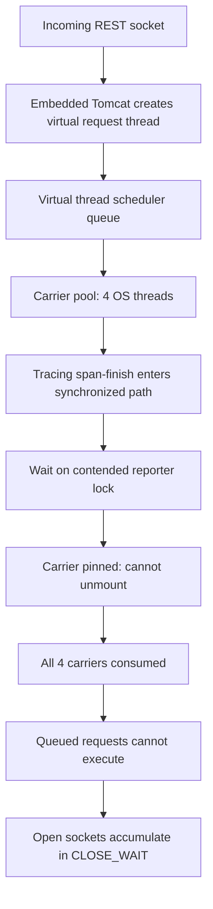

# Netflix — Java 21 virtual-thread starvation hidden behind tracing locks

**Case ID:** `case.netflix.java21-virtual-thread-carrier-starvation` | **M9:** E16-03 #116 | **Status:** source-backed draft, not independently reviewed  
**Original first-party source:** N06, Netflix TechBlog, Filanovsky, Huang, Thomas and Chalupa, **2024-07-29**; sections "The problem", "Collected diagnostics", "Why is Tomcat stuck?", "Who has the lock?", "Inspecting the lock". [Original article](https://netflixtechblog.com/java-21-virtual-threads-dude-wheres-my-lock-3052540e231d).

## The actual failure—not a synthetic throughput benchmark

Some Netflix Java 21, Spring Boot 3, embedded Tomcat REST instances intermittently stopped responding, though their JVM processes stayed alive. An increasing number of sockets entered `CLOSE_WAIT`. Conventional platform-thread dumps appeared idle. The engineers switched to virtual-thread aware `jcmd Thread.dump_to_file` and heap inspection and found many virtual threads with no stack yet, created but never scheduled. They ultimately traced carrier-thread starvation through tracing/span finishing and a contended lock, not a general inability of virtual threads to serve requests. [N06, named sections above].

In the reproduced incident context a VM had **four vCPUs** and thus an effective default carrier pool of four OS threads. **Four virtual threads were pinned** while traversing a synchronized span-finish path and waiting on a lock in the Brave/Zipkin tracing ecosystem. These four carrier threads could not run newly scheduled request virtual threads; accepted connections accumulated while Tomcat could not drain them. The article describes a lock-owner diagnostic that ordinary Java 21 dumps did not expose clearly. This is a **specific lock + scheduler + version** failure and must not be generalized to newer JDKs without retesting.

**Diagram alternative:** incoming requests enqueue virtual-thread tasks; when the carrier pool is monopolized by pinned lock waiters, other tasks cannot start. The diagram is a conceptual adaptation and does not reproduce Netflix's stacktrace or memory graph.

## Diagnosis chain and instrumentation boundary

| Clue | Initially plausible but misleading explanation | Disambiguating evidence |
|---|---|---|
| JVM alive, endpoints hung | Generic upstream outage or CPU crash | Service instances specifically enabled virtual threads; remote peers closed connections |
| Standard `jstack` appears idle | No workers or requests running | JVM 21 virtual stacks require appropriate dump tools; `jcmd Thread.dump_to_file` and heap view exposed unscheduled threads |
| Thousands of empty virtual threads | Memory leak from too many threads | Roughly correlated with pending sockets: tasks created but not mounted |
| Four contended traces on four-core node | Simple reporter congestion | Synchronized section pinning prevented carrier reuse while waiting |
| Lock owner unclear | No true lock contention | Heap object inspection of tracing reporter waiters, locks and conditions required |

These are the authors' observations. We have not reproduced their stack trace or measured any current JDK correction.

## Decision and transition safety

The *proposed Tycho adoption strategy* is to retain a platform-thread baseline, identify all blocking work inside monitors and native calls, inspect tracing/security/metrics filters under load, turn on virtual threads for representative I/O-heavy endpoints, and run cancellation/stalled-request fault injection. Concurrency should be constrained by downstream capacity, not by the number of cheap virtual-thread objects. Canary on small-core instances as well as large ones; compare runnable-queue depth, carrier utilization, pinning events, timeouts and `CLOSE_WAIT`, not only mean latency.

**Negative decision:** if the service is CPU-bound or uses libraries that block carrier threads, virtual threads may increase apparent concurrency without improving throughput. A reactive event-loop boundary may suit high fan-out but also requires prohibiting hidden blocking operations; compare N07. A platform-thread pool with an explicit admission limit may be safer until monitoring is trustworthy.

**Rollback:** reverting request execution to the known platform-thread mode and restoring deployment configuration is a proposed guardrail; the Netflix article does not supply a complete production rollback sequence or prove a specific permanent patch version.

## Causal sequence: a free lock with no available carrier

The [July 29, 2024 first-party incident investigation](https://netflixtechblog.com/java-21-virtual-threads-dude-wheres-my-lock-3052540e231d) (N06, **Why is Tomcat stuck?**, **Who has the lock?**, **The lock with no place to run**) exposes a subtle form of starvation. The queue contained **six contenders**: **five virtual threads** and **one platform reporter thread**. Four virtual threads were **pinned to four OS carriers** while waiting in a tracing span-finalization path that entered Java monitor synchronization and then tried to acquire a reporter lock. A fifth virtual thread had been notified that it could progress, but was **unmounted and needed a free carrier** to run.

The source's heap inspection found the shared reentrant lock in a state where **its recorded owner was null and its lock state was zero**. This disambiguates the failure: it was not enough to find a single ordinary thread that had “forgotten to release the lock.” The lock had been released and a waiter signaled, but the signaled *unmounted* virtual thread could not execute because all **four carrier permits** were occupied by other virtual threads *pinned while waiting* for that same lock. Those pinned threads could not unmount to free a carrier. The result was a scheduler/resource deadlock even though the lock's release pathway had run.

This causal chain matters for incident triage. A conventional monitor deadlock detector could miss a wait-state cycle whose decisive capacity constraint is **carrier availability**, not merely mutex ownership. A heap view of AQS wait nodes plus virtual-thread scheduling state can be necessary when thread dumps do not show a conventional lock owner. These details are explicitly tied to the **Java 21** state described in N06; do not extrapolate the same tooling limitations or pinning behavior across all newer JVMs.

## Diagnostics and safety gates from the documented failure

| Source-reported diagnostic | Meaning in the 2024 incident | Transfer lesson |
|---|---|---|
| Increasing TCP **CLOSE_WAIT** sockets | Remote peers closed; local accepted requests were not being completed/cleaned up | Track half-closed sockets and request-lifecycle progress, not process liveness alone |
| Idle-looking old-style dumps | Virtual-thread stacks were missing from the collection method | Use version-appropriate virtual-thread-aware dumps; preserve instance metadata |
| Many empty virtual threads | Thread objects created by Tomcat had **not yet started executing** | Number of VTs is not evidence of useful concurrency or completed work |
| Four pinned waiters on four-core VM | Every carrier was occupied by an unschedulable lock-acquisition path | Include small carrier-pool hosts in canaries and simulate reporter slowdown |
| Reporter lock appears free in heap state | The signaled successor still needed a carrier to run | Inspect scheduler and AQS state before asserting a permanently held mutex |
| Reproducible isolated example constructed | Source authors could reproduce the unusual wait/resource interlock | A reproducer is a local causal test, not a company-wide frequency estimate |

**Source:** N06, **Collected diagnostics**, **Analysis**, **Inspecting the lock**. The original article references a minimal external reproducer; this Tycho case does not claim to have executed it or reproduced the production trace.

## Proposed safe migration test for an unrelated Java REST service

Before changing Tomcat request execution, pin JDK minor version, Tomcat/Spring Boot, Micrometer/Brave reporter versions and custom interceptors. Exercise the full **request-to-trace-flush lifecycle**, including a saturated reporter queue, slow remote telemetry collector, failed span write and cancellation. Measure runnable/scheduled/pinned virtual threads, carrier occupancy, queue age, CLOSE_WAIT, inbound timeout, CPU/operation and useful completed requests. Repeat on four-core and higher-core shapes; more carriers might delay but do not logically prove elimination of a synchronization defect.

**Fail conditions:** the service remains alive but requests stop completing; carrier occupancy becomes bounded by pinned lock waiters; telemetry failure prevents request cleanup; or tracing can be disabled only by compromising required audit context. The safe interim choice can be a bounded platform-thread executor or a corrected tracing stack until verified on the target JVM. This is **Tycho's synthetic acceptance contract**, not Netflix's documented release management.

The company concludes it still sees value in virtual threads and looked forward to runtime improvements. It did **not** announce global rejection of Loom, nor provide a later production fix/version rollout, benchmark p99 before/after, or exact fleet frequency of this incident. Contrast the separate [CPU-intensive gRPC worker-pool performance regression](netflix-grpc-cpu-workerpool-virtual-thread-regression.md): there, virtual threads were slower for **CPU work**, not because a pinned tracing lock blocked all carriers. Different causes require different remedies.

## Transferability limits

No general Netflix fleet-wide failure rate is reported; no measured p99 delta or throughput improvement from Loom is published in this incident. **JDK 21 (2024)** monitor pinning behavior, instrumentation and tracing-library versions are crucial; reevaluate on newer runtime releases. The correct conclusion is 'verify your complete dependency graph before enabling Loom', not 'never use virtual threads'.

**Evidence type:** named Netflix engineer incident, reporter-authored; no reproduced benchmark. **Related case:** [ZGC workload selection](netflix-generational-zgc-workloads.md), [Zuul 2 asynchronous gateway](netflix-zuul2-nonblocking-gateway.md). **Review:** pending #121.
