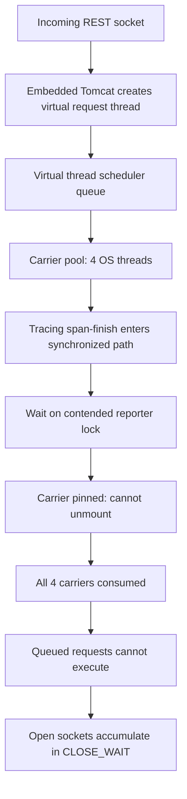

# Netflix — Java 21 virtual-thread starvation hidden behind tracing locks

**Case ID:** `case.netflix.java21-virtual-thread-carrier-starvation` | **M9:** E16-03 #116 | **Status:** source-backed draft, not independently reviewed  
**Original first-party source:** N06, Netflix TechBlog, Filanovsky, Huang, Thomas and Chalupa, **2024-07-29**; sections "The problem", "Collected diagnostics", "Why is Tomcat stuck?", "Who has the lock?", "Inspecting the lock". [Original article](https://netflixtechblog.com/java-21-virtual-threads-dude-wheres-my-lock-3052540e231d).

## The actual failure—not a synthetic throughput benchmark

Some Netflix Java 21, Spring Boot 3, embedded Tomcat REST instances intermittently stopped responding, though their JVM processes stayed alive. An increasing number of sockets entered `CLOSE_WAIT`. Conventional platform-thread dumps appeared idle. The engineers switched to virtual-thread aware `jcmd Thread.dump_to_file` and heap inspection and found many virtual threads with no stack yet, created but never scheduled. They ultimately traced carrier-thread starvation through tracing/span finishing and a contended lock, not a general inability of virtual threads to serve requests. [N06, named sections above].

In the reproduced incident context a VM had **four vCPUs** and thus an effective default carrier pool of four OS threads. **Four virtual threads were pinned** while traversing a synchronized span-finish path and waiting on a lock in the Brave/Zipkin tracing ecosystem. These four carrier threads could not run newly scheduled request virtual threads; accepted connections accumulated while Tomcat could not drain them. The article describes a lock-owner diagnostic that ordinary Java 21 dumps did not expose clearly. This is a **specific lock + scheduler + version** failure and must not be generalized to newer JDKs without retesting.

**Diagram alternative:** incoming requests enqueue virtual-thread tasks; when the carrier pool is monopolized by pinned lock waiters, other tasks cannot start. The diagram is a conceptual adaptation and does not reproduce Netflix's stacktrace or memory graph.

## Diagnosis chain and instrumentation boundary

| Clue | Initially plausible but misleading explanation | Disambiguating evidence |
|---|---|---|
| JVM alive, endpoints hung | Generic upstream outage or CPU crash | Service instances specifically enabled virtual threads; remote peers closed connections |
| Standard `jstack` appears idle | No workers or requests running | JVM 21 virtual stacks require appropriate dump tools; `jcmd Thread.dump_to_file` and heap view exposed unscheduled threads |
| Thousands of empty virtual threads | Memory leak from too many threads | Roughly correlated with pending sockets: tasks created but not mounted |
| Four contended traces on four-core node | Simple reporter congestion | Synchronized section pinning prevented carrier reuse while waiting |
| Lock owner unclear | No true lock contention | Heap object inspection of tracing reporter waiters, locks and conditions required |

These are the authors' observations. We have not reproduced their stack trace or measured any current JDK correction.

## Decision and transition safety

The *proposed Tycho adoption strategy* is to retain a platform-thread baseline, identify all blocking work inside monitors and native calls, inspect tracing/security/metrics filters under load, turn on virtual threads for representative I/O-heavy endpoints, and run cancellation/stalled-request fault injection. Concurrency should be constrained by downstream capacity, not by the number of cheap virtual-thread objects. Canary on small-core instances as well as large ones; compare runnable-queue depth, carrier utilization, pinning events, timeouts and `CLOSE_WAIT`, not only mean latency.

**Negative decision:** if the service is CPU-bound or uses libraries that block carrier threads, virtual threads may increase apparent concurrency without improving throughput. A reactive event-loop boundary may suit high fan-out but also requires prohibiting hidden blocking operations; compare N07. A platform-thread pool with an explicit admission limit may be safer until monitoring is trustworthy.

**Rollback:** reverting request execution to the known platform-thread mode and restoring deployment configuration is a proposed guardrail; the Netflix article does not supply a complete production rollback sequence or prove a specific permanent patch version.

## Transferability limits

No general Netflix fleet-wide failure rate is reported; no measured p99 delta or throughput improvement from Loom is published in this incident. **JDK 21 (2024)** monitor pinning behavior, instrumentation and tracing-library versions are crucial; reevaluate on newer runtime releases. The correct conclusion is 'verify your complete dependency graph before enabling Loom', not 'never use virtual threads'.

**Evidence type:** named Netflix engineer incident, reporter-authored; no reproduced benchmark. **Related case:** [ZGC workload selection](netflix-generational-zgc-workloads.md), [Zuul 2 asynchronous gateway](netflix-zuul2-nonblocking-gateway.md). **Review:** pending #121.
