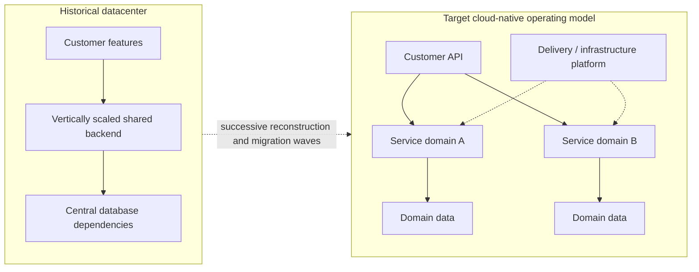

# Netflix — seven years from datacenter dependency to cloud-native service architecture

**Case ID:** `case.netflix.cloud-rearchitecture-2008-2016` | **M9:** E16-04 #117 | **Status:** evidence-backed historical draft  
**Period:** incident August 2008; project completed early January 2016; [Netflix first-party retrospective, February 12, 2016](https://about.netflix.com/en/news/completing-the-netflix-cloud-migration), N01.

## The original problem and why a 'lift and shift' was rejected

The company traced its migration motivation to a major database corruption event that interrupted shipping DVDs for three days in 2008. This was not evidence that DVDs, relational databases or centralized architecture were inherently wrong. It exposed concentration of failure and scaling dependencies in Netflix's specific vertically scaled datacenter environment. The retrospective explains a multi-year move rather than a weekend conversion: customer-facing capabilities were largely in the cloud before the last remaining datacenter streaming components were switched off in early January 2016. A critical part of the engineering choice was to rebuild for elastic, fault-contained services rather than transfer unchanged monolithic software to rented machines.

**Text alternative:** the company moved from a platform with concentrated datacenter dependencies to multiple independently operated cloud services and domain data boundaries, supported by a shared delivery platform. The nodes are a simplified, original educational view, not a literal inventory.

## Transition sequence and evidence

| Observation | Time / origin | What it proves and what it does not |
|---|---|---|
| Major database corruption interrupted DVD shipments | August 2008, N01 opening | A triggering operational failure, not controlled evidence that all monoliths are unavailable |
| Datacenter-to-cloud effort spanned roughly seven years | N01 overall retrospective | Replatforming touched data, services, operations and release practice; not a forklift |
| Most customer-facing services migrated earlier | N01 narrative of staged migration | Sensitive back-office state and some services remained later; no simultaneous big bang |
| Final remaining streaming datacenter components shut down | Early January 2016, N01 | Project milestone, not proof every later Netflix workload would always remain in the same topology |

Netflix also describes services and engineering autonomy at dramatically expanded scale, but the retrospective's company growth figures are **not causal A/B evidence** that adopting microservices produces that growth. Its technology narrative is intentionally historical; a current architecture diagram would require 2026-specific evidence.

## What an architect should actually copy

The reusable principle is a **migration dependency graph**, not an AWS mandate. Establish failure boundaries, inventory transactional/data ownership, make interfaces stable, and isolate workloads into reversibly migrated slices. For a hypothetical company, keep the original stack functioning while new components accumulate; migrate write ownership only with transactional correctness guarantees and explicit read comparison. Build rollout controls, dependency tracing and change rollback before increasing service count. These are Tycho's proposed controls—not an assertion that every Netflix team used an identical choreography.

**Counterdecision:** a 20-engineer product with a deployable monolith and one reliable database may improve availability more cheaply through backups, failover, modular components and controlled deployments. Compare [Shopify's modular-monolith alternative](shopify-modular-monolith.md), not Netflix's operating scale blindly.

## What the 2016 retrospective actually establishes

The [Netflix first-party retrospective of February 12, 2016](https://about.netflix.com/en/news/completing-the-netflix-cloud-migration) (N01) places the **August 2008 database-corruption event** at the start of the project and says **all customer-facing systems** had moved before 2015. The slowest final stage involved sensitive, durable operational data and subscription/customer management. The remaining data-center infrastructure used by the streaming service was retired in **early January 2016**. These are separate milestones, not evidence of a single all-service deployment in January.

Netflix's architects explicitly contrasted the simpler **lift-and-shift** option—run unchanged datacenter systems in rented cloud machines—with rebuilding virtually all of the platform. The retrospective reports moving from a monolithic application toward hundreds of independently operated services and denormalized NoSQL data models. This is a **reported historical design direction**, not proof that every one of Netflix's databases became nonrelational or that relational transactions were eliminated from every workload. [N01, the migration rationale and final engineering reflection].

The text identifies an **operating-model** migration as well as a hosting migration: long provisioning and coordinated approvals were replaced by infrastructure self-service and continuous delivery, while service teams assumed more independent release decisions. That combination created capabilities that merely rehosting the monolith would not have yielded. Its trade-off is an increase in distributed service boundaries, dependency coordination and ownership surfaces. N01 does not identify every intermediate release or attach a numerical SLO to each transition stage.

## Workload change is not an architecture-controlled experiment

| Netflix-reported observation | Period | How to use it without inventing causality |
|---|---|---|
| Streaming membership increased **8×** from 2008 | Retrospective published February 2016 | Demonstrates workload-growth pressure; no randomized comparison of cloud and on-prem growth |
| Overall video viewing increased by **three orders of magnitude** | Similar historical span | Illustrates load diversity and scale, not a universal transaction-rate benchmark |
| Infrastructure could expand by **thousands of virtual servers** and **petabytes of storage** in minutes | Claimed platform elasticity in 2016 | Does not reveal p95 provisioning distributions or actual application-scale timing |
| Netflix expanded to **130+ new countries on January 6, 2016** | Dated company announcement | Global operational context, not proof global data consistency became automatic |
| Availability trended toward a target of **four nines** | Reported improving trajectory, with acknowledged cloud outages | Not independent proof of exactly 99.99% uptime or zero incidents |
| Cloud cost per **streaming start** became a fraction of old datacenter cost | Relative publisher statement; absolute amounts unpublished | Must not be translated into a precise cloud-bill percentage or general cloud TCO law |

The paper also distinguishes cloud execution from **Open Connect**, Netflix's separately distributed video-delivery CDN. The ability to expand stateless or horizontally scalable cloud workers does not mean video bytes were all delivered from the same virtual server tier. Treat distributed content delivery as an adjacent architecture boundary, not an invented microservice count. [N01, mid-article global infrastructure and Open Connect descriptions].

## Failure containment and migration ownership

Netflix credits replication, redundancy, graceful degradation and repeated fault exercises for improvements in availability, while explicitly acknowledging that cloud infrastructure also fails. That assertion is stronger than “AWS itself eliminated outages” and narrower than a measured causal effect for a particular circuit breaker. The retrospective does **not** publish incident counts, complete chaos-testing methods or a fleet-wide rollback protocol.

**Tycho analytical transition architecture for an unrelated system:** first identify the true single points of failure (runtime, database, release, region and human operating process); test smaller availability remedies such as backup/restore and active/passive failover; set workload and consistency constraints; isolate one bounded domain behind a stable API; verify old/new read and mutation semantics; canary regional and consumer cohorts; enforce bounded retry budgets and visible degradation; preserve old write authority until parity; and retire shared infrastructure only after real failure/recovery observations support it. This is a proposed procedure, **not** Netflix's unreported seven-year task calendar.

**Reject direct transfer** when the system has one stable deployment team, low release frequency, a reliable transactional model and no measured multi-region or independent scaling requirement. A [modular-monolith counterpart](shopify-modular-monolith.md) offers a different response to coupling without introducing every network failure mode at once. The source offers a persuasive *historical company account* of why the rebuild mattered to Netflix's evolving demand, not an independent proof that distributed services are always the lowest-risk modernization choice.

## Trade-offs / missing facts

Sharding, async communication, dozens of service owners and decentralized deployments add failure surfaces: network partitions, observability and incident ownership, contract evolution, infrastructure cost, cross-team planning and consistency. These costs are inferred architecture risks; the retrospective does not provide a transferable baseline of cost/service or precise per-team productivity delta.

**Decision test:** identify current systemic availability bottlenecks and split one domain only after proving a smaller change cannot meet the target. A cloud migration is not automatically a microservices migration; those are distinct decisions.

**Citation anchor:** [N01 — Completing the Netflix Cloud Migration](https://about.netflix.com/en/news/completing-the-netflix-cloud-migration), opening incident, migration rationale, timeline and final shutdown paragraphs. Source-reported historical account; no copied diagrams, independent measurements or private data. **Review:** pending #121.
