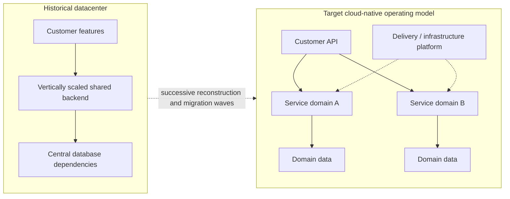

# Netflix — seven years from datacenter dependency to cloud-native service architecture

**Case ID:** `case.netflix.cloud-rearchitecture-2008-2016` | **M9:** E16-04 #117 | **Status:** evidence-backed historical draft  
**Period:** incident August 2008; project completed early January 2016; [Netflix first-party retrospective, February 12, 2016](https://about.netflix.com/en/news/completing-the-netflix-cloud-migration), N01.

## The original problem and why a 'lift and shift' was rejected

The company traced its migration motivation to a major database corruption event that interrupted shipping DVDs for three days in 2008. This was not evidence that DVDs, relational databases or centralized architecture were inherently wrong. It exposed concentration of failure and scaling dependencies in Netflix's specific vertically scaled datacenter environment. The retrospective explains a multi-year move rather than a weekend conversion: customer-facing capabilities were largely in the cloud before the last remaining datacenter streaming components were switched off in early January 2016. A critical part of the engineering choice was to rebuild for elastic, fault-contained services rather than transfer unchanged monolithic software to rented machines.

**Text alternative:** the company moved from a platform with concentrated datacenter dependencies to multiple independently operated cloud services and domain data boundaries, supported by a shared delivery platform. The nodes are a simplified, original educational view, not a literal inventory.

## Transition sequence and evidence

| Observation | Time / origin | What it proves and what it does not |
|---|---|---|
| Major database corruption interrupted DVD shipments | August 2008, N01 opening | A triggering operational failure, not controlled evidence that all monoliths are unavailable |
| Datacenter-to-cloud effort spanned roughly seven years | N01 overall retrospective | Replatforming touched data, services, operations and release practice; not a forklift |
| Most customer-facing services migrated earlier | N01 narrative of staged migration | Sensitive back-office state and some services remained later; no simultaneous big bang |
| Final remaining streaming datacenter components shut down | Early January 2016, N01 | Project milestone, not proof every later Netflix workload would always remain in the same topology |

Netflix also describes services and engineering autonomy at dramatically expanded scale, but the retrospective's company growth figures are **not causal A/B evidence** that adopting microservices produces that growth. Its technology narrative is intentionally historical; a current architecture diagram would require 2026-specific evidence.

## What an architect should actually copy

The reusable principle is a **migration dependency graph**, not an AWS mandate. Establish failure boundaries, inventory transactional/data ownership, make interfaces stable, and isolate workloads into reversibly migrated slices. For a hypothetical company, keep the original stack functioning while new components accumulate; migrate write ownership only with transactional correctness guarantees and explicit read comparison. Build rollout controls, dependency tracing and change rollback before increasing service count. These are Tycho's proposed controls—not an assertion that every Netflix team used an identical choreography.

**Counterdecision:** a 20-engineer product with a deployable monolith and one reliable database may improve availability more cheaply through backups, failover, modular components and controlled deployments. Compare [Shopify's modular-monolith alternative](../../sources/REAL_WORLD_ARCHITECTURE_CASES.md#research-admission-and-usage-rules), not Netflix's operating scale blindly.

## Trade-offs / missing facts

Sharding, async communication, dozens of service owners and decentralized deployments add failure surfaces: network partitions, observability and incident ownership, contract evolution, infrastructure cost, cross-team planning and consistency. These costs are inferred architecture risks; the retrospective does not provide a transferable baseline of cost/service or precise per-team productivity delta.

**Decision test:** identify current systemic availability bottlenecks and split one domain only after proving a smaller change cannot meet the target. A cloud migration is not automatically a microservices migration; those are distinct decisions.

**Citation anchor:** [N01 — Completing the Netflix Cloud Migration](https://about.netflix.com/en/news/completing-the-netflix-cloud-migration), opening incident, migration rationale, timeline and final shutdown paragraphs. Source-reported historical account; no copied diagrams, independent measurements or private data. **Review:** pending #121.
