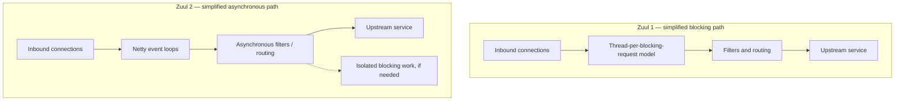

# Netflix — Zuul 2: async gateway architecture with workload-dependent efficiency

**Case ID:** `case.netflix.zuul2-nonblocking-gateway` · **Owner:** M9 E16-02 #115 · **Status:** evidence-backed draft; independent technical review pending  
**Primary:** src.m9-n07, Netflix Cloud Gateway Team, September 2016, "Results of Zuul 2 in Production"; src.m9-n08, Netflix Zuul 2.0 public architecture wiki (living documentation; snapshot not pinned). Company-reported results, not Tycho measurements.

## Engineering pressure

A blocking request-per-connection gateway can be simple and effective when each request completes quickly. Persistent downstream connections change the arithmetic: a connection with low activity may still occupy a worker in a blocking implementation, and the load balancer's resource budget becomes tied to waiting rather than useful work. Netflix's existing gateway platform was exposed to growing device and persistent-connection needs. The migration targeted **concurrent connection scalability** and I/O handling, not a universally faster CPU implementation. [src.m9-n07: motivation and "Results of Zuul 2 in Production"].

## Before and after: execution ownership

**Text alternative:** formerly, blocking threads could remain attached to requests during I/O waits; a Netty event-loop design seeks to multiplex such waits but must quarantine blocking work and track context explicitly. The graph is an original conceptual reduction, not a reproduction of Netflix's architecture image.

The benefit is conditional. It depends on the share of time spent waiting, the number of long-held connections, listener and upstream behavior, scheduling and how thoroughly filters are nonblocking. If a CPU-intensive filter is kept on the event loop, it can hurt latency for unrelated requests; merely swapping a network library cannot speed up cryptography, serialization or business logic.

## What Netflix actually reported

The Netflix gateway write-up describes significant persistent-connection scalability benefits with Zuul 2. But the production outcome was not a uniform CPU-efficiency win. For the API-facing, computation-heavier cluster, CPU efficiency did **not** materially improve. For a logging cluster doing less work per request, the company reported about **25% throughput improvement with associated CPU-use reduction**. This is precisely why a simple 'no gain' or 'Netty 10x better' summary is false. [src.m9-n07: "Results of Zuul 2 in Production"].

| Measurement | Observed result | External-validity boundary |
|---|---|---|
| Persistent connections | Higher scalable connection population | Source-reported specific Netflix gateway |
| CPU-bound/API gateway | No significant CPU efficiency gain | CPU share dominant; no universal improvement |
| Lower-work logging gateway | Approximately 25% throughput gain | Historical workload, configuration and fleet; not transferable 1:1 |
| Developer/operational cost | More complex thread locals, blocking boundaries, testability and debugging | Narrative trade-off, not measured engineering hours |
| Retry-storm resilience | Some benefit, requiring tuning | Not a zero-failure guarantee |

## Migration safety as a decision framework

A compatible gateway transition typically requires dual-stack requests and response validation, explicit filter execution guarantees, backpressure, end-to-end trace propagation across asynchronous boundaries, and canaries covering long-lived and short connections. These are **Tycho's recommended transition gates**, not a claim that Netflix ran this exact checklist.

An isolated canary should compare: inbound active connections; event-loop utilization; pending tasks; queue depth; per-route p95/p99; upstream errors/timeouts; filters' thread-affinity assumptions; request identity/security context; GC and heap pressure; and CPU per standardized request mix. A rollback criterion must not be based solely on aggregate throughput: a quiet cluster could look better while a latency-critical cluster worsens.

## Alternatives and contraindications

A tuned blocking gateway may be appropriate when connection counts are moderate, all work is CPU-heavy, latency objectives are already met and simplicity matters. A mixed design can preserve blocking libraries in worker pools with explicit budgets, at the cost of crossings and backpressure. An asynchronous network layer may be required for streaming or high fan-out but is not permission to silently execute blocking JDBC or tracing tasks on the event loop.

**Decision rule:** compare *connection waiting capacity*, *CPU per request class*, and *p99 under saturation* separately. For a traffic mix that is 90% low-work I/O and 10% high CPU, test both distributions rather than assume the aggregate reflects both segments. This ratio is a synthetic test suggestion—not a Netflix traffic statistic.

## A two-stage compatibility transition before network replacement

The [September 21, 2016 first-party account](https://netflixtechblog.com/zuul-2-the-netflix-journey-to-asynchronous-non-blocking-systems-45947377fb5c) (src.m9-n07, **Building Non-Blocking Zuul**) describes a counterintuitive migration sequence. The team **first made Zuul filters and filter chaining asynchronous**, using RxJava, **while they could still run on the blocking gateway**. The same logical filters could then be shared by old Servlet-based Zuul and a new Netty-based gateway. This preserved one application-behavior layer while replacing connection and execution machinery beneath it; it was not an instantaneous rewrite of every filter.

The change required investigating **thread-local request context**, hidden blocking network-library assumptions and code that needed to be forked or reimplemented asynchronously. The publisher mentions **Reactive-Audit** as one diagnostic tool for surfacing blocking calls. Its authors distinguished async filters for I/O from synchronous filters for local operations, rather than declaring that every task needed an async API. The historical account does not publish a complete per-filter migration ledger or independent proof that no blocking operation remained after rollout.

## Why reliability was not automatically improved

In the Servlet model a thread can remain attached to a request while it waits on a downstream dependency. A downstream latency spike and repeated device retries can amplify open connections, threads, memory and scheduler pressure. A Netty event loop lowers the cost of *waiting connections*, but this trades straightforward per-request stacks for callback lifecycle state, context propagation and manual resource cleanup. Netflix describes difficult-to-debug **ByteBuf leaks, file-descriptor leaks and dropped responses** as possible failures of incomplete async error paths. These are publisher-identified failure classes, not a confirmed list of every Zuul 2 production incident. [src.m9-n07, **Differences Between Blocking vs. Non-Blocking Systems**].

**Operating guards for a different gateway (Tycho synthesis):** explicit event-loop blocking detector; bounded offload executor for unavoidable synchronous dependencies; request context and principal propagation across callbacks; cancellation/deadline cleanup; leak detection for reference-counted buffers; retry/hedging and upstream admission limits; p99 measured by route and connection cohort rather than aggregated at cluster level. A partially converted framework must support a known rollback version while downstream contract and security behavior are stable. No universal Netflix rollback threshold is documented.

These are the actual distinctions in src.m9-n07, **Results of Zuul 2 in Production**. A second
modern Java case about a CPU-bound [gRPC worker-pool regression under virtual threads][grpc] is a different scheduling experiment and must
not be collapsed into this 2016 result. The [JDK 21 monitor-pinning risk][pin] is likewise a different mechanism.

## Two incompatible architecture choices for a hypothetical legacy gateway

For a legacy entry service with relatively few connections and heavy per-request transformation, an existing blocking or bounded-thread gateway may satisfy all objectives with less risk. For very many persistent idle connections and asynchronous downstream waits, Netty/event-loop I/O may materially reduce resource cost. For a mixed request population, isolate request classes and quantify: blocked wait time; active connection count; event-loop queue delay; completed requests/CPU; per-class p99; retry volume; cancelled but still running upstream work; trace and authorization-context errors; and leaked buffers.

The **selection criterion** is what each scheduler is waiting for, not the number of fashionable concurrency abstractions. A gateway handling large CPU-bound cryptography cannot rely on an event loop to do more useful CPU work, and a per-request virtual thread is not proof that a tracing library is safe. A migration without request-context verification, leak/error-path tests or a representative traffic baseline should remain **insufficient evidence**, not automatic approval of the reactive rewrite.

## Provenance and limits

- src.m9-n07: [Zuul 2 — The Netflix Journey to Asynchronous, Non-Blocking Systems](https://netflixtechblog.com/zuul-2-the-netflix-journey-to-asynchronous-non-blocking-systems-45947377fb5c), company 2016 article, especially "Results of Zuul 2 in Production."
- src.m9-n08: [Netflix/zuul Wiki, How It Works 2.0](https://github.com/Netflix/zuul/wiki/How-It-Works-2.0), public evolving architecture. Do not attribute fixed-version runtime behavior without an immutable Git revision.
- Numerical outcomes are author-reported. Independent replication, exact contemporary source revision, full benchmark setup and cross-version comparison are not documented here.

**Review state:** authored and content-scoped; pending overall #114 verification gate and #121 independent review. Relevant conceptual material: event loops, async boundaries, backpressure and gateway capacity.

[grpc]: netflix-grpc-cpu-workerpool-virtual-thread-regression.md
[pin]: netflix-java21-virtual-thread-pinning.md
