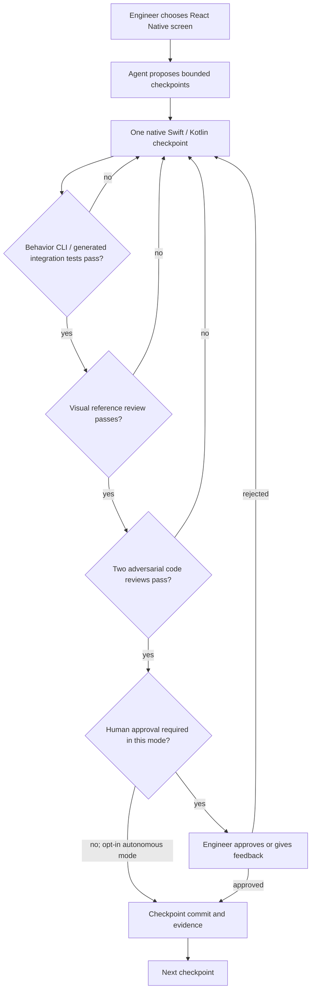

# Shopify — Helix: replace one-shot AI migrations with small provable checkpoints

**Case ID:** `case.shopify.helix-checkpoint-gates` | **Owner:** M9 E16-05 #118 | **Status:** source-grounded draft; independent reviewer pending.  
**Source:** SH04, Talha Naqvi, [Shopify Engineering, 2026-09-21](https://shopify.engineering/helix), sections **The loop at a glance**, **Checkpoints that can be reviewed at a glance**, **Reviews are gates instead of advice**, **Gate 1: Behavior**, **The UI review gate**, **An engineer closes the loop**, **Helix can also run autonomously**. Related [2026 native strategy](https://shopify.engineering/back-to-native) and [Shop app migration](https://shopify.engineering/shop-app-migration) are distinct articles.

## Decision pressure and temporal state

Shopify's mobile team had previously favored React Native to share implementation between platforms. By 2026, improvements in coding-agent workflows changed *development economics*: the publisher reports that a native Swift/Kotlin rebuild of the **Shop app** was shipped in 12 weeks. A separate larger **Shopify App** migration, with over 300 screens, was under way. These are **two apps**: the source does not say all Shopify mobile products were already rewritten. The transition does not retroactively mean React Native was a bad decision in 2020.

A single agent request to translate a large React Native screen tends to generate an unreviewable diff whose product behavior, UI details and architecture are difficult to validate together. The Helix response was to make a reference implementation observable and divide translation into small checkpoints where failures cannot silently pass to the next step. [SH04, opening and "Why Helix works"].

## Actual reported architecture and verification loop

**Text alternative:** an engineer selects a reference screen and reviews a set of small milestones. For each milestone, functionality, UI equivalence and two adversarial reviews must pass. Human approval is enabled by default but can be explicitly relaxed for bounded autonomous runs. A failed gate returns work to correction rather than committing. This is an independently authored abstraction of the reported workflow, not Shopify's actual CLI implementation.

### Gates and their limits

| Gate | Reported source behavior | What it does *not* prove |
|---|---|---|
| Behavioral CLI | Reference app states/actions exposed through CLI; generated integration tests check target checkpoint | Not automatically equivalent to test coverage of every product state |
| Visual review | Model compares reference UI to native outcome; pixel-identical files are not required | Visual plausibility cannot verify accessibility, latency or security alone |
| Two adversarial reviewers | Revisions must satisfy architecture/code quality reviews before progression | Reviewer models may share blind spots; independence is a quality design goal, not proof |
| Human approval | Standard mode has an engineer approve before checkpoint commit | Human may still miss faults, and approval policy can be relaxed intentionally |
| Feedback retained | Later checkpoints may incorporate fixes/decisions from earlier | An adaptive agent is not guaranteed to converge for unknown systems |

## Migration safeguards and counterexamples

For an organization considering this approach, Tycho proposes reference-system instrumentation, reproducible app states, testable API and UI traces, framework-specific native design rules, rollback by feature/commit, and a human review queue for ambiguous UI/logic. These are **synthetic transfer controls** and must not be misrepresented as every Shopify internal practice.

**Negative case:** Without a reliable reference runtime, a visual-only translation can pass screenshots while breaking interaction, accessibility or state persistence. A native rewrite may increase parity maintenance and duplicated platform expertise versus a stable shared UI stack. If the existing cross-platform app meets goals, adopting native solely because AI writes code quickly can be the wrong architecture decision.

## Evidence / claims / uncertainty

SH04 reports that **Shop** was already shipped natively after approximately **12 weeks** and Shopify App rebuild work was continuing. The article does not publish a controlled comparison of bug escape rates, total cost, long-term maintenance or productivity across identical teams; these remain **unknown**. The opt-in autonomous mode is not a universal safety guarantee. Original diagrams/text are not copied; source URL and section-level attribution only.

**Compare:** [Spotify's dataset consumer migration](spotify-honk-data-consumer-migration.md) lacks build-time tests in many affected repositories and must rely on human downstream-owner validation. Helix's quality gates are not automatically transferable to untestable pipelines. [General agentic decision guide](decisions/agentic-migration-safety.md). **Review pending #121.**
