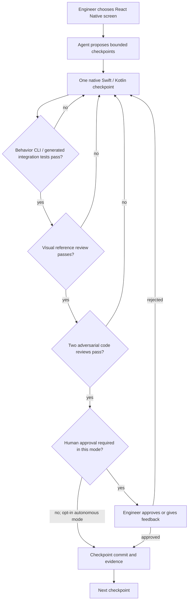

# Shopify — Helix: replace one-shot AI migrations with small provable checkpoints

**Case ID:** `case.shopify.helix-checkpoint-gates` | **Owner:** M9 E16-05 #118 | **Status:** source-grounded draft; independent reviewer pending.  
**Source:** src.m9-sh04, Talha Naqvi, [Shopify Engineering, 2026-09-21](https://shopify.engineering/helix), sections **The loop at a glance**, **Checkpoints that can be reviewed at a glance**, **Reviews are gates instead of advice**, **Gate 1: Behavior**, **The UI review gate**, **An engineer closes the loop**, **Helix can also run autonomously**. Related [2026 native strategy](https://shopify.engineering/back-to-native) and [Shop app migration](https://shopify.engineering/shop-app-migration) are distinct articles.

## Decision pressure and temporal state

Shopify's mobile team had previously favored React Native to share implementation between platforms. By 2026, improvements in coding-agent workflows changed *development economics*: the publisher reports that a native Swift/Kotlin rebuild of the **Shop app** was shipped in 12 weeks. A separate larger **Shopify App** migration, with over 300 screens, was under way. These are **two apps**: the source does not say all Shopify mobile products were already rewritten. The transition does not retroactively mean React Native was a bad decision in 2020.

A single agent request to translate a large React Native screen tends to generate an unreviewable diff whose product behavior, UI details and architecture are difficult to validate together. The Helix response was to make a reference implementation observable and divide translation into small checkpoints where failures cannot silently pass to the next step. [src.m9-sh04, opening and "Why Helix works"].

## Actual reported architecture and verification loop

**Text alternative:** an engineer selects a reference screen and reviews a set of small milestones. For each milestone, functionality, UI equivalence and two adversarial reviews must pass. Human approval is enabled by default but can be explicitly relaxed for bounded autonomous runs. A failed gate returns work to correction rather than committing. This is an independently authored abstraction of the reported workflow, not Shopify's actual CLI implementation.

### Gates and their limits

| Gate | Reported source behavior | What it does *not* prove |
|---|---|---|
| Behavioral CLI | Reference app states/actions exposed through CLI; generated integration tests check target checkpoint | Not automatically equivalent to test coverage of every product state |
| Visual review | Model compares reference UI to native outcome; pixel-identical files are not required | Visual plausibility cannot verify accessibility, latency or security alone |
| Two adversarial reviewers | Revisions must satisfy architecture/code quality reviews before progression | Reviewer models may share blind spots; independence is a quality design goal, not proof |
| Human approval | Standard mode has an engineer approve before checkpoint commit | Human may still miss faults, and approval policy can be relaxed intentionally |
| Feedback retained | Later checkpoints may incorporate fixes/decisions from earlier | An adaptive agent is not guaranteed to converge for unknown systems |

## Migration safeguards and counterexamples

For an organization considering this approach, Tycho proposes reference-system instrumentation, reproducible app states, testable API and UI traces, framework-specific native design rules, rollback by feature/commit, and a human review queue for ambiguous UI/logic. These are **synthetic transfer controls** and must not be misrepresented as every Shopify internal practice.

**Negative case:** Without a reliable reference runtime, a visual-only translation can pass screenshots while breaking interaction, accessibility or state persistence. A native rewrite may increase parity maintenance and duplicated platform expertise versus a stable shared UI stack. If the existing cross-platform app meets goals, adopting native solely because AI writes code quickly can be the wrong architecture decision.

## Why checkpoint size changes the proof obligation

The [September 21, 2026 Shopify source](https://shopify.engineering/helix) (src.m9-sh04, **Checkpoints that can be reviewed at a glance**) explicitly rejects the “collect all reference code, write a huge spec, and then generate everything” strategy. Its target artifact begins with a **screen skeleton**, then one small section, then increasingly complex sections only after prior decisions have passed review. Each checkpoint's description is short enough for an engineer to approve scope without reading a wall of pre-generated prose. Crucially, the **running React Native application and reference code are the specification**: the agent can inspect that bounded source directly rather than trust a stale, gigantic summary.

This is a process design around **reviewability**. A large final diff can contain several interacting defects and hide which early interpretation was wrong; committing independently verified small steps makes the failure location and allowable rollback surface easier to understand. It does **not** prove small commits are intrinsically correct—each must still pass its evidence gates.

## Four sequential proofs and independent failure paths

| Shopify gate (src.m9-sh04) | Actual mechanism reported | Unproven or risky case |
|---|---|---|
| Behavior | CLI exposes reference screen state/actions; a subagent proposes user-perspective integration tests, executable without a simulator | A test suite may omit an unobserved gesture, accessibility feature, auth state or side effect |
| Visual review | Matching reference and native screenshots are compared; reviewer reports location/severity of discrepancies | Two screenshots in different UI states make the comparison invalid; screenshot similarity cannot prove data correctness |
| Adversarial code review | **Two context-isolated reviewer agents** enforce separately documented target architecture and code-quality guidelines | Same organization/model family may share an unknown blind spot; “two reviewers” is not external independent acceptance |
| Engineer approval | Human reviews code and running result, feedback becomes the next checkpoint's memory | Approval can be explicitly relaxed; not proof a human inspected every autonomous checkpoint |

The source names an instructive **invalid-comparison branch**: when the orchestrator presents screenshots from different states, its visual reviewer can mark the review **INVALID**, requiring recapture of equivalent states. This is a more precise safety rule than repeatedly tweaking CSS until an arbitrary image score improves.

The authors also state that after adversarial code changes **affected tests run again**, and visual review runs again if the patch changes the appearance. A gate's prior success is not indefinitely reusable after a change to the artifact it checked. Every checkpoint ends in a commit, with test/visual/reviewer evidence available for later inspection. These are source-reported workflow mechanics, not independent defect-rate measurements. [src.m9-sh04, **Gate 1**, **The UI review gate**, **The adversarial reviews gate**, **An engineer closes the loop**].

## Explicit autonomous mode is not removal of testing

In the company-reported process, **engineer approval is required by default**. A developer can request several checkpoints in one autonomous run or bypass human approval; **behavior, visual and two adversarial review gates remain required**. Therefore “autonomous” in this description means *which approval step is delegated*, not “generate without validation”. The source does not publish an independent audit of reviewer quality, maximum parallel safe branches, defects escaping production or total human review hours.

**Temporal status:** the **Shop** consumer app was described as rebuilt and shipped natively in about **12 weeks**. The separate **Shopify App** with more than **300 screens** was still being migrated in September 2026. The article cannot establish that every Shopify mobile app was complete or that the 12-week outcome transfers to every native rewrite.

## Synthetic transfer to non-UI and unsafe legacy changes

The same gate structure can be adapted to a **hypothetical backend refactor**: divide work by one invariant-preserving change, read the exact old behavior, write contract tests, run integration comparison, perform independent code review, then explicitly approve or reject the step before advancing. A nonvisual change omits the **visual gate**, as Shopify's source also notes, but must replace it with a relevant correctness oracle (schema/transaction compatibility, authorization, replay invariants).

**Fail/stop conditions:** reference behavior inaccessible or insufficiently instrumented; generated tests unable to exercise a consequential branch; screenshots not matched to one state; reviewer finding ignored or bypassed; unclear approval policy; or rollback requiring a data migration that the checkpoint never modeled. A source generator may produce correct code quickly but that does not confer permission to alter business meaning or security boundaries silently.

Compare [Spotify Honk's incomplete dataset testing](spotify-honk-data-consumer-migration.md) and [the independent decision guide](decisions/agentic-migration-safety.md). The important **contraindication** is absence of an oracle: a gated harness cannot certify equivalence if it has no trustworthy reference, and the right outcome is *human decision required / insufficient evidence*.

## What a checkpoint certifies—and what it cannot

The September 2026 first-party src.m9-sh04 description separates **three review oracles**: expected reference behavior, visual correspondence, and adversarial code/architecture review. They do not certify the same thing. A script can correctly navigate a screen while violating the intended data authorization boundary; a screenshot can look correct while accessibility or state persistence fails; two AI reviewers can agree while sharing an incorrect assumption. Treat each as a **separate veto** over a bounded change.

| Checkpoint evidence | Positive result permits | Additional evidence needed |
|---|---|---|
| Reference interaction states | Move to the next implementation/test gate | Failure-path state, offline/disconnected operation and test determinism |
| Generated behavior tests | Assert observed mappings for exercised user actions | Real product invariants not represented in the reference |
| Visual comparison | Validate layout, typography, spacing and state variants in tested viewport | Accessibility, localization, keyboard navigation, hardware/OS variants |
| Adversarial code review | Catch implementation anti-patterns and unsupported assumptions | Human architecture and security ownership; reviewer disagreement resolution |
| Approval/commit gate | Fix one checkpoint's state in version control | Deploy/canary telemetry, release safety and end-to-end defect monitoring |

The table is **Tycho analytical categorization**; the source does not publish a universal coverage percentage for these oracles or an independently audited escaped-defect benchmark. Shopify's report distinguishes a shipped native **Shop** app from an **ongoing larger Shopify App** rewrite. A successful app-specific project cannot be treated as 100%-fleet migration.

## Original decision record for an unrelated UI modernization

**Hypothetical baseline:** a cross-platform mobile product has shared-state screens, device-specific APIs, multiple languages, accessibility requirements and an independently released backend. Native Swift and Kotlin may improve OS integration but create duplicated maintenance and two sets of platform-specific defects. The alternatives are (a) keep the existing shared runtime and modernize it, (b) extract only the device-specific feature layer, or (c) rebuild native screens incrementally behind stable API contracts.

The decision should not be “AI makes code cheap.” It should depend on native-platform capability, responsiveness, build/release cost, ability to keep reference behavior testable, and staffed ownership of both native apps. src.m9-sh04's reported checkpoint approach is transferable as a *review method* even when a full native rewrite is not the correct architecture.

## A reversible proof strategy

Begin with one screen whose source behavior can be driven deterministically. Record the complete state machine: initial and error states, navigation transitions, identity/permission checks, persistence and network failure. Implement the smallest native slice behind an opt-in route or experiment flag. At each step, run original-reference behavior tests, native integration tests, visual/accessibility checks, static analysis and architecture review independently. Do not carry a failing checkpoint forward by masking its test; expose uncertainty to an authorized owner.

After checkpoint acceptance, validate app lifecycle behavior, feature flags, serialization and backend contract evolution before canary release. Preserve a rollback to the former screen implementation until user telemetry and incident response validate the replacement. **Stop** if the reference runtime is inaccessible, a visual metric hides a functional regression, platform code cannot respect security constraints, or reviewer disagreements cannot be adjudicated.

This is an **original Tycho migration design**, not a description of Shopify's private deployment stages. The reported 12-week Shop app delivery is a company outcome with project-specific resources; no reproducible claim about total cost or a universal release interval follows.

## Authority and autonomy are explicit choices

The source's default engineer approval and opt-in autonomous mode make approval a **configurable authority boundary**. For any high-risk migration, human signoff should be governed by the risk of irreversible user state change, access-control impact and test-oracle uncertainty—not by the size of a diff or a model's confidence. A checkpoint with no independent oracle should result in a *review task or refusal*, not an autonomously merged change. Contrast Spotify's [missing-test dataset migration](spotify-honk-data-consumer-migration.md): an automated patch is not verified merely because the generator completed.

## Evidence / claims / uncertainty

src.m9-sh04 reports that **Shop** was already shipped natively after approximately **12 weeks** and Shopify App rebuild work was continuing. The article does not publish a controlled comparison of bug escape rates, total cost, long-term maintenance or productivity across identical teams; these remain **unknown**. The opt-in autonomous mode is not a universal safety guarantee. Original diagrams/text are not copied; source URL and section-level attribution only.

**Compare:** [Spotify's dataset consumer migration](spotify-honk-data-consumer-migration.md) lacks build-time tests in many affected repositories and must rely on human downstream-owner validation. Helix's quality gates are not automatically transferable to untestable pipelines. [General agentic decision guide](decisions/agentic-migration-safety.md). **Review pending #121.**
