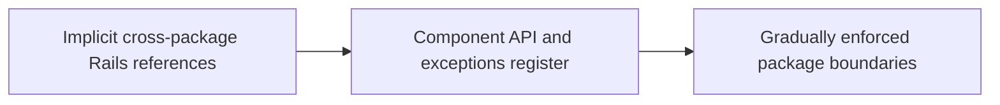

# Shopify — component governance is a migration, not a one-time refactor

**Case ID:** `case.shopify.component-governance` | **Milestone:** M9 E16-05 #118 | **Status:** evidence-bound original draft; technical review pending.  
**Source:** SH02 — [original company engineering article](https://shopify.engineering/shopify-monolith) (2020 Shopify Engineering follow-up); primary evidence: Under Deconstruction; component boundaries and dependency enforcement. Source reuse: original link and attributable paraphrase only; no copied diagrams or pages.

## Situation — the legacy architecture and constraint

After selecting a modular monolith, residual shared models and Rails conventions still enabled accidental dependencies. A diagram naming components did not enforce their promises; changing historical references without breaking releases required gradual work.

## Chosen architectural change

Shopify's follow-up discusses an evolving codebase in which domain components and dependency checking are strengthened iteratively, while acknowledging remaining work. Packwerk and Rails packaging are tools in the larger migration; governance, ownership and exception reduction matter more than a magic static checker.

**Diagram alternative:** Implicit cross-package Rails references evolved through Component API and exceptions register toward Gradually enforced package boundaries. This is a deliberately simplified, original decision/transition sketch; it is not the original company's infrastructure map.

## Migration and validation

For another team, begin with observed dependency graph; classify cross-component edges by business requirement and ownership, introduce public API layers, grandfather known exceptions with explicit reduction targets, and add CI guardrails that reject new violations. These steps are Tycho's implementation proposal, not a claim of the company's exact per-week sequence.

Suggested decision record for a different organization:

| Verification gate | Evidence needed before accepting change | Rollback or hold |
|---|---|---|
| Interface and ownership | Inventory of dependent clients, schema/contract/API compatibility and authorized owner | Preserve existing public contract |
| Representative workload | Actual traffic mix, failure modes and capacity baseline; no invented p99 | Roll back the cohort if its own SLO worsens |
| Correctness | Domain-specific business invariants, dual-state reconciliation if used, idempotent replays | Keep authoritative old representation until proven |
| Operability | Error budgets, runbooks, trace continuity, incident ownership and cost | Stop rollout without a clear incident response owner |

The gates in this table are Tycho's **analytical adaptation**, not an assertion that the source's engineers measured these same four things.

## Negative evidence, costs and alternatives

A static dependency checker cannot ensure data contract ownership, transaction semantics or runtime isolation. Broad exceptions can preserve the dependency knot forever; enforcing every rule instantly can stall delivery. This is an incomplete-state case, not a falsely completed modernization.

**Alternatives:** retain/tune the legacy architecture if capacity and correctness already meet requirements; incrementally constrain its internal dependency graph; adopt the described transition only if its own reported bottleneck exists; otherwise conclude **insufficient evidence** rather than copying the brand's solution. These are synthetic architecture alternatives and must not be presented as alternatives the company explicitly evaluated unless the source said so.

## Observed results and temporal validity

The follow-up illustrates the continuing operational cost of architectural boundaries within a monorepo. It does not prove that all components became independent or that a specific tool solved every cycle.

This is a company-reported historical result, not an independently reproduced benchmark. Precise current topology, total engineering effort, p99 and comparative cost must be regarded as **unknown** unless the named primary article supplies them. Do not extrapolate a dated deployment to October 2026 current practice.

## Applicability to legacy modernization

Prefer incremental, observable dependency constraints over a big-bang module rewrite; measure new violations, removed exceptions and cross-boundary churn. Before a roadmap is approved, require a baseline with data ownership and blast radius, a comparison to a smaller intervention, and measurable acceptance gates. An agent should retrieve this case as **evidence for conditions and counterconditions**, not as a universal preferred architecture.

**Provenance:** [SH02 primary](https://shopify.engineering/shopify-monolith), sections Under Deconstruction; component boundaries and dependency enforcement. Cross-case comparisons must retain the original company's architecture and historical observation window. **Case review:** not yet independently approved under #121.
