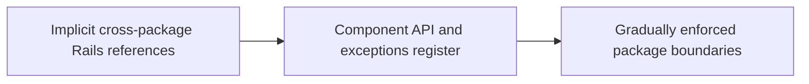

# Shopify — component governance is a migration, not a one-time refactor

**Case ID:** `case.shopify.component-governance` | **Milestone:** M9 E16-05 #118 | **Status:** evidence-bound original draft; technical review pending.  
**Source:** src.m9-sh02 — [original company engineering article](https://shopify.engineering/shopify-monolith) (2020 Shopify Engineering follow-up); primary evidence: Under Deconstruction; component boundaries and dependency enforcement. Source reuse: original link and attributable paraphrase only; no copied diagrams or pages.

## Situation — the legacy architecture and constraint

After selecting a modular monolith, residual shared models and Rails conventions still enabled accidental dependencies. A diagram naming components did not enforce their promises; changing historical references without breaking releases required gradual work.

## Chosen architectural change

Shopify's follow-up discusses an evolving codebase in which domain components and dependency checking are strengthened iteratively, while acknowledging remaining work. Packwerk and Rails packaging are tools in the larger migration; governance, ownership and exception reduction matter more than a magic static checker.

**Diagram alternative:** Implicit cross-package Rails references evolved through Component API and exceptions register toward Gradually enforced package boundaries. This is a deliberately simplified, original decision/transition sketch; it is not the original company's infrastructure map.

## Migration and validation

For another team, begin with observed dependency graph; classify cross-component edges by business requirement and ownership, introduce public API layers, grandfather known exceptions with explicit reduction targets, and add CI guardrails that reject new violations. These steps are Tycho's implementation proposal, not a claim of the company's exact per-week sequence.

Suggested decision record for a different organization:

| Verification gate | Evidence needed before accepting change | Rollback or hold |
|---|---|---|
| Interface and ownership | Inventory of dependent clients, schema/contract/API compatibility and authorized owner | Preserve existing public contract |
| Representative workload | Actual traffic mix, failure modes and capacity baseline; no invented p99 | Roll back the cohort if its own SLO worsens |
| Correctness | Domain-specific business invariants, dual-state reconciliation if used, idempotent replays | Keep authoritative old representation until proven |
| Operability | Error budgets, runbooks, trace continuity, incident ownership and cost | Stop rollout without a clear incident response owner |

The gates in this table are Tycho's **analytical adaptation**, not an assertion that the source's engineers measured these same four things.

## Negative evidence, costs and alternatives

A static dependency checker cannot ensure data contract ownership, transaction semantics or runtime isolation. Broad exceptions can preserve the dependency knot forever; enforcing every rule instantly can stall delivery. This is an incomplete-state case, not a falsely completed modernization.

**Alternatives:** retain/tune the legacy architecture if capacity and correctness already meet requirements; incrementally constrain its internal dependency graph; adopt the described transition only if its own reported bottleneck exists; otherwise conclude **insufficient evidence** rather than copying the brand's solution. These are synthetic architecture alternatives and must not be presented as alternatives the company explicitly evaluated unless the source said so.

## Observed results and temporal validity

The follow-up illustrates the continuing operational cost of architectural boundaries within a monorepo. It does not prove that all components became independent or that a specific tool solved every cycle.

This is a company-reported historical result, not an independently reproduced benchmark. Precise current topology, total engineering effort, p99 and comparative cost must be regarded as **unknown** unless the named primary article supplies them. Do not extrapolate a dated deployment to October 2026 current practice.

## Two successive detection approaches and why they differed

The [2019 first-party article](https://shopify.engineering/deconstructing-monolith-designing-software-maximizes-developer-productivity) (src.m9-sh01, **Isolating Dependencies**) described **Wedge**: a component-coupling feedback mechanism that combined runtime Ruby traces and static framework structure such as ActiveRecord associations. The [2020 follow-up](https://shopify.engineering/shopify-monolith) (src.m9-sh02, **What We're Building Right Now** and **How We Enforce Boundaries**) explains why the team built **Packwerk** as a separate tool: analyzing explicit Ruby constant references was faster and more actionable in the pull-request workflow. It intentionally did **not** attempt to infer every possible runtime call. Both mechanisms concern **Shopify's source-code boundary enforcement**, not the knowledge graph excluded from the Tycho product.

| Historical stage | What the company was trying to observe | Principal limitation |
|---|---|---|
| Wedge (2019 account) | Runtime cross-component calls, ActiveRecord associations, inheritance and public-API violations, summarized into an isolation score | Instrumented execution covers the exercised paths; dynamic calls and long-term ownership are still hard |
| Packwerk (2020 account) | Static references to Ruby constants, component dependency declarations and privacy breaches, checked in PRs | A constant-reference checker does not prove runtime absence of cross-domain data access or business invariant preservation |
| Ownership and stewardship (2020) | Engineers own code grouped by commerce subdomain and negotiate API contracts | Organizational ownership alone is not equivalent to an isolated component |
| Enforced and declining exceptions (goal) | Refuse new violations while simplifying older dependencies | Complete acyclicity and strong isolation were a future objective, not the reported final state |

This is an observed evolution in **scope and enforcement**, not proof that Packwerk replaced every Wedge capability or that the original organization had solved all dynamic Ruby boundaries. Wedge and Packwerk should not be presented as interchangeable fully semantic dependency proofs.

## Why rigid rules were a failed modernization tactic

The 2020 retrospective names a social/technical failure: a centralized architecture team initially emphasized uniform public-interface patterns; some teams reshaped their problems just to fit the prescribed approach, and the rules added friction without addressing the actual blockers. The later effort placed more emphasis on **developer motivation, pairing, reducing tooling pain and letting component owners succeed incrementally**. [src.m9-sh02, **What We Learned so Far**, **Foster the Grassroots**].

The same account distinguishes **two incomplete-state strategies**. Shopify's main monolith prioritized labeling a broad target set of subdomains and establishing file **stewardship**, even when their boundaries were still porous. Other applications experimented with extracting small fully isolated components, leaving a larger unstructured core behind. Each intermediate shape optimizes something different: discoverable ownership versus stronger isolation of selected code. Neither can be declared universally superior without knowing the primary failure mode.

## Reported progress and unresolved correctness boundaries

At the **September 2020** reporting point, the main monolith contained **37 components** and **about one third** used Packwerk to restrict dependencies. The writer explicitly described cycles, database model access and further isolation as still-in-progress work. Adoption percentage refers to components using Packwerk, **not** to verified zero-coupling or every Ruby constant covered. Architectural evolution cannot be marked 100% finished from this number alone.

The article also discusses partial **Rails Engine** packaging and selective service extraction (storefront rendering for separate read-heavy scaling and payment-vault separation for sensitive data). These are practical boundary cases: a modular-monolith strategy can be the *default* without forbidding independently operated components when workload or security justifies them. See the distinct [2019 modular-monolith decision](shopify-modular-monolith.md).

## A source-grounded adoption/reversal rubric (Tycho synthesis)

For a hypothetical Rails legacy system, baseline the number of implicit cross-component access paths, cycles, ownership gaps, runtime call failures and prior migration regressions. Choose an **ownership-first** organizational regrouping if individual developers cannot find or safely edit their domain; choose **isolation-first** for a critical component whose unexpected dependencies already cause incidents. Avoid announcing that dependency enforcement has been completed when a large exception set is still active.

Stage with read-only diagnostics, per-component owner decisions, a tiny contract test surface and nonblocking reports; tighten CI only for net-new violations after the team can resolve old debt. Independently test cross-component data authority, schema drift, retries and permission checks that a Ruby constant linter cannot observe. A safe rollback can restore the previous file/package boundary rule while preserving code behavior; full data-owner changes require their own reversal plan.

**Reject a tooling-first rollout** when static checks identify “violations” without a usable migration path, the service framework uses dynamic dispatch outside the analyzer's visibility, or a component's data ownership is unknown. Evidence insufficient to say whether a specific cycle can be removed? Escalate to the domain owner with a concrete scenario rather than invent a globally correct refactoring. The blog gives no reproducible 2026 production topology, independent productivity benchmark or completed-cycle count.

## What failed before Packwerk

The [September 16, 2020 follow-up](https://shopify.engineering/shopify-monolith) (src.m9-sh02, **Understand Developer Behaviour**, **Apply Tooling Deliberately**) is unusually candid that **boundary governance was also a social migration**. Imposing one prescribed interface pattern everywhere made work more difficult in some contexts; developers sometimes changed the problem to match the approved pattern. Merely producing violations and rules did not give domain owners the *ability* to repair legacy ActiveRecord coupling. The Architecture Patterns team shifted toward pairing, local coaching, owned changes and making the intended modular design understandable to many contributors. A static checker cannot replace that skill and ownership transfer.

The preceding **Wedge** approach instrumented Ruby method calls during the test suite, then interpreted cross-component callers, associations and inheritance. Two practical defects emerged:

- A dynamic call trace does not always identify the component that conceptually owns inherited dispatch. A method defined in one component, inherited in a second and calling into a third presents a real attribution ambiguity.
- Trace collection depended on running the **full instrumented test suite**, taking **more than an hour**. For many contributors this was too slow and noisy to act on during normal pull-request work.

Packwerk deliberately changed the evidence boundary. It examines **static constant references** (for example the reference to a model constant) rather than asserting that it has modeled every possible Ruby runtime call. These references are introduced explicitly in code, producing more actionable violation locations and reducing the analysis time for Shopify's large codebase to **a few minutes**. That made PR-time checks feasible. The result is an engineering trade-off: improved feedback speed and actionable static coverage at the cost of **not proving the absence of all dynamic runtime dependencies**. [src.m9-sh02, **Perform Static Dependency Analysis**].

## The 2020 rollout, precisely scoped

| Publisher-reported state, September 2020 | Architectural meaning | What the figure cannot establish |
|---|---|---|
| Core monolith **over 2.8 million lines of Ruby** and **500,000 commits** | Large, continuously changing codebase; centralized component ownership is expensive | Current 2026 size, runtime dependency structure, unique class count |
| **37 domain components** in main monolith | Responsibility and stewardship partitions existed | Strong isolation of all components or independent deployment |
| **About one third** adopting Packwerk restrictions | Dependency/privacy checks were being enabled incrementally | Universally enforced cycles, zero cross-component coupling |
| Full Packwerk static scan **a few minutes** versus Wedge's instrumented test-suite run **over an hour** | An important reduction in feedback-cycle latency | A controlled same-workload benchmark or invariant execution time |
| Total component dependency acyclicity as a **long-term goal** | A desired improvement, not a published completed result | A globally cycle-free codebase in 2020, much less today |

These numbers and dates come from src.m9-sh02 (**The Status Quo**, **Perform Static Dependency Analysis**, **What We're Building Right Now**). They are first-party historical reports, not independently reproduced measurements or extrapolated productivity gains.

## Beyond reference checking: cohesion, contracts, ownership

The authors distinguish **low coupling** from **high cohesion**. Early work optimized for fewer inter-component calls, but related behavior still changed together across multiple packages. A component could have a neat public interface and still require multiple teams to modify several components for one small capability. Shopify therefore used **change locality**—which components change together in real pull requests—as a useful outcome signal. The article describes work toward a PR-based measurement, not a completed published statistical study. [src.m9-sh02, **Balance Loose Coupling With High Cohesion**].

The technical controls evolved too. The report says **Rails Engines** became the preferred packaging structure because a set of engines can coexist in one process and could later be extracted if required. The team encountered external-gem dependency resolution issues and library assumptions about a single Rails application. For input/output contracts they moved from a runtime hash-schema approach (**Component::Schema**) toward **Sorbet** static typing, reporting maintenance and runtime-performance concerns with complex dynamic validation. These choices identify an operational boundary: if static analysis produces violations but component APIs remain underspecified, teams simply move coupling behind public methods. [src.m9-sh02, **Use Rails Engines**, **Define and Enforce Contracts**].

The authors also describe real deviations from a single-deployable strategy. They had **separately extracted storefront rendering** for high-throughput read traffic and **credit-card vaulting** for data-boundary reasons. This historical decision demonstrates that one modular-monolith policy can coexist with selectively deployed services. It does not establish the later number of services or a universally appropriate component extraction threshold. [src.m9-sh02, **What We're Building Right Now**].

## Two different modernization paths and their risks

The 2020 team had tried both **vision-first grouping** (rearrange most source files into business subdomains, assign stewardship and gradually strengthen interfaces) and **small strongly isolated carve-outs** (leave a large legacy core while moving selected responsibilities to clean components). Neither is universally better:

| Choice for a different team | Immediate value | Long-lived intermediate state |
|---|---|---|
| Group existing code into candidate domains first | Clear ownership and findability across a large codebase | Many historical dependencies still violate weak boundaries |
| Carve out fully isolated small components first | Concrete examples with demonstrable independent tests and contracts | The rest of the legacy code remains unstructured |
| Convert everything to independently deployed services immediately | Potential runtime isolation for measured independent load | Multiple distributed failure/transaction surfaces before stable domain boundaries are understood |

**Actual Shopify position in September 2020:** the main monolith used vision-first grouping; other apps used isolated carve-outs. The comparison is a Tycho synthesis of explicitly described choices, not proof the company measured all three under equal workloads. [src.m9-sh02, **Decide to Prioritize Ownership or Boundaries**].

## Testable and reversible decision transfer

For a hypothetical mature Rails-like monolith, a sensible pilot would:

1. Record owners, package entrypoints, concrete static references, known dynamic/plugin calls, shared data ownership and the current time-to-review baseline for one stable business domain.
2. Begin in **advisory mode**, catalog existing violations and document approved exceptions, with enough context that a developer can fix a single violation without deep global knowledge.
3. Establish a public API, a component-local contract and an integration test that exercises any shared ActiveRecord transactions, authorization, serialization and module initialization paths.
4. Enable **new-violation-only rejection** for the pilot while older exceptions have accountable owners and a scheduled review, not an unsupported claim of universal zero violations.
5. Observe actual exception burn-down, **change locality**, PR feedback latency, author corrections and real integration regressions. Only after source-level and behavioral results support the boundary should strict enforcement expand.

**Stop or reverse** if a refactoring changes the authoritative transaction boundary, introduces circular initialization, breaks dynamic dispatch or makes a formerly local change require more components than before. Packwerk is a *dependency-detection aid*, not proof of runtime correctness, service independence, performance or data consistency. If owners cannot name a meaningful boundary, return **insufficient evidence** rather than use a tooling project to force one.

**Scope note:** static dependency relationships described in this historical Shopify case are *the company's code-analysis subject*. They do **not** authorize a curated concept/knowledge graph feature in Tycho; the latter remains explicitly retired by Tycho's architecture ADR.

## Applicability to legacy modernization

Prefer incremental, observable dependency constraints over a big-bang module rewrite; measure new violations, removed exceptions and cross-boundary churn. Before a roadmap is approved, require a baseline with data ownership and blast radius, a comparison to a smaller intervention, and measurable acceptance gates. An agent should retrieve this case as **evidence for conditions and counterconditions**, not as a universal preferred architecture.

**2026-10-19 bounded source recheck:** Selected src.m9-sh01/src.m9-sh02 factual assertions (including Wedge test duration, Packwerk scan timing, 37 components, partial adoption, and the 2019-versus-2020 difference) were compared directly with publisher sections in the [Shopify evidence spot-check](../../authoring/cases/M9_SHOPIFY_SOURCE_SPOTCHECK_2026-10-19.md). No independent acceptance or running-tool validation is implied.

**Provenance:** [src.m9-sh02 primary](https://shopify.engineering/shopify-monolith), sections Under Deconstruction; component boundaries and dependency enforcement. Cross-case comparisons must retain the original company's architecture and historical observation window. **Case review:** not yet independently approved under #121.
