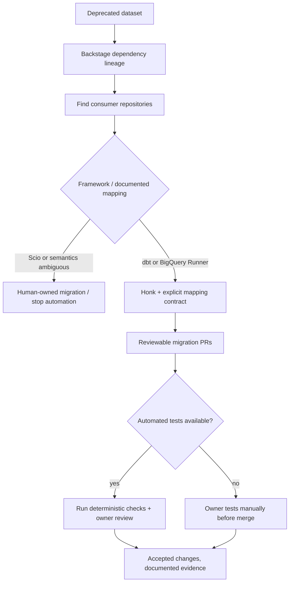

# Spotify — Honk: why data-lineage context and tests determine safe AI migration scope

**Case ID:** `case.spotify.honk-dataset-consumer-migration` | **Owner:** M9 E16-05 #118 | **Status:** first-party evidence-backed draft; independent reviewer pending.  
**Primary:** src.m9-sp03, Devon Edwards Joseph, [Spotify Engineering, 2026-04-22](https://www.engineering.atspotify.com/2026/4/background-coding-agents-dataset-migrations-honk-part-4), sections **Dataset migrations can be painful**, **Simplifying fleet migrations with Backstage**, **With Honk, context is key**, **What did we learn for the future**. Secondary context: src.m9-sp02, [Honk Part 1](https://www.engineering.atspotify.com/2025/11/spotifys-background-coding-agent-part-1), Nov 6, 2025. These report distinct populations and dates.

## Original migration and constraints

Spotify planned to deprecate two heavily used datasets to release richer replacements. Its lineage graph indicated approximately **1,800 direct downstream data pipelines**, and several thousand indirect dependencies, spanning **BigQuery Runner, dbt and Scio**. The manual work estimate was about **10 engineering weeks**. That estimated baseline is *not* an independently controlled timer.

The engineering team used Backstage endpoint lineage/Codesearch to identify affected repositories and Fleetshift to orchestrate changes. Honk could create code PRs, but it did not have the feature-rich tools and external context retrieval options now often assumed for coding agents. This made precise per-framework field mappings critical. [src.m9-sp03, background and platform sections].

## Iteration: three failure boundaries

The first attempt to derive migration instructions from a human-oriented guide let the agent infer wrong field mappings. The team corrected this by writing **explicit mapping tables** and by telling the agent to **leave ambiguous business-meaning transformations unchanged**, inserting comments for a human owner. That is an important *positive use of refusal* in code migration.

Scio pipelines were too varied for a general instruction set; the team **stopped attempting to automate that framework's migration in this wave**. BigQuery Runner and dbt were more standardized and could be handled with narrower context. However, many of those repositories had **little or no build-time unit testing**. Consequently, Honk could not verify itself using its usual correction loop; pipeline owners had to perform manual tests before merging changes. [src.m9-sp03, "With Honk, context is key"].

**Text alternative:** lineage identifies affected data consumers. A framework/semantic gate excludes variable Scio or ambiguous mappings; the remaining standardized cohorts get agent-generated PRs. Tests determine whether validation can be automated; missing tests route changes to explicit human-owner verification. The graph is original and does not claim all consumer pipelines were completed.

## Quantitative claims and why they cannot be mixed

| Period / source | Publisher-reported number | Correct interpretation |
|---|---|---|
| src.m9-sp03 April 2026 | **~1,800** direct downstream pipelines | Original potential migration scope for two deprecated datasets |
| src.m9-sp03 April 2026 | **240** automated migration PRs **rolled out** | Rollout metric; **not** proof of 240 merges or of 1,800 migrations complete |
| src.m9-sp03 April 2026 | **~10 engineering weeks** | Hypothetical estimated manual effort; not measured savings or quality |
| src.m9-sp02 Nov 2025 | **>1,500 AI-generated PRs merged** across Spotify | Earlier cross-fleet background-agent total; **not** identical to src.m9-sp03's 240 targeted PRs |
| src.m9-sp02 Nov 2025 | **60–90% estimated development time saving** on described migrations | Self-reported estimate; no claim of independently audited defect rate |

## Counterevidence and decision transfer

An agent is not automatically safe because its input is 'structured'. Missing field semantics produced wrong assumptions until explicit mapping tables were written. Even then, the target repositories lacked automatic tests, so *human verification remained necessary*. The scalable architecture here is **lineage + bounded transformation context + supervised PR workflow**, not unattended SQL code generation.

For another organization, test one standardized framework cohort, pin dataset schema versions and source-lineage snapshot, require a field-level oracle and detect missing test coverage before expansion. Mark untestable or ambiguous cases for owners; if data governance cannot define equivalence, the correct agent output is *insufficient evidence*, not a speculative mapping. A failed mapping, deferred framework or PR still awaiting merge is a first-class result.

## A versioned transformation contract for each consumer cohort

The src.m9-sp03 article distinguishes **discovering affected repositories**, **generating patches**, **testing their semantic correctness**, and **merging/rolling out**. These are different acceptance states. The cited lineage population of about **1,800 direct pipelines** is an impact estimate for two datasets; it must not be reported as the set successfully changed. The **240 rolled-out PRs** are a narrower migration cohort, not proof every PR merged, every affected pipeline migrated or every data value preserved business meaning.

For a different platform, each eligible transformation should have a versioned contract containing: original dataset fields and types; replacement field mappings; acceptable null/default transformations; affected query engine; data-owner-approved invariants; executable verification procedure; a repository/source revision; and a refusal policy. This should be **machine-readable enough to constrain a coding agent** and human-readable enough that a downstream owner can challenge the mapping.

| Transformation decision | Required oracle | Safe outcome |
|---|---|---|
| Direct field rename with equivalent semantics | Both schemas and representative query-value tests | Automated patch candidate, still subject to review |
| Field change with ambiguous business meaning | Named data-owner interpretation, explicit mapping and examples | **Stop; request human decision** instead of guessing |
| Unsupported framework or highly variable pipeline | Framework-specific dependency model and target runtime tests | Leave unchanged, report as excluded cohort |
| No local build/test runner | Executable downstream validation owned by pipeline team | Human-owned verification before merge |
| Generated PR awaiting owner action | Merge and deployment state from a trusted workflow | Keep status **proposed**, not “migrated” |

The matrix is an **original Tycho test design** and must not be presented as Spotify's unpublished mandatory tool schema. The company explicitly describes wrong inferred mappings, the narrowed scope excluding Scio and manual tests when repositories lacked automatic test feedback.

## Controlling progress and measuring failure honestly

A synthetic experiment should begin with a small representative cohort of BigQuery Runner/dbt consumers and a separate *excluded* Scio set. Snapshot the original lineage and identify downstream users; run the agent with the exact mapping contract; compare query semantics with an independent reviewer; execute repository checks where available and owner-run data tests otherwise. Record every excluded/ambiguous mapping and every generated, reviewed, merged, deployed or rolled-back PR **as separate status**. Do not smooth away the long tail by reporting only automatic successes.

**Negative-path drills:** deprecated fields with similar names but different meaning, null-value changes, joins whose cardinality changes, a pipeline missing unit tests, stale lineage and target schema changing after PR generation. If the oracle fails or an owner cannot verify semantics, preserve the existing consumer until a correct migration is specified. A compile-success label and a visually plausible SQL diff are not correctness evidence.

The first-party reports describe an operational tool chain and selected outcomes; they do not publish a controlled independent escaped-defect rate. Treat estimated engineering-week savings as **hypotheses**, not verified effort saved. Compare with [Shopify Helix's checkpoint gates](shopify-helix-checkpoint-gated-native-migration.md), recognizing that UI visual tests are not valid oracles for data-consumer semantics.

## Source and review limits

All performance and adoption counts are attributed to Spotify and their publication dates. The company did not report in this article a controlled escaped-defect benchmark or complete migration rate across all consumers. Agent-produced code or internal prompts cannot be imported into Tycho without rights. Case remains a **draft pending #114 per-claim admission and #121 independent review**; avoid introducing private employer examples.
