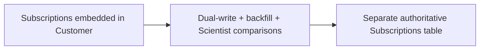

# Stripe — four-stage online migration of subscription data ownership

**Case ID:** `case.stripe.online-subscriptions` | **Milestone:** M9 E16-05 #118 | **Status:** evidence-grounded draft, pending reviewer.  
**Public primary:** src.m9-st01 [official engineering account](https://stripe.com/blog/online-migrations), 2017-02-02, Jacqueline Xu / Stripe; source anchors: A pattern for online migrations; Part 1: Dual writing; Part 2: Changing all read paths; Part 3: Changing all write paths; Part 4: Removing old data. No private materials or copyrighted graphics reproduced.

## Original pressure and baseline

Early Stripe billing represented subscriptions on Customer records. As subscriptions became plural and more complex, updating an entire Customer and scanning embedded subscription structures hampered features. A simultaneous rewrite of all the dependent services would threaten live financial correctness and downtime.

## Architecture shift and ownership

Stripe moved subscriptions into a dedicated table with a four-phase compatibility path: dual-write and backfill; switch reads after shadow comparison; redirect writes so the new table becomes authoritative; retire the old field. The method separates storage-copy existence from actual read/write ownership transfer.

**Text alternative:** Subscriptions embedded in Customer, through Dual-write + backfill + Scientist comparisons, evolved toward Separate authoritative Subscriptions table. Diagram is a simplified original architectural transition, not a provider topology inventory.

## Execution stages, validation and reversibility

Source details matter: Stripe copied missing records with offline Hadoop/MapReduce snapshots rather than loading live databases with full table scans, and used GitHub Scientist to run production-read comparisons while serving the old path until verified. After switching to new reads it incrementally changed mutation sites, then made old-field access throw errors and removed old data. This is a reported real sequence, not generic speculation.

A **synthetic migration readiness checklist** for applying the lesson elsewhere (not a claim that the original authors used this exact checklist):

1. Define the old and new ownership boundaries and which API/data contract must stay invariant throughout coexistence.
2. Capture representative traffic and error distributions, not solely a success-path benchmark. Specify performance baselines with release version, dataset and sample size.
3. Compare old/new result sets and temporal semantics; test retried writes, old clients, skipped batches and partial deployment.
4. Observe canary failure and rollback behavior with exact data-authority ordering. Do not retire the legacy system before provable invariants hold.
5. Retest under realistic resource limits, hot keys and failure injections. A change in infra topology is not a substitute for demand shaping.

## Measured or reported outcome

Stripe reports an online migration without downtime while API behavior remained stable; the article gives process detail but not a transferable quantified p99 or labor-saving gain. No claim of independent proof is made.

## Failed assumptions and when not to transfer the design

A two-table representation may diverge during retries, time windows or schema-dependent business logic. Comparing only counts is insufficient; read results must match under a defined subscription identity and temporal snapshot. Switching new writes before all old reads are migrated risks inconsistencies.

**Architecture choice:** Use this for high-value evolving data models with many callers when existing transactions must remain online and compatible. Reject if you cannot define reconciliation or reversibly switch authoritative reads/writes.

A lesser change (query optimization, archive policy, package boundary, deploy-tuning) is a valid alternative when it meets SLOs and costs less. A counter-architecture for this case requires workload, team skills, and service-level constraints; do not infer that the original company explicitly evaluated every alternative in this paragraph.

## Observed migration: preserve the subscription API while changing authority

Jacqueline Xu's [February 2, 2017 practitioner account](https://stripe.com/blog/online-migrations) (src.m9-st01) is unusually explicit about **source-of-truth transition order**. At the beginning a Customer record could contain one subscription, then an array of subscriptions. Updates to that array required updating the entire Customer; queries needed to find subscription records within customers. The intended destination was a dedicated Subscriptions table. The report names **hundreds of millions** of existing subscription objects but no independently audited total, exact elapsed migration time or final p99.

This was neither an online schema rename nor a one-off database copy. During the transition, **old and new representations coexisted** and different application paths moved at different times. The safety condition is that a reader sees equivalent subscription semantics regardless of which representation supplies a result. Such equivalence cannot be assumed from equal row counts.

| Stage in original 2017 report | Live write authority and replication | Active read path | Required observation and source |
|---|---|---|---|
| 0 — before change | Customer subscription fields only | Customer fields | Identify all readers/writers and object identity before introducing new table |
| 1 — dual-write and backfill | Writes first maintain the old model **and copy into the new table**; older objects are backfilled | Old Customer representation | Slowly ramp duplicate writes, watch production load; audit offline snapshot versus new-table IDs |
| 2 — read migration | Still update both copies | **Scientist** compares old and new results; actual response initially comes from old, then reader switches to new | Alert on any differing observable result; experimental path failures must not become primary failures |
| 3 — write migration | Gradually refactor mutation paths; write to the new table first and keep the old copy in sync temporarily | New table | Validate each mutation path, not just create; detect accidental access to old Customer array |
| 4 — cleanup | New Subscriptions table is the sole writer/authority | New table | Remove old write path; empty and eventually delete old embedded arrays only after no code depends on them |

**Source anchors:** src.m9-st01, **Part 1: Dual writing**, **Part 2: Changing all read paths**, **Part 3: Changing all write paths**, **Part 4: Removing old data**. The direction of write authority during stage 3 matters: switching the reads alone is *not* equivalent to retiring the original write representation.

## Why the data copy did not overload the live database

The article distinguishes two populations. **Newly created or updated** subscriptions enter the new representation during ordinary requests once dual writing is enabled, with controlled ramp-up. **Older, untouched** subscriptions need a separate backfill. Enumerating all missing subscriptions by scanning live production tables would add unacceptable load. Stripe instead described a database snapshot available to an **offline Hadoop cluster**, and **Scalding/MapReduce** jobs to enumerate source IDs requiring copying. A fleet of migration processes copied the identified records in parallel. Running the offline enumeration again after completion checked for remaining missing objects. This is an important distinction between *discovering the migration set* and *performing the data writes*.

A second scan can prove absence of *identified* missing IDs within the examined snapshot/logic; by itself it does not prove every record has correct field values, valid lifecycle transitions or exactly-once event effects. Concurrent changes require reconciliation and a reliable write path throughout. The primary report does not publish one universal race-free algorithm or transaction isolation level for every subscription operation. These unreported guarantees must not be retroactively invented.

## Read comparison is an architectural interface, not a dashboard

For read migration, the team used **GitHub Scientist** to evaluate both the incumbent and candidate code paths in production while exposing the incumbent response. Diffs and experimental exceptions were reported so the new path could be corrected before taking live read authority. The *served result* versus *experimental result* distinction is crucial: a broken candidate cannot be allowed to corrupt an otherwise healthy production request merely because it is shadowed.

A robust implementation in a **different** system needs a comparison normalization contract: identity, ordering where observable, null/default semantics, trial/renewal state, old-client serialization, authorization and temporal freshness. A numeric field can be different due to legitimate snapshot timing or because business logic diverged; a bare equality assertion cannot make that policy decision. These are **Tycho's proposed extensions**, not an undocumented list of Stripe's own Scientist comparators.

A negative-path test matters just as much as a matching successful response: the experimental path should time out or raise an error without changing the result delivered by the authoritative path. Exception and mismatch counters should include the cohort denominator and observation interval.

## Write cutover is the hard part: changing mutation semantics

src.m9-st01 calls the write-path migration especially difficult because subscription **updates, renewals and prorations** span multiple services and thousands of lines. It describes slicing the changes into small increments and preserving consistency between old and new tables while the new representation becomes authoritative. The team then intentionally caused errors for uses of the now-obsolete Customer subscription field to discover straggling read/mutation paths. That guard came **after** a staged migration; putting it into the first release would have broken old consumers.

The order of operations offers a causal lesson: a backfill is an **inventory operation**, a dual write is a **coexistence mechanism**, a shadow read is a **behavioral oracle**, and changing write authority is a **semantic cutover**. None substitutes for the others. Before removing old data, every live writer, async job and retry path must be accounted for in a new implementation. The source reports final cleanup but does not provide externally reproducible migration logs, failure counts, rollout cohorts, error budgets or independent correctness testing.

## Negative cases and alternatives for an unrelated system

| Alternative / migration hazard | Why it may be appropriate | Required countercheck |
|---|---|---|
| Leave the embedded field and optimize query/indexing | Legacy data model may still satisfy product requirements with much less change | Confirm whether additional subscription multiplicity or lifecycle complexity is truly blocked |
| Migrate offline during an outage | Simple for a tiny noncritical dataset and allowed maintenance window | Fails where availability and continuously changing records are mandatory |
| All-at-once switch to a new table | Fewer temporary paths on paper | Unacceptable when many mutable clients or async writers cannot be upgraded atomically |
| Parallel representation with reversible cutover | Supports live compatibility and staged verification | Dual-write divergence, retry idempotency, race windows and test-oracle fidelity must be addressed |

These alternatives are **Tycho analytical options**, not evidence that the 2017 Stripe engineers systematically tested each option. A machine-generated plan must refuse to invent exact zero-data-loss probabilities or write latency from the blog alone.

## Synthetic acceptance and rollback contract

For an illustrative service that must preserve external API behavior, define a staged gate: (1) enumerate every writer and consumer by code revision and ownership; (2) prove initial data identity and baseline query semantics; (3) deploy dual writes with idempotency/version protection and divergence metrics; (4) backfill from a fixed snapshot and reconcile online changes; (5) shadow candidate reads with a no-impact failure boundary; (6) move readers, then writers, in independently reversible cohorts; (7) block obsolete-field use only after monitoring confirms no remaining consumers; (8) archive and remove old state after an approved rollback horizon.

**Rollback limits:** before the old model is retired, a cohort may be directed back if both models remain synchronized; after old writes stop and new-only features emerge, merely switching readers back could lose semantics. Record the last safe rollback point and a forward-repair option. The cited article does not document Stripe-specific rollback time objectives, and Tycho has not executed this synthetic procedure. The general transfer principle is **observable authority changes before destructive cleanup**, not blind replication of a historic implementation.

## Provenance and acceptance boundary

Evidence is company-authored and scoped to the publication date and sections: [src.m9-st01](https://stripe.com/blog/online-migrations), **A pattern for online migrations; Part 1: Dual writing; Part 2: Changing all read paths; Part 3: Changing all write paths; Part 4: Removing old data**. Numerical results, where stated, are publisher-reported; no Tycho benchmark, source reproduction or copyright permissions inferred. Source status must be reconciled with [the candidate audit](../../sources/REAL_WORLD_CASES_CANDIDATE_AUDIT.md) and E16-01 #114. This case remains a draft until independent #121 correctness and source review.
