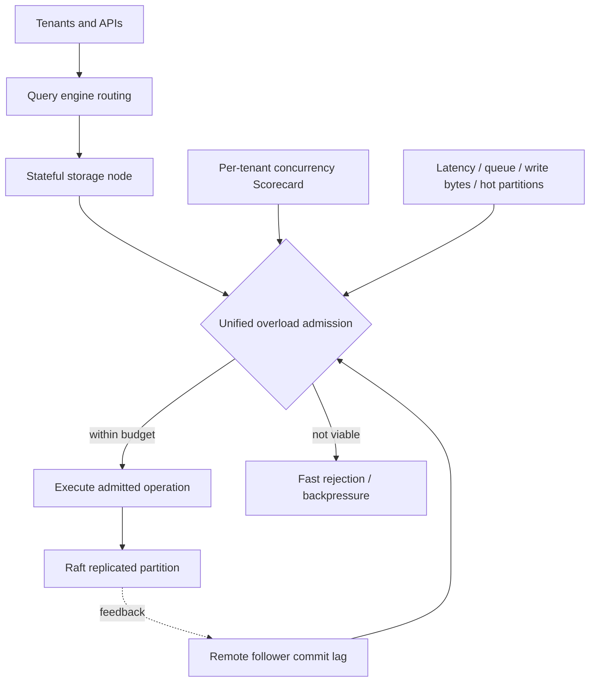

# Uber — Failed Static Quotas to Storage-Local Overload Control and Tenant Fairness

**Case ID:** `case.uber.cinnamon-database-overload-control` · **M9:** E16-05 #118 · **Status:** source-backed draft, independent review pending.  
**Primary U06:** Dhyanam Vaidya, Prathamesh Deshpande, Mike Ma et al., Uber Engineering, **2026-04-20**, [How Uber Conquered Database Overload](https://www.uber.com/us/en/blog/from-static-rate-limiting-to-intelligent-load-management/), sections **Quota-Based Rate Limiting in the Query Engine Layer**, **Identifying the Right Signal**, **Balancing Resilience and Fairness**, **Controlled Delay**, **Scorecard Engine**, **Regulators**, **The Unified Load Shedding Engine**, **The Payoff**, **Lessons Learned**. All measurements below company-reported, not independently reproduced.

## Why the first idea failed in production

Uber's distributed Docstore/Schemaless database services have stateless query engines which plan and route work and stateful storage nodes with shard leadership and Raft replication. A proposed per-caller quota layer in the **stateless query tier** assigned cost to queries from their return-byte count and relied on Redis to share quotas. A full scan returning a single row cost the same as a point lookup; quotas remained static while workload skew and hotspots evolved. The Redis round trip added a reliability dependency, and query nodes did not possess current health signals for all storage partitions. The authors report that this approach **did not hold up in production**. Its failure was about **placement and measurability of resource pressure**, not a universal indictment of rate limiting.

## Revised boundary: storage-local and multi-signal

The team moved protection into the stateful engine with three complementary mechanisms. **CoDel** initially considered request sojourn time in queues separated by read, write and slow jobs; **Scorecard** provided tenant-specific concurrency fairness even without systemwide overload; **regulators** protected against unusual write-byte volume, hot partition keys, memory and goroutine pressure. Static delay and simple queue policies still caused inappropriate rejection of high-priority traffic or required manual tuning. The later **Cinnamon** controller incorporated PID feedback and pluggable local/remote signals, including follower commit lag, with priority-aware decisions. [U06, named sections].

**Text alternative:** client requests flow through query routing to stateful storage. The storage-local admission layer uses tenant fairness, local resource signals and remote replica lag to execute viable work or shed low-priority work promptly. This is an original teaching schematic, not Uber's diagram.

## Negative and positive results with denominators

| Finding | Original observation | Non-transferable condition |
|---|---|---|
| Original quota design | Redis hop, static quotas, full-scan price indistinguishable from lookup | Query-node layer lacked direct partition resource signals |
| Early CoDel | Avoided runaway queues; overly static timeouts shed important traffic | Priority/QPS mix and queue deadlines matter |
| Scorecard | Per-tenant fairness during normal operation and stress | Doesn't independently detect every hot key or large write payload |
| Cinnamon throughput under overload | **~3,000 → ~5,400 QPS (80% higher)** | Specific comparison to prior token-bucket-style limiter, not a guarantee for arbitrary DB |
| Upsert p99 under overload | **~3.1s → ~1.0s (~70% lower)** | Publisher's targeted benchmark/incident context |
| Resource under overload | Peak goroutines **~150k → ~10k**, heap **5–6 GB spikes → ~1 GB** | **GB is the publisher's unit**, not independently established GiB; reported peaks and aggregates differ, not a universal memory footprint |

The publisher additionally labels heap improvement **~60% lower**, although its stated **5–6 GB spikes versus 1 GB maximum** do not specify an aggregation denominator that reproduces this percentage. Preserve both figures **without silently recalculating** the company's result; see [the source check](../../authoring/cases/M9_NUMERIC_SOURCE_RECHECK_WAVE09.md).

The source's 'Lessons Learned' recommends priority-aware admission, early rejection when deadlines are already lost, storage-local signals and observability. **Do not infer** that static rate limits are always wrong: they can complement the dynamic controller for API contract policing, and cannot replace workload capacity measurements.

## Model the protection boundaries separately

The [2026 first-party account](https://www.uber.com/us/en/blog/from-static-rate-limiting-to-intelligent-load-management/) (U06) separates three jobs that are easy to conflate: **systemwide overload shedding**, **per-tenant fairness in healthy periods**, and **specific resource protection** for hot keys, large writes, memory or goroutine budgets. Its architecture evolved from fixed query-layer quotas through CoDel queues/Scorecard and regulators to a priority-aware Cinnamon controller using feedback from storage-local and remote replica conditions.

| Control | What it regulates | Why another controller cannot simply replace it |
|---|---|---|
| Request-level quota | Caller entitlement or contractual request ceiling | It cannot infer stateful disk/replica health from byte-size of the response |
| Tenant Scorecard | Inflight concurrency by tenant | A low-QPS, high-byte write or hot partition can still overload local resources |
| Resource regulator | Specific write-byte, hot-key, memory or goroutine pressure | Without priority policy it may drop a critical request as early as an optional job |
| Feedback-based Cinnamon admission | Current workload delay/error/replica-lag against priority | Feedback may oscillate, be delayed, or reflect conditions different from the request cohort |
| Client retry/deadline | Limits useful time and retry amplification outside the store | Admission alone cannot stop irresponsible client retry storms |

The table's explanatory contraindications are Tycho reasoning; U06 describes these mechanisms and some historic missteps, not an externally standardized load-management specification.

## Admission must optimize useful completed work, not accepted requests

A retryable request with a deadline shorter than predicted queue wait can create harm if accepted: its caller has already abandoned it by the time the store consumes CPU, memory and locks. A controller should count **completed useful operations** and successful critical classes, not just ingress QPS or aggregate reject rate. It should also expose why individual requests were rejected, and whether old low-priority work made critical traffic miss deadlines.

**Synthetic comparison test:** replay equivalent read, write, scan, long-lived background and hot-key traffic at a fixed offered load. Use priority classes with immutable test metadata, inject follower replication lag and a burst of large writes, and run the old fixed limiter versus the candidate controller independently. Compare successful results by class, p95/p99, queue age, retries, admission rate, heap/goroutines, replica lag and fairness (per-tenant share and starvation). A controller that increases total throughput while starving an essential tenant **fails** the requirement.

The publisher reports **5,400 vs 3,000 QPS** and **1.0s vs 3.1s upsert p99** in its overload comparison, plus large goroutine/heap reductions. Its stated heap reduction percentage and peak examples use different aggregations and cannot be mathematically normalized from the public post alone. These are **reported test observations**, not guarantees for another store. [U06, **The Payoff**].

## Controller failure and safe rollback

PID regulation is only as good as its observations, sampling rate and bounded output. A delayed follower-lag signal could cause over-admission into a replica that cannot commit; stale error telemetry can drive oscillation. Another test is a false-priority producer attempting to mark noncritical work as critical. Protect the policy at a trusted ingress boundary, not by trusting a user-supplied header.

A reversible rollout can initially run Cinnamon in **decision-only shadow mode**, recording hypothetical shed reasons. Canary actual admission on a small tenant/partition cohort while leaving fixed baseline protection available. Raise scope only after observing priority fairness, hot-key isolation, replication safety and recovery from overload. Keep a kill switch, rate-of-change cap on control output, a safe low-confidence behavior when remote signals fail, and operator-readable reason codes.

**Stop conditions:** controller swings repeatedly between rejection and flooding; critical requests are shed while optional work survives; a lagging follower becomes an invisible bottleneck; telemetry outage produces unlimited admission; or an emergency fallback requires unauthorized priority override. Those are **original Tycho design requirements**, not assertions about undocumented implementation details.

## Alternative architectures and applicability

For a small stateless API, a fixed bounded concurrency limit and per-caller quota may already suffice. For a stateful multi-tenant store, a storage-local regulator can prevent one hot partition from crippling others, while an authenticated priority policy can preserve high-value operations. The key questions are where resource pressure is actually observed, whether the service can distinguish traffic importance, and whether rejection is cheaper than futile queued execution. Without those measurements and ownership, the correct recommendation is **insufficient evidence**, not immediate adoption of a sophisticated feedback controller.

## Three kinds of admission are not interchangeable

The [April 20, 2026 first-party report](https://www.uber.com/us/en/blog/from-static-rate-limiting-to-intelligent-load-management/) (U06, **Balancing Resilience and Fairness**, **Scorecard Engine**, **Regulators**) distinguishes **global overload**, **one noisy tenant** and **one hot resource**. A system-wide PID shedder can preserve the total storage process yet allow a single tenant to monopolize admitted slots; per-tenant Scorecard enforces concurrency limits even when aggregate capacity is healthy; regulators detect high write bytes, one hot partition, low process memory or excessive goroutine count that aggregate QPS may not reveal.

The first quota experiment failed partly because **output bytes were a bad proxy for consumed work**: a table scan returning one row looked as cheap as a one-row point lookup. Moving the admission decision closer to the stateful storage executor exposed more relevant load signals, while avoiding Redis network dependency on every request. This placement is the historical architectural decision, not an instruction to remove all edge/API contractual rate limits.

## The load-manager iterations and actual negative outcomes

| Source-described version | Admission/queue design | Observed failure that motivated the next stage |
|---|---|---|
| Query-layer fixed quotas | Redis-backed per-user accounting, request cost from returned bytes | Expensive scans underpriced; static quotas stale; no per-partition health view |
| Storage CoDel + Scorecard | Separate read/write/slow queues, delay-based rejection, per-tenant fairness | Queue thresholds were **static and priority-agnostic**; expired work piled up; clients retried together and high-priority requests were dropped |
| Priority-aware Cinnamon | Priority ranks **t0–t5**, with online-important **t1**; simplify to read/write queues; dynamic timeout and inflight limits | Storage-local health alone cannot detect a healthy leader whose followers are lagging |
| Unified Cinnamon + regulators | PID control with external follower **commit-index lag** and pluggable resource signals in one decision path | Requires robust signal freshness, priority governance and feedback stability; detailed operator thresholds are not public |

**Evidence:** U06, **Controlled Delay**, **Limitations**, **Cinnamon Replaces CoDel**, **Areas for Improvement**, **The Unified Load Shedding Engine**. The exact total-cost and all-cohort incident counts are not published.

One subtle protocol issue matters: the source reports using **adaptive FIFO-to-LIFO behavior under queue pressure** in early CoDel, reducing wasted work on aged requests. This can be appropriate for **new independent lookups**, but a datastore performing ordered writes or transactions cannot blindly reorder conflicting mutations. Tycho's separate consistency test must establish that any reordering is confined to admissible independent tasks. This is a synthetic contraindication, not a documented Uber ordering incident.

## The actual feedback loop and non-equivalent performance figures

Cinnamon uses request priority and an adaptive time budget based on observed **p90 latency** plus a **PID-controlled inflight limit**; later it accepts remote follower-lag signals. The first-party report compares a specific overloaded test/reference condition: average throughput **~3,000 → ~5,400 QPS**, upsert p99 **~3.1 → ~1.0 seconds**, peak goroutines **150,000 → 10,000**, peak heap **5–6 GB → about 1 GB**. The company's own headline “~60% lower heap” is not exactly derivable from the separately quoted spike/max values; do not silently overwrite its percentage with an arithmetic reduction from unlike denominators. These are **publisher-scoped results**, not arbitrary QPS capacity predictions or independent randomized trials. [U06, **The Payoff**].

**Control-loop hazard (Tycho analysis):** a PID controller with stale metrics, delayed actions, badly chosen gains or priority override can oscillate and shed the wrong cohort. Therefore measuring lower rejected-request counts is not enough: simultaneously record successful **goodput by priority**, queue wait, fraction already past client deadline, leader/follower lag, retries, memory and per-tenant fairness.

## Synthetic reversible rollout and refusal contract

Start with **observation only** at the storage executor, logging which requests would be rejected under each independently checked constraint. Verify tenant and priority identity propagation from the query tier; reject untrusted caller claims of tier-zero importance. Bring Scorecard online with conservative per-tenant limits without simultaneously enabling dynamic global load shedding. Canary priority-aware queues by partition and traffic cohort, then add the PID control loop behind a reversible switch with guardrails on minimum critical-service capacity and maximum retry burst. Test a hot partition, a slow follower, an oversized write from low-QPS caller, a retry storm and a dropped telemetry feed.

**Stop/rollback triggers:** priority spoofing or unknown tenant identity; healthy traffic starved by stale external signals; rising p99 despite fewer admitted tasks; follower lag propagating beyond safety threshold; PID oscillation or prolonged shed state; or an inability to restore the old control mode without unbounded retry pressure. With no measured workload mix or protected operation priorities, return **insufficient evidence**, not “deploy Cinnamon because it improved Uber's QPS.”

## Applicability, migration and rollback ADR for another organization

**Synthetic context:** multitenant ledger serving unpredictable scans and writes, high retry amplification and a few tenant hot keys. Proposed architecture decision: instrument per-key hotness, concurrency, queue wait, follower lag and request priority before building a pluggable controller; continue existing budget limiting during canary to avoid unlimited client flood.

Transition: (1) establish independent SLOs for critical and low-priority operations; (2) add diagnostic-only admission shadow decisions; (3) stage one partition/tenant canary; (4) test slow follower, hot key and oversized payload failures; (5) compare goodput and successful transactions at matched load; (6) retain reversible old limiter until fairness and recovery tests pass. These are **Tycho-proposed controls**, not a claim that Uber rolled out each step this way.

**Counterexample:** if storage is fully managed and cannot expose per-partition load/commit lag, a storage-local controller may be impossible. An API-edge quota protecting billing or contractual usage may remain useful but does not replace overload-aware downstream limits. No request must be accepted merely because it fits an API quota.

**Acceptance gaps:** original code/revision, full workload benchmark replication, independent reviewer signoff and cross-company benchmarking remain unknown. Avoid using company data to assert a global priority formula; re-run tests in an adopter's own environment.
