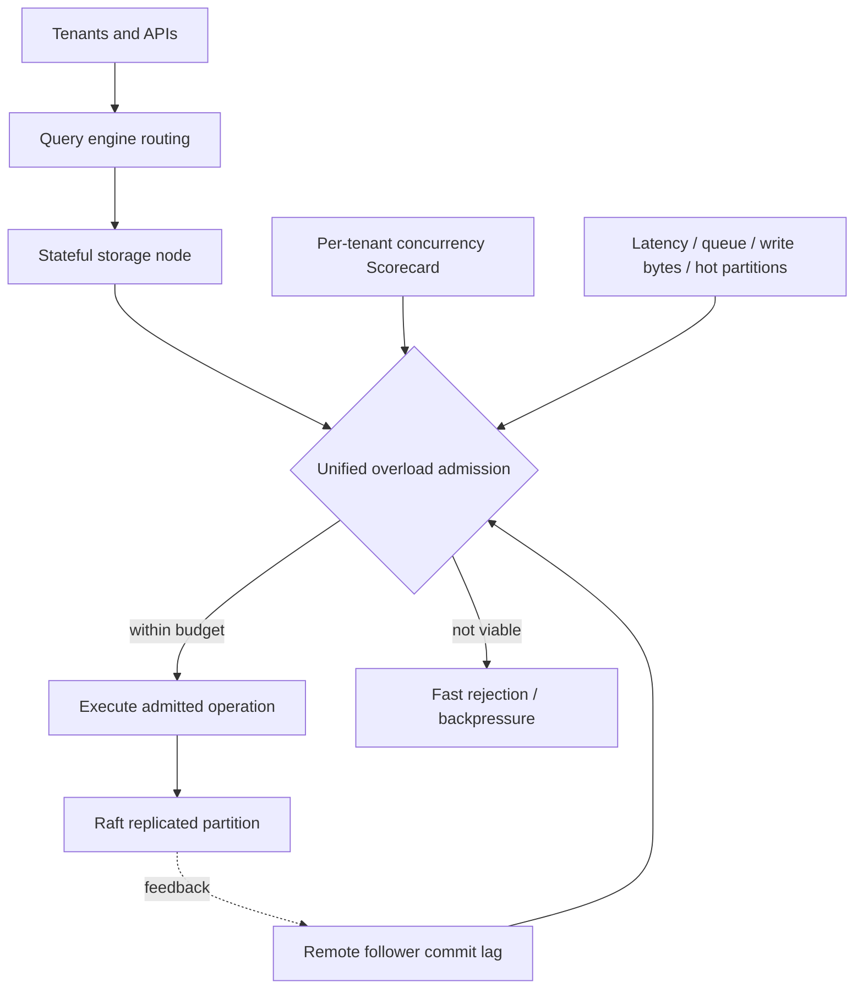

# Uber — Failed Static Quotas to Storage-Local Overload Control and Tenant Fairness

**Case ID:** `case.uber.cinnamon-database-overload-control` · **M9:** E16-05 #118 · **Status:** source-backed draft, independent review pending.  
**Primary U06:** Dhyanam Vaidya, Prathamesh Deshpande, Mike Ma et al., Uber Engineering, **2026-04-20**, [How Uber Conquered Database Overload](https://www.uber.com/us/en/blog/from-static-rate-limiting-to-intelligent-load-management/), sections **Quota-Based Rate Limiting in the Query Engine Layer**, **Identifying the Right Signal**, **Balancing Resilience and Fairness**, **Controlled Delay**, **Scorecard Engine**, **Regulators**, **The Unified Load Shedding Engine**, **The Payoff**, **Lessons Learned**. All measurements below company-reported, not independently reproduced.

## Why the first idea failed in production

Uber's distributed Docstore/Schemaless database services have stateless query engines which plan and route work and stateful storage nodes with shard leadership and Raft replication. A proposed per-caller quota layer in the **stateless query tier** assigned cost to queries from their return-byte count and relied on Redis to share quotas. A full scan returning a single row cost the same as a point lookup; quotas remained static while workload skew and hotspots evolved. The Redis round trip added a reliability dependency, and query nodes did not possess current health signals for all storage partitions. The authors report that this approach **did not hold up in production**. Its failure was about **placement and measurability of resource pressure**, not a universal indictment of rate limiting.

## Revised boundary: storage-local and multi-signal

The team moved protection into the stateful engine with three complementary mechanisms. **CoDel** initially considered request sojourn time in queues separated by read, write and slow jobs; **Scorecard** provided tenant-specific concurrency fairness even without systemwide overload; **regulators** protected against unusual write-byte volume, hot partition keys, memory and goroutine pressure. Static delay and simple queue policies still caused inappropriate rejection of high-priority traffic or required manual tuning. The later **Cinnamon** controller incorporated PID feedback and pluggable local/remote signals, including follower commit lag, with priority-aware decisions. [U06, named sections].

**Text alternative:** client requests flow through query routing to stateful storage. The storage-local admission layer uses tenant fairness, local resource signals and remote replica lag to execute viable work or shed low-priority work promptly. This is an original teaching schematic, not Uber's diagram.

## Negative and positive results with denominators

| Finding | Original observation | Non-transferable condition |
|---|---|---|
| Original quota design | Redis hop, static quotas, full-scan price indistinguishable from lookup | Query-node layer lacked direct partition resource signals |
| Early CoDel | Avoided runaway queues; overly static timeouts shed important traffic | Priority/QPS mix and queue deadlines matter |
| Scorecard | Per-tenant fairness during normal operation and stress | Doesn't independently detect every hot key or large write payload |
| Cinnamon throughput under overload | **~3,000 → ~5,400 QPS (80% higher)** | Specific comparison to prior token-bucket-style limiter, not a guarantee for arbitrary DB |
| Upsert p99 under overload | **~3.1s → ~1.0s (~70% lower)** | Publisher's targeted benchmark/incident context |
| Resource under overload | Peak goroutines **~150k → ~10k**, heap **5–6 GiB spikes → ~1 GiB** | Source-reported conditions; not a universal memory footprint |

The source's 'Lessons Learned' recommends priority-aware admission, early rejection when deadlines are already lost, storage-local signals and observability. **Do not infer** that static rate limits are always wrong: they can complement the dynamic controller for API contract policing, and cannot replace workload capacity measurements.

## Applicability, migration and rollback ADR for another organization

**Synthetic context:** multitenant ledger serving unpredictable scans and writes, high retry amplification and a few tenant hot keys. Proposed architecture decision: instrument per-key hotness, concurrency, queue wait, follower lag and request priority before building a pluggable controller; continue existing budget limiting during canary to avoid unlimited client flood.

Transition: (1) establish independent SLOs for critical and low-priority operations; (2) add diagnostic-only admission shadow decisions; (3) stage one partition/tenant canary; (4) test slow follower, hot key and oversized payload failures; (5) compare goodput and successful transactions at matched load; (6) retain reversible old limiter until fairness and recovery tests pass. These are **Tycho-proposed controls**, not a claim that Uber rolled out each step this way.

**Counterexample:** if storage is fully managed and cannot expose per-partition load/commit lag, a storage-local controller may be impossible. An API-edge quota protecting billing or contractual usage may remain useful but does not replace overload-aware downstream limits. No request must be accepted merely because it fits an API quota.

**Acceptance gaps:** original code/revision, full workload benchmark replication, independent reviewer signoff and cross-company benchmarking remain unknown. Avoid using company data to assert a global priority formula; re-run tests in an adopter's own environment.
