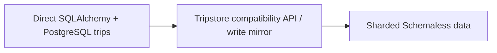

# Uber — Project Mezzanine: moving trip data behind a compatibility seam

**Case ID:** `case.uber.mezzanine-trip-data` | **Milestone:** M9 E16-05 #118 | **Status:** evidence-bound original draft; technical review pending.  
**Source:** U02 — [original company engineering article](https://www.uber.com/us/en/blog/mezzanine-codebase-data-migration/) (historical Uber engineering account); primary evidence: From SQLAlchemy to Schemaless; Changing trip ids; Backfilling; Mirrored Writes; Validation. Source reuse: original link and attributable paraphrase only; no copied diagrams or pages.

## Situation — the legacy architecture and constraint

Trip identifiers and SQLAlchemy queries tied large parts of Uber's backend to PostgreSQL and implicit relational relationships. Extracting the storage engine without first changing those application assumptions would expose callers to incompatible query shapes and identifier semantics.

## Chosen architectural change

A tripstore library presented a narrower compatible interface and could dispatch to PostgreSQL or Uber's Schemaless store. The project converted sequence identifiers to UUIDs, remodeled trip data, backfilled prior data, mirrored writes, rewrote queries and validated behavior. Schemaless intentionally did not support all relational joins.

**Diagram alternative:** Direct SQLAlchemy + PostgreSQL trips evolved through Tripstore compatibility API / write mirror toward Sharded Schemaless data. This is a deliberately simplified, original decision/transition sketch; it is not the original company's infrastructure map.

## Migration and validation

The source enumerates explicit milestones: change trip IDs, remodel columns, backfill, mirror writes, rewrite queries, and validate repeatedly. In addition, a new implementation should define consistency under write races, idempotent retries and observed counters before switching reads; those latter controls are Tycho analytical gates rather than a blanket claim about Uber's exact implementation.

Suggested decision record for a different organization:

| Verification gate | Evidence needed before accepting change | Rollback or hold |
|---|---|---|
| Interface and ownership | Inventory of dependent clients, schema/contract/API compatibility and authorized owner | Preserve existing public contract |
| Representative workload | Actual traffic mix, failure modes and capacity baseline; no invented p99 | Roll back the cohort if its own SLO worsens |
| Correctness | Domain-specific business invariants, dual-state reconciliation if used, idempotent replays | Keep authoritative old representation until proven |
| Operability | Error budgets, runbooks, trace continuity, incident ownership and cost | Stop rollout without a clear incident response owner |

The gates in this table are Tycho's **analytical adaptation**, not an assertion that the source's engineers measured these same four things.

## Negative evidence, costs and alternatives

Dual writes can diverge; removing JOIN capability can force surprising API changes. A backfill that succeeds on row counts but mishandles key relationships is not correct. The resulting system remains subject to shard and indexing operational costs.

**Alternatives:** retain/tune the legacy architecture if capacity and correctness already meet requirements; incrementally constrain its internal dependency graph; adopt the described transition only if its own reported bottleneck exists; otherwise conclude **insufficient evidence** rather than copying the brand's solution. These are synthetic architecture alternatives and must not be presented as alternatives the company explicitly evaluated unless the source said so.

## Observed results and temporal validity

Uber reports a completed trip-data store migration and interface-seam pattern. The published narrative is not a reproducible, environment-independent proof of lower database costs or universally safe dual writes.

This is a company-reported historical result, not an independently reproduced benchmark. Precise current topology, total engineering effort, p99 and comparative cost must be regarded as **unknown** unless the named primary article supplies them. Do not extrapolate a dated deployment to October 2026 current practice.

## A dated 2014 migration with a real launch constraint

René Schmidt's [July 28, 2015 first-party retrospective](https://www.uber.com/us/en/blog/mezzanine-codebase-data-migration/) (U02, **Background**, **The New Trip Store**) describes **2014** conditions, not Uber's 2020 DOMA structure. Trip volume was growing around **20% per month**. A large shared PostgreSQL store still served many near-100-service backend components; trip rows consumed the greatest storage/IOPS share, and adding an index/column to the largest table could require downtime. Uber projected the store would exhaust capacity during the year and set a high-traffic **October 31** deadline.

The target tripstore had published requirements: backup/replication, online capacity/index expansion, high write availability, secondary lookups and stable operator behavior. The team rejected several externally evaluated NoSQL products **for its own maturity/operational-experience reasons**, then built a sharded **Schemaless** API backed by MySQL. This is *not* an assertion that PostgreSQL generally cannot scale or that building a new database is usually the right choice. [U02, **The New Trip Store**].

## The data semantics made the cutover tractable

The target organized JSON-style cell data by **trip UUID**, column name and optional timestamp. Its fixed initial logical shard count was typically **4,096**, with shards movable among MySQL hosts for online capacity balancing. The model was **append-only**: a cell was not changed after being written. That property enabled application-defined idempotent and commutative operations for retries and replay. When a target shard was temporarily unavailable, writes could enter a **pending table on another healthy MySQL node** and be replayed later. Secondary indexes were themselves sharded and could be versioned/backfilled before an alias switch. [U02, **The New Trip Store**].

These design decisions require explicit **domain semantics**. A cancellation, price recalculation or correction must be represented as new versioned facts if the record cannot be updated in place. Appending data is not equivalent to a full relational ACID transaction across arbitrary tables; idempotency and ordering constraints must be demonstrated for each effect. The source does not publish a generalized formal proof covering every downstream user/business projection.

## Six observed code and data migration milestones

| Migration stage in 2014 | What the team changed | Specific compatibility/failure risk |
|---|---|---|
| Global identifier refactoring | Auto-increment PostgreSQL trip IDs → UUIDs | Hidden references in SQLAlchemy relationships, API payloads and secondary keys |
| Explicit data layout | Convert trips and linked columns to Schemaless cell model | Loss of implicit joins and relational constraints |
| Historical backfill | Transfer existing trip records | Old/new identity mapping, incomplete record versions and repeated backfills |
| Mirrored writes | Writes maintained PostgreSQL **and** Schemaless | Divergent retries or one unavailable target |
| Query migration | Replace **hundreds** of direct/indirect ORM queries with a restricted tripstore query API | Missing joins, wrong projection order or incompatible filters |
| Read validation and switch | Replay queries on Schemaless and compare results while PostgreSQL served callers | Comparison sampling can miss rare operations or ordering differences |

**Observed API seam:** `lib/tripstore` initially implemented the *new restricted API* over **old PostgreSQL**, then used a switch to route the same operation to Schemaless. That is a strong ordering decision: migrate consumers to one stable abstraction **before** making their storage source change. The source explicitly says mirrored writes and shadow-query comparisons began early and progressed alongside backfill and code changes; validation was **sampled probabilistically** to limit additional load on the already pressured PostgreSQL system. [U02, **From SQLAlchemy to Schemaless**].

## Measured historical results and negative evidence

The article reports that the initial storage system went from idea to production in **about five months**, the final focused migration wave spanned **six weeks**, and the final routing switch happened roughly **one month before Halloween 2014**. It describes a non-event cutover, then a further capacity doubling without downtime; these are **company retrospective statements**, not an audited service SLO, a universal five-month delivery forecast or proof of zero latent data defects. Hundreds of millions of rows, **more than 100 services**, and many engineers are original migration *scope* figures, not parallel read throughput benchmarks.

**Failure and cost:** SQLAlchemy joins could not be carried into the restricted API; identifier and query rewrites were substantial; data-model revisions required repeated backfills; the column model moved some query/index cost directly to application owners. Parallel backfill and shadow reads themselves added load to an already IOPS-bound PostgreSQL instance. The reporting does not provide a full post-cutover p99, exact changed-row count, error distribution, total project cost or recovery-time objective.

## Independent transfer with safe rollback (Tycho synthetic)

A hypothetical high-growth transaction system can emulate the ordering **identity → compatible API facade on old store → explicit new model → dual write/backfill → sampled old/new query parity → canary → authority switch**. Keep the incumbent writable until outstanding consumers and delayed retries are fully enumerated. Reconcile UUID mappings and secondary indexes under the same snapshot; run negative-path tests for unavailable shards, duplicate append/replay and missing compound relational reads. Sample enough pathological consumer queries before making a global switch.

**Stop conditions:** unsupported query semantics, secondary index not backfilled, mirrored write divergence, pending-write backlog without bounded recovery, old client misinterpreting UUIDs, or inability to route reads back without losing new-only committed facts. Choosing append-only or UUIDs does not by itself guarantee zero data loss. Compare the [Stripe online-subscription migration](stripe-online-subscriptions-migration.md) as a contrasting mutable data-authority strategy and the [data-migration decision guide](decisions/data-migration-correctness.md) for scenario selection.

## The 2014 requirements: migrate semantics before storage

The [July 28, 2015 first-party retrospective](https://www.uber.com/us/en/blog/mezzanine-codebase-data-migration/) (U02, **Background**, **The New Trip Store**) dates the project to **2014**, with publisher-reported trip growth around **20% monthly** at the time. A single PostgreSQL instance still carried the largest and fastest-growing trip dataset; a mature network of services did not by itself remove this storage concentration. The stated target required scalable IOPS/capacity, backup and multi-datacenter replication, online index changes and high write availability, even when short-term read availability had to degrade.

Schemaless retained **MySQL underneath a sharded append-only column model**; it was not the removal of SQL storage engines from the company. The original report describes a fixed initial set of typically **4,096 logical shards**, movable between physical MySQL hosts, plus secondary-index versions and write buffering to an available server when the responsible shard was temporarily unavailable. Those implementation details carry a crucial semantic precondition: record updates must be representable as append-only, idempotent/commutative cell writes. A legacy transactional update that depends on an atomic join cannot silently be assumed equivalent.

## A compatibility API before any authority switch

Uber reports hundreds of SQLAlchemy queries, including ORM relationship traversal, that depended on integer trip IDs and relational joins. A new `lib/tripstore` interface exposed the restricted query shape needed by Schemaless while initially supporting **PostgreSQL as an implementation**. This meant query callers could be migrated to a new *interface contract* independently of the underlying persistence switch. Mirrored writes to Schemaless and sampled background query comparison then checked whether the candidate store produced usable results before serving it. [U02, **From SQLAlchemy to Schemaless**].

| Transition | Reported responsibility | Risk if the step is skipped |
|---|---|---|
| Integer ID → UUID | Global caller/reference migration | Old and new systems identify different logical trips |
| Schema/query surface | Restrict joins and model column layout | Callers unknowingly depend on unsupported relational operations |
| Stable library interface | Implement Schemaless-compatible API over old PostgreSQL | One incompatible storage cutover also forces all client releases |
| Backfill + mirror | Populate old history and follow current writes | Candidate target is missing historical or most recent state |
| Sampled read comparison | Reissue queries under bounded extra source load | New store appears correct from row counts while query values diverge |
| Flip read authority | Controlled release after broad validation | A single nonreversible migration couples all teams to the new store |

The publisher says the final intense migration phase took **about six weeks**, with the first successful switch in **late September 2014**; it does not provide a controlled p99 or an independently audited zero-error rate. A further reported doubling of trip-store capacity without downtime is a later outcome claim, not general database throughput evidence.

## Failure oracles for a different store

For a synthetic high-volume trip lifecycle, compare create, edit, cancel, recompute, retry, arrival-order change and offline/batch reads under exactly specified identity and time-window rules. An append-only model needs explicit materialization logic: what wins when multiple cells represent distinct revisions, how deletions or corrections work, and whether a replay has new side effects. The source's append-only assertions cannot serve as a proof for unrelated mutable business models.

Test a missing index replica, buffered writes awaiting replay, duplicate events, a stale secondary index alias, incompatible joins and a partially completed backfill. Keep the old authority available until replay and query semantics are reconciled; **do not** treat “all rows copied” as sufficient for a read cutover. When the new query API cannot preserve a required relational operation, stop and redesign the domain contract rather than implement a surprising approximate join.

## Alternative architecture and stop conditions

Staying on a PostgreSQL-based design with partitioning and targeted indexing may be less risky if current scaling margins, migration ownership and online schema-change needs can be met. A distributed append-only model is justified by measured write/storage scaling and predictable domain semantics, not simply because the original application now has many services. The historical engineering team evaluated alternatives, but this is Tycho's **independent option analysis**.

**Refuse a cutover** when UUID mapping is incomplete, old clients still issue direct ORM queries, buffered writes cannot be replayed idempotently, secondary-index and current-data views differ, or business invariants require atomic relations absent in the target API. Retain the historical **2014/2015** time boundary; no claim about 2026 Uber data-store state follows from U02.

## Applicability to legacy modernization

Prefer API strangling and explicit change of identifiers when a storage migration crosses many teams. If the original relational store still meets capacity and operational requirements, a new distributed engine may not justify this migration. Before a roadmap is approved, require a baseline with data ownership and blast radius, a comparison to a smaller intervention, and measurable acceptance gates. An agent should retrieve this case as **evidence for conditions and counterconditions**, not as a universal preferred architecture.

**Provenance:** [U02 primary](https://www.uber.com/us/en/blog/mezzanine-codebase-data-migration/), sections From SQLAlchemy to Schemaless; Changing trip ids; Backfilling; Mirrored Writes; Validation. Cross-case comparisons must retain the original company's architecture and historical observation window. **Case review:** not yet independently approved under #121.
