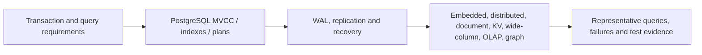

# Database design, storage engines and recovery

> Status: independent-source technical draft chapters, including distinct V05/C01 and V05/C03 owners for [Issue #83](https://github.com/rouslanbaranov/tycho/issues/83), not complete coverage of all databases or a tested operational deployment. Example queries, failure cases and architecture diagrams are fictional and original.

## Purpose and mission

Choose data architecture from business invariants, query access paths, concurrency and durability requirements, not database labels or registered-user counts. Distinguish authoritative transactional state, replica state, event history and derived analytical or graph views.

## Reading route

Text alternative: define actual transaction and query requirements before exploring PostgreSQL's visibility/planner mechanisms, its persistence/replica semantics and specialized engine alternatives. A migration decision still requires workload and recovery evidence.

## Canonical researched pages

| Reader question | Page | Primary evidence |
|---|---|---|
| Which relational identities, constraints and isolation guarantees preserve business invariants? | [Relational modeling and transaction isolation](../volumes/v05/c01/relational-modeling-and-transaction-isolation.md) | V05/C01, PostgreSQL 17 §§5,13, original concurrency counterexample; not executed |
| What governs index selection, planner statistics and estimated-versus-actual query behavior? | [PostgreSQL indexes, statistics and query plans](../volumes/v05/c03/postgresql-indexes-statistics-and-query-plans.md) | V05/C03, PostgreSQL 17 §§11,14, original benchmark/negative cases; no DB run |
| Where is the original combined PostgreSQL MVCC/index research? | [Combined MVCC and query-planning research](postgresql-mvcc-indexes-and-query-plans.md) | Retained historical evidence source pending claim-by-claim reconciliation; no longer sole chapter owner |
| What survives a crash/failover, and how do WAL, replicas and backups differ? | [PostgreSQL WAL, replication and recovery](../volumes/v05/c02/postgresql-wal-replication-and-recovery.md) | PostgreSQL 17 WAL, standby/logical replication and archive recovery |
| How are restorable backup chains, WAL gaps and business-level RPO/RTO proven? | [Backup, PITR and recovery drills](../volumes/v05/c07/backup-restore-pitr-and-recovery-drills.md) | PostgreSQL 17 §§25–26 and original recovery acceptance experiments; no restore performed |
| How can data identity, schema changes, backfill and retirement preserve historical meaning? | [Schema lifecycle and semantic migration](../volumes/v05/c06/schema-lifecycle-and-semantic-migration.md) | V05/C06; independently sourced original data transition draft; no migration executed |
| When are embedded SQL, distributed SQL/KV, document, wide-column, OLAP, graph and time-series storage good candidates? | [Storage model alternatives and workload fit](../volumes/v05/c04/storage-model-alternatives-and-workload-fit.md) | Public official SQLite, CockroachDB v24.3, FoundationDB 8.0, MongoDB, Cassandra 5.0, ClickHouse and Neo4j docs |

## Cross-domain ownership

- [Local isolation and distributed sagas](../volumes/v04/c03/transaction-isolation-and-sagas.md) owns correctness across service boundaries.
- [Transactional outbox and idempotency](../distributed/transactional-outbox-and-idempotency.md) owns asynchronous external event effects.
- [Performance and queueing](../volumes/v07/c01/queueing-littles-law.md) owns rate/concurrency mathematics.
- [Stateful stream processing and CDC](../volumes/v04/c08/stateful-stream-processing-and-cdc.md) owns continuous derived state and replay.
- [Rollout and recovery](../delivery/safe-rollout-and-recovery.md) owns application/schema migration acceptance.

## Open gaps

Measured workloads, DDL evolution with installed drivers, partition/sharding implementation, query planner/optimizer settings, executed backup/restore drills, geographically distributed failure tests and detailed specialized-engine internals require further bounded source/experiment work. This landing does not imply a complete volume or a working database service.
