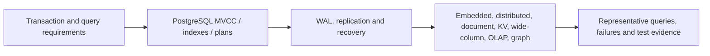

# Database design, storage engines and recovery

> Status: three bounded independent-source technical chapters for [Issue #83](https://github.com/rouslanbaranov/tycho/issues/83), not complete coverage of all databases or a tested operational deployment. Example queries, failure cases and architecture diagrams are fictional and original.

## Purpose and mission

Choose data architecture from business invariants, query access paths, concurrency and durability requirements, not database labels or registered-user counts. Distinguish authoritative transactional state, replica state, event history and derived analytical or graph views.

## Reading route

Text alternative: define actual transaction and query requirements before exploring PostgreSQL's visibility/planner mechanisms, its persistence/replica semantics and specialized engine alternatives. A migration decision still requires workload and recovery evidence.

## Canonical researched pages

| Reader question | Page | Primary evidence |
|---|---|---|
| How do PostgreSQL isolation, query plans and indexes affect correctness and workload? | [PostgreSQL MVCC, indexing and query planning](postgresql-mvcc-indexes-and-query-plans.md) | Version-pinned PostgreSQL 17 §§13, 14 and Indexes |
| What survives a crash/failover, and how do WAL, replicas and backups differ? | [PostgreSQL WAL, replication and recovery](postgresql-wal-replication-and-recovery.md) | PostgreSQL 17 WAL, standby/logical replication and archive recovery |
| When are embedded SQL, distributed SQL/KV, document, wide-column, OLAP, graph and time-series storage good candidates? | [Storage model alternatives and workload fit](storage-model-alternatives-and-workload-fit.md) | Public official SQLite, CockroachDB v24.3, FoundationDB 8.0, MongoDB, Cassandra 5.0, ClickHouse and Neo4j docs |

## Cross-domain ownership

- [Local isolation and distributed sagas](../distributed/transaction-isolation-and-sagas.md) owns correctness across service boundaries.
- [Transactional outbox and idempotency](../distributed/transactional-outbox-and-idempotency.md) owns asynchronous external event effects.
- [Performance and queueing](../performance/queueing-littles-law.md) owns rate/concurrency mathematics.
- [Stateful stream processing and CDC](../integration/stateful-stream-processing-and-cdc.md) owns continuous derived state and replay.
- [Rollout and recovery](../delivery/safe-rollout-and-recovery.md) owns application/schema migration acceptance.

## Open gaps

Measured workloads, DDL evolution with installed drivers, partition/sharding implementation, query planner/optimizer settings, automated backup drills, geographically distributed failure tests and detailed specialized-engine internals require further bounded source/experiment work. This landing does not imply a complete volume or a working database service.
