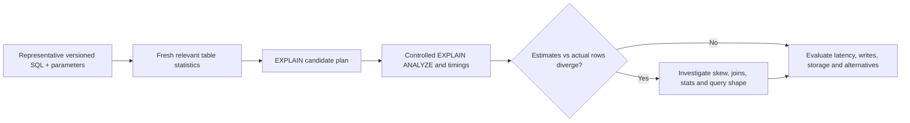

# PostgreSQL indexing, planner statistics and query access paths

> **Tycho independent manuscript — proposed V05/C03**, prepared 2026-10-19, using version-scoped PostgreSQL 17 official documentation. The query shapes and workload are entirely synthetic. No DB engine, EXPLAIN ANALYZE, DDL, benchmark or reviewer approval was executed. Earlier [combined MVCC/index research](postgresql-mvcc-indexes-and-query-plans.md) remains preserved for claim-by-claim reconciliation.

## Purpose and mission

Index choice is not a contest to add as many lookup structures as possible. A database planner chooses a route through data based on the SQL predicate, available physical access paths, estimated row counts and system cost assumptions. An index can make selective reads faster but adds storage, maintenance and write overhead.

The right question is **which representative query shapes and actual row distributions justify a particular access path, with acceptable write and operating cost?**

[PostgreSQL 17 Indexes, Chapter 11](https://www.postgresql.org/docs/17/indexes.html) documents B-tree, hash, GiST, SP-GiST, GIN and BRIN as supported access-method families. [PostgreSQL 17 EXPLAIN, §14.1](https://www.postgresql.org/docs/17/using-explain.html) distinguishes estimated planner *cost units* from actual time measured when executing EXPLAIN ANALYZE. This chapter owns access paths and planner evidence; [relational invariants and isolation](relational-modeling-and-transaction-isolation.md) owns correctness and transactional state authority.

## 1. Model the query and distribution first

Original fictional case: a community tool catalogue stores tools, bookings and descriptive tags. Representative requests:
- find one tool by stable identifier;
- list currently available devices for one site and date;
- search by term or tag;
- list most recently updated public descriptions;
- display all reservations for one member during a bounded period.

These workloads do not necessarily benefit from the **same index**. A primary-key lookup, range filter, full-text query and ordered pagination impose different access patterns and selectivity.

An index design question should include:
- columns/operator predicates and sort order;
- total table size, estimated rows after each filter and data skew;
- actual query frequency and latency objectives;
- write/update/delete rate, storage budget and vacuum/maintenance behavior;
- joined table cardinalities and relationships;
- whether partial, expression or covering indexes fit the data contract;
- index-build and version/deployment constraints.

“An index exists” is not sufficient: the planner may correctly choose a sequential scan when a large fraction of rows qualifies, or when the index path is more expensive under its assumptions.

## 2. Compare access methods by the supported operator/workload

| PostgreSQL index family | Typical supported purpose | Limitation to verify |
|---|---|---|
| B-tree | Equality, ordered comparison/range and matching ordered scan | Column order and selectivity affect multicolumn usefulness |
| Hash | Hashable equality | Narrower operator coverage; not universal substitute for B-tree |
| GiST | Extensible general search tree for configured operator classes | Behavior depends on datatype/operator implementation |
| SP-GiST | Space-partitioned search trees for supported operator classes | Not appropriate for arbitrary text/range operations |
| GIN | Inverted lookup for composite values such as lexemes, arrays or compatible JSONB operators | Update and posting-list maintenance, result semantics |
| BRIN | Compact block-range summaries for data whose physical locality correlates with values | May need rechecks and can be ineffective with random scatter |

The exact operator support is **not a property of the index name alone**. Consult PostgreSQL's [index types](https://www.postgresql.org/docs/17/indexes-types.html) and [built-in index methods](https://www.postgresql.org/docs/17/indextypes.html) for current version details. A GIN text search index is not a general-purpose semantic vector index.

## 3. Planner estimates are hypotheses about table contents

The [PostgreSQL 17 planner statistics, §14.2](https://www.postgresql.org/docs/17/planner-stats.html) explains row-count and distribution estimates and how PostgreSQL uses single-column and extended multivariate statistics. Correlated predicates can fool naive independence assumptions, producing badly estimated joins or scan plans.

**Synthetic illustration:** one location has 90% of devices tagged as “portable”, while other locations rarely use the tag. A planner relying on approximate independent selectivities may underestimate rows for a combined location-and-tag predicate. A suitable extended-statistics object (when supported for the chosen predicate) and ANALYZE may improve estimates; the design still requires an actual EXPLAIN and controlled workload test.

Planner estimates are *not* guaranteed measured data, and creating extended statistics does not itself gather representative samples until ANALYZE runs. Samples, data growth, skew and schema changes can invalidate prior assumptions.

## 4. EXPLAIN is not a user latency report

An estimated plan may show a sequential scan, index scan, bitmap heap scan, nested loop, merge join or hash join, depending on the query and cardinality. The estimated cost is in planner units; it should not be read as elapsed milliseconds.

EXPLAIN ANALYZE **executes the query** and records actual timings and row counts, with instrumentation overhead and the side effects of commands that are not read-only. Do not run EXPLAIN ANALYZE on an unsafe data-changing statement against uncontrolled state. Observe actual run context, caching, concurrent load, locks, network and client serialization separately.

**Text alternative:** reproducible query parameters and appropriate statistics shape the planner choice. Controlled execution compares actual row counts and times, then investigates misestimates and checks the end-to-end system cost. No plan was run for this page.

## 5. An index is a data-lifecycle change

Adding an index may change:
- write/update latency and WAL volume;
- storage and backup/restore size;
- vacuum/maintenance, cache pressure and bloat management;
- schema rollout constraints and lock exposure during index creation;
- planning time and scan choice;
- resource cost when multiple replicas or tenants repeat the same index.

[PostgreSQL 17 CREATE INDEX](https://www.postgresql.org/docs/17/sql-createindex.html) documents creation and concurrent build choices, including limitations and failure recovery. The choice to create an index concurrently reduces some write-blocking behavior but has **its own** constraints, phases and resource costs; it is not a free online operation.

For high write demand, an index improving one query by a few milliseconds can be a net loss if it increases every update or checkpoint cost. Keep the unit of value as correct completed user operations across the whole workload.

## 6. Original negative cases

| Proposed observation | Possible interpretation | What it does not establish |
|---|---|---|
| Index scan appears after creating B-tree | Planner found it cheaper for tested input | End-to-end p99 improvement under peak load |
| Estimate 10 rows; actual 100,000 | Bad cardinality/statistics assumption possible | That adding another index is the only fix |
| GIN reduces tag search scan work | Inverted lookup fits the predicate | Low write amplification or semantic relevance |
| BRIN index is tiny | Block summary has low storage overhead | It can prune enough unrelated blocks on shuffled data |
| Covering index enables index-only scan sometimes | Visibility map and query shape made it possible | Heap reads always disappear |
| More parallel workers lower one query time | Extra capacity is used | Overall system throughput improves with fixed resource budget |

These observations are **illustrative possibilities, not executed results**. A planner may change choices across parameter values, row distributions and PostgreSQL minor updates.

## 7. Controlled acceptance method

1. Fix PostgreSQL major/minor version, input SQL/parameters and schema.
2. Use an admitted synthetic dataset reflecting cardinality and correlated distributions; record construction method.
3. Freeze comparable CPU/memory/IO and concurrency envelopes.
4. Gather statistics, inspect estimated rows and safely run EXPLAIN ANALYZE for read-only queries.
5. Compare with and without candidate index under the same input and warm/cold state.
6. Include writes, index maintenance, lock waits, storage and backup cost in the result.
7. Capture client-level latency, successful/failed outcome denominators and p95/p99 on an appropriate sample.
8. Review negative edge cases (rare keys, extreme skew, empty results, retention/change).
9. Reject improvements based only on non-representative synthetic query selection.

The procedure is a design proposal. No steps were run or published as performance findings.

## 8. Public evidence ledger and limits

| Independently read PostgreSQL 17 source | Narrow claim supported | Unproven |
|---|---|---|
| [Chapter 11, Indexes](https://www.postgresql.org/docs/17/indexes.html) | Index/operator families, read-versus-write trade-offs | One index's measured benefit for the fictional workload |
| [§14.1, Using EXPLAIN](https://www.postgresql.org/docs/17/using-explain.html) | Plan nodes, cost units, actual rows/timing and instrumented query | Actual trace or tested query plan |
| [§14.2, Planner Statistics](https://www.postgresql.org/docs/17/planner-stats.html) | Per-column and extended selectivity statistics, ANALYZE | Evidence about this invented data distribution |
| [CREATE INDEX](https://www.postgresql.org/docs/17/sql-createindex.html) | Index creation/concurrency options and limitations | Safe migration or measured write impact |

Every query scenario, diagram and table was independently authored for education. No PostgreSQL engine, SQL statements, index DDL or independent technical acceptance were executed.

## Navigation

Proposed **V05/C03** in [draft outline](../PROPOSED-STRUCTURE.md), [data landing](README.md). Prerequisite [relational modeling and isolation](relational-modeling-and-transaction-isolation.md). Related [PostgreSQL WAL/recovery](postgresql-wal-replication-and-recovery.md), [query distribution/performance](../performance/workload-demand-and-arrival-models.md), [lexical full-text ranking](../search/lexical-indexing-bm25-and-sql-fts.md).
