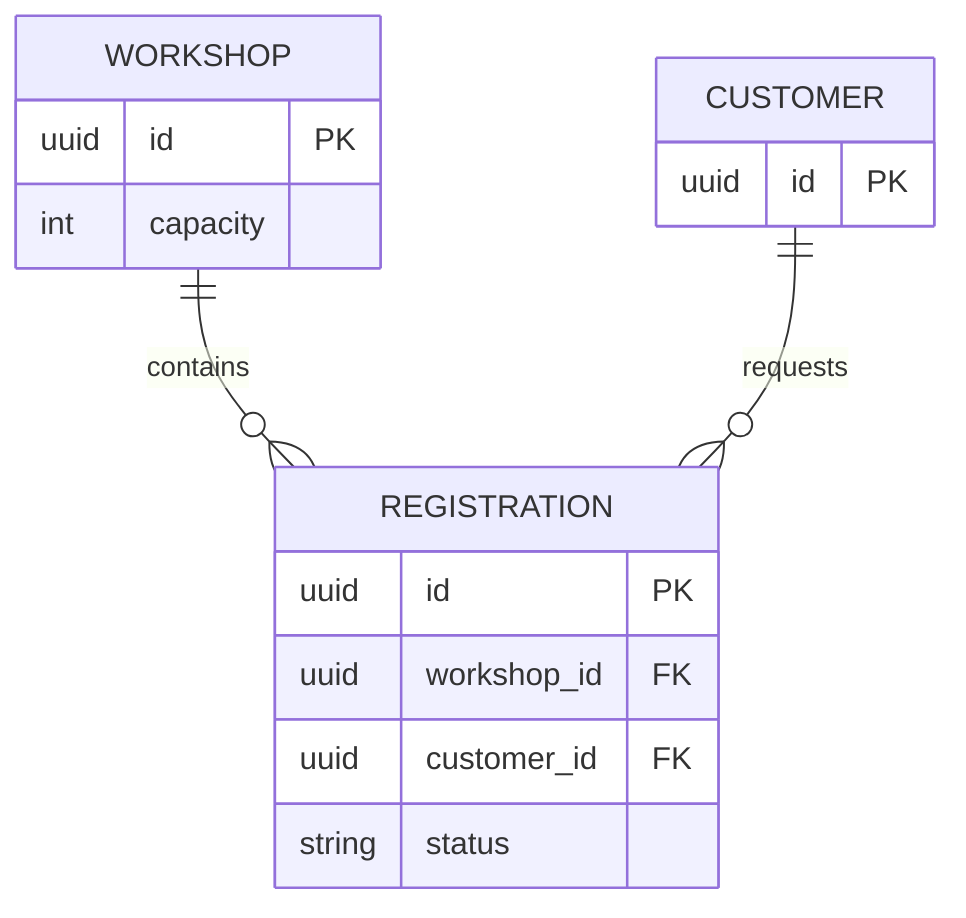
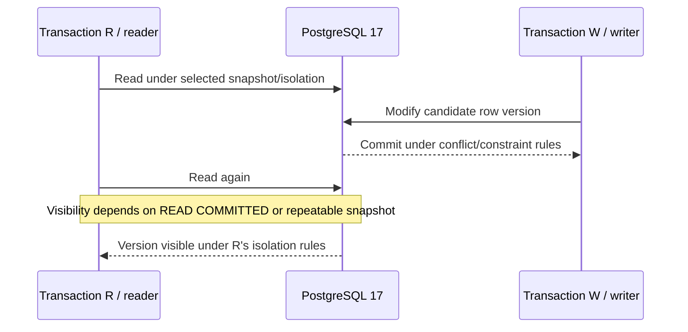
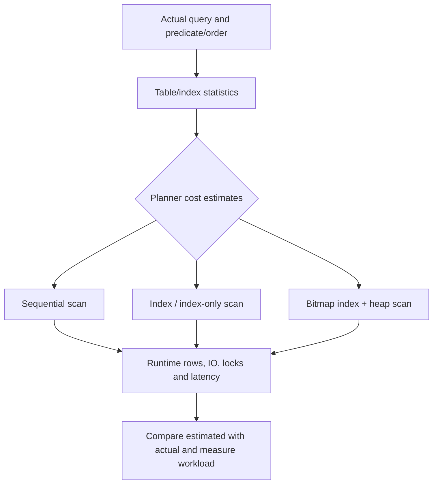

# PostgreSQL 17: MVCC, indexing, query plans and relational invariants

> Tycho technical chapter for [Issue #83](https://github.com/rouslanbaranov/tycho/issues/83). Research scope: **PostgreSQL 17**, official public versioned documentation, inspected 2026-10-19. Original diagrams and fictional examples. No SQL statements were executed, no query benchmark was collected and no independent database expert has reviewed the chapter.

## Purpose and mission

A storage engine choice must preserve **business invariants under concurrent transactions** and meet workload objectives without misinterpreting indexes or optimizer estimates. PostgreSQL's multiversion concurrency control (MVCC), isolation policies and plan choices are complementary mechanisms rather than universal promises about speed.

**Primary question:** Given a relational workload with concurrent writes and read-heavy access paths, how can an architect choose transaction isolation, schema constraints, indexes and physical query plans, and what must be measured before selecting a different data architecture?

## 1. Data authority and an original relational model

Take an invented workshop registration application. Each registration belongs to exactly one workshop and customer. A workshop has finite capacity. A synthetic schema might model `workshops(workshop_id, capacity)` and `registrations(registration_id, workshop_id, customer_id, status)`; constraints or a well-defined transactional allocation protocol must enforce the invariants.



Text alternative: each registration refers to a workshop and customer, with explicit identity and referential ownership. The diagram **does not** prove capacity constraints; counting confirmed rows concurrently is a separate transactional problem.

A foreign key enforces reference existence under the database's constraint rules; it does not implement business rules about aggregate capacity. A unique constraint on a specific assigned seat might prevent identical seat identities from being allocated twice, but a business process with flexible reservations still needs a separately validated concurrency policy.

## 2. MVCC is about snapshot visibility, not a replacement for reasoning about writes

PostgreSQL 17 §13.1 explains how each statement can read a suitable version of data while concurrent transactions maintain row versions. Reads and writes generally do not need to block each other merely to preserve a snapshot; this does **not** mean writers never conflict or that every read sees the latest committed change at all isolation levels. [E01]



Text alternative: a reader observes versions according to its transaction isolation and snapshot timing, while a concurrent writer attempts a new version. Whether the next read sees the writer's change depends on the selected isolation level and any conflicts; no specific read result is universal.

PostgreSQL 17 §13.2 documents **READ COMMITTED**, **REPEATABLE READ** and **SERIALIZABLE**. Importantly:

- At **READ COMMITTED**, each command can acquire a fresh snapshot. Repeating a logical read in one transaction may produce a different result.
- At **REPEATABLE READ**, a stable transaction snapshot prevents several read anomalies but its guarantees must be read in PostgreSQL's own documentation; do not infer full serializability from the name.
- At **SERIALIZABLE**, the system can abort a transaction with a serialization failure instead of permitting a non-serializable history. The **entire transaction** and application decisions may need retry.
- PostgreSQL treats SQL **READ UNCOMMITTED** as **READ COMMITTED**, not as an independent weaker implementation.
- Row/table/advisory locks remain specific tools for selected contention; locking an apparently relevant row without capturing the whole invariant can still be insufficient.

See the canonical [transaction-isolation and sagas](../volumes/v04-distributed-coordination-and-events/c03-consistency-and-distributed-transactions/transaction-isolation-and-sagas.md) chapter for cross-boundary invariants. This chapter owns the local storage/query mechanics rather than repeating distributed workflow rules.

## 3. Indexes trade read access against writes, storage and maintenance

PostgreSQL 17's [Indexes](https://www.postgresql.org/docs/17/indexes.html) documents multiple families: B-tree, hash, GiST, SP-GiST, GIN and BRIN, plus multicolumn, expression and partial indexes. The existence of an index does **not** force the planner to use it. It also cannot automatically satisfy every predicate or grouping mode.



Text alternative: the planner estimates access choices using query shape and statistics, and may select a sequential scan, index path or bitmap combination. Actual row counts, physical IO and latency must then be checked under representative data—not guessed from an index's existence.

### Workload-driven candidate index sketches

| Access path | Candidate design | Known limit / measurement |
|---|---|---|
| Point lookup by `registration_id` | Unique B-tree-backed primary key | Useful for point access; check real lookup latency and cache |
| List recent confirmations per workshop | Consider composite B-tree on `(workshop_id, confirmed_at DESC)` when field exists and query matches | Predicate/order/covering behavior and write amplification depend on actual plan |
| Only confirmed records queried frequently | Conditional/partial index with predicate matching the query | Planner must be able to prove query predicate implication; test parameterized SQL |
| Array/JSONB membership and containment | Candidate GIN index with operator class matched to query | Different operator classes and data distribution change space/update costs |
| Large roughly ordered append-only time series | Candidate BRIN for correlated ranges | Heap recheck, correlation and range-selectivity can dominate |
| Geometric or extensible operator queries | GiST/SP-GiST under appropriate operator class | Not generic replacements for B-tree equality/range queries |

These are **design hypotheses**, not executable DDL for a known schema and not comparative benchmark results. SQL source and index definitions should be tested on a version-appropriate database with actual statistics, bloat and concurrent write traffic.

## 4. EXPLAIN: estimated plan costs are not milliseconds

PostgreSQL 17 §14.1 **Using EXPLAIN** states that the planner creates a tree of scan/join/aggregation nodes. Its `cost` fields use internal cost units; they are not latency predictions in ms. Row count estimates depend on sampled statistics and selectivity. [E02]

For one entirely **synthetic** query:

```sql
-- Original illustrative schema/query, not run on PostgreSQL.
SELECT r.registration_id, r.status
FROM registrations AS r
WHERE r.workshop_id = $1
  AND r.status = 'CONFIRMED'
ORDER BY r.created_at DESC
LIMIT 50;
```

A candidate index could target `workshop_id` and `created_at`, potentially combined with a carefully chosen partial predicate. But no claim about actual index scan, index-only scan or sort elimination follows without executing `EXPLAIN (ANALYZE, BUFFERS)` on a representative dataset.

**EXPLAIN ANALYZE executes the query.** A write query may change data unless enclosed in a safely controlled transaction and rolled back, and side effects outside the transaction are not necessarily reversed. Do not run it against a production write workload as if it were a read-only plan inspection. The PostgreSQL documentation explicitly warns that its analysis instruments actual execution. [E02]

### Planner/debugging workflow

1. Identify query fingerprint and material business latency objective; separate client time from DB server time.
2. Collect representative parameters, table cardinality, skew, active connections, indexes, row statistics and resource/IO constraints.
3. Inspect `EXPLAIN` estimates without running the statement when execution is unsafe; then controlled `EXPLAIN ANALYZE` where authorized.
4. Compare estimated vs actual rows, scan/join order, buffers, sort and spill, lock/wait effects and execution time.
5. Change **one** index/statistics/query hypothesis at a time and evaluate read *and write* workload impacts.
6. Record version, dataset, cache/warmup, plan settings and any regressions before recommending schema change.

## 5. Capacity limits: connections and concurrency are not throughput

A platform thread, a virtual thread, a reactive subscriber and a database connection are **different resource budgets**. A connection is occupied while a database operation/transaction needs it; adding more request concurrency does not create more DB execution capacity. A growing connection acquisition queue can dominate p99 even if service CPU is low.

The [queueing chapter](../volumes/v07-performance-scale-and-resilience/c01-queueing-littles-law-and-measurement-boundaries/queueing-littles-law.md) owns the mean occupancy identity and its stationary limitations; the [Java execution chapter](../volumes/v03-execution-concurrency-and-flow-control/c02-java-execution-and-virtual-threads/platform-threads-executors-and-virtual-threads.md) covers pools/virtual threads. Do not size the connection pool by copying "number of users" or virtual-thread count. Measure mean and tail connection hold time, transaction length, lock conflicts, query service demand, active slots, DB saturation and the cost of retries.

## 6. Failure/recovery and a deliberately unanswered question

| Condition | Failure effect | Recovery/evidence needed |
|---|---|---|
| Serialization conflict | Transaction abort, ambiguous retry work | Retry whole logical transaction where safe; ensure external effects are not duplicated |
| Query plan shifts after data growth | Read latency and resource consumption change | Compare exact version/stats and runtime plan against representative data |
| Index added without write-cost assessment | Extra storage/IO and maintenance, possible contention | Benchmark read and write paths before accepting |
| Long-lived transaction | Old versions remain visible; cleanup/vacuum pressure can grow | Measure transaction age, dead tuples, vacuum behavior |
| Connection pool saturates | Requests wait or fail before query starts | Measure queue and DB work, then choose bounded admission |
| Process/storage failure | In-memory work lost; committed data recovery depends on durable logging/config | WAL, backups, replica position and restore rehearsal |

**Insufficient evidence:** "Our API has 150,000 users and the table contains two million rows; should PostgreSQL be sharded and how many DB connections do we need?" No. Need key distribution, actual queries, reads/writes, contention, IO/CPU, required transactions, peak/failure headroom and measured response distributions; table size alone does not determine that decision.

## Public evidence ledger

| ID | Public source / fixed version and exact sections | Supports; limitations |
|---|---|---|
| E01 | [PostgreSQL 17 §13.1 MVCC introduction](https://www.postgresql.org/docs/17/mvcc-intro.html), [§13.2 Transaction Isolation](https://www.postgresql.org/docs/17/transaction-iso.html), inspected 2026-10-19 | Snapshot/version visibility and implemented isolation levels; not benchmarked for this synthetic database |
| E02 | [PostgreSQL 17 §14.1 Using EXPLAIN](https://www.postgresql.org/docs/17/using-explain.html), §§14.1.1–14.1.3; costs, estimates and execution caveats | Optimizer plan interpretation; planner cost not wall-clock latency |
| E03 | [PostgreSQL 17 Chapter 11 Indexes](https://www.postgresql.org/docs/17/indexes.html), index types, multicolumn, partial/expression indexes | Available index mechanisms; does not prescribe an optimal index for an unmeasured query |
| E04 | [PostgreSQL 17 §13.5 Serialization Failure Handling](https://www.postgresql.org/docs/17/mvcc-serialization-failure-handling.html) | Whole transaction retry requirement under serialization errors |

**Verification state:** explanatory source review with original hypothetical queries, three editable Mermaid figures, no running PostgreSQL instance, no actual EXPLAIN output, no measured index/bloat benchmark or independent DB reviewer approval.
