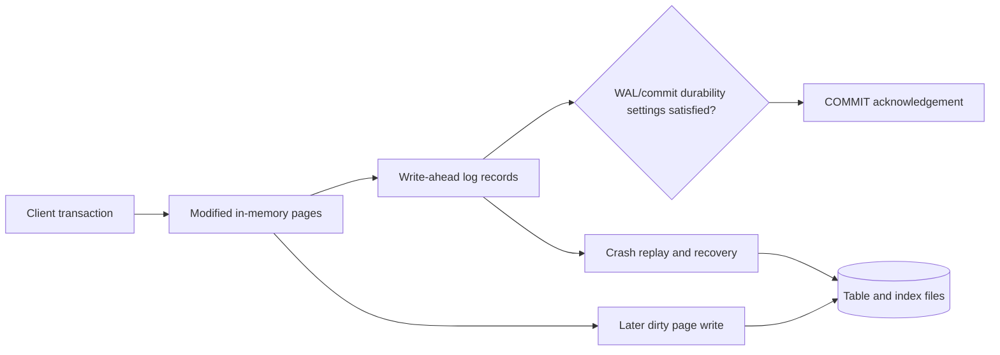
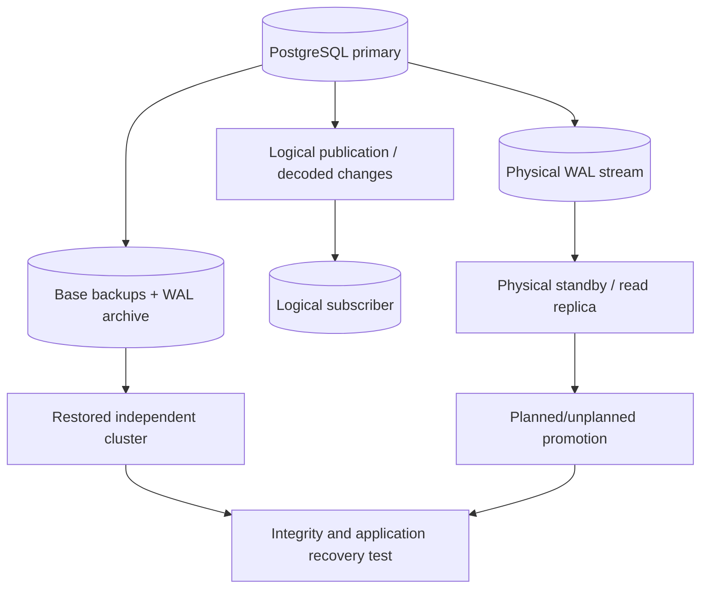
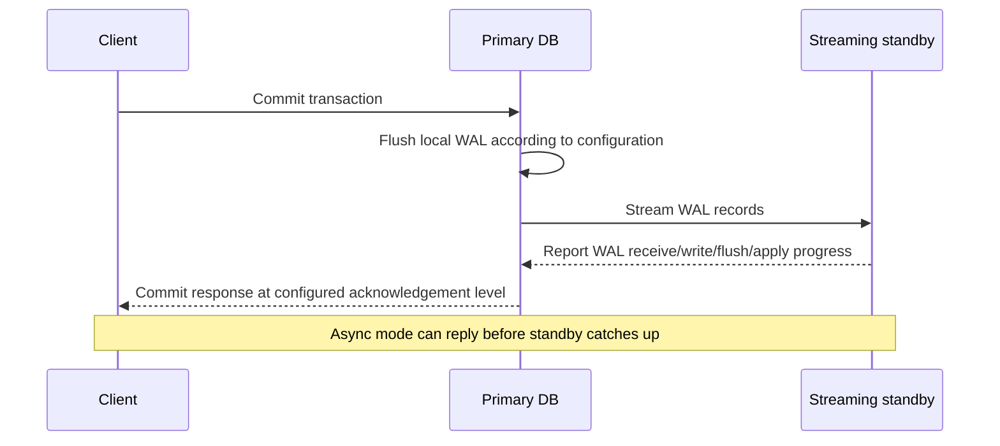

# PostgreSQL 17 WAL, physical/logical replication and recovery evidence

> Tycho Issue [#83](https://github.com/rouslanbaranov/tycho/issues/83). Version-pinned public source reading: PostgreSQL **17**, on 2026-10-19. Original mechanism explanations and fictional system diagrams, not a live restore drill, benchmark or operational guarantee.

## Purpose and mission

Durability and availability depend on **which state has been acknowledged, where it has been persisted, which copies have received it and what was actually restored**. A replica is not automatically a backup. A WAL archive is not automatically a working point-in-time recovery procedure. Local COMMIT, replication acknowledgment and user-visible success must be distinguished.

**Primary question:** How do write-ahead logging, asynchronous/synchronous streaming replication, logical replication and backup/recovery complement one another in PostgreSQL, and what evidence is needed to claim a defined RPO/RTO?

## 1. Why write-ahead logging exists

PostgreSQL 17 §28.3 **Write-Ahead Logging (WAL)** explains the durability approach: record modifications into a log before the affected data pages must be written to their permanent table/index files. WAL records and commit policies permit recovery after a crash without forcing every changed page to disk at transaction commit. WAL is both a recovery mechanism and a foundation for replication approaches. [E01]

Text alternative: transaction changes affect in-memory pages, and corresponding WAL records must meet the configured commit durability policy before acknowledgement. Table/index pages can be flushed later. Following a crash, recovery uses durable WAL to restore a consistent state. This is a conceptual flow; the exact flush ordering is controlled by PostgreSQL internals and configuration.

### Durability has configuration boundaries

`synchronous_commit`, `fsync`, `full_page_writes`, replica availability and storage-level guarantees change what an acknowledged write can survive. A diagram with WAL arrows does **not** guarantee resistance to disk firmware corruption, total-site loss or an incorrectly operated restore.

Avoid saying "transactions use WAL, therefore RPO=0" without specifying the failure (process crash, disk loss, node loss, network partition, region outage) and durable/replicated positions. Under async replication, a primary can acknowledge writes that a standby has not yet received; failing over to that standby may lose the not-yet-replayed or not-yet-received portion. PostgreSQL's §26.2 describes this delay and its implications. [E02]

## 2. Physical streaming replication versus logical replication

| Mechanism | What is transferred | Common purpose | Applicability/recovery limit |
|---|---|---|---|
| Physical base backup + WAL archive | Consistent storage snapshot plus WAL history | Restore a cluster, point-in-time recovery | Restore only if base backup, timeline and WAL chain are complete and tested |
| Physical streaming replica | Physical WAL progression from one instance to another | Standby failover/read scaling under version/topology constraints | Lag and failover promotion matter; replica may inherit logical corruption/deletions |
| Synchronous replication configuration | Commit wait tied to configured replica acknowledgements | Strengthen selected failure class durability | Availability/latency may degrade if required standby cannot acknowledge |
| Logical replication/publication | Selected data changes via logical decoding/publication/subscription | Selective propagation, migration, independently modeled consumers | Schema/DDL/sequence behavior and conflict/replay need explicit compatibility plan |
| Application outbox + CDC relay | An application-specific committed event-intent record | Durable integration event publication | Does not automatically provide downstream exactly-once effects |

Logical replication is **not** the same as point-in-time cluster backup. PostgreSQL 17 Chapter 31 **Logical Replication** documents publication/subscription, initial data synchronization and normal subsequent change propagation; DDL and other replication limitations require evaluation. [E03] See [outbox](../distributed/transactional-outbox-and-idempotency.md) for a business-level event contract rather than duplicating connector details.

Text alternative: physical WAL can feed a standby, logical changes can feed a subscriber, and separate base-backup plus archived-WAL artifacts can restore an independent cluster. Promotion or restore is not complete until application-level integrity and user outcomes are checked. This drawing is an original overview and intentionally omits topology-specific tools.

## 3. Acknowledgments and replication are not one binary switch

PostgreSQL §26.2.8 **Synchronous Replication** documents configurable commit waiting for standby acknowledgment, with trade-offs in lag and availability. It distinguishes the stage at which a standby has written/flushed/applied changes under configured policies. In a topology whose primary waits for one synchronous standby, an unreachable standby may prevent timely commit progress until configuration or availability changes. [E02]

Text alternative: primary sends WAL and receives progress from a standby. Whether the client waits for any standby progress depends on the synchronous replication configuration. This is not proof of a measured replication delay, cross-region RPO or external event commit.

**A replica count is not a durability SLA.** Deployment must account for quorum/ack configuration, data-center placement, network tail, replication slots/retention, failover fencing, split-brain prevention, old primary reintegration and application retry semantics.

## 4. A synthetic failure and recovery timeline

Imagine a fictional registration service using one primary and one **asynchronous** standby. A command commits at time `t=0` on primary and the client receives success. The primary then becomes unrecoverable before the standby receives the last few WAL records. Promotion of the standby can restore service while excluding some acknowledged writes.

The correct business outcome must be investigated; merely issuing `pg_promote()` is not a demonstrated zero-loss failover. A separate reconciliation strategy may be required for outward notifications already delivered, retries after lost responses and authoritative registration counts.

```mermaid
stateDiagram-v2
    [*] --> Healthy
    Healthy --> PrimaryLost: Node or storage failure
    PrimaryLost --> Assess: Identify durable replica/WAL positions
    Assess --> Promote: Safe candidate and fencing verified
    Assess --> Restore: Need backup + archived WAL
    Promote --> Verify: Read/write, invariants and missing commits
    Restore --> Verify: Recover target point and application function
    Verify --> Healthy: Recovery accepted; rejoin policy applied
    Verify --> Repair: Invariants or data gap unresolved
    Repair --> Verify: Reconcile and retest
```

Text alternative: after losing a primary, compare durable replica/archive positions, choose a safe promoted standby or a verified restore path, then test business functionality and missing committed data. Failed integrity checks require reconciliation before declaring recovery complete.

The timeline is **synthetic**, not a real production incident. No exact seconds/bytes of data loss can be inferred without capturing actual commit, WAL positions, synchronous mode and replica lag.

## 5. Backup integrity and recovery are independently testable

PostgreSQL 17 Chapter 25 **Backup and Restore** and §25.3 **Continuous Archiving and Point-in-Time Recovery** explain physical backup plus continuous WAL archiving. A credible recovery plan needs:

1. An independent recovery target and named disaster class (crash, data corruption, host loss, region loss, operator error).
2. Backup artifact provenance, encryption/keys, retention, WAL continuity and location outside the failed fault domain.
3. A restore procedure tested on an isolated host or environment without corrupting current production.
4. Replay/recovery point selection and integrity verification including application constraints, references and downstream effects.
5. Timed recovery drills measuring **actual** restored business capability and actual last recoverable commit, not dashboard green states.
6. A documented failback/fencing procedure and a reconciliation protocol for ambiguous client outcomes.

Backups protect different failure modes from replicas; a logical destructive command can be faithfully replicated to every standby while an older recoverable backup could still contain desired data. Neither mechanism is a substitute for the other without evidence.

## 6. Workload and scale considerations

A physical standby may offload some eligible reads at the cost of freshness and replication resource consumption; it cannot automatically make writes scale out. Index maintenance/WAL volume, long transactions, bulk imports, logical decoding slots, hot tables and checkpoint IO all change performance.

Choosing synchronous replicas affects request tail and failure availability. Choosing async replicas affects acknowledged-write recovery risk. The right configuration follows a **business-approved RPO/RTO**, fault-domain assumptions, load experiments and support capabilities. See the [rollout/recovery chapter](../delivery/safe-rollout-and-recovery.md) for source-to-user acceptance distinctions.

**Insufficient evidence:** "We have three copies of PostgreSQL data, so RPO=0, RTO under 30 seconds and no data divergence." No. Need placement, physical/logical mode, sync config, guaranteed/fenced promotion, WAL positions, restore test, integrity and client-level measurements.

## Engineering walkthrough — Primary acknowledgment is not standby completeness

**Original fictional write:** a PostgreSQL 17 primary accepts booking R7, records WAL and acknowledges according to its actual configured durability policy. The asynchronous standby is behind by one WAL interval when the primary becomes unavailable. A failover to that standby can omit R7 even though the original caller saw a success; the precise outcome depends on the acknowledgment, WAL flush/replay and failover configuration.

| Observed evidence | Meaning | Incorrect claim |
|---|---|---|
| Primary commit acknowledged | Local commit durability under chosen setting | Every replica has replayed it |
| Standby received WAL | Data reached standby transport/storage boundary | Business row is queryable or replayed already |
| Standby replay position known | A measurable recovery frontier | All externally committed effects are reconciled |
| New primary promoted | New writable authority if old primary fenced | No historical acknowledged write can be missing |

Physical replication carries low-level state; logical replication has publication/subscription and object/DDL semantics that cannot be equated to one universal backup. If a primary returns with divergent transactions, it cannot safely rejoin as an independent writer. **Recovery:** select a verified timeline, fence the old authority, reconcile accepted operation IDs and delayed consumers, then expose booking reads/writes only after user-level constraints hold.

The existing PostgreSQL 17 WAL, streaming and logical replication sources describe specific mechanisms, not this imagined disaster's RPO. **Proposed, not run:** inject primary loss immediately after acknowledgment and at differing standby replay positions; test data and user outcomes, including PITR to a chosen timeline. If no acknowledged-write loss is permitted, compare suitable synchronous acknowledgment policies and their availability/latency trade-offs instead of advertising async replicas as lossless.

## Exact public evidence ledger

| ID | PostgreSQL 17 documentation; actual inspected scope | Supports and boundaries |
|---|---|---|
| E01 | [§28.3 WAL introduction](https://www.postgresql.org/docs/17/wal-intro.html), recovery and WAL ordering rationale | WAL supports crash recovery when configured correctly; not inherently zero loss on total-site failure |
| E02 | [§26.2 Log-Shipping Standby Servers](https://www.postgresql.org/docs/17/warm-standby.html), streaming replication, async/synchronous concepts and §26.2.8 | Replica roles, streaming progress and synchronous durability/availability trade-offs |
| E03 | [Chapter 31 Logical Replication](https://www.postgresql.org/docs/17/logical-replication.html), overview/publication and subscription | Logical change propagation; not a physical whole-cluster backup |
| E04 | [Chapter 25 Backup and Restore](https://www.postgresql.org/docs/17/backup.html) and [§25.3 Continuous Archiving](https://www.postgresql.org/docs/17/continuous-archiving.html), broad concepts only | Independently recoverable base backup/WAL artifacts and PITR; no actual restore performed |

**Verification state:** bounded research draft, no PostgreSQL deployment, replication-slot inspection, backup restore, failover or measured RTO/RPO. Mermaid diagrams describe original systems, not operationally proven procedures or independent expert review.
