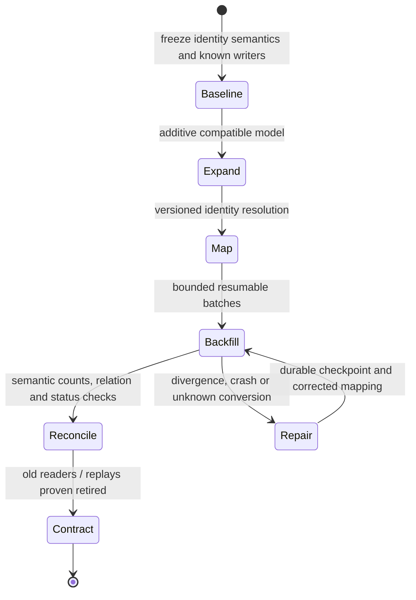

# Schema lifecycle, semantic data migration and data retirement

> **Tycho book draft V05/C06**, 2026-10-19. Original synthetic migration and source-led architecture explanation. Sources: Danilo Sato's public Parallel Change and PostgreSQL 17 ALTER TABLE documentation. No schema migration, data backfill, SQL execution or independent review occurred. Previous [combined rollout/schema research](../delivery/progressive-delivery-and-schema-evolution.md) is preserved until source claims are reconciled.

## Purpose and mission

A database schema is a contract between stored historical state and all readers/writers able to interpret it. Changing a column name is often trivial syntax; changing the meaning or identity of data may be difficult or irreversible. A safe schema lifecycle must preserve **business meaning**, versioned provenance and recoverability through its transition.

This chapter owns **data modeling changes, backfill consistency, identity mapping, migration checkpoints and removal of retired data**. [V08/C05 mixed-version database compatibility](../delivery/mixed-version-database-compatibility-and-online-ddl.md) owns old/new deployed reader-writer combinations and operational DDL timing. [V08/C04 progressive rollout](../delivery/gitops-canary-and-progressive-rollout.md) owns traffic exposure and deployment controllers.

## 1. Distinguish syntactic change from semantic change

| Change | Syntactic requirement | Domain integrity requirement |
|---|---|---|
| Add optional display field | Older rows can represent absence | Missing does not imply an invented business value |
| Rename external identity | Reader accepts old and new names during transition | Both names resolve to the same durable logical entity |
| Split one field into two | New columns and mapping function | Original cases map without ambiguity or loss |
| Change enum/status meaning | Codec accepts versioned old/new labels | Old accepted state is not misread as pending/rejected |
| Split a table into entities | Data-copy and foreign keys | Historical relationships, authorization and ownership survive |
| Delete a field | No remaining declared readers | Replays, archives and restoration no longer depend on it |

An “additive schema” can still be a *semantic breaking change* if a new writer interprets the field differently or an old consumer hard-codes projection order.

## 2. Original synthetic scenario: two equipment identities

In a fictional tool catalogue the original field asset_code conflates a public model description and a unique physical unit. A new model separates model_id (shared by identical units) and unit_id (physical item). Simply copying asset_code into both fields can create collisions, incorrect reservations and misleading history.

A safe migration requires a **totality analysis**:
- Which old code maps to a unique physical unit?
- Which records represent a model/type rather than one unit?
- Can mappings be many-to-one, one-to-many or unknown?
- How are links to historical reservations converted?
- Which source revision proves each mapping?
- What if a new record arrives while backfill is in progress?

Mappings that cannot be proven must be marked unresolved for domain review rather than silently defaulted.

## 3. Expand, migrate, contract as gated lifecycle

[Danilo Sato's Parallel Change](https://martinfowler.com/bliki/ParallelChange.html) describes an expand/migrate/contract approach for interfaces. Applying it to a database requires **additional explicit transactional/data requirements** not established by that method alone.

**Text alternative:** begin with versioned authoritative identities, expand without removing old contract, resolve semantic mappings, backfill in resumable batches and reconcile *meaning* and references. Retire old data only after readers/replay paths are proved gone. Any divergent or uncertain mapping holds the transition.

### Backfill acceptance is more than row totals

A job that copies 10,000 source rows and produces 10,000 target rows can still corrupt meanings. Check:
- stable source/target identity and tenant scope;
- field-level semantic equivalence and unknown mappings;
- concurrent writes, deletes and timestamps;
- checkpoint durability on crash/retry;
- event/CDC offset and replay horizon;
- history, authorization and referential integrity;
- exact source snapshot and migration code version.

If backfill takes hours, it may read records while new writes occur. A design needs an authoritative writer and a change-capture/reconciliation plan. Two independent writers are not automatically atomic just because the schema includes both fields.

### Worked original migration: resolve meaning before transferring authority

For the fictional equipment catalogue, suppose an old `asset_code = "DRILL-A"` refers to a **model** in one business area but to **a specific physical unit** in another. The target model requires `model_id` and `unit_id`. A naive string rename preserves equal row counts while silently making a model look like one reservable unit. The following is a *proposed* migration protocol, not an executed database script.

| Transition | Single-writer rule | Falsifiable gate | Recovery when the gate fails |
|---|---|---|---|
| S0 — Snapshot | Legacy database remains the only writer | Snapshot/replay start offset and schema version are recorded | Abort before deploying new semantics |
| S1 — Expand | Legacy writer emits old representation plus a durable versioned change signal | Old binaries and consumers still read/write without change | Revert additive reader path; keep source authoritative |
| S2 — Resolve | Versioned mapping `(tenant, old_id, mapping_revision) → (model_id, unit_id or UNKNOWN)` is reviewed | No two authoritative physical identities map to one unit without an approved merge rule | Quarantine ambiguous records; never invent an ID |
| S3 — Backfill + catch-up | New tables are **projections**, not independently writable authorities | Per-tenant unique identities, history relations and post-snapshot updates reconcile | Resume from durable checkpoint; recompute affected projections |
| S4 — Guarded authority transfer | A fenced cutover authorizes precisely one writer; old writes are rejected or routed to it | Mixed-version reads, old event replay, authorization and reservation invariants pass | Route reads back while source remains compatible; otherwise hold and forward-repair |
| S5 — Contract | Retirement requires a verified replay horizon and explicit no-return approval | Historical restoration and retention obligations remain satisfiable | Preserve old decoders/archive or stop the deletion |

A useful **negative example** is a delete-and-recreate event arriving while S3 processes an older snapshot. Applying events by receipt order can resurrect a deleted unit. A design must use a source-authoritative version/checkpoint ordering rule or reconcile the full identity history before S4. Hash totals alone would miss that semantic corruption. A second negative case is two writers accepting the same reservation on opposite sides of the cutover; without fencing, a green source/target comparison at T0 proves nothing about T1.

**Choice and evidence boundary:** smaller changes may retain the existing schema and add an explicit mapping layer instead of migrating authority. The reversible point ends when new-only writes or deletion break old-reader expectations. The [deployment-compatibility owner](../delivery/mixed-version-database-compatibility-and-online-ddl.md) covers mixed binaries and DDL locks; [transition architecture](../decisions/target-and-transition-architecture-states.md) covers global go/no-go and fallback authorization. The protocol and all identifiers above are **synthetic**; Sato's Parallel Change and PostgreSQL's ALTER TABLE reference do **not** establish its safety.

## 4. Data retirement has a no-return point

Deleting a column, archived identifier or legacy event decoder may destroy an old client's ability to read history or replay effects. Contract is safe only after recording:
1. all active and required historical readers/writers;
2. migration completeness and an approved residual-unknown policy;
3. verified state restoration and event replay;
4. supported old/new binary plans and deprecation period;
5. data retention and deletion obligations, including backups and projections;
6. authorized acceptance of an irreversible change.

[PostgreSQL 17 ALTER TABLE](https://www.postgresql.org/docs/17/sql-altertable.html) documents that DDL operations differ in lock needs and that ACCESS EXCLUSIVE is the default unless otherwise noted. Database syntax does not certify that a lifecycle change preserves every domain invariant.

## 5. Alternatives and failure conditions

| Option | Appropriate when | Counterexample |
|---|---|---|
| Simple local migration | Small bounded dataset and well-understood downtime | Long unknown consumers or expensive state copy |
| Additive schema with backfill | Old/new readers must overlap and mapping can be validated | New required field meaning cannot be derived |
| New normalized authority with adapter | Old model inconsistent and gradual cutover needed | Two writers make independent conflicting commitments |
| Immutable new-version records | Audit/history needs preservation across changes | Readers cannot resolve old/new entity identity |
| Retain old representation longer | Cost acceptable while source semantics are uncertain | Deletion/retention obligations forbid indefinite duplication |

A migration may legitimately stop on an **unresolvable identity** or unknown source meaning. Such a hold is a correct outcome, not failure to finish a technical change.

## 6. Proposed negative tests and evidence limits

No tests were executed. A future fixture should insert ambiguous identifiers, backfill concurrently with writes, crash between data commit and checkpoint persist, replay an old event after cutover, test old clients, inject an unauthorized cross-tenant reference, and restore a historical backup. Every scenario must verify intended business identity, not only SQL success.

## 7. Public sources and nonclaims

| Independently read source | Supported point | Unproven |
|---|---|---|
| [Danilo Sato — Parallel Change](https://martinfowler.com/bliki/ParallelChange.html) | Expand/migrate/contract interface coexistence method | Automatic database consistency |
| [PostgreSQL 17 ALTER TABLE](https://www.postgresql.org/docs/17/sql-altertable.html) | Operation-specific DDL and lock constraints | Running migration result |
| [Prior Tycho combined schema study](../delivery/progressive-delivery-and-schema-evolution.md) | Original research on mixed versions and data transition | Accepted semantic migration |

The invented schema, example workflow, diagram, test matrix and conclusions are original. No versioned database data or human review was available.

**Navigation:** proposed **V05/C06** in [book outline](../PROPOSED-STRUCTURE.md) and [data landing](README.md). Read [relational modeling](relational-modeling-and-transaction-isolation.md), [mixed-version schema compatibility](../delivery/mixed-version-database-compatibility-and-online-ddl.md), [legacy transition](../decisions/target-and-transition-architecture-states.md).

## Applied M9 evidence: what transfers and what does not

These examples connect the chapter's conditional mechanism to published experiences or synthetic decision exercises. A historical company report is **first-party, time-scoped evidence**, not a controlled Tycho benchmark; an M9 decision playbook is **original synthetic analysis**, not a company decision.

**Case lens — [Netflix — Casspactor shadow migration](../cases/netflix-casspactor-shadow-migration.md)**. **Relevant mechanism or architectural contrast:** Backup identity, shadow comparisons and fallback are distinct evidence gates for pipeline migration. **Not established by this report/playbook:** Comparing row sets alone does not guarantee semantic correctness or zero downtime; company performance evidence remains scoped.

**Case lens — [Uber — Mezzanine PostgreSQL migration](../cases/uber-mezzanine-pg-to-schemaless.md)**. **Relevant mechanism or architectural contrast:** Moving data authority requires compatibility seam, identity migration, mirrored writes and backfill reconciliation. **Not established by this report/playbook:** Uber's 2014 store change does not prove abandoning relational databases is generally preferable or fully reversible.

**Case lens — [Spotify — Honk data-consumer migration](../cases/spotify-honk-data-consumer-migration.md)**. **Relevant mechanism or architectural contrast:** Agent-assisted dataset changes need context, lineage and affected-repository test gates. **Not established by this report/playbook:** Reported PR counts are not controlled correctness measurements or evidence of fully migrated consumers.

**Case lens — [Meta — Ingestion shadow cutover](../cases/meta-ingestion-shadow-migration-lifecycle.md)**. **Relevant mechanism or architectural contrast:** Shadow read/validation, rollout and authority transfer are separate proof obligations for large ingestion migrations. **Not established by this report/playbook:** Source-reported complete migration is not a formal proof of no semantic corruption or transferable production protocol.

**Transfer test:** before applying the lesson to another legacy system, identify the exact workload, source date, relevant runtime/protocol versions, state authority, failure/recovery gate and the new observation that would reverse the choice. Follow the case's public evidence ledger rather than treating its link as independent proof.
