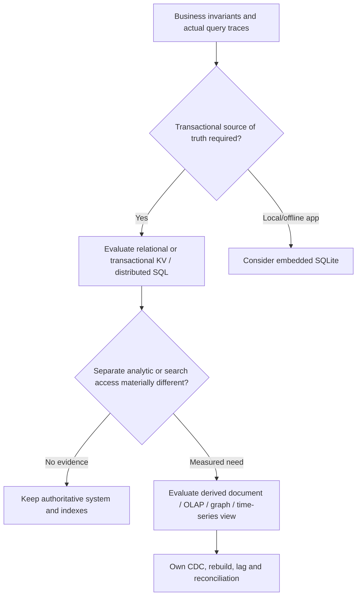
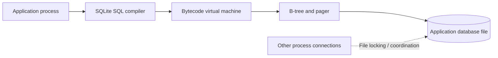
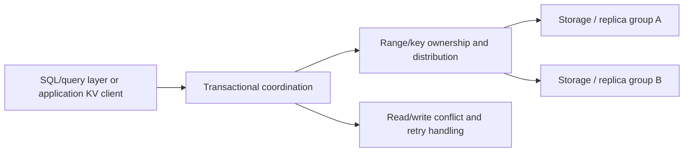
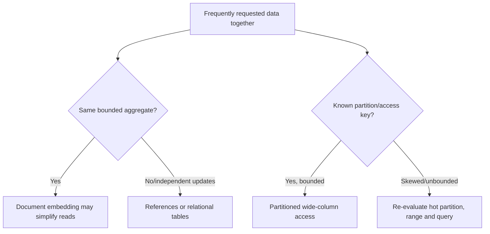
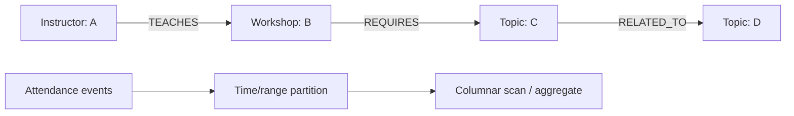
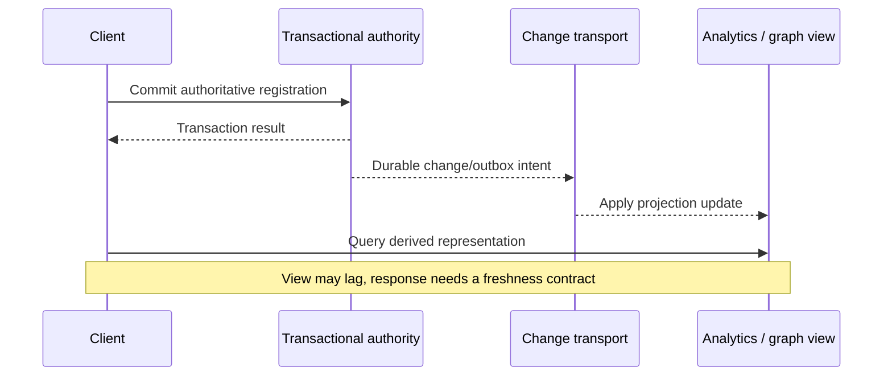

# Storage model alternatives: embedded SQL, distributed SQL, document, wide-column, OLAP, graph and time series

> Tycho Issue [#83](https://github.com/rouslanbaranov/tycho/issues/83). Independent official public documentation inspected on 2026-10-19, versions recorded below. This is a **bounded comparative architecture primer**, not a vendor ranking, empirical TCO calculation or claim of testing production databases.

## Purpose and mission

Storage engines optimize for different **transaction boundaries, access patterns, data layout, query expressiveness, operational footprints and recovery behavior**. "SQL versus NoSQL" is too crude to select one. The first decision should identify the authoritative invariants and representative read/write queries; next, decide whether one data model can serve them or a separately maintained derived view is worthwhile.

**Primary question:** What model trade-offs and operational prerequisites distinguish relational/server, embedded SQL, distributed transactional key-value/SQL, document, wide-column, analytical columnar, graph and time-series data designs?

## 1. Start from the workload and invariant, not a database brand

Imagine a fictional workshop service with three distinct needs:

- **Authoritative registration:** concurrency-safe confirmed seat allocation and recoverable request identity.
- **Event/usage analytics:** summarize attendance and request metrics over periods, perhaps over billions of mostly append-only observations.
- **Explore relationships:** traverse instructors, topics, workshops and prerequisites to find multi-hop recommendations.

These are three **query/invariant shapes**, not proof that three different databases are necessary. A single relational store may initially handle all of them. Before adding specialized engines measure data volume, retention, selectivity, ingest rate, aggregation and traversal costs, write/update mix and operational cost.

Text alternative: start from business constraints. Preserve authoritative transaction semantics and choose simple storage first; if real query demand warrants specialized projections, explicitly budget synchronization and recovery rather than silently treating another database as the same authority.

## 2. Transactional relational and embedded storage

**PostgreSQL 17** provides a server-managed relational engine with versioned concurrency, SQL planner, diverse indexes, WAL and logical/physical replication. These mechanisms are explained separately in [MVCC/query planning](postgresql-mvcc-indexes-and-query-plans.md) and [WAL/replication](postgresql-wal-replication-and-recovery.md).

**SQLite** is a library embedded in the hosting process rather than an independent client/server database service. Its official *Architecture of SQLite* document describes SQL text compiled to bytecode and executed in a virtual machine; B-tree storage, page cache/pager, file locking and optional WAL are core subsystems. [E01]

Text alternative: an application's local SQLite library compiles a query into VM instructions that access on-disk B-trees via a pager. Concurrent file access must obey SQLite's locking/journaling model. This is a **conceptual** design, not a benchmark.

SQLite can be appropriate for mobile/edge/offline apps, local configuration or single-node embedded transactional storage. It is not by itself a networked multi-region service with independently scalable write nodes; adding such a system would require a **separate synchronization/conflict protocol**. It is also incorrect to say embedded means "not ACID": actual guarantees depend on filesystem, transaction and journaling settings.

## 3. Distributed SQL and transactional key-value

**CockroachDB v24.3**, official architecture overview, describes SQL, transaction, distribution, replication and storage layers. This decomposition is intended to run transactional SQL workloads across distributed key ranges and replicas, at the cost of distributed coordination and more complex placement/recovery than a single server. [E02]

**FoundationDB 8.0**, official architecture, describes an ordered **transactional key-value** model with separately assigned cluster roles and optional application layers that implement higher-level data models. Its core API is not simply "any SQL query" without a layer. [E03]

Text alternative: applications interact with an SQL translation layer or transactional KV API, while coordination places data across storage owners. Network/quorum/conflict behavior becomes part of transaction latency and recovery. This is a **generic synthetic architecture**, not an assertion that CockroachDB and FoundationDB share identical internal protocols.

Do not assume SQL dialect equivalence, single-region latency, unbounded horizontal scaling or zero-conflict writes. Compare serializability/isolation at the declared API, hot-range distribution, network round trips, failover and cost under a representative transaction mix.

## 4. Document and wide-column data models

**MongoDB's official data modeling** documentation distinguishes embedding related subdocuments from referencing separate documents. Embedding can make related reads and atomic single-document updates simpler; high-cardinality or independently updated relations can make a referencing model more appropriate. The model's fit depends on access patterns and update frequency. [E04]

**Apache Cassandra 5.0** official overview describes distributed partitioned **wide-column** storage, with Dynamo-influenced replication and eventual consistency semantics. Data modeling depends heavily on partition keys, clustering order and query patterns. It should not be silently treated as a relational engine with arbitrary cross-partition joins/transactions. [E05]

Text alternative: document embedding depends on bounded co-read/co-update aggregate behavior; wide-column models depend on reliable partition/query planning. An uncontrolled growing collection or a hot partition can undermine the apparent simplicity. These are conceptual choices, not vendor-specific design recipes.

### Counterexample: the unbounded document/partition

A fictional workshop document embeds every registration ever made. It looks convenient for one read but can grow without bound, trigger large updates and mix unrelated lifecycle/retention patterns. Separating registration records may be safer; that does not require switching from MongoDB to SQL. Likewise, placing every user's activity in one Cassandra partition can create oversized/hot partitions; correct partitioning needs actual distribution and access traces.

## 5. OLAP, time series and graph data

**ClickHouse MergeTree** official docs describe immutable sorted data parts, background merges, sparse primary index/data pruning and an `ORDER BY` sorting key. This architecture is especially relevant to high-volume analytical scans and aggregates, but it should not be assumed to support a transactional seat-allocation invariant with the same semantics as an OLTP database. [E06]

A **time-series model** emphasizes event timestamp, ingestion order, retention/downsampling and range aggregations. It can live in PostgreSQL or a columnar/TS-specialized system. "Time-series" describes the query and lifecycle problem, **not a unique storage consistency guarantee**. A comprehensive vendor-specific TSDB analysis is not completed in this bounded page.

**Neo4j's public property-graph concepts** model nodes, directed typed relationships and properties, with indexes/constraints available. This supports explicit multi-hop traversal queries; it does not prove such queries will always be faster or cheaper than a relational recursive query or precomputed adjacency structure. [E07]

Text alternative: a property graph records relationships between people, events and concepts as typed edges; event analytics can instead group high-volume observations by time for aggregations. Those workloads have different access paths and may justify separate **derived** storage only after actual evidence.

## 6. Cross-model trade-off matrix

| Model / representative engine | Strong workload fit | Central boundary and failure cost | Measure before adopting |
|---|---|---|---|
| Embedded SQL — SQLite | Local/offline transactional storage with bounded process integration | Local file/device availability; networking/sync must be built separately | Concurrent writer behavior, backup and local I/O |
| Server relational — PostgreSQL | Relational invariants, joins and mixed transactional queries | Connection/lock/index/WAL bottlenecks; replica lag and failover | Actual query plans, transactions, write/read mix, recovery |
| Distributed SQL — CockroachDB | SQL with distributed placement and transactions | Distributed commit/conflict/network costs and operational topology | Hot ranges, geographic latency, failover and dialect fit |
| Transactional KV — FoundationDB | Ordered key-value transactions and flexible higher-level layers | Key design/layer implementation, conflict rate, cluster operation | Range shape, transaction size, conflicts and API translation |
| Document — MongoDB | Variable-shape bounded aggregates and common co-read data | Cross-document links, growing arrays, index/consistency semantics | Embedding vs referencing, payload growth and update pattern |
| Wide-column — Cassandra | Predefined partition-based access over large distributed datasets | Hot partitions, query rigidity and replication/consistency policy | Partition sizes/skew, repairs, consistency and failure behavior |
| Columnar OLAP — ClickHouse | Aggregate scans over append-oriented high-volume data | Background merges, freshness/ingest architecture and separate authority | Query selectivity, merge cost, lag, retention and correctness |
| Graph — Neo4j | Typed multi-hop relationship queries | Graph maintenance/index/constraint and cross-store sync | Actual traversal depth/fan-out vs SQL alternatives |
| Time series — workload category | Time range/retention/downsampling and metric-oriented queries | Out-of-order input, cardinality, rollup and cold retention | Series cardinality, ingestion, query/window/retention |

This is **architecture reasoning** based on documented mechanisms, not a numerical product comparison. No benchmark scores, release prices or generic "winner" are asserted.

## 7. Multiple databases create a new synchronization problem

A single authoritative registration database plus a graph/search/OLAP projection is a valid possible design—but then there are *two data representations*, not two automatically consistent sources of truth.

Text alternative: a user commits to an authoritative store. A change pipeline later updates derived views, which may temporarily return stale results. Define freshness, rebuild, deduplication, schema migration and failure recovery explicitly. See the canonical [outbox page](../distributed/transactional-outbox-and-idempotency.md) and [CQRS projections](../distributed/cqrs-event-sourcing-and-projections.md).

## 8. Safe selection process and insufficient evidence

A credible selection compares:

1. Invariants, transaction scope, security/compliance and authorized deletion/retention.
2. Canonical queries and write patterns with actual request volume/distribution and peak/failure changes.
3. Data size and growth by cardinality, key, index and partition rather than total rows alone.
4. Read consistency, freshness, cross-system coordination, conflict/retry and migration obligations.
5. Operational cost: staffing, backup/restoration, topology, upgrades, support and license constraints.
6. Measured performance on comparable representative datasets, with cache/warmup, concurrent writes and failure drills.
7. A simpler single-database alternative and the evidence that could reverse the decision.

**Insufficient evidence — unanswered architecture choice:** "Our product has 5 million users and wants a fast dashboard, so should we migrate everything from PostgreSQL to Cassandra, MongoDB and ClickHouse?" **No determination is possible.** User count and the word "fast" do not establish the authority, query mix, dataset, costs, latency window, migration compatibility or consistency requirements. Start by profiling actual PostgreSQL query plans and workload; consider a single purpose-built projection only if the evidence supports it.

## Public evidence, version scope and limitations

| ID | Exact public source actually inspected | Supports, not a benchmark |
|---|---|---|
| E01 | [SQLite Architecture](https://www.sqlite.org/arch.html), *Overview; Bytecode Engine; B-Tree; Page Cache*, last-updated 2025-05-31 | Embedded compiled-to-VM SQL/B-tree/pager mechanisms |
| E02 | [CockroachDB v24.3 Architecture Overview](https://www.cockroachlabs.com/docs/v24.3/architecture/overview), *SQL, Transaction, Distribution, Replication and Storage Layers* | Architectural role decomposition, not measured universal SQL compatibility |
| E03 | [FoundationDB 8.0 Architecture](https://apple.github.io/foundationdb/architecture.html), *Detailed FoundationDB Architecture, Coordinator/Storage roles* | Distributed transactional ordered KV API and role separation |
| E04 | [MongoDB data modeling best practices](https://www.mongodb.com/docs/manual/data-modeling/best-practices/), *Link Related Data*, and [Embedding](https://www.mongodb.com/docs/manual/data-modeling/embedding/); current rolling docs observed 2026-10-19 | Embed/reference workload trade-offs; release-specific claims must be independently pinned |
| E05 | [Apache Cassandra 5.0 architecture overview](https://cassandra.apache.org/doc/stable/cassandra/architecture/overview.html), *Overview* | Partitioned wide-column/replication principles; not all consistency modes verified |
| E06 | [ClickHouse MergeTree engine](https://clickhouse.com/docs/reference/engines/table-engines/mergetree-family/mergetree), *Data parts, primary key and ordering*, rolling official docs observed 2026-10-19 | Sorted data parts/merges and pruning, no measured comparative throughput |
| E07 | [Neo4j property graph concepts](https://neo4j.com/docs/getting-started/appendix/graphdb-concepts/), *Introduction; Node; Relationship; Schema*, rolling official docs observed 2026-10-19 | Property graph model, not universal graph query speed advantage |

**Review state:** explanatory comparison, fictional workload diagrams only; no engine installed or benchmark run, no independent domain review, no comprehensive time-series vendor comparison and no measured migration. This page does **not** give a database product recommendation for a real user system.

## Applied M9 evidence: what transfers and what does not

The following historical cases are **time-scoped publisher/practitioner reports**, not a Tycho benchmark or proof of a universal architecture choice. Any associated decision playbook is an **original synthetic comparison**, not a decision made by the companies cited. These cases inform the specific mechanism and contraindications above:

- **[Uber — MyRocks](../cases/uber-mysql-to-myrocks.md)** illustrates storage-engine choice must include operational write amplification, workload shape and production rollout gates. **It cannot establish:** company-reported MyRocks savings do not transfer to arbitrary datasets, hardware, version or query patterns.
- **[Discord — Cassandra to ScyllaDB](../cases/discord-cassandra-scylladb-messages.md)** illustrates combining data engine migration with request coalescing addresses hot partitions and latency feedback. **It cannot establish:** publisher-reported results cannot isolate the new engine as sole cause or compare equal server resources without adjustment.

A different system must recheck its workload, source date, version, authority boundary and failure/recovery acceptance criteria before transferring any decision. See the case's own evidence ledger for exact public references and unresolved claims.
