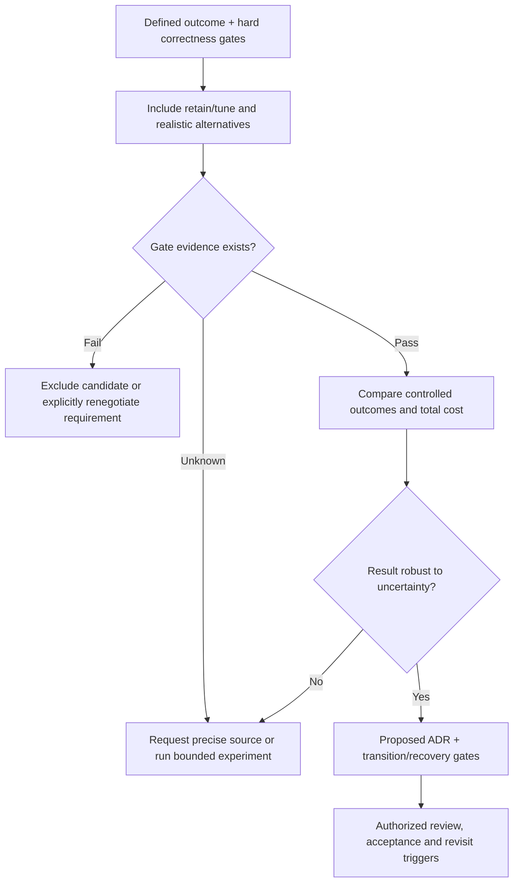

# Architecture alternatives, discriminating experiments and decision records

> **Tycho independent book manuscript — proposed V10/C04, 2026-10-19.** The example, calculations and diagrams are original and hypothetical. This is a reader-facing explanation of how to compare options, not a real approved ADR, executable architecture experiment, or automated selector. The existing [candidate comparison authoring method](../../authoring/models/candidate-comparison-adr.md) remains a separately owned reusable record.

## Purpose and mission

Architecture selection is not a competition between technology names. A useful decision starts with competing causal explanations of a problem and asks: **which observations could make one feasible candidate preferable to another without violating non-negotiable requirements?** An option that seems cheaper, faster or easier to operate cannot compensate for losing committed data or allowing unauthorized effects.

The [arc42 architecture decisions guidance, §9](https://docs.arc42.org/section-9/) recommends documenting important alternatives, criteria, rationale and consequences. It describes the familiar context/status/decision/consequences record, but does not supply a mathematical ranking that can replace evaluation. The [arc42 quality requirements guide, §10](https://docs.arc42.org/section-10/) emphasizes concrete, measurable scenarios. This chapter adds a systematic decision experiment to those principles and makes its uncertainty visible.

## 1. A precise problem statement comes before alternatives

An original fictional equipment-booking site experiences slow responses during a short opening window. A stakeholder proposes splitting its one deployed application into reservation and catalogue microservices.

Known in the invented prompt: reservations must be exclusive, and responses are slow during bursts. Unknown: offered versus completed arrivals, key skew, connection waits, database locking, client deadline, runtime CPU usage, and the real benefit expected from separate releases.

A valid *question* is therefore not "How do we adopt microservices?" but "Which bounded architectural change most reliably preserves exclusive reservations while meeting an agreed user-visible deadline during the specified arrival and contention pattern?"

A decision frame has four types of information:

| Type | Synthetic example | Evidence status |
|---|---|---|
| Correctness invariant | At most one accepted booking per physical unit/time window | Proposed non-negotiable requirement |
| Quality scenario | Final result within a named deadline under a specified burst | Incomplete until workload and denominator are defined |
| Constraint | Existing clients must remain supported through transition | Hypothetical hard compatibility gate |
| Preference | Lower on-call complexity, cheaper operation, independent component changes | Competing objectives; cannot override hard gates |

When a hard requirement is unknown, *measure first* is a legitimate decision. Do not pretend an unspecified SLO or operational budget passed.

## 2. Enumerate a genuine retained/simple option

Three viable candidates for evaluation—not selection—are:

- **A — retain and instrument the modular deployable.** Measure lock/pool/CPU/arrival conditions and repair a proven bottleneck without introducing a new remote owner.
- **B — keep one state authority, add bounded admission or a durable accepted/pending workflow.** Useful only if the user can receive a pending outcome or explicit rejection under the signed contract.
- **C — extract reservation into a separately deployed service.** Potentially worthwhile if independently managed capabilities, release cadence or isolated capacity are real requirements and transactional authority can move safely.

The hard-gate matrix must be completed before weighted preference scoring:

| Gate | A | B | C |
|---|---|---|---|
| No duplicate exclusive allocations | Must test current transaction | Must test queue + authority | Must prove remote authority transfer |
| Mandatory final-result semantics | Might preserve | Async/pending may **fail** current contract | Might preserve, but adds network failure |
| Old/new client coexistence | Small interface surface | Pending/error contract change | Mixed-version routing and data ownership |
| Bounded loss and recovery | Requires restore evidence | Queue replay and status reconciliation | Fencing/cutover and restore proof |
| Operational/cost limit | Existing footprint not yet measured | Extra queue/runbook | Extra deployment/on-call surfaces |

**Fail** means exclude unless requirements legitimately change; **unknown** means withhold unconditional acceptance. The table deliberately leaves actual outcomes unproven. A low cost score cannot rescue an option that fails booking exclusivity.

## 3. Hypothesis → discriminator → possible reversal

For each candidate, specify a causal benefit that another source of evidence could disprove.

| Hypothesis | Proposed discriminating experiment | Falsifying observation |
|---|---|---|
| A: requests wait mainly for one DB lock | Correlate per-key contention, transaction time and parent spans under a replayed skewed burst | Most critical-path wait is elsewhere, and optimizing the lock does not improve outcomes |
| B: admission protects accepted correct work under overload | Hold offered demand fixed; compare queue age, rejects, success, retries, fairness and deadlines | Apparent p99 gain is only from hiding or dropping required work |
| C: independent deployments materially reduce change risk | Rehearse N/N+1 clients, read/write ownership and rollback of bounded capability changes | A common store/writer still forces coordinated releases or cutover violates an invariant |

One experiment should vary one decision-relevant mechanism at a time where possible. Equivalent test inputs include **offered logical operations**, not merely completed requests. A result at different data cardinality or resource budgets may not distinguish architecture from an accidental test setup. [Benchmark validity](../performance/load-testing-and-benchmark-validity.md) owns arrival-generator and denominator mechanics.

A negative result is evidence, not a failed research task. Retain the baseline when it satisfies hard constraints and new complexity has no demonstrated incremental benefit.

## 4. Conditional preference scoring and sensitivity

After hard gates pass, a *hypothetical* 0–5 preference matrix may help expose stakeholder priorities:

| Preference | Weight | Retain/tune A | Extract service C |
|---|---:|---:|---:|
| Operational simplicity | 0.5 | 4 | 2 |
| Independent deployment | 0.3 | 2 | 5 |
| Migration effort | 0.2 | 5 | 2 |
| Weighted illustrative result | 1.0 | 3.60 | 2.90 |

These numbers are **invented subjective ratings**, not benchmarks. If independent deployment becomes the dominant documented requirement, the rank can reverse. More importantly, if one contender cannot meet a hard exclusivity or restore gate, numerical scores become irrelevant.

For a sensitivity check: define ranges for every uncertain cost/benefit estimate, perturb weights within agreed stakeholder bounds, and explicitly report whether the ranking changes. A wide outcome interval means **decision sensitivity**, not false numerical confidence.

## 5. ADRs document consequences and update history

An architecturally significant decision record should carry:

- stable ID, title, responsible reviewer, date and status;
- affected user journey, versions, exact scope and change trigger;
- known inputs and unknowns with source/revision;
- alternatives, including the retained design, and hard-gate table;
- observed versus hypothesized findings; falsifiers and tests;
- positive, negative and neutral consequences;
- transition and irreversible-effect gates;
- explicit status **PROPOSED**, **ACCEPTED**, **SUPERSEDED** or **DEFERRED** as appropriate;
- review trigger and pointer to a superseding record.

Do not silently replace an accepted decision with a new paragraph: a later ADR should state which earlier reasoning was superseded and by which changed facts. A GitHub issue closed for documentation is **not** a business approval of an architecture. The [arc42 §9](https://docs.arc42.org/section-9/) description of decision status and traceable consequences supports maintaining that distinction.

### Original proposed ADR — reservation burst

**Title:** ADR-SYN-07, Retain single reservation authority during burst diagnosis  
**Status:** PROPOSED; no person or production team approved it.

**Context:** exclusive allocation required; offered burst, lock waits, clients and cost are presently unknown.  
**Alternatives:** A retain/instrument; B bounded admission; C extract service.  
**Hard gates:** one accepted owner per unit/time; stable client effect identity; data recovery and authorized writes.  
**Decision:** **MEASURE_FIRST**; temporarily prefer smallest reversible baseline instrumentation.  
**Reasons:** no demonstrated independent data ownership or deployment advantage yet; distributing the writer would add a new failure and migration boundary.  
**Costs:** instrumenting and testing consumes work; retaining shared deployment may delay independently desirable changes.  
**Falsifier:** a verified independent capability repeatedly causes unacceptable release or resource coupling that simpler changes cannot satisfy.  
**Revisit:** when key skew, parent latency, owner mapping and the transition compatibility matrix are measured and reviewed.

This is a *worked writing example*. A real decision would require actual stakeholder approval and a fresh evidence ledger.

## 6. A decision is also a stopping rule

Text alternative: after framing a decision, generate real alternatives; unknown hard-gate evidence leads to investigation and a failed gate excludes the candidate. Compare only feasible options, challenge assumptions, and record a proposal that requires explicit authorized approval.

Research may conclude **no feasible candidate under current constraints**, **defer**, or **insufficient evidence**. Neither a book chapter nor a search/agent service should quietly turn these outcomes into a fabricated architecture recommendation.

## 7. Public reference ledger and limitations

| Inspected independent source, 2026-10-19 | Supports | Does not establish |
|---|---|---|
| [arc42 §9 — Architecture Decisions](https://docs.arc42.org/section-9/) | Context, criteria, alternatives, statuses, rationale and consequences | Validity of the book's synthetic ratings |
| [arc42 §10 — Quality Requirements](https://docs.arc42.org/section-10/) | Measurable quality scenarios as inputs to decisions | Real SLO or measured acceptance result |
| [Tycho candidate comparison method](../../authoring/models/candidate-comparison-adr.md) | Reusable authored screening/ADR structure | An automatically computed or approved architectural choice |
| [Tycho performance experiments](../performance/workload-profiles-and-capacity-experiments.md) | Measurement boundaries and falsifiable trial design | Any real workload observation |

All sample identities, outcomes, weights and experiments here are **independent original synthetic content**. No system was evaluated or benchmarked. Real technical review, claim-by-claim public-source check and final chapter/page metadata remain pending.

## Navigation

Proposed home: **V10/C04** in [proposed contents](../PROPOSED-STRUCTURE.md). Current landing: [Decision support](README.md). Read [Requirements/workload](requirements-and-workload-architecture-profiles.md), [Pattern applicability](pattern-applicability-and-contraindications.md), [Legacy baseline](legacy-baseline-and-modernization-evidence.md), then [target and transition planning](../../authoring/models/target-transition-architecture.md) for implementation readiness.
