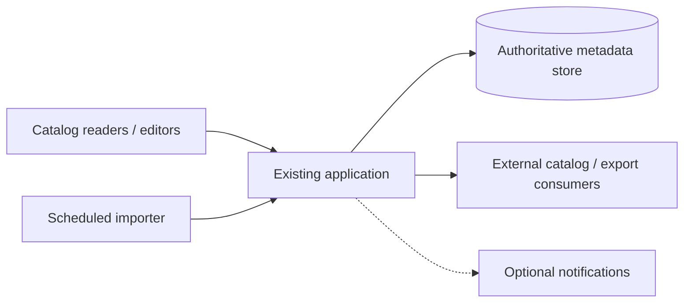
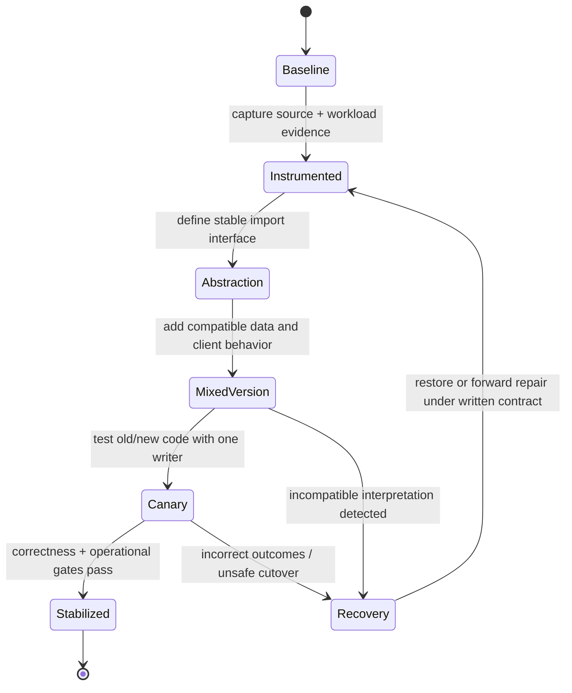

# Legacy system baseline and modernization evidence: deciding what to keep

> **Tycho book chapter draft:** proposed V10/C02, 2026-10-19. This is an original, industry-neutral teaching example based on admissible public modernization literature. It is not a description, reconstruction, measurement or modernization plan for an actual employer, application or production system. Its companion [legacy-profile authoring model](../../authoring/models/legacy-modernization-profile.md) is an information-gathering tool, not a replacement for this chapter.

## Purpose and mission

Modernization starts with a contradiction: engineers need to replace or improve something, but parts of its behavior may be undocumented and still essential to users. An attractive target diagram can therefore be less informative than a map of **what is actually owned, what must not break and how existing and new behavior can coexist**.

The answer to "which architecture should replace a legacy system?" may legitimately be **retain and stabilize**, **upgrade in place**, **modularize without distributing**, or **incrementally replace a bounded capability**. This chapter develops a versioned baseline, turns uncertain legacy claims into research tasks, evaluates options against transition constraints, and demonstrates why moving the deployment boundary is not equivalent to transferring data ownership. The independent [Patterns of Legacy Displacement, Cartwright/Horn/Lewis (2024)](https://martinfowler.com/articles/patterns-legacy-displacement/) emphasizes desired outcomes and incremental delivery; [Fowler's Strangler Fig update (2024)](https://martinfowler.com/bliki/StranglerFigApplication.html) explains staged substitution. Neither source proves which option is right for the synthetic case used here.

## 1. Old software is not itself an architecture defect

Age alone does not explain a service-level failure. The real drivers may be unsupported dependencies, high change lead time, untestable side effects, incompatible external protocols, data retention risk or an observed resource bottleneck. Equally, a long-lived modular system may be more reliable and cheaper to maintain than a newly distributed one.

Define the modernization outcome independently of the technology:

- Reduce the time to safely change a specific user journey while preserving existing behavior.
- Remove a documented unsupported runtime/dependency without invalidating its persisted data or external contracts.
- Reduce measured failure blast radius or recovery time at a named workload.
- Allow a distinct capability to deploy independently **only if** team/domain and transaction ownership genuinely support it.

An unknown issue should generate an investigation, not a design imperative. "Legacy monolith" is not a sufficient explanation for a slow request, deployment outage, audit deficiency or rising maintenance cost.

## 2. Collect a baseline as an evidence-bearing architecture model

A useful baseline is **not** merely a box diagram. Record several boundaries independently:

| Dimension | Minimum question | Evidence that can answer it | Common false inference |
|---|---|---|---|
| User journeys | Which behavior is essential, optional, scheduled, degraded? | Client contract, test, support/usage statement with scope | Features documented are the ones still used |
| Module dependencies | Which code units depend on which internal contracts? | Versioned source, build metadata, call graph or test fixture | Package split equals deployable isolation |
| Runtime | Which process, task runner, JVM/container or service executes the work? | Deployment manifest, process config, observable topology | Repository layout equals deployment topology |
| State authority | Who can write, commit, delete and reconcile each critical entity? | Schema, migrations, writer inventory, transaction source | One table belongs to only one service |
| API/events | Who consumes historical versions, events, exports and callbacks? | Versioned API/event schemas and consumer evidence | All clients can be updated simultaneously |
| Failures and recovery | Which component must restart/restore, what gets replayed? | Runbook, observed drill, exception path, backfill protocol | Image rollback restores changed persisted state |
| Security and audit | Which authorization decision protects the actual business effect? | Policy enforcement path, log structure, tests | A gateway guarantees object-level isolation |
| Operational cost | Which team and resources maintain, upgrade and debug it? | Workload, incident and staffing evidence with date | More services automatically improve changeability |

A source snapshot proves what a specific revision says; it is not proof that the same version serves real traffic. Configuration and migration scripts may disagree with actual state. Leave that contradiction visible and request an explicit observation or reconciliation.

A baseline ideally records **what has never been verified**. Incomplete, visibly uncertain knowledge is safer than a polished fictional truth model.

## 3. Original synthetic case: a catalog and import service

Imagine a community-run *public image catalog* that maintains licensed photo metadata, searchable titles, contributor permissions and periodic bulk imports. We invent these constraints solely for teaching:

- One deployed application serves interactive search, metadata edits and background batch import.
- A relational database is the only authoritative metadata writer.
- A scheduled import reads a file, upserts metadata, and may emit a notification after commit.
- Older clients read the public catalog; export consumers may rely on stable identifiers and timestamps.
- An operator says "nightly imports are taking longer" and "deployments are risky", but exact load, code ownership, failure records and version history are **not available**.

We deliberately do **not** assert a particular language/framework, actual downtime, numerical throughput or existing authorization bug. The two complaints are observations reported by a hypothetical stakeholder; their causes are unknown.

Text alternative: reads, edits and import pass through one deployed application, which owns the authoritative metadata. External consumers may depend on versioned IDs and schemas. Optional notifications introduce separate failure possibilities. The diagram is a candidate **baseline**, not a validated production inventory.

### Hypothesis register: investigate before rebuilding

| Observation | Competing explanation A | Competing explanation B | Minimal discriminator |
|---|---|---|---|
| Import is slower | Data volume/access path changed | External fetch or retry wait increased | Elapsed stages, query plans and external call timing |
| Deployment appears risky | No mixed-version schema compatibility | Slow maintenance window and absent rollback proof | Read migration and release history, test old/new clients |
| Search is sometimes stale | Index freshness or delayed projection | Browser/client cache | Compare authoritative row version and served response |
| Editor reports duplicate notifications | Retry of external side effect | Duplicate data-change event | Trace durable operation identity and consumer effect record |

Each hypothesis must remain a hypothesis until an admissible source or reproducible experiment discriminates it. Guessing a need for Kafka, event sourcing, distributed caching or microservices would add new failure boundaries before the existing one is understood.

## 4. Four modernization alternatives and contraindications

| Alternative | When it fits | Technical cost/risk | What would falsify it |
|---|---|---|---|
| A — retain and stabilize | Incidents trace to identifiable config/query/test gaps; current deployable ownership is adequate | Still needs observability, dependency security upgrades and recovery drills | Verified structural constraint prevents required improvement |
| B — upgrade runtime in place | Main driver is lifecycle/security support; APIs and state need not move | Runtime/library compatibility; old data encoding; mixed-version release | Cannot run required dependency/runtime combination or preserve externally required behavior |
| C — modularize behind internal contracts | Change coupling is dominant but separate deployment provides little benefit | Internal dependency reversal and contract-test investment | Actual transactions/coupling cannot be separated incrementally |
| D — bounded extraction with anti-corruption interface | Clear capability/state owner, independent release requirement and measured benefit | Distributed failure, data movement, observability, temporary dual-format complexity | No distinct ownership, unknown writer inventory, incompatible consumers or unacceptable cutover risk |

A replacement service does not become authoritative merely because its new database exists. If two writers can independently accept edits during transition without a conflict-resolution rule, state divergence is a risk. A "dual write" across stores without a coordinated correctness protocol is not equivalent to atomic commit.

[Microsoft's Strangler Fig pattern](https://learn.microsoft.com/en-us/azure/architecture/patterns/strangler-fig) documents a façade that gradually redirects capabilities; it also identifies the cost of coexistence. The pattern is conditional: introducing a façade adds a new routing and security boundary, which can itself fail. A feature that only runs as an internal module may be better modernized internally rather than relocated over the network.

## 5. Target architecture and transition states are different artifacts

**Original conditional plan:** Assume subsequent source inspection supports **option B (runtime upgrade in place)** and **option C (internal modularization)** for the catalog, with one data owner preserved. The target could be a single modern supported runtime with domain-specific modules and a clear import interface; the transition still requires coexistence of code, data and consumers.

Text alternative: start by measuring and freezing the baseline; introduce an internal stable interface without moving data ownership; test mixed versions; promote a limited release only after correctness and recovery checks pass. A failed compatibility gate returns to a known safe state or explicit forward repair plan. No arrow is a guarantee of automatic data rollback.

| Stage | Old/new behavior permitted | Evidence gate | Potential irreversible effect |
|---|---|---|---|
| Baseline | Existing behavior only | Versioned code, schema and client inventories | Existing undocumented data semantics |
| Abstraction | New code behind internal interface; one writer | Contract tests and old-result comparison | New code may encode subtly different business meaning |
| Expand | Additive schema and optional API fields | Old read/write clients still work | A newly written value may not be understood by old code |
| Mixed-version | Old and new code coexist, single authority | Bidirectional compatibility matrix, retry idempotency | New format may block image-only rollback |
| Guarded switch | Route bounded work to new implementation | Failure/replay, data diff and SLO gates | External effects or data changes may be non-reversible |
| Cleanup | Retire old consumers and code after evidence | No old replays/clients remain, recovery rehearsed | Removing old schema can prevent rollback |

Use **expand → migrate → contract** for storage evolution, but do not claim it is sufficient without checking data meanings and old readers. [Safe schema evolution](../delivery/progressive-delivery-and-schema-evolution.md) owns the detailed technique and mixed-version test matrix. [Fowler's Patterns of Legacy Displacement](https://martinfowler.com/articles/patterns-legacy-displacement/) and [AWS incremental modernization guidance](https://docs.aws.amazon.com/prescriptive-guidance/latest/modernization-aspnet-web-services/considerations.html) describe staged replacement principles; they are not a validation of the exact transition proposed here.

## 6. A correct migration must test failure and recovery

### Failure A — response acknowledgment is lost

A contributor edits photo metadata; the transaction commits but the response disappears. The client retries. Correct behavior requires a durable operation identity or other safe retry contract; otherwise two update effects or duplicate notifications may result. [Outbox/idempotency](../distributed/transactional-outbox-and-idempotency.md) explains why local transaction boundaries do not cover external notifications.

### Failure B — old and new clients interpret the same field differently

A previously optional metadata field becomes mandatory under the new implementation. Old clients continue submitting records without it, while the new server silently defaults to a materially different value. **Wire parsing succeeds but behavioral compatibility fails.** Fix by retaining documented default meaning, staging field requirements or versioning the client contract; prove each pairing before removal.

### Failure C — import cutover halfway through a batch

An imported data file partially applies and then its worker crashes. Restart may reread already processed records. Safe recovery needs durable import identity, checkpoint semantics, row-level logical identity and an explicit partial/error policy. An in-memory cursor is not evidence of idempotent restart.

### Failure D — deployment rollback after irreversible writes

New code persists records that old code cannot parse. Returning to the older container image does not restore the database. A release gate needs either a backward-compatible period, a reversible tested migration, or explicit **forward recovery**. A runtime deploy rollback and a data correctness rollback are distinct.

## 7. The evidence-based selection outcome

For the synthetic catalog, available evidence is insufficient to prove that the workload needs microservices, a new database or Kafka. A **provisional recommendation** is:

1. Record the current data authority, external clients, release assumptions and import workflow at pinned versions.
2. Reproduce the import slowdown with timing broken down by stage and query plan; record offered versus completed work and error/timeout outcomes.
3. Establish contract tests and a reversible runtime upgrade path while preserving one metadata writer.
4. Use an internal abstraction for import behavior only if it reduces known change coupling.
5. Revisit extraction if measured requirements demand independent deployment or isolation, and the data/consumer ownership is demonstrably separable.

**Decision state:** INVESTIGATE_AND_RETAIN_BASELINE, with conditional incremental modernization. There is no confirmed target architecture, operational win or approved plan because the case is hypothetical and key evidence is deliberately absent.

### Evidence that would reverse the choice

A signed functional contract that requires isolating import failures from public reads; measured separate resource bottlenecks not addressable in the existing deployable; a fully owned data subset; independently deployable teams with compatible consumer timelines; reproducible benefit greater than the overhead of network, data and operational boundaries. Every such statement still needs a testable criterion and a transition strategy.

## 8. Public source ledger and review limits

| Independently accessible reference reviewed | Supports | Does not establish |
|---|---|---|
| [Fowler, Strangler Fig (2024)](https://martinfowler.com/bliki/StranglerFigApplication.html) | Incremental legacy replacement rationale | That all older applications should be extracted |
| [Cartwright, Horn & Lewis, Patterns of Legacy Displacement (2024)](https://martinfowler.com/articles/patterns-legacy-displacement/) | Outcome-led, staged modernization and displacement patterns | Measurements for the synthetic catalog |
| [Microsoft Architecture Center, Strangler Fig](https://learn.microsoft.com/en-us/azure/architecture/patterns/strangler-fig) | Coexistence/routing trade-offs and phased substitution | A validated single-writer migration in this page |
| [AWS Prescriptive Guidance, modernization considerations](https://docs.aws.amazon.com/prescriptive-guidance/latest/modernization-aspnet-web-services/considerations.html) | Interim versus target-state considerations | Platform-independent universal implementation details |
| [Tycho safe rollout and recovery](../delivery/safe-rollout-and-recovery.md) | Page-local test and recovery explanation | An actual exercised rollback |

**Provenance boundaries:** every component, observation, workflow, diagram, decision and failure in the fictional catalog is original synthetic teaching material. No private or restricted architecture source was consulted. No live application, actual schema, production measurement, independent compliance/domain review or recovery exercise exists for it. Public pattern descriptions are documented design options, not verified implementation outcomes. Actual source/version/access limitations require a fresh review for real use.

## Navigation

- Planned home: **V10/C02** in [Tycho's proposed chapters](../PROPOSED-STRUCTURE.md), currently linked from [decision-support landing](README.md).
- Before: [Requirements/workload profile](requirements-and-workload-architecture-profiles.md).
- Mechanisms: [Application architecture evolution](../application/architecture-evolution-and-extraction.md); [Transactional outbox](../distributed/transactional-outbox-and-idempotency.md); [HTTP/RPC compatibility](../application/http-rpc-contracts-and-compatibility.md).
- Transition owners: [Safe rollout and recovery](../delivery/safe-rollout-and-recovery.md); [Schema evolution](../delivery/progressive-delivery-and-schema-evolution.md).
- Supporting method (not book chapter): [Legacy baseline authoring model](../../authoring/models/legacy-modernization-profile.md).

## Engineering walkthrough — Observed legacy baseline versus hypothetical future benefit

**Original fictional estate:** a Java catalogue imports vendor records nightly to PostgreSQL while exposing lookup APIs. A planned microservice extraction claims it will shorten imports; yet no current SQL timing, lock and pool profile, startup time, replay correctness or team release-lead-time data has been collected.

| Baseline question | Required observation | Candidate assumption, not yet fact |
|---|---|---|
| Why nightly import is slow | Batch sizes, explain plans, lock/pool waits and retries | A queue/service split will improve processing |
| Who owns item identity | Mapping, invariant, reader/writer and partner versions | New datastore can replace old authority |
| What failure means | Commit and checkpoint positions, partial updates, replay | New workflow is restart-safe |
| Why deployments are expensive | Actual collaboration/approval and release history | Autonomous service saves meaningful effort |

**Counterexample:** a measured query plan later exposes one expensive scan; an index or staged batch repair meets the latency goal while retaining the same transaction and interface. That falsifies the *performance* case for extraction. Conversely, externally imposed fault isolation or independently owned data may still justify a new boundary, but it must carry compatibility and recovery obligations.

**Proposed test, not run:** pin identical vendor snapshots, apply equivalent offered import work and compare retained+optimized versus separated-worker paths under interrupted backfill and old partner clients. A target diagram is **hypothesis**, original measurements would be **observations**, while Fowler's Strangler/displacement sources describe candidate methods. No modernization or benchmark is asserted.

## Applied M9 evidence: what transfers and what does not

These examples connect the chapter's conditional mechanism to published experiences or synthetic decision exercises. A historical company report is **first-party, time-scoped evidence**, not a controlled Tycho benchmark; an M9 decision playbook is **original synthetic analysis**, not a company decision.

**Case lens — [Netflix — Cloud rearchitecture](../cases/netflix-seven-year-cloud-rearchitecture.md)**. **Relevant mechanism or architectural contrast:** A datacenter failure and multiyear gradual change illustrate staged removal of concentrated dependencies. **Not established by this report/playbook:** An historical cloud migration does not prove microservices or cloud would improve a different monolith's TCO or reliability.

**Transfer test:** before applying the lesson to another legacy system, identify the exact workload, source date, relevant runtime/protocol versions, state authority, failure/recovery gate and the new observation that would reverse the choice. Follow the case's public evidence ledger rather than treating its link as independent proof.
