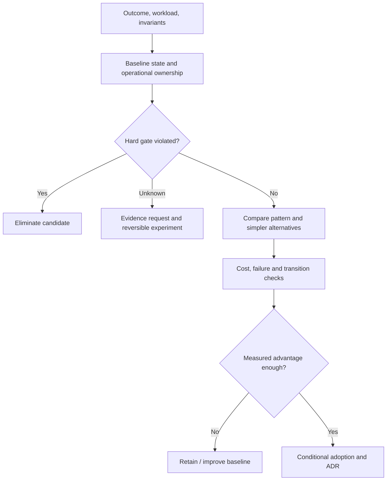

# Architecture patterns: applicability, contraindications and evidence gates

> **Tycho chapter draft V10/C03**, 2026-10-19, original general-purpose explanations and synthetic examples. This is the book-level interpretation of pattern selection. The separately maintained [pattern applicability authoring model](../../authoring/models/pattern-applicability-card.md) remains a reusable decision-record tool and is not substituted for technical prose. No real design review, measured service or automatic selector is claimed.

## Purpose and mission

An architecture pattern is a **conditional intervention** into an existing set of constraints. Microservices can create independent deployments but add remote failure and data ownership questions; caching can avoid repeated work but weaken freshness unless tightly controlled; sharding can distribute independent keys but does not solve contention on a single logical record. Knowing a pattern's definition is not enough to decide whether to apply it.

This chapter teaches how to turn a requirements and legacy baseline into **applicability conditions, disqualifying evidence, alternatives and a falsifiable experiment**. The chapter is neither a broad taxonomy nor a ranked list of favorite technologies. [Martin Fowler's Microservice Trade-Offs (2015)](https://martinfowler.com/articles/microservice-trade-offs.html) explicitly analyzes benefits against distribution, consistency and operational costs. [SEI ATAM](https://www.sei.cmu.edu/library/the-architecture-tradeoff-analysis-method/) studies quality-attribute interactions. These public methods support conditional selection rather than universal adoption.

## 1. A pattern card answers a decision, not a vocabulary question

A meaningful applicability statement has six parts:

| Field | Required meaning |
|---|---|
| **Problem boundary** | Named user journey, correctness invariant, state owner and deployment/runtime context |
| **Preconditions** | Observable requirements without which the pattern's intended benefit does not apply |
| **Mechanism and gain** | The *specific* architectural constraint relaxed or capability created |
| **Costs and failure modes** | New distributed/state/resource risks, migration burden, team complexity and total cost |
| **Contraindications** | Confirmed hard-gate violations or missing capability that should reject the option |
| **Discriminator and revisit** | Minimal test that could prove/disprove benefit, and conditions for reevaluation |

An **unknown** is not automatically a contraindication. If the unknown concerns a non-negotiable data or security gate, it blocks approval until measured; if it concerns an optional quality preference, alternatives may be compared with uncertainty clearly shown. A hard failure is not made acceptable by a high weighted score.

If a pattern has several independent effects (e.g., microservices improve deployment isolation but may worsen p99), give these effects separate evidence tasks. Avoid a single red/green label for an entire style.

## 2. Evaluate the baseline before choosing a target

The canonical [requirements/workload chapter](requirements-and-workload-architecture-profiles.md) establishes what an architecture must achieve. The [legacy baseline](legacy-baseline-and-modernization-evidence.md) establishes which parts of the existing system must coexist during change. Their outputs become a decision envelope:

Text alternative: the pattern is selected only after it passes hard constraints, can be compared against the unchanged architecture and has a falsifiable benefit sufficient to justify its implementation and operational costs. Unknown gates generate investigations, not automatic approvals.

A useful design review includes *retain, tune or modularize* as candidates. Retaining a design is not the same as doing nothing: it may entail improving tests, dependency support, instrumentation, capacity control and operational contracts.

## 3. Worked applicability cards: deployment and communication

### Modular monolith or internal modules

**Applies if:** cohesive capabilities and shared state can live within one deployable, changes can be isolated through enforceable module boundaries and independent deployment provides little measured value.

**Benefits:** local transactional boundaries can remain simple, operational surfaces are fewer and cross-module calls do not require distributed-network fault handling. **Costs:** release/unit scaling may remain coarse, and ownership can degrade if internal boundaries are not enforced.

**Contraindications:** hard runtime-isolation requirements or proven need for independent deployment at an incompatible change cadence *may* disqualify a single deployable. A mere increase in user count is not such proof.

**Test:** inspect dependency rules and change impact, compare deployment risk and recovery under bounded changes. Read [module boundaries](../application/architecture-styles-and-module-boundaries.md) for the mechanism.

### Service decomposition / microservices

**Applies if:** independently owned capabilities can expose stable contracts, their state ownership and consistency model can be deliberately separated, and independent deployment or failure isolation is a real requirement.

**Benefits:** independently scalable/deployable services and stronger deployment barriers, conditional on real ownership. **Costs:** network, cross-service availability, multiple deployable operations, distributed trace and transaction/retry complexity, temporary dual-version migrations.

**Contraindications:** unowned shared data writers, strict single-local-transaction invariants without a viable redesign, absent release automation/operations capacity, clients that cannot tolerate network failure, or unknown data-cutover conditions.

**Test:** an incremental boundary pilot with actual shared-state and consumer tests, rollback/forward recovery, and bounded release time. Fowler's [Microservice Trade-Offs](https://martinfowler.com/articles/microservice-trade-offs.html) explicitly warns that distribution costs can overwhelm benefits in insufficiently complex systems. Independent service count is not a quality target.

### Asynchronous queue / durable workflow

**Applies if:** work can complete later than a synchronous response; durable acceptance and user-visible status are defined; volume spikes can be buffered within bounded retention/age budgets.

**Benefits:** decouples temporal demand from execution throughput and permits retry/replay policies. **Costs:** outcome uncertainty, queue ageing, duplicate effects, consumer lag, operational state and backlogs.

**Contraindications:** caller requires immediately committed final result; workflow lacks durable operation identity; replay can repeat irreversible effects; upstream keeps retrying indefinitely; retention and overload are unbounded.

**Test:** acknowledgment loss after acceptance, consumer restart after side effect, duplicate delivery, dead-letter/recovery and queue-age SLO. Read [outbox/idempotency](../distributed/transactional-outbox-and-idempotency.md), [Kafka](../integration/kafka-partitions-replication-and-contracts.md) and [durable messaging choices](../integration/messaging-families-and-durable-workflows.md).

## 4. Worked applicability cards: performance and data

### Cache

**Applies if:** repeated reads dominate a costly computation, authority and invalidation are known, freshness/error policy is measurable, and extra storage/routing can be operated safely.

**Benefits:** fewer repeated authoritative reads, lower latency for selected popular values. **Costs:** stale reads, memory cost, cache stampedes, invalidation race conditions, credential/tenant leaks if scoped badly.

**Contraindications:** strong immediate freshness with no proven invalidation protocol; high write churn; low key reuse; cached data whose ownership/correctness cannot be defined.

**Test:** read hit ratio under the real key distribution, post-write freshness, cache outage fallback, hot-key and stampede injection. Read [cache correctness](../scaling/local-distributed-caching-and-invalidation.md).

### Sharding and partitioning

**Applies if:** a measurable datastore/resource ceiling is caused by *distributable* independent key ranges, routing identity is stable and resharding/reconciliation is feasible.

**Benefits:** distributed storage/workload limits and independent partitions. **Costs:** repartitioning, cross-shard queries/transactions, hot-key skew, rebalancing and operational failure domains.

**Contraindications:** the bottleneck is one serial hot key, all operations require global atomicity, or client/schema ownership prevents safely moving keys.

**Test:** replay skew distribution, shard migration with dual-version readers, failure mid-copy, correctness of exclusive ownership and response tail. Read [shard keys and migration](../scaling/shard-keys-hotspots-and-resharding.md).

### Virtual threads / reactive execution

**Applies if:** I/O waiting dominates and an execution model's task/stack/flow semantics match the dependency behavior and runtime version.

**Benefits:** cheaper waiting-task concurrency or nonblocking composition for certain workloads. **Costs:** scheduling/backpressure/cancellation complexity, dependence on downstream limits and framework integration.

**Contraindications:** CPU-saturated hot path, uncontrolled shared connection pool, lack of cancellation/backpressure correctness, or chosen libraries that do not obey the required execution contract.

**Test:** compare at fixed **offered** work and downstream capacity; measure CPU, queue/pool waits, timeout, cancellation and correctness. Read [Java execution](../execution/platform-threads-executors-and-virtual-threads.md), [reactive demand](../execution/reactor-webflux-r2dbc-and-backpressure.md) and [CPU/GC diagnostics](../execution/cpu-memory-gc-and-blocking-diagnostics.md).

## 5. Contraindications are not generic anti-pattern labels

A pattern can be a poor fit **here and now** without being inherently bad. For example, event-driven processing may be appropriate for an asynchronous catalog index even if it is inappropriate for a synchronous safety-critical allocation decision. The difference is not the popularity of event sourcing but **authority and required consistency**.

Record one of these explicit decision states:

- **Applicable:** required preconditions are supported and no hard-gate violation is established; still requires implementation tests.
- **Conditionally applicable:** plausible under stated but unverified assumptions; proposed experiment/guarded transition required.
- **Contraindicated:** an observed non-negotiable requirement is demonstrably violated by the proposed design as specified.
- **Not required:** baseline meets known outcomes and no incremental benefit justifies new complexity.
- **Insufficient evidence:** important owner, workload, dependency or recovery facts are missing.
- **Historical/obsolete candidate:** supported only for a dated runtime/migration snapshot, not current guidance without re-verification.

**Crucial:** a missing measurement is not evidence that an option can never work. In a decision tool, "unknown" must not silently become "pass" or "fail"; it triggers source or experiment work.

## 6. Original synthetic decision: bursty reservations

A fictional resource reservation application guarantees that each timeslot is committed to at most one eligible requester. An input says "busy mornings," but gives no observed contention, latency, arrival or retry distribution. The team proposes "Kafka + sharded microservices + distributed cache."

**Test hard gates first:**
1. No double allocation under simultaneous attempts and ambiguous responses.
2. Correct authorization to reserve or cancel a named slot.
3. A visible final-result or accepted/pending contract for the user.
4. Stable operation identity across retries and no untracked divergent writers.

**Compare realistic candidates:**

| Option | Why it might help | What must first be true |
|---|---|---|
| Keep local authority, instrument/tune | Preserves simple invariant and measures actual bottleneck | Existing transaction semantics verified, observed demand profile available |
| Bounded admission + async result | Protects backend when deferred completion is allowed | Business/client can accept pending status and durable tracking |
| Separate service with owned store | Useful for measured independent deployment/capacity boundaries | One-writer migration, safe cross-version clients, recoverable cutover |
| Shard slot authority | Could distribute *independent* slot keys | Hot-key distribution and migration ownership validated |
| Cache available slots | Speeds eligible reads when staleness understood | Final allocation always revalidated at authority |
| Reactive/virtual execution | Reduces waiting overhead under I/O-heavy admission | Downstream actually has capacity and cancellation semantics are correct |

The composite proposal is **not yet warranted**. It adds multiple state, network and operational boundaries while leaving a single-slot invariant unresolved. Adopt **MEASURE_FIRST** for queue, contention and user-visible outcomes, then test one reversible change at a time.

### Reversing the initial decision

If a consistent multi-day measurement demonstrates isolated per-key transactions, distinct independent capability owners and safe asynchronous customer semantics, an extracted/sharded service or durable work queue may be conditionally viable. If the bottleneck is a single hot timeslot, more partitions or threads do not alter the invariant that only one requester can win. If clients strictly require final outcomes synchronously, a queue-based acceptance change is a contract change, not a transparent optimization.

This invented example is **not** evidence that a particular implementation meets the given numbers; no load test or service exists.

## 7. A complete pattern decision includes transition risk and falsification

An architecture decision record should include:
- concrete user outcome and failure class, units/time window and budget;
- current evidence versus assumptions, including source revisions and confidence;
- options with current/retained design, hard-constraint screening and cost;
- why selected and rejected patterns fit or fail **this** context;
- a minimal discriminating experiment with correctness and operational acceptance;
- target **and transitional** data/client boundaries;
- irreversible steps, rollback/forward repair and explicit stop gates;
- conditions and owner for re-evaluation.

Cross-domain examples belong in the separate [decision synthesis](cross-domain-modernization-and-adr-examples.md). General option scoring and ADR formatting remain in the supporting [candidate comparison model](../../authoring/models/candidate-comparison-adr.md). Do not copy canonical technical explanations into every pattern card; link them.

## 8. Source-to-claim ledger and review limits

| Reviewed independent public source | Narrow support | Limit |
|---|---|---|
| [Fowler, Microservice Trade-Offs (2015)](https://martinfowler.com/articles/microservice-trade-offs.html) | Independent deployment, boundaries and distributed/operational costs | Not proof that any particular project needs microservices |
| [SEI ATAM, Kazman et al. (1998)](https://www.sei.cmu.edu/library/the-architecture-tradeoff-analysis-method/) | Evaluating interacting quality attributes and design risks | Not an automated ranking or acceptance of this book's example |
| [Tycho module and style chapter](../application/architecture-styles-and-module-boundaries.md) | Canonical mechanism distinction for modular monolith/SOA/services | No executable modularity enforcement for fictional app |
| [Tycho caching, sharding, outbox and concurrency chapters](../scaling/local-distributed-caching-and-invalidation.md) | Boundaries of the referenced technical patterns | No real-world performance values transferred to the example |

All matrix entries and the resource reservation example are original educational statements under explicit assumptions. No live workload, executed migration, independently reviewed pattern suitability, cost study or deployed architecture selection agent is claimed. Validation of a real decision requires source/version evidence and domain review.

**Navigation:** planned **V10/C03** in [book outline](../PROPOSED-STRUCTURE.md), current [decision support landing](README.md); prerequisite [requirements/workload](requirements-and-workload-architecture-profiles.md), [legacy baseline](legacy-baseline-and-modernization-evidence.md); next [cross-domain decisions](cross-domain-modernization-and-adr-examples.md), [target-vs-transition](../../authoring/models/target-transition-architecture.md).
