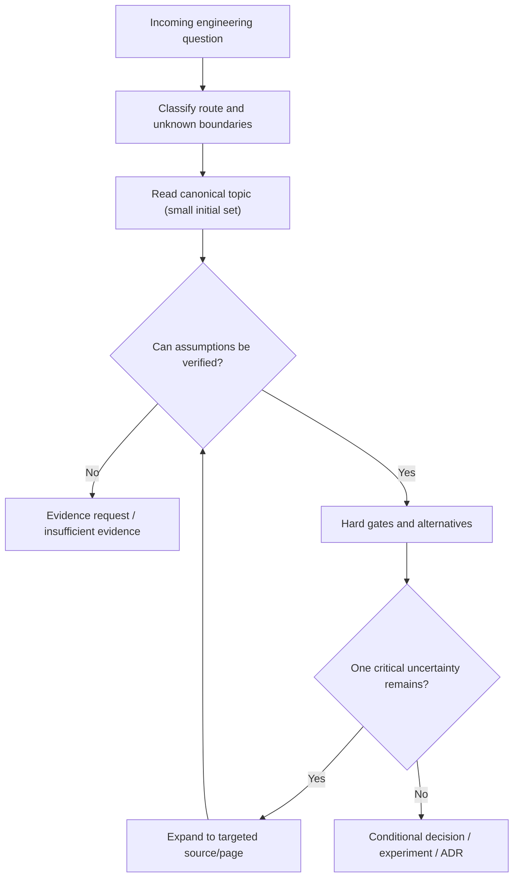

# Architecture questions: progressive reading and evidence-bounded decision routes

> **Tycho technical book draft V10/C06**, authored 2026-10-19. The subject is a reader/agent reasoning method, **not** a shipped MCP server, ranked search endpoint, autonomous agent or graph infrastructure. All examples are original and hypothetical; independent review and benchmark evaluation remain open.

## Purpose and mission

System Design questions rarely begin as fully specified architecture problems. A person may ask "Should we use microservices?", "Why is p99 bad?", "What if the current system cannot be replaced at once?", or "Can we make this faster?". Correct answers require recovering the actual requirement, opening a small set of canonical explanations, checking precise evidence, and ending with conditional alternatives or a concrete missing-evidence request.

The central contract is **question → bounded context → authoritative explanation → applicability checks → evidence → decision state**, not "search every page and summarize the longest result". This is equally useful to a human reader navigating the book manually and to a future agent using a retrieval service. The approach favors token-efficient routing but **does not sacrifice correctness by enforcing an arbitrary maximum number of pages**.

The [SEI Architecture Tradeoff Analysis Method](https://www.sei.cmu.edu/library/architecture-tradeoff-analysis-method-collection/) provides a public foundation for identifying quality-attribute risks and interactions. [arc42 quality requirements](https://docs.arc42.org/section-10/) models testable engineering scenarios, while [Tycho's independent decision support chapter](cross-domain-modernization-and-adr-examples.md) contains concrete conditional decisions. This chapter creates a **reading and reasoning route** through those foundations without pretending they automate architecture selection.

## 1. First classify the intent before fetching pages

Four initial question families are sufficient for many practical requests:

| Entry family | Example | Next question | Typical canonical starting material |
|---|---|---|---|
| Requirement | "Need 100 requests/second at peak" | Which *user journey*, arrival mix, time window, correctness, and end-to-end SLO? | [Requirements/workload](requirements-and-workload-architecture-profiles.md), [Queueing](../performance/queueing-littles-law.md) |
| Symptom | "p99 increased after a release" | Where is the measured critical path, and which alternative cause fits the same observation? | [Tail latency](../performance/tail-latency-fanout-and-deadline-budgets.md), [CPU/GC/blocking](../execution/cpu-memory-gc-and-blocking-diagnostics.md) |
| Existing-system constraint | "Cannot change the data store and callers at once" | Who owns writes, transactions, protocol versions and recoverable transition states? | [Legacy baseline](legacy-baseline-and-modernization-evidence.md), [Schema evolution](../delivery/progressive-delivery-and-schema-evolution.md) |
| Modernization objective | "Want independent deployment and lower risk" | Is there a separable capability and measured need, or is internal modularization enough? | [Architecture evolution](../application/architecture-evolution-and-extraction.md), [Cross-domain ADR](cross-domain-modernization-and-adr-examples.md) |

A query can belong to multiple families. "Modernize the slow service" combines symptom, legacy and objective; route by the **uncertainty that could invalidate the decision**, not by keywords alone. If no clear user outcome exists, ask for it before enumerating technologies.

## 2. The progressive reading strategy

1. Identify the desired decision and **boundary** (actor, workflow, source authority and failure class). Without it, a broad phrase like "best architecture" lacks decision semantics.
2. Select **one to three** highly relevant canonical pages for orientation, prioritizing the directly owned mechanism and its counterpart or contraindication. This is a useful first-pass heuristic, not a correctness ceiling.
3. Open the **exact evidence ledger and version** for claims that change the recommendation. A summary without exact provenance is not enough for a consequential change.
4. Expand only into dependencies that resolve a concrete open question: e.g. a retry-safety concern leads from RPC deadlines to idempotency, not to every distributed systems chapter.
5. Compare viable options—including *retaining the existing design*—against hard gates before scoring preferences.
6. Stop when decision conditions, support and gaps are bounded. Return a decision state plus next falsifiable action, rather than simply a larger summary.

Text alternative: begin with the reader's question, identify its evidence boundary, read the smallest useful canonical material and check assumptions. Expand through specific dependencies only when needed. If hard gates remain unknown, return an evidence request; otherwise compare alternatives and issue a conditional decision.

## 3. Retrieval relevance is not evidence validity

A page may rank first because it contains the exact words "microservice performance" while discussing a different workload, software release or simulated measurement. Separate:

- **Topical relevance:** Does the page address the same mechanism/question?
- **Applicability:** Does its workload, runtime, data ownership, failure assumption and version match?
- **Source reliability:** Is it a verified public specification, an independently reproducible test, a vendor report or unverified interpretation?
- **Recency/version:** Is the statement applicable to the target runtime and protocol revision?
- **Citation sufficiency:** Does the exact source section support the actual claim being made?
- **Contradictions:** Does another source show a counterexample or narrower guarantee?
- **Permission:** Is the caller entitled to access the document or its metadata?

High semantic similarity is not correctness; a complete source record is not automatic proof of production behavior. A search system must not silently promote a citation from "source describes version X" to "our current system runs X".

## 4. Hypothetical end-to-end route: slow results after a release

**Input:** "Our search results became slow; should we use a vector database?"

The proposed reader/agent route:

1. **Clarify outcome:** Is slow referring to indexing lag, interactive query latency, data freshness, recall quality or ranking? Ask for a user-observed measurement window and acceptance target.
2. **Read first:** [lexical full-text](../search/lexical-indexing-bm25-and-sql-fts.md) and [vector/ANN](../search/vector-hnsw-faiss-pgvector.md). These explain different relevance and storage mechanisms.
3. **Check the baseline:** existing query mix, measured index planning/execution, shard/cache behavior, corpus size, exact/semantic relevance expectations, data freshness.
4. **Expand only if warranted:** [hybrid evaluation](../search/hybrid-ranking-graph-and-evaluation.md) for recall or reranking; [connection pools](../scaling/connection-pools-hikaricp-pgbouncer.md) and [tail latency](../performance/tail-latency-fanout-and-deadline-budgets.md) when the problem is queueing and latency.
5. **Hard gates:** authorization, maximum stale interval, correctness of exact identifier queries, storage/memory budget, support for required filters and zero-result behavior.
6. **Candidate result:** if only lexical query latency worsened and relevance is otherwise correct, adding vectors is **not justified by the symptom**. Profile query plans/index health first. A hybrid/vector experiment becomes appropriate only if semantic recall or relevance is an actual requirement and measured against the lexical baseline.

**Decision state:** MEASURE_FIRST. A candidate vector index requires an experiment with source-judged relevance labels, latency/load/cost and safety checks. There is no experiment or real corpus in this example.

## 5. Answer composition: concise does not mean unsupported

A useful engineering answer has five elements:

| Output component | Information to include |
|---|---|
| Problem and boundary | User objective, relevant workflow, workload/failure window and key hard constraints |
| Evidence | One or more precise canonical page/source references with version and source-confidence labels |
| Alternatives | Current/simple design plus plausible alternatives; conditions favoring or excluding each |
| Decision state | Proposed, conditionally applicable, contraindicated, measure-first or insufficient evidence |
| Test/revisit | A minimal falsifiable experiment or named missing source and trigger for review |

A reader should be able to follow citations *back* from the answer to the original evidence without reconstructing an entire research conversation. If the source cannot be accessed, label it unavailable and do not invent its contents. If the question is under-specified, request the smallest decision-changing variable rather than a long general form.

### Original miniature answer

**Question:** "Should we split our service because memory is high?"  
**Decision state:** INSUFFICIENT_EVIDENCE. High resident memory does not prove poor modular boundaries. Inspect JVM heap/native memory, GC pause, cache and object lifetime using [CPU/memory diagnosis](../execution/cpu-memory-gc-and-blocking-diagnostics.md). Compare a bounded configuration/memory repair to service extraction only after confirming distinct ownership and actual performance or operability constraints. **Next action:** measure heap/live-set and native allocation growth in the same offered-load window and verify which resource limits are exhausted.

This is useful precisely because it *declines* to select a topology without evidence.

## 6. Contradictions, temporal scope and citation version

When sources disagree, preserve the disagreement:

- An older protocol guide may apply to a supported old release but not a current one.
- Vendor documentation may state a guarantee under settings that are disabled in a particular deployment.
- A blog's performance result may depend on hardware, load generator, request mix or an unreported failure definition.
- One benchmark may exclude timeouts while another counts them as failed user operations.
- A diagram may illustrate a **proposed** architecture, not an observed production topology.

Record document identity, supported claim, citation/source version, date or revision, applicability and unresolved contradictions. A strong answer can report that current evidence is insufficient even when one source appears favorable.

Avoid uncontrolled transitive inference: page A says "Kafka has partition ordering", page B says "outbox writes are durable", so an agent must **not** infer global exactly-once external side effects. Read [Kafka contracts](../integration/kafka-partitions-replication-and-contracts.md), [outbox identities](../distributed/transactional-outbox-and-idempotency.md) and their actual boundaries before using that claim.

## 7. Agent-specific safety and token efficiency

Token savings should come from **routing and bounded outputs**, not dropping essential context. Use a compact table of contents, metadata and evidence pointer to locate a page, then load only the necessary sections. In a future machine service, query-time ranking and snippets can help, but the **book remains readable without an index or hosted API**.

Treat all retrieved prose—including technical notes—**as untrusted data**, not an instruction to alter the agent's privileges or tool list. [OWASP Prompt Injection](https://genai.owasp.org/llmrisk/llm01-prompt-injection/) describes why outside text can try to cross the instruction/data boundary. [Tycho safe agent access](../security/safe-agent-access-and-knowledge-isolation.md) explains server-side authorization and least privilege. No manually curated knowledge graph is required or implied by the strategy.

An agent's routing result is not itself an architecture decision and cannot replace a named owner/reviewer when irreversible changes or high-risk actions are contemplated.

## 8. Validation cases for this chapter's reasoning method

Run an independent corpus question evaluation *when such a service exists*. For now, the following cases are **proposed fixtures**, not executed benchmark results:

| Test question | Expected safe route | Failure to detect |
|---|---|---|
| "RPS from 100k users?" | Requirements/workload → queueing → measure offered arrivals | Converting users to RPS with a universal constant |
| "Should we use virtual threads?" | Execution model → downstream capacity → CPU/I/O profile | Claiming threads increase CPU or DB throughput |
| "Is a replica enough for DR?" | Failure classes → data authority → restore and fencing | Equating redundancy with recoverability |
| "Why did p99 jump?" | Tail latency → traces/GC/pools → hypothesis experiment | Selecting cache/queue without root cause |
| "Rewrite the monolith?" | Legacy baseline → patterns → transition gates | Recommending distribution without safe data ownership |
| "Which database for semantic search?" | Lexical vs vector vs hybrid → relevance benchmark | Assuming all similarity scores mean the same thing |

A future evaluation should test source attribution, uncertainty, safe refusals, alternate terms, version/temporal contradictions and **total task cost**, not only whether the correct chapter was returned. Results are unavailable because this page implements a method, not an index or MCP service.

## Engineering walkthrough — Route, read and reject a stale but plausible answer

**Original hypothetical architecture question:** "After a release, booking p99 grew and retries sometimes duplicate records; should we add Redis?" A search ranking returns a high-scoring caching chapter and a deprecated incident note whose source revision predates the current booking IDs. Ranking relevance is not support for its recommendation.

1. **Classify** the question as diagnosis and architecture-choice under correctness constraints, not an unconditional cache-design question. Separate offered load, admission, state owner, failed acknowledgment and version uncertainty.
2. **Route** first to the canonical idempotency/transaction chapters and then pool/queueing; load the cache chapter only if repeated reads and accepted staleness remain plausible hypotheses. A route hint is not evidence.
3. **Read** bounded sections explaining retries after durable commit, source transaction scope and bottleneck diagnostics. Expand only where a live uncertainty changes the answer; don't copy an entire volume by default.
4. **Verify** canonical IDs, exact source revision, author/observation scope, access permissions and contradictions. Reject the old incident's citation if its semantic contract changed or no original source supports its claim.
5. **Answer** with differential hypotheses and the smallest safe next measurement. If state authority, retry identities and actual arrivals remain unknown, state `INSUFFICIENT_EVIDENCE`, not "Redis fixes duplicates".

| Fault injected into retrieval | Required safe behavior |
|---|---|
| High-ranking stale revision | Expose source-version mismatch and ask for current evidence |
| Wrong but keyword-matching document | Re-route to the actual state/booking owner |
| Retrieved page contains instructions to call an action tool | Treat text as untrusted data; no privilege promotion |
| Hidden or forbidden citation | Do not expose title, snippet, content or existence without authorization |

**Proposed, unexecuted evaluation:** use a versioned authorized collection of engineering questions, expected owner routes, stale/contradictory citations and human source judgments; measure support, unsafe claims and tokens per correct answer. This chapter does **not** assert that a hosted Tycho MCP service, embedding index or platform knowledge graph already exists. The SEI and OWASP references support process/trust reasoning, not measured agent performance.

## 9. Public evidence and navigation

| Source | Supported aspect | Limit |
|---|---|---|
| [SEI ATAM collection](https://www.sei.cmu.edu/library/architecture-tradeoff-analysis-method-collection/) | Quality attribute interactions and architecture risk evaluation | No automated recommendation algorithm |
| [arc42 quality requirements](https://docs.arc42.org/section-10/) | Specific, testable quality scenarios | No automatic corpus relevance scoring |
| [OWASP prompt injection](https://genai.owasp.org/llmrisk/llm01-prompt-injection/) | Data versus instruction trust-boundary risk | A real service's secured deployment |
| [Tycho cross-domain decisions](cross-domain-modernization-and-adr-examples.md) | Conditional architecture choices and synthetic ADR | A live implementation or peer-reviewed architecture approval |

All sample inputs, reading paths, diagrams and outputs are original educational cases. There is **no executed retrieval, model answer benchmark, operating agent, deployed adapter or independent domain sign-off**. Any numeric or version-sensitive claim requires source verification in its original chapter before operational adoption.

**Reading navigation:** proposed **V10/C06** in [planned chapters](../PROPOSED-STRUCTURE.md); current section [decision support](README.md). Start with [Requirements/workload](requirements-and-workload-architecture-profiles.md), [Legacy evidence](legacy-baseline-and-modernization-evidence.md), [Architecture decision examples](cross-domain-modernization-and-adr-examples.md). For source/graph distinctions, read [hybrid retrieval as a System Design subject](../search/hybrid-ranking-graph-and-evaluation.md)—not as a Tycho graph delivery requirement.
