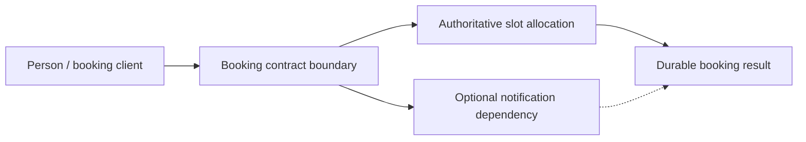
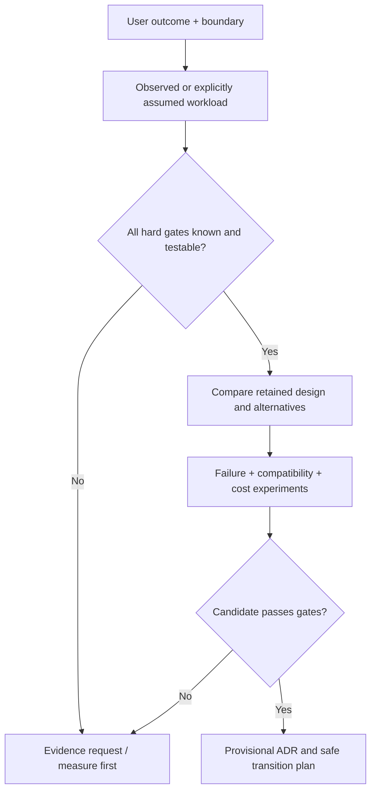

# From requirements and workloads to a testable architecture profile

> **Tycho independent technical chapter draft:** proposed V10/C01. Authored 2026-10-19 using publicly accessible architecture-evaluation guidance and original synthetic examples. This chapter explains a *book-level method*; the reusable [authoring profile contract](../../authoring/models/requirements-workload-profile.md) remains a separate supporting tool. No actual organization, workload telemetry, approval or benchmark is represented.

## Purpose and mission

The same headline requirement—"serve more users reliably"—can justify different designs when one system has a write-contention bottleneck, another has occasional bulk jobs, and a third has a downstream rate limit. An architecture recommendation should therefore begin with **an explicit contract for observable outcomes, load, invariants and resources**, rather than a technology catalogue.

The profile's job is to preserve what is *known*, what is required, what is assumed and what must be measured. Its output is not an architecture: it is a testable decision boundary in which every candidate can be rejected, conditioned or compared. [arc42 Introduction and Goals](https://docs.arc42.org/section-1/) ties architectural drivers to fundamental requirements, quality goals and stakeholders. [arc42 Quality Requirements](https://docs.arc42.org/section-10/) distinguishes usage and change scenarios with observable response measures. [SEI's Architecture Tradeoff Analysis Method](https://www.sei.cmu.edu/library/the-architecture-tradeoff-analysis-method/) describes systematic evaluation against interacting qualities. Those are methodological sources, not evidence for the invented workload below.

## 1. Begin with a user outcome and a system boundary

**Original fictional case:** people reserve shared workshop equipment through a web application. A successful action allocates one available timeslot exactly once and provides a durable booking ID. Two users may contend for the same slot, and external clients may retry a booking after losing a response.

A useful business boundary includes the actor, requested outcome, external systems, irreversible changes and failure ownership. It should not be defined as "the Java backend" before we know who owns allocation state and whether an external payment or calendar write is mandatory. If relevant interfaces are outside the evaluated boundary, their failure assumptions must still be recorded.

**Diagram explanation:** The slot allocation and durable booking ID are required for correctness. Notification is optional under this *invented* contract and may complete later. A notification failure must not turn a successfully committed booking into a new booking attempt. The diagram does not prescribe monolithic or distributed deployment; both could implement it with different cost and failure risk.

Define what is **in scope** (booking acceptance, allocation consistency, outcomes, rejection) and **out of scope** (equipment inventory procurement, unrelated reporting). Write separate ingress/egress and state-authority boundaries, not only a list of code packages.

## 2. Four kinds of requirement must stay distinct

| Statement kind | Fictional example | Treatment during selection |
|---|---|---|
| Business outcome | An accepted reservation has a durable identifier | Evaluate the observable journey and its final state |
| Hard invariant | A slot must not have two simultaneously valid owners | Reject any design that cannot enforce it; measure correctness under contention |
| Measurable quality target | For a defined 10-minute peak, 99% of eligible completed booking attempts receive a final result within 700 ms | Requires a precise clock, population, failure treatment and verification method |
| Preference / cost envelope | Prefer small on-call burden and predictable monthly cost | Compare only candidates that first pass non-negotiable gates |

A hard invariant is not the same as an availability SLO: a 99.9% success objective does **not** permit 0.1% duplicate bookings. Nor may an architecture score trade away an authorization failure or data-loss constraint to gain p95 latency. Unknown hard-gate evidence remains a blocker to unconditional approval; it is not equivalent to passing the gate.

The example 700 ms and 99% are **invented targets**, not an engineering recommendation. Before using them, define whose clock starts the attempt, whether the 99% population includes rejected, timed-out or retried requests, how errors contribute to success, and what workload mix and geographical environment are represented.

## 3. Workload is a vector, not a user count

An initial workload description records:

| Dimension | Questions a meaningful profile answers |
|---|---|
| Offered arrival rate | How many attempts per time unit reach the boundary, including failed and retried demand? |
| Admitted and completed rate | How much work is accepted, completed, rejected, queued and timed out in the same window? |
| Request mix | What proportion is read, booking write, cancellation, bulk synchronization, search or administrative change? |
| Concurrent work | How many requests are resident, waiting for resources, awaiting I/O or in durable background processing? |
| State size and skew | How much storage and how many active keys; do a few slots attract most concurrent writes? |
| Temporal shape | Is the peak 3 seconds, 10 minutes or 4 hours; what is normal and seasonal behavior? |
| Dependency limits | What external quotas, DB pool sizes, lock durations, connection budgets and network deadlines apply? |
| Growth and degradation | What happens under doubled offered load, partial loss or failed downstream dependencies? |
| Cost/team horizon | Staffing, recovery skill, operating envelopes and cost constraints across environments |

These values cannot be inferred from "daily active users" alone. Distinguish a *request arrival* from a *concurrent session*, and a client retry from a new business operation. Queueing identities such as L = λW constrain long-run mean resident work under a stable compatible boundary; they do not convert active accounts into requests per second. Read [queueing and measurement boundaries](../performance/queueing-littles-law.md).

### Synthetic contrast: same daily users, different architecture pressure

Two **fictional** products each have 10,000 registered users.

- **Scenario A:** most use the system at separate times to read static workshop schedules. A small number write bookings; dominant costs are cache freshness, search usability and delivery of public content.
- **Scenario B:** a short opening window drives 2,000 booking attempts in 20 seconds, many against the same few workshop slots, while clients retry uncertain outcomes. The peak offered rate in the invented scenario is 100 attempts/second; **it does not imply** 100 successful transactions/second or independent slot keys.

One user-count metric cannot distinguish A from B. Even in B, adding service replicas does not remove serialization at a single authoritative slot. Before considering scale-out, measure key skew, duplicate effects, contention duration and the success definition under burst.

## 4. Turn qualities into adversarial scenarios

A quality attribute should have a stimulus, affected boundary, environment, expected response and measurable acceptance criterion. In the fictional booking system, these would be **proposed experiments**:

| Scenario | Stimulus and environment | Observable criterion | Architectural question |
|---|---|---|---|
| Concurrency correctness | Two clients reserve same slot simultaneously | At most one committed owner; both get consistent final results | Which datastore transaction or compare-and-set boundary enforces this? |
| Client uncertainty | Reply is lost after durable commit | Same logical retry yields original booking, no duplicate | Where is durable operation identity stored? |
| Capacity peak | 100 offered attempts/s for 20 seconds with configured skew | Defined admission/success/latency envelope; no invisible loss | Which resource saturates first? |
| Dependency outage | Notification provider unavailable | Booking truth remains queryable; notifications eventually resolved according to policy | Can notification be decoupled without changing core outcome? |
| Changeability | Booking rule extended while old clients remain | Named old/new client matrix and tests pass | Is API/schema evolution independently safe? |
| Recovery | Instance restarted with in-flight operations | Reconciliation produces correct durable results | Can locks, commands and offsets be recovered? |

The quality target may have to change after constraints and system boundaries are better understood. A scenario that is impossible without an unaffordable architectural change must be renegotiated explicitly, not silently omitted from the benchmark.

## 5. Separate evidence classes to prevent false certainty

Use a small, reusable evidence ledger for any consequential profile claim:

| Evidence state | What the profile may assert |
|---|---|
| Stakeholder requirement | A desired behavior exists; not that it is currently achieved |
| Instrumented observation | A measured ratio or event for a specified population/time/source/version |
| Reproduced test | Behavior occurred in a bounded setup; not a timeless production guarantee |
| Public vendor/standard text | How a protocol or implementation claims to behave at an identified version |
| Derived model | A mathematical or architecture inference under stated assumptions |
| Unknown | A missing measurement/ownership/compatibility check that must be requested |

This original classification applies general principles from [SEI ATAM](https://www.sei.cmu.edu/library/architecture-tradeoff-analysis-method-collection/) and Tycho's [evidence-first research method](../../authoring/METHODOLOGY.md). It is not a claim that the fictional measurements happened.

An author must record which of these states applies to each *important* claim, not only a global "verified" badge. A design's assumptions—like independent queues, immutable IDs or lossless retries—must be falsifiable. A reference to a published API contract supports contract semantics but does not prove a client implementation adheres to it.

## 6. Candidate screening before preference scoring

Suppose the team proposes three alternatives:

| Option | Baseline owner | Potential benefit | Risk and proof required |
|---|---|---|---|
| A — retain modular application and improve contention handling | Same transactional owner | Lowest migration surface; consistent data boundary | Verify lock/transaction semantics and measured peak ceiling |
| B — add bounded admission and a durable job queue | Same committed booking authority, with asynchronous acceptance | Stabilizes offered work when synchronous final outcome is not mandatory | Requires client consent to async completion; deduplication and recovery contract |
| C — extract separately deployed booking service | New runtime boundary; data ownership must be transferred deliberately | Independent deployment or resource isolation if evidence justifies it | Mixed-client compatibility, remote failures, durable cutover and total operating cost |

**Hard gate first:** if a client contract requires the *final* booking decision within 700 ms, option B is invalid until the contract or implementation proves that an asynchronous acceptance can satisfy the actual user journey. If one state owner is mandatory during coexistence, C must provide a safe migration with no double-writer gap. Unknown bottleneck data make none of these a proven scale solution.

Only after all gates are satisfied may preference comparisons assign relative weights to simplicity, cost, flexibility or latency. Check whether modest changes in assumed workloads or weights reverse the preferred option. [Candidate comparison and ADR model](../../authoring/models/candidate-comparison-adr.md) owns reusable scoring details; this book chapter explains when scoring would be invalid.

Text alternative: requirements are translated into a workload and hard gates; insufficient evidence produces an evidence request rather than a technology recommendation. Only viable candidates receive deeper experiments and a *provisional* record. Publication of this flow does not automate architecture approval.

## 7. Outcome of the fictional analysis

**Decision:** keep the current transactional owner and first measure actual key skew, queue wait, lock conflicts and accepted/completed outcomes under a replayable 20-second burst. This is **MEASURE_FIRST**, not a finding that one implementation is fast enough.

**Falsifiable hypotheses:** (H1) a small set of hot slots dominates contention; (H2) retries create duplicate offered demand; (H3) the notification provider occupies synchronous worker resources. Tests must distinguish competing causes rather than retroactively fitting an expected solution.

**Change/revisit triggers:** if measured multi-key load demonstrates separable state ownership and deployment cycles diverge, service extraction becomes more plausible. If one hot key remains dominant, sharding or more app replicas may not help. If the final-result deadline proves infeasible, options include changing service-level expectations or presenting a durable accepted/pending state only with an explicitly changed contract.

**Reader takeaway:** requirements and workloads do not select architecture automatically; they make a design decision *falsifiable*. This same profile supports later [legacy baseline assessment](../../authoring/models/legacy-modernization-profile.md), [pattern contraindications](../../authoring/models/pattern-applicability-card.md) and [cross-domain decisions](cross-domain-modernization-and-adr-examples.md).

## 8. Source-to-claim ledger, limitations and next research

| Inspected independent public evidence | Narrow use | Not established |
|---|---|---|
| [arc42 §1 — Introduction and Goals](https://docs.arc42.org/section-1/) | Stakeholder expectations, fundamental requirements and architectural goals | Any specific system's actual workload |
| [arc42 §3 — Context and Scope](https://docs.arc42.org/section-3/) | Business and technical interface boundaries | Runtime isolation or measured behavior |
| [arc42 §10 — Quality Requirements](https://docs.arc42.org/section-10/) | Measurable usage/change scenarios | Universal numerical SLOs |
| [SEI, Kazman et al., ATAM, CMU/SEI-98-TR-008 (1998)](https://www.sei.cmu.edu/library/the-architecture-tradeoff-analysis-method/) | Evaluation of competing architectural quality attributes | ATAM assessment of this illustrative booking design |
| [Tycho queueing study](../performance/queueing-littles-law.md) | Distinction between offered/completed load and stable-average modeling | Validation of synthetic 100/s demand |

All booking numbers, diagrams, decision tables, tests, hypotheses and outcomes are **original invented teaching material**. They were not exercised on a running service. No independent review, real cost study, workload collection or whole-volume coverage is claimed. For an actual project, obtain consented stakeholder requirements and telemetry before moving a provisional decision to accepted. The method's machine-readable integration remains independent future work.

## Navigation

- Planned owner: **V10/C01** in [book outline](../PROPOSED-STRUCTURE.md); current section [System Design decision support](README.md).
- Prerequisite: [Quality drivers](../application/quality-drivers-and-architecture-views.md); [Queueing](../performance/queueing-littles-law.md).
- Next concepts: [Legacy evolution](../application/architecture-evolution-and-extraction.md); [Cross-domain ADR decisions](cross-domain-modernization-and-adr-examples.md); [Safe rollout](../delivery/safe-rollout-and-recovery.md).
- Supporting non-book tooling: [Requirements/workload template](../../authoring/models/requirements-workload-profile.md), [Candidate ADR format](../../authoring/models/candidate-comparison-adr.md).
