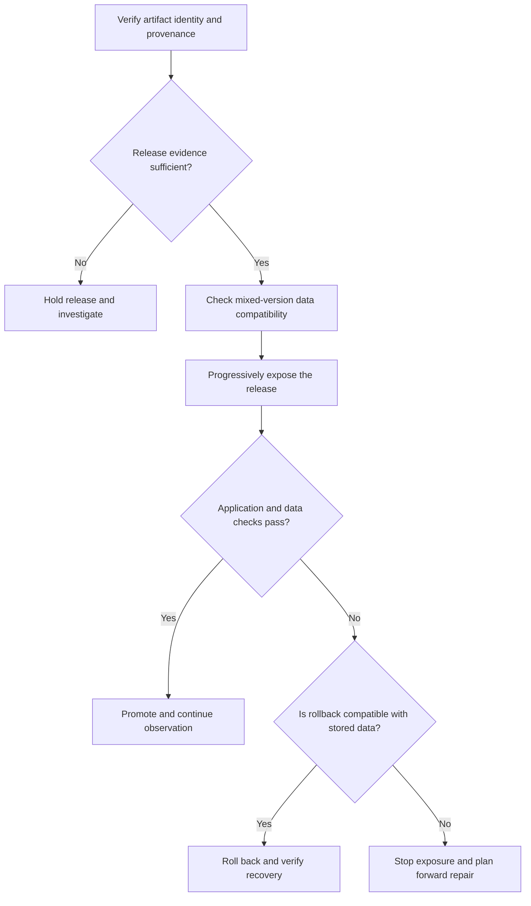

# Delivery pipelines, progressive releases and schema evolution

## Purpose and mission

This section distinguishes producing trusted artifacts, promoting those artifacts, operating mixed-version applications and recovering correct business state after a failed change. Neither green CI nor a successful resource rollout is proof of data correctness.

## Release and recovery boundaries

The following original, synthetic decision flow separates artifact eligibility,
application rollout and data recovery. It is a reading guide, not a report of
an executed deployment or a complete release policy.

Text alternative: verify the artifact before releasing it, check data
compatibility before exposing mixed versions, and evaluate application and data
behavior during rollout. On failure, choose rollback only when the data
contract permits it; otherwise stop exposure and use a validated forward-repair
plan. The chapters below explain the assumptions and evidence for each boundary.

## Canonical chapters

1. [CI/CD architecture, artifact provenance and GitOps reconciliation](ci-cd-provenance-and-gitops.md) — source/build/artifact/release identity, runner trust and permissions, signing/provenance, direct push versus GitOps pull, drift and deployment authority.
2. [Software supply-chain evidence, SBOM and attestations](sbom-attestation-and-release-verification.md) — V08/C02 independently scoped SLSA 1.2, SPDX/CycloneDX and Sigstore verification policies; no build or signing executed.
3. [GitOps, rolling, blue/green and canary releases](gitops-canary-and-progressive-rollout.md) — **V08/C04** release controllers, traffic exposure and rollback safety gates.
4. [Backward-compatible database change and online DDL](mixed-version-database-compatibility-and-online-ddl.md) — **V08/C05** mixed-version reader/writer matrix, schema-change locks, replay and forward repair.
5. [Earlier combined rollout/schema research](progressive-delivery-and-schema-evolution.md) — preserved historical source, no longer the primary owner of V05/C06, V08/C04 or V08/C05.
6. [Safe rollout, compatibility and recovery under partial failure](safe-rollout-and-recovery.md) — original synthetic failed deployment timeline, user-visible acceptance gates, recovery objectives and limitations.

## Directed question routes

| User/agent question | Read first | Related evidence |
|---|---|---|
| How do we prove the deployed artifact is the one tested? | [CI/CD provenance](ci-cd-provenance-and-gitops.md) | [Safe rollout](safe-rollout-and-recovery.md) |
| Which artifact digest, signer, SBOM and provenance claims justify release eligibility? | [SBOM/attestation verification](sbom-attestation-and-release-verification.md) | [CI/CD provenance](ci-cd-provenance-and-gitops.md) |
| When does GitOps actually reconcile live resources? | [CI/CD provenance](ci-cd-provenance-and-gitops.md) | [Deployment control-plane assumptions](../deployment/runtime-placement-and-control-plane.md) |
| Can we run old and new application versions against one database? | [Mixed-version database contracts](mixed-version-database-compatibility-and-online-ddl.md) | [Target and transition model](../../authoring/models/target-transition-architecture.md) |
| Is rolling back an image a safe recovery? | [Safe rollout](safe-rollout-and-recovery.md) | [Progressive delivery](gitops-canary-and-progressive-rollout.md) |
| How should a region-wide loss change the release/recovery plan? | [Disaster recovery](../deployment/disaster-recovery-and-recovery-objectives.md) | [Safe rollout](safe-rollout-and-recovery.md) |

The new chapter owners are original evidence-linked research drafts; the earlier combined study is preserved for editorial evidence migration. Their diagrams, incompatibility examples, controls and incidents are **synthetic**; no deployed pipeline, signature verification, schema upgrade, multi-version experiment, restore drill or independent human review is claimed. The full V08 chapter coverage still requires a distinct editorial crosswalk, not only a landing-page assertion.
