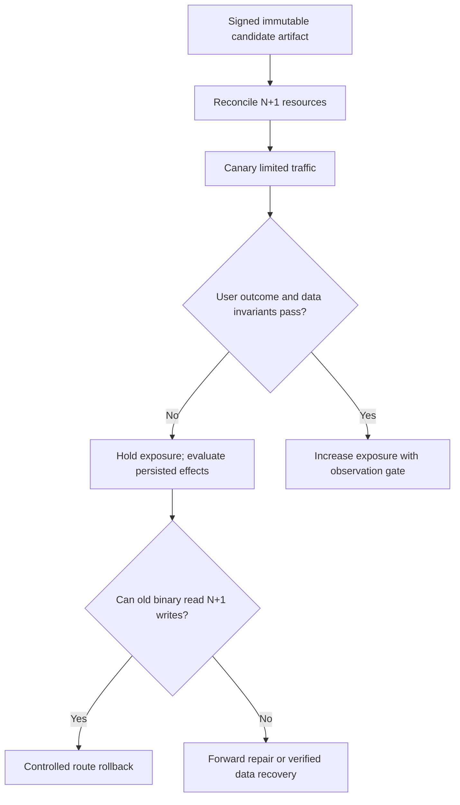

# GitOps, rolling, blue/green and canary release architecture

> **Independent Tycho V08/C04 manuscript**, 2026-10-19. Public Kubernetes Deployment and Argo Rollouts documentation informs controller mechanisms. All rollout examples, diagrams and acceptance criteria are original hypotheticals; no cluster, deployment, pipeline, experiment or external review was executed. Prior [mixed rollout/schema research](progressive-delivery-and-schema-evolution.md) is preserved for editorial mapping.

## Purpose and mission

A release mechanism decides which version is **deployed and exposed**. It does not by itself prove which data, users or business effects each version can safely interpret. Progressive deployment can limit a failure's initial blast radius, but cannot prevent a small canary from writing incompatible shared state used by every older instance.

This chapter owns **release-controller behavior, routing/exposure, analysis gates and GitOps reconciliation**. [V08/C05 data compatibility](mixed-version-database-compatibility-and-online-ddl.md) owns old/new readers and online DDL; [V05/C06 data lifecycle](../data/schema-lifecycle-and-semantic-migration.md) owns semantic migration itself.

## 1. GitOps reconciles desired configuration, not business outcomes

A GitOps controller observes versioned desired deployment state and tries to align cluster/runtime resources with it. A clean diff or converged resource state does not mean downstream effects, durable writes or API contracts are correct.

Separate:
- **source/build artifact identity**: which immutable bytes were tested and approved;
- **deployment state**: which revision and configuration an authorized controller attempts to apply;
- **runtime readiness**: which instances are ready to accept some work;
- **traffic exposure**: which eligible requests reach old or candidate version;
- **user outcome**: correctly completed effects under the declared SLO and state contract.

The [CI/CD and GitOps provenance chapter](ci-cd-provenance-and-gitops.md) owns artifact source trust and reconciliation authority. This chapter considers what happens during controlled release exposure.

## 2. Release strategies and their limits

| Strategy | Version exposure | Trade-off and hidden failure |
|---|---|---|
| Recreate | Stop old, start new; possible downtime | Avoids some simultaneous binaries, not lingering clients/events |
| Rolling | Gradually replace old replicas | N/N+1 coexist, shared DB and queues may carry both versions |
| Blue/green | Maintain two serving environments, switch routing | Extra capacity, sessions, shared state and irreversible N+1 writes |
| Canary | Candidate receives a bounded traffic slice; observe before expansion | Traffic percentage is not percentage of data effects or rare tenants |
| Feature-controlled rollout | Enable capability by identity/cohort/flag | State write may outlive a flag reversal |

[Kubernetes Deployments](https://kubernetes.io/docs/concepts/workloads/controllers/deployment/) documents rolling strategy knobs maxUnavailable and maxSurge. These govern resource availability/extra pods, not application-level data compatibility or a human approved exposure schedule.

The [Argo Rollouts Canary guide](https://argo-rollouts.readthedocs.io/en/stable/features/canary/) describes setWeight, pause, analysis and optional traffic management. Controller-specific weights should not be conflated with exact business-operation or tenant-level exposure without verifying routing behavior.

## 3. Original fictional canary failure

A hypothetical registration application adds a new durable state field. Candidate N+1 handles only five percent of user requests, but commits state that old N cannot interpret. The canary's own requests succeed, while old N instances later fail reading those same records.

**Text alternative:** a rollout controller introduces a candidate to some requests. Failure can trigger a stop, but route rollback is safe only when old binaries can handle persisted state; otherwise repair/recovery is needed. This diagram represents a proposed gate, not an executed rollout.

Even a very small canary can alter shared schema or deliver an irreversible external effect. A metric-based analysis cannot repair those effects after an unsafe write has already committed.

## 4. Release identity and evidence gates

A controlled rollout needs:
1. immutable artifact digest/source provenance, policy-approved signer and target;
2. explicit old/new API, event and state compatibility matrix;
3. workload and expected client/tenant mix, not merely pod percentage;
4. observability of *offered, admitted and correct* user journeys;
5. hard authorization/consistency and known source-of-truth invariants;
6. stop/hold/abort controls and permissions to invoke them;
7. complete business-effect reconciliation on failure;
8. proven rollback **or** forward-recovery strategy before exposure;
9. promotion and decommissioning evidence.

A controller's “Available” status is one necessary operational signal; it is not evidence that an exclusive reservation or cross-version read still works.

## 5. Deciding which exposure mode fits

- **Rolling** may be suitable for additive stateless changes where compatible version overlap is proven.
- **Blue/green** can reduce some deployment cutover risk if states and client contracts remain compatible, at higher resource cost.
- **Canary** can make uncertainty observable in a limited sample, but must expose enough relevant workload to discriminate errors.
- **Recreate** may be acceptable under a negotiated downtime if no mixed binaries are permitted, but background consumers can still be active.
- **Feature-controlled release** can decouple dormant implementation deployment from functionality, but toggling a feature off does not undo existing persisted state.

Selecting a style is a decision about the change's **risk envelope**, not only a traffic-routing preference.

## 6. Proposed negative experiments

A test fixture (not run) should inject:
- N+1 writes that N cannot read;
- canary traffic too small to include rare authorized operations;
- readiness green but user state invalid;
- controller restarted mid-promotion;
- interrupted rollout with terminating old pods still consuming resources;
- old event consumer replay after new release;
- feature flag off after irreversible side effect;
- rollback command when the old schema is missing.

Report exact deployed revision, observed old/new mix, correct business outcomes, time budgets and any unrepairable effects. Do not report “rollback succeeded” if only replica labels reverted.

## 7. Public source ledger

| Versioned/public source | Narrow support | Not established |
|---|---|---|
| [Kubernetes Deployments — rolling updates](https://kubernetes.io/docs/concepts/workloads/controllers/deployment/) | maxSurge/maxUnavailable, rollout progress and controller mechanics | Product/data compatibility |
| [Argo Rollouts Canary](https://argo-rollouts.readthedocs.io/en/stable/features/canary/) | Weighted steps, pauses, analysis concepts | Representative business-outcome measurement |
| [Prior combined rollout/schema study](progressive-delivery-and-schema-evolution.md) | Existing source-led mixed-version and rollout research | Run release, restore or independently accepted decision |

All examples, diagrams and acceptance steps are invented for teaching. No cluster, signed release, test, rollback or source-to-claim independent approval occurred.

**Navigation:** proposed **V08/C04** in [book outline](../PROPOSED-STRUCTURE.md), [delivery landing](README.md). Continue [mixed-version DB](mixed-version-database-compatibility-and-online-ddl.md), [data schema lifecycle](../data/schema-lifecycle-and-semantic-migration.md), [safe rollout and recovery](safe-rollout-and-recovery.md).
