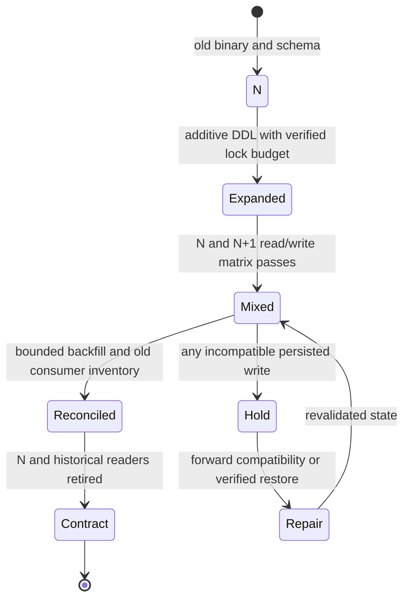

# Backward-compatible database change: mixed-version reads, writes and online DDL

> **Tycho independent book manuscript — proposed V08/C05**, 2026-10-19. Official PostgreSQL 17 ALTER TABLE and Confluent Schema Registry evolution guidance were independently consulted for narrow semantics. The examples and rollout checks are original and fictional. No migration, SQL test, event replay, load test or independent expert review occurred. Previous [combined rollout/data study](progressive-delivery-and-schema-evolution.md) remains preserved for detailed evidence mapping.

## Purpose and mission

A successful deployment can fail when an older process reads data written by a newer process. The database engine may accept new DDL, but the application can still misinterpret a status field or require a removed column. **Compatibility is a relation between deployed reader/writer versions and persisted information**, not a single green “schema compatible” Boolean.

This chapter owns **mixed-version reader/writer compatibility and operational schema-change constraints**. [V05/C06 semantic schema migration](../data/schema-lifecycle-and-semantic-migration.md) owns domain identity mapping/backfill and long-term retirement. [V08/C04 rollout](gitops-canary-and-progressive-rollout.md) owns traffic exposure and release strategy.

## 1. Check the real combinations, including old readers

For two binary versions N and N+1 with old, expanded and contracted schema states:

| Running component / data state | Old state | Expanded transition state | Destructive new-only state |
|---|---|---|---|
| Old API N | Known baseline (still test under workload) | Must interpret new optional values and preserve existing writes | Often fails if required old field removed |
| New API N+1 | May require fallback decoder | Must read/write both old and new valid meanings | Target candidate, not safe while N active |
| Old background consumer | Can replay historical events | Must tolerate optional/mapped fields | May reject or silently misread new-only events |
| New consumer | Must still decode retained old events | Mixed-format tests required | New-only assumptions can break replay |
| Restore process | Needs version-compatible backups and readers | Must resolve historical state correctly | Old restore images may fail reading newer data |

An *additive field* may still be semantically incompatible: old code might deserialize a fixed projection, treat unknown enum values as errors, or misclassify absence as an allowed action.

## 2. Expand-migrate-contract includes a compatibility window

The public [Parallel Change method](https://martinfowler.com/bliki/ParallelChange.html) frames an interface expansion, client migration and eventual contract/removal. Applying that to database schemas requires versioned DB-specific locks and data invariants, not just a column rename.

**Original fictional change:** a tool-registration API replaces display_name with canonical_item_id. During coexistence, a temporary schema holds both. New writers must preserve enough old representation for old supported readers until a verified cutover. If an old row has no valid mapping, the new reader must say **unknown**, not invent an ID.

**Text alternative:** expand the representation, run a tested mixed-version phase, reconcile migrated data, and contract only after old readers are proven absent. Incompatible writes hold the rollout and may require forward repair rather than redeploying N. Nothing was actually deployed or migrated.

## 3. DDL is part of the runtime resource budget

[PostgreSQL 17 ALTER TABLE](https://www.postgresql.org/docs/17/sql-altertable.html) documents different lock requirements by alteration; absent a weaker stated lock, ACCESS EXCLUSIVE is acquired. A syntactically simple migration can block concurrent work or require a table rewrite depending on its exact form.

Operations like index creation, adding constraints, validating existing records, backfill and large DDL statements consume CPU, I/O, lock time, WAL and replica replay capacity. Their safety requires knowing the PostgreSQL version, table size and workload.

A safe preflight for an exact proposed statement asks:
- what lock mode and potentially blocking duration?
- does the subcommand rewrite a table or block writes?
- how many rows/bytes and what estimated WAL/replica lag?
- are long transactions and connection queues present?
- how will a partially finished job resume or clean up?
- what does failure do to old and new readers?
- how can we stop the migration before the no-return point?

A lock estimate is not a measurement; test with a realistic fixture before promising a zero-downtime change.

## 4. Event schema compatibility is an additional axis

[Confluent Schema Registry schema evolution](https://docs.confluent.io/platform/current/schema-registry/fundamentals/schema-evolution.html) distinguishes BACKWARD, FORWARD, FULL and transitive variants, with format-specific rules. It explicitly notes that simple BACKWARD checks cover the previous schema version, not every historical revision.

Even a successful schema registry check is not a guarantee that a domain enum's *meaning* remains compatible. If a new event “Approved” is interpreted as “Pending” by an older consumer, wire parsing might succeed while the user effect fails.

A complete compatibility matrix tests versioned **API, database record, event schema, business status, authorization scope and retention/replay history**. A service may satisfy one transport contract and fail another.

## 5. Rollback has a no-return boundary

Code image rollback is safe only when old N can correctly read and mutate every persisted state written by N+1 during exposure. Once N+1 commits a genuinely new-only state, restoring N containers may reproduce errors or violate business invariants.

| Condition | Possible response |
|---|---|
| Candidate failed before incompatible writes | Route/replica rollback may be valid after checks |
| Candidate wrote additive values N correctly handles | Revert only with verified mixed-version tests |
| Candidate wrote new-only business state N misreads | Hold traffic; forward compatibility/repair or verified restore |
| DDL dropped mandatory N field | Cannot assume N image can operate |
| External effects after cutover | Reconciliation required even if DB schema restored |
| Old event replay after field retirement | Retained decoder or explicitly accepted archival limitation |

A revert command is not recovery of acknowledged reservations or external effects.

## 6. Acceptance tests must include failures

Proposed test fixture (not executed):
1. N clients use N API and N+1 API against expanded schema.
2. N+1 clients exercise both API versions where supported.
3. Old queued event consumed by N+1, and new event by N where still supported.
4. Crash during backfill, then resume without mapping divergence.
5. Concurrent writer changes an identifier while old/new reads occur.
6. Abort a migration after a long lock; measure queue wait and replica lag.
7. Roll back the binary after N+1 produced valid new data.
8. Restore/replay historical state after contract step; verify completeness.

Acceptance includes correct user effects, database invariants, bounded downtime and actual recovery. Green migration SQL alone cannot close the gate.

## 7. Source ledger and remaining verification

| Public evidence | Supported point | Not proven |
|---|---|---|
| [PostgreSQL 17 ALTER TABLE](https://www.postgresql.org/docs/17/sql-altertable.html) | Versioned DDL/lock/subcommand semantics | Actual online migration time |
| [Confluent Schema Registry evolution](https://docs.confluent.io/platform/current/schema-registry/fundamentals/schema-evolution.html) | Format- and version-specific backward/forward/full compatibility | Business meaning or real consumer compatibility |
| [Danilo Sato Parallel Change](https://martinfowler.com/bliki/ParallelChange.html) | Expansion, migration and contraction as transition method | DB/backfill safety |
| [Prior combined Tycho research](progressive-delivery-and-schema-evolution.md) | Earlier rollout/schema study and failure matrix | Independently accepted chapter split |

Every system, schema, migration diagram and experiment is original synthetic work. No SQL, client/consumer, restore or load test was run and final book metadata remains pending.

**Navigation:** **V08/C05** in [draft outline](../PROPOSED-STRUCTURE.md) via [delivery landing](README.md). Read [data lifecycle](../data/schema-lifecycle-and-semantic-migration.md), [canary/rolling](gitops-canary-and-progressive-rollout.md), [target/transition states](../decisions/target-and-transition-architecture-states.md), [safe recovery](safe-rollout-and-recovery.md).
