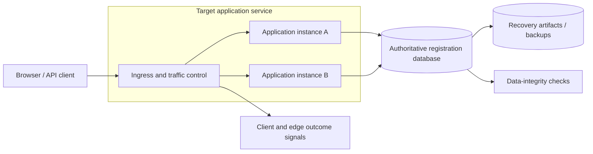
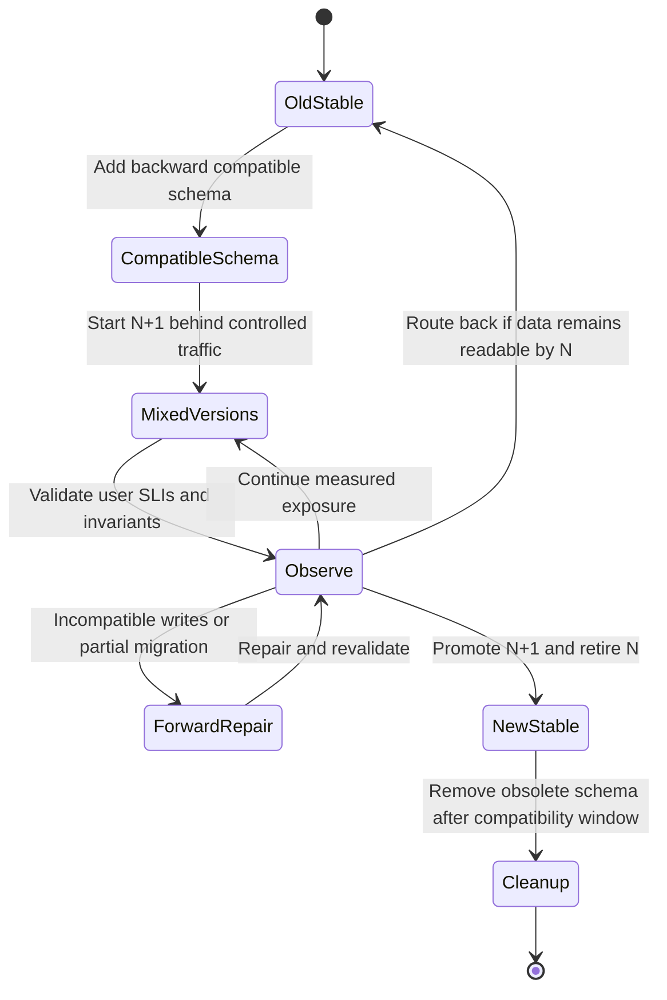
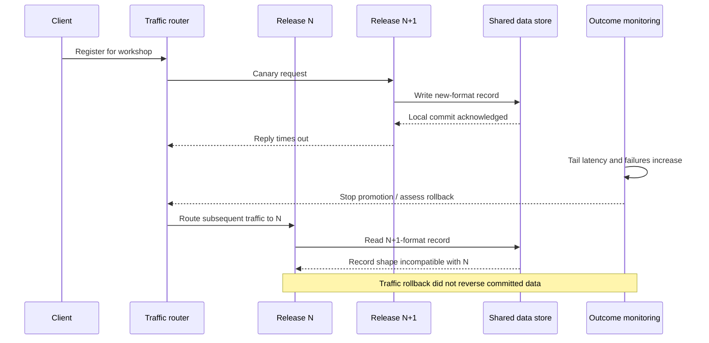
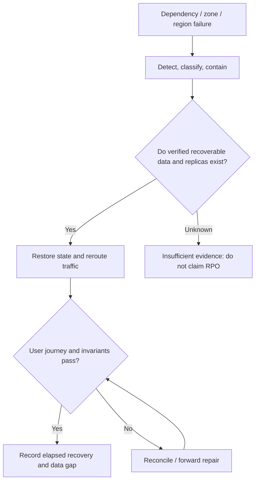

# Safe rollout, compatibility and recovery under partial failure

> Tycho technical research pilot [#40](https://github.com/rouslanbaranov/tycho/issues/40), proposed owners V08/C04–C07. Independent public-source reading: **2026-10-18**. This is original technical explanation and **synthetic failure analysis**. It is not an executed deployment, operational runbook, certified DR design, measured RTO/RPO, production guarantee or independently human-reviewed chapter.

## Purpose and mission

A successful build pipeline and a healthy deployment controller do not prove that a new software version is safe for users, old binaries remain compatible with new data, or a destroyed failure domain can be recovered without loss. This chapter teaches readers to separate a target architecture from the **transitional states** required to reach it, choose evidence-based promotion gates and distinguish binary rollback from data recovery.

**Primary question:** Under which compatibility, telemetry and recovery conditions can a system progressively replace a running version, and what if the new version modifies persistent state that the old version cannot read?

**Reading route:** target vs transition → rollout mechanisms → version coexistence → failure timeline → rollback versus forward recovery → RPO/RTO and failure domains → decision with missing evidence.

## 1. The fictional boundary and the target design

Consider a completely **invented workshop registration application** using a browser/API, an application group and a relational database. The hypothetical business invariant is: acknowledged successful registrations must remain retrievable; confirmed registrations may not exceed workshop capacity.

The **target architecture** is a multi-instance stateless API with one defined authoritative registration store, observable user-level SLIs, immutable application releases and a declared backup/restore protocol. These are **goals**, not things already tested or deployed.

Text alternative: clients enter through an ingress and reach two application instances sharing a defined database. Telemetry describes user outcomes; backup and integrity checks exist as **separate operational responsibilities**. The diagram is a target hypothesis, not a deployment observation, and it does not itself provide HA or zero-loss semantics.

### Target versus transition are different artifacts

| Dimension | Target after migration | Temporary transition requirement |
|---|---|---|
| Application | All instances run release N+1 | Instances of N and N+1 may serve traffic simultaneously |
| Data model | New schema recognized by N+1 | Old N must safely read/ignore or tolerate changes made by N+1 |
| User traffic | Normal routing with desired SLIs | Planned fraction or set of users enters N+1; safe stop/route-back path exists |
| Events/clients | New contract available | Old readers/producers or cached clients might remain active |
| Recovery | Defined restore path and acceptance evidence | Need to reverse or repair *partial* deployment without corrupting committed state |
| Operations | Stable steady-state support | Extra capacity, traffic-switch controls, on-call gates, migration coordination |

A target can be attractive yet have **no safe migration path** under an old-client compatibility requirement. Design the intermediate states and irreversible actions first; do not infer safe transition from target topology.

## 2. Rolling, canary and blue/green mechanisms are not equivalent

Kubernetes Deployments documentation (public page observed in the **v1.37** docs family) describes how a `RollingUpdate` gradually reduces old ReplicaSet replicas and increases new ones. `maxUnavailable` and `maxSurge` bound unavailable replicas and temporary extra replicas. It also documents failure states such as readiness errors or image pull failures, and the ability to roll back deployment revisions. These controls concern controller objects and replica status; they do **not** automatically prove user-facing correctness or data migration reversibility. [E01]

Argo Rollouts' public **Canary** and **BlueGreen** pages describe extra progressive delivery mechanisms. Blue/green can use a preview service, a distinct active service, delayed old ReplicaSet scale-down and optional pre/post-promotion analyses; canary shifts a portion of traffic over steps with traffic-routing capabilities that need an appropriate controller/provider configuration. Product-specific behavior must be verified against an explicitly selected release and actual integration, not inferred from generic page names. [E02]

| Strategy | Common boundary it controls | Useful condition | Hidden requirement / downside |
|---|---|---|---|
| Rolling replacement | Old and new replicas coexist while controllers update capacity | Backward-compatible releases with adequate surge/headroom | Replica readiness does not validate live business effects or database compatibility |
| Canary with traffic analysis | Progressive exposure of clients to candidate version | User outcome signals and representative traffic permit a safe comparison | Requires correctly configured traffic weights/metrics, enough sample and statistically meaningful stop rules |
| Blue/green service switch | Previews a separate new stack and changes active routing | Fast traffic reversal is feasible and temporary double resource footprint acceptable | Switching traffic back does not reverse already committed new-format data |
| Recreate / scheduled stop | Planned downtime acceptable, parallel versions undesirable | Small or tightly constrained system where downtime budget permits it | Downtime and restart risk; may still require forward-compatible migration |

Neither a Kubernetes `Deployment Available` condition nor a green CI status means "zero data loss" or "p99 SLO satisfied". Such claims need service-level observations, an integrity plan and failure tests.

## 3. Explicit state machine for transitional safety

Text alternative: begin with stable N, apply compatible additive schema changes, then run mixed N/N+1 under controlled traffic. Promotion requires user and data checks. If new data cannot be read by N, traffic rollback is unsafe; use a verified forward repair or restoration plan before re-evaluating. Only after old readers have stopped should destructive schema cleanup occur.

The branch `Observe -> OldStable` is **conditionally valid**, not an assertion that all writes are reversible. The state machine is a proposed release-safety contract for the fictional system.

### Compatibility matrix: every cell needs a test

| Reader/writer combination | Schema N | Schema N+1 additive | Schema N+2 destructive |
|---|---|---|---|
| Old application N | Baseline expected | **Unknown until tested**: whether it ignores new columns or handles changed defaults | Likely incompatible; require a concrete read/write test |
| New application N+1 | **Unknown**: does it require new fields? | Expected target only after tested migrations | Unknown; must not assume rollback |
| Older events/clients | Existing contract assumptions | Compatibility adapter/versioning may be needed | Cannot infer behavior without source/contract testing |

"Add a nullable column" is **not sufficient evidence** of compatibility if old application code uses brittle mapping, triggers or schema-dependent assumptions. Requiring a database migration tool is not a substitute for an actual mixed-version integration test.

### A deliberately unsafe migration

Imagine N+1 replaces a durable `workshop_code` value with a brand-new opaque `workshop_identifier` and discards the original code while N continues reading it. If N+1 writes values that N cannot interpret, simply redirecting traffic to N may cause user-visible errors or incorrect behavior.

A safe hypothetical plan might **expand** the schema, **dual-read or controlled dual-write** during a validated transition, backfill with reconciliation, switch the authoritative read path, and only then **contract** and remove obsolete fields. Every intermediate invariant, including concurrent writers, timeouts and rollback compatibility, requires experiment and review. The *concept* is a synthetic engineering proposal; no claim is made that a particular migration tool guarantees it.

## 4. Failure chronology: request outcomes can diverge from deployment status

Text alternative: a candidate version commits a new-format record but its reply times out. Monitoring stops rollout and traffic routes back to old N, which cannot interpret the already committed new data. Restoring old binaries is not restoration of old data. This is a fictional failure injection scenario.

### Safety gates

| Gate | Required evidence / stop criteria |
|---|---|
| Pre-deploy | Immutable artifact provenance; known release/config; rollback/recovery preparation; N/N+1 schema and event-contract tests |
| Before exposure | Ready capacity, dependency limits, synthetic end-to-end checks and ability to route back while state remains compatible |
| During canary | Client-perceived good-event SLI, errors/timeouts, latency distributions, saturation, data-integrity violations and sufficient sample window |
| On degradation | Freeze promotion; identify whether state changed irreversibly; avoid blind traffic rollback if N cannot parse new data |
| After rollback / forward fix | Validate authoritative records, queues, duplicate effects and user-visible acceptance; restoration evidence rather than controller green status |
| At completion | Retire old binaries only after compatibility window; archive release facts, metrics, source versions, issues and review |

A canary with too few events to observe a rare corruption bug is **not** a meaningful safety demonstration. Conversely, a large/slow rollout imposes longer coexistence and operational complexity. Gates must reflect actual severity and exposure rather than an arbitrary percentage.

## 5. Recovery domains and two distinct objectives

**RTO** is a business-selected maximum acceptable time to restore defined service capability after disruption. **RPO** is a business-selected bound on tolerated gap/loss of recoverable data relative to the interruption. AWS's public **Disaster Recovery of Workloads on AWS** whitepaper introduction explicitly distinguishes avoidance of data loss from shortening unavailable service, and advises selecting DR mechanisms against these business objectives. [E03]

RTO/RPO are **objectives**, not test results, measured guarantees or interchangeable percentages. For a fictional requirement `RTO ≤ 20 min, RPO ≤ 5 min`, it would be inaccurate to claim success based on keeping replicas running: restoration tests must establish an observable recovery point and functional user outcomes for the **named failure class**.

Text alternative: detect failure; first determine whether a verified restoration point exists. Restore/reroute only with a supported runbook, verify user-level integrity and record actual recovery time and data gap. Unknown recoverability is an evidence gap, not a passing RPO check.

A single-process restart, zone loss, region loss and logical data corruption are **different disaster scenarios**. Surviving instance count does not determine surviving database availability, quorum behavior, required write availability or downstream capacities. A backup is not a restore result until integrity and application usability are tested.

AWS's published cloud DR options contrast backup/restore, pilot light, warm standby and multi-site/active-active patterns. This is a vendor document's option taxonomy, not a universal ranking or an assertion that every system needs multiple regions. [E03]

## 6. Recovery under additional load

A degraded site can receive both its original workload and redirected traffic, while retries and backlog replay add more pressure. The public Google SRE chapter **Addressing Cascading Failures** discusses overloaded components, retries, limited resources and recovery challenges. [E04]

For an **invented** capacity thought experiment:

- Region A and region B normally each handle **60 successful requests/s**.
- A fails, and traffic routing asks B to handle **120 offered requests/s**.
- Nothing in "B normally handles 60/s" proves B can sustain 120/s or that database/write capacity can follow.
- In case B completes only **90/s** while all 120/s are admitted, backlog grows by **30/s**, or **900** operations over 30 seconds, excluding retries/rejections.
- A recovery design may require tested spare capacity, throttling, read-only fallback, priority isolation or degraded user outcomes; it cannot assume replicas automatically grant headroom.

This arithmetic is deliberately synthetic. Queue/backlog definitions are owned by [the researched queueing page](../volumes/v07-performance-scale-and-resilience/c01-queueing-littles-law-and-measurement-boundaries/queueing-littles-law.md). No actual region has been measured.

## 7. Alternatives and the conditions that reverse a choice

1. **Rolling update with simple readiness:** may be sufficient if N and N+1 are demonstrably compatible, impact is small and extra routing mechanisms exceed benefit.
2. **Canary with decision-grade analysis:** useful for risky changes when enough representative traffic/telemetry exists; fail when metric sampling, routing or dependency isolation is unreliable.
3. **Blue/green switching:** enables quick traffic direction changes, but needs extra capacity and a durable state strategy. It cannot rewind committed database writes by switching a service selector.
4. **Explicit downtime with tested restore:** may be preferable if a truly incompatible change cannot be staged safely, the allowed downtime is sufficient and data/recovery tests pass.
5. **Forward-only repair or compatibility bridge:** needed when writes are irreversible or many old clients persist; requires clear invariants, reconciliation and rollback-independent validation.

No pattern becomes the default purely because the app has high RPS. Architecture selection uses business constraints, actual failure domains, data invariants, workload measurements, observability and migration ability.

## 8. Evidence ledger and unanswerable cases

The following **specific public sections** were consulted on 2026-10-18. Public docs can change; these citations name the observed online version/scope and are not a claim of running the cited software.

| Evidence | Source / observed version | Exact section read | Supports; limits |
|---|---|---|---|
| E01 | [Kubernetes Deployments](https://kubernetes.io/docs/concepts/workloads/controllers/deployment/), online documentation in **v1.37** family | **Rolling Update Deployment**, **Deployment status**, **Failed Deployment**, **Operating on a failed deployment** | Controller behavior/maxSurge/maxUnavailable and revision rollback capabilities; *not* user-level or schema rollback proof |
| E02 | [Argo Rollouts Canary](https://argo-rollouts.readthedocs.io/en/stable/features/canary/) and [BlueGreen](https://argo-rollouts.readthedocs.io/en/stable/features/bluegreen/), online stable docs observed 2026-10-18 | **Canary**, **BlueGreen**, **Sequence of Events**, **Configurable Features** | Traffic strategy and preview/active service concepts; exact release and controller integration not independently pinned/tested |
| E03 | [AWS, Disaster Recovery of Workloads on AWS](https://docs.aws.amazon.com/whitepapers/latest/disaster-recovery-workloads-on-aws/introduction.html), official live whitepaper | **Introduction**: RTO/RPO business objectives; related [DR options](https://docs.aws.amazon.com/whitepapers/latest/disaster-recovery-workloads-on-aws/disaster-recovery-options-in-the-cloud.html) | Vendor's DR goals and strategy taxonomy, not measured suitability for the example |
| E04 | [Google SRE, Addressing Cascading Failures](https://sre.google/sre-book/addressing-cascading-failures/), public SRE book | Overload, resource limits, retries and recovery portions | Published operator guidance, not a guaranteed site recovery model |

**Insufficient-evidence decision:** "The deployment controller reports success and the team can roll back the image. Does that establish a safe production migration with RPO=0?" **No.** Missing are N/N+1 write compatibility results, confirmed durable recovery point, client-level failure telemetry, external effects and deduplication, restore drill, traffic redirection correctness and measured time to restored business function. Record a plan for these experiments before approving any irreversible schema change.

## 9. Review and readiness

- [x] Distinguishes target and transition, including old/new coexistence.
- [x] Normal, degraded, failure, rollback and forward-repair paths with user-visible effects.
- [x] Three architecture/failure Mermaid visuals plus target, state and DR figures with text alternatives.
- [x] Bounded public-section evidence and original synthetic capacity/compatibility examples.
- [x] At least one explicit unanswerable RTO/RPO decision and finite verification requirements.
- [ ] No live cluster/database, fault-injection or restore drill run.
- [ ] No independent domain/human review performed.
- [ ] No complete volume, whole-book index, JSON Schema or MCP rollout implemented.

**Next research:** Ground general legacy modernization and pattern applicability in the actual three pilot chapters, without treating their fictional assumptions as empirical production constraints.
