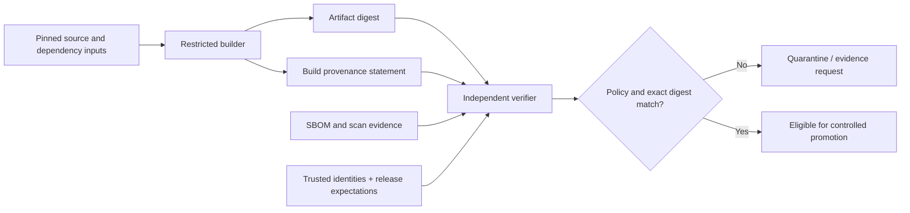

# Software supply-chain evidence: SBOM, build attestations and release verification

> **Tycho book manuscript draft V08/C02 (2026-10-19).** Based on independently public SLSA 1.2, SPDX, CycloneDX and Sigstore material. Original synthetic failure examples. No build, signing, scanning, provenance verifier, release policy, or security assessment has been executed for this book.

## Purpose and mission

A release is not trustworthy simply because a pipeline succeeded or an artifact carries a signature. A signature can demonstrate a claim was made by a cryptographic identity; a Software Bill of Materials (SBOM) can enumerate components according to its declared scope; an attestation can describe how a particular artifact was built. None of these alone proves the artifact contains no vulnerability, that its dependencies are complete, that the signing identity is allowed to publish it, or that it is safe to deploy against existing state.

This chapter owns the **independent verification chain from actual artifact digest to authorized release decision**. The [CI/CD and GitOps architecture](ci-cd-provenance-and-gitops.md) chapter owns runner topology, promotion flow and reconciliation. [Progressive delivery](progressive-delivery-and-schema-evolution.md) owns safe exposure and mixed-version data contracts.

## 1. Distinguish evidence objects and subjects

| Evidence object | What it can describe | What it cannot establish alone |
|---|---|---|
| Source commit/revision | Versioned authoring input | Whether the same bytes produced the deployed artifact |
| Artifact digest | Exact bytes/identity of built object under selected digest algorithm | Their intended source, quality or deployment permission |
| Build provenance | Builder identity, build process and materials/parameters within declared scope | Runtime correctness or complete dependency/vulnerability freedom |
| Signature / attestation envelope | Cryptographic link between a statement and an authenticated key/identity | Whether the signer was authorized or its statement true |
| SBOM | Identified components/relationships/licenses according to format and generator coverage | Absence of undiscovered dependencies or exploitable behavior |
| Vulnerability/security report | Scanner observations at a point in time with known inputs/databases | Complete and eternal absence of defects |
| Policy verification record | Exact checks and applicable source/builder/target requirements that passed | Future runtime success after configuration/data changes |
| Runtime admission result | An authorized target accepted a verified artifact under a declared policy | That a user-visible invariant is preserved under real load |

The artifact is the **subject**, not a mutable tag. A signed attestation bound to digest A is not evidence for digest B even if both share an image name. Treat documentation-derived source identity, runtime deployment identity and release approval identity as separate checks.

## 2. SLSA 1.2: levels and provenance have explicit scopes

[SLSA specification 1.2](https://slsa.dev/spec/v1.2/) distinguishes **Build** and **Source** tracks. The [Build Track Basics](https://slsa.dev/spec/v1.2/build-track-basics) describe progression from Build L1, where provenance exists, to Build L2, where a hosted build platform generates signed provenance, and Build L3, where platform hardening provides stronger resistance to build-time tampering. A versioned level is not automatically attained because one artifact has an attestation.

The [SLSA verification guide](https://slsa.dev/spec/v1.2/verifying-artifacts) describes policy-based checking of the expected builder identity, provenance signature, build type and parameters, among other requirements. Consumer verification must know what it expects: accepting any validly signed statement is not a meaningful supply-chain policy.

**Text alternative:** a restricted builder produces a content-addressed artifact and a provenance statement. A separate verifier binds the artifact digest, attestation and SBOM to expected builder/source/identity policies. Failure blocks promotion; passing allows *candidate eligibility*, not automatic proof of operational safety.

There are at least three distinct questions: **Was this built from the intended inputs?** **Did an allowed builder produce it under an acceptable process?** **Does it satisfy the target's release constraints?** They cannot safely be collapsed into one Boolean called “signed”.

## 3. SBOM completeness and dependency identity

[SPDX specifications](https://spdx.dev/use/specifications/) identify SPDX 3.0 as the current published format, while [CycloneDX specification overview](https://cyclonedx.org/specification/overview/) describes BOM objects and recognized serialization/version conventions. Both formats support software component descriptions, but no format creates perfect inventory coverage without a capable generator and suitable input visibility.

A generated SBOM should disclose:

- artifact identifier and target digest; generation timestamp and producing tool/version;
- scope: build-time, runtime, transitive, platform/system packages, generated code and bundled binaries;
- component names, identifiers, versions, hashes where available, dependency edges and unresolved identities;
- license/source information as available, rather than assumed defaults;
- known omissions and nested/image-layer or dynamically loaded dependencies;
- relationship to the exact release artifact, not merely to the source tree.

**Original synthetic error:** an application is scanned at source checkout and shows no problematic direct dependencies. Its container image includes an obsolete operating-system package copied into a runtime layer after scanning. A source-only SBOM cannot establish the runtime image's full component set. The correct next action is to inspect the actual released image/digest and disclose coverage of each scanner rather than report “no vulnerabilities”.

Likewise, a dependency name without exact identity is insufficient for reliable exposure analysis. Component aliases, forks, vendored source and unavailable package metadata create uncertainty; preserve it as a verification task.

## 4. Authenticity is not authorization

[Sigstore Cosign verification guidance](https://docs.sigstore.dev/cosign/verifying/verify/) covers signature verification using explicit keys or OIDC-issued certificate identity and issuer constraints. [Sigstore in-toto attestation guidance](https://docs.sigstore.dev/cosign/verifying/attestation/) explains verification of signed predicates and policy checking. Real deployments must pin compatible tool, format, issuer/trust-root and verification policies; examples in live documentation may change.

**Hypothetical authorization failure:** a CI account from an unapproved fork signs an artifact correctly. Cryptographic verification succeeds, but the signing identity, builder/source revision or environment target is not on the release allowlist. The proper outcome is **reject**, not “valid signature means approved”.

A verification gate should bind:
1. Exact subject digest of the artifact being promoted.
2. Signature authenticity and supported algorithm/trust-root/certificate chain.
3. Allowed issuer, signing workflow/builder and expected identity claims; expiry/revocation where applicable.
4. Approved source repository and immutable source revision (or explicit policy-matched provenance materials).
5. Expected build parameters and dependency/source policy, with known optional fields documented.
6. SBOM identity/format and integrity; vulnerability/license gates according to an explicit policy.
7. Named target/environment eligibility and mixed-version runtime/data safety *before exposure*.
8. Recorded evidence IDs, timestamp, decision and a failure/exception process that does not silently weaken the gate.

A public transparency log provides a different property from an authorization policy. An entry's existence can support accountability or inclusion verification; it does not approve the publisher's authority, nor ensure that every missing attestation was ever submitted.

## 5. Missing evidence must fail the gate appropriately

| Failure scenario | Superficial green signal | Required policy behavior |
|---|---|---|
| Signed artifact with wrong digest | Signature verification on unrelated object | Refuse digest mismatch; bind subject to actual bytes |
| Valid signature by unauthorized identity | Cryptographic check passed | Reject issuer/identity/source or target policy mismatch |
| Provenance references mutable branch only | Branch exists and CI is green | Require immutable source identity appropriate to the policy |
| SBOM generated for source, not released image | Scanner says no finding | Record coverage gap; verify final built object |
| Attestation omitted or deleted | Other checks happened to pass | Required proof absent → reject or explicit controlled exception |
| Signature service unavailable | Build and unit tests passed | Do not auto-disable verification; hold candidate |
| Old critical scan database | Last scan green | Record freshness window and re-evaluate under policy |
| New image incompatible with persisted state | Build integrity is good | Block rollout until schema/data coexistence and recovery gates pass |

SLSA Build L2 or L3 should not be inferred from a custom script merely writing a JSON file. Provenance authenticity and isolation controls matter; implementation requires evaluating the *actual* build platform against the published track requirements.

## 6. Original worked decision: controlled artifact promotion

**Fictional project:** a small open-source photo-gallery server releases a versioned container image and a command-line package. Both are built from the same source revision but with distinct toolchains and artifact bytes. The team wants to promote a digest to a new environment.

Candidate A trusts the image tag, an unscoped signature and a successful unit-test job. Candidate B records the container digest, source revision, builder provenance, relevant SBOM coverage, policy decision and target-runtime compatibility before approval.

B provides a stronger **potential verification design**, conditional on actual enforcement and absence of bypasses. A is unsuitable if the release policy requires traceable bytes and limited promotion authority. B is not necessarily equivalent to SLSA Build L3; its implementation, builder isolation, provenance producer and policy enforcement still need an independently reviewed assessment.

**Falsifiable experiment (not executed):** retag an image to a different digest; present a genuine signature from an unauthorized CI identity; delete a required provenance attachment; use an SBOM whose subject digest is the previous release. The verifier should reject each mismatch, without permitting deployment through an alternate unguarded entry point. Positive tests should accept only artifacts satisfying the explicitly recorded policy.

## 7. A release gate belongs outside the artifact itself

The party that built the artifact should not be the sole authority deciding that its own output is trustworthy. Independent policy evaluation can be applied at promotion, registry ingestion or target runtime admission, with multiple gates for high-impact changes. Any gate needs reliable identity, time/scoped evidence and audit of exceptions. If deployment tools can bypass it directly, the mechanism is advisory rather than enforced.

The final release decision additionally checks runtime and data outcomes. A fully traceable container that drops committed events, serves unauthorized records or corrupts stored data is not a safe release. The [safe rollout/recovery](safe-rollout-and-recovery.md) page owns these post-build validity gates.

## 8. Public source-to-claim ledger and unperformed verification

| Inspected source (accessed 2026-10-19) | Narrow supported point | Not established |
|---|---|---|
| [SLSA 1.2 specification](https://slsa.dev/spec/v1.2/) and [Build Track Basics](https://slsa.dev/spec/v1.2/build-track-basics) | Distinct Build/Source tracks, provenance and layered build levels | A demonstrated Tycho or fictional project SLSA level |
| [SLSA 1.2 artifact verification](https://slsa.dev/spec/v1.2/verifying-artifacts) | Expected provenance/builder/signature/parameter comparisons | Existence of a deployed verifier or actual policies |
| [SPDX specifications](https://spdx.dev/use/specifications/) | SPDX 3.0 published model and formats | Every SBOM has complete runtime components |
| [CycloneDX specification overview](https://cyclonedx.org/specification/overview/) | BOM format/object identity and versioned serialization | Quality of any generator's output |
| [Sigstore Cosign signature verification](https://docs.sigstore.dev/cosign/verifying/verify/) and [attestation verification](https://docs.sigstore.dev/cosign/verifying/attestation/) | Cryptographic verification plus predicate policy checks | Correct trust-root deployment, authorized release or automatic runtime safety |

The diagrams, failures, candidate designs and validation experiments are original **hypothetical** teaching content. No artifact was built or signed, no tool was executed and no private system was consulted. Compatibility/semantic review and full Tycho editorial acceptance remain open.

## Navigation

- Proposed owner V08/C02 in [planned contents](../PROPOSED-STRUCTURE.md); current [delivery landing](README.md).
- Prerequisite: [CI/CD provenance and GitOps](ci-cd-provenance-and-gitops.md).
- Follow-on: [Progressive deployment and schema evolution](progressive-delivery-and-schema-evolution.md), [safe rollback/recovery](safe-rollout-and-recovery.md), [security authority and isolation](../security/identity-authorization-and-isolation.md).
