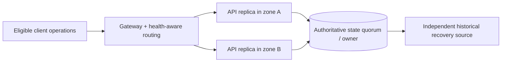

# Availability zones, placement and failure-domain architecture

> **Independent Tycho manuscript — proposed V08/C06**, 2026-10-19. Public Kubernetes scheduling/topology and AWS Well-Architected DR planning references inform the explanation. The topology and fault tests are original hypothetical examples. No cluster, deployment, failover or independent technical acceptance was performed. The earlier [combined region/recovery research](multi-region-disaster-recovery-contracts.md) is preserved.

## Purpose and mission

A process can be healthy and the overall user journey unavailable because all replicas share a datastore, network gateway, certificate issuer, routing plane or failure domain. Running *more replicas* does not guarantee isolation unless their placement and dependencies are modeled.

This chapter owns the **physical and logical allocation of compute/network/state across failure domains**, including single-zone and multi-zone service availability. [V08/C07 disaster recovery](disaster-recovery-and-recovery-objectives.md) owns regional catastrophe response and RPO/RTO/restore acceptance; [runtime topology](runtime-placement-and-control-plane.md) owns container, VM and control-plane mechanics.

## 1. Failure domains are dependency sets, not just geographical labels

Potentially shared elements include:
- host, disk, node pool, hypervisor or availability zone;
- network routes, ingress gateways, certificate/secret services;
- orchestration control plane, scheduler and artifact registry;
- database primary, storage quorum, coordination service or failover policy;
- common service identity, DNS, external API and global rate quota;
- regional power/connectivity and operator access to recovery tooling.

An availability design should state which faults it intends to survive **without violating state authority**. Placing web workers in different zones while retaining one unreplicated database does not satisfy a whole-journey zonal failure objective.

## 2. Redundancy must be combined with correct traffic routing

Original fictional example: a public tool catalogue serves read-only descriptions and accepts reservations. The proposed design has two independently placed API replicas and an authoritative database cluster with documented quorum/replication behavior.

**Text alternative:** two API replicas in separate placement domains may improve tolerance of one compute zone failure, but both still depend on a correctly configured shared state authority and gateway. Backup is separately shown because replica redundancy is not equivalent to point-in-time recovery. This is a conceptual topology; no actual cluster was set up.

A **readiness probe** may help route traffic only to prepared pods, but a successful process-health check does not prove a transaction, identity or user contract is correct. A cluster may keep processes running when it cannot reach a quorum. Health conditions should include just enough dependency/readiness state for safe routing and not create self-amplifying restarts.

## 3. Kubernetes placement as an illustrative mechanism

[Kubernetes Pod Topology Spread Constraints](https://kubernetes.io/docs/concepts/scheduling-eviction/topology-spread-constraints/) use labels and policy to influence or require distribution across domains such as nodes or zones. Policy choices like DoNotSchedule and ScheduleAnyway differ: one may leave replicas pending when constraints are unmet; the other may permit uneven placement.

Their enforcement is not an all-times guarantee that replicas always remain balanced after later node removal, and placement itself does not provide database consistency or regional data recovery.

| Choice | Can improve | Must verify |
|---|---|---|
| Spread replicas across nodes | Host-loss tolerance | Shared node/pool storage/network boundaries |
| Spread across zones | Zonal compute availability | Gateway and authoritative data can survive zone failure |
| Prefer placement but permit skew | Scheduling flexibility | Real placement may violate intended availability |
| Require eligible placement | Stronger scheduling constraint | Insufficient capacity can leave work unscheduled |
| Run active replicas in separate regions | Geographic reach and possible independent failure domains | State coordination, routing consistency, latency and conflict policy |

**Caveat:** pod scheduling options are *one* product implementation. They should not determine the architecture of a non-Kubernetes workload without considering its actual runtime placement controls.

## 4. Data authority and control-plane loss change availability claims

A control plane schedules or configures resources; a data plane carries user operations. Some existing pods may continue handling work when the control plane is unavailable, but new deployments, scaling, secret updates, node repair or replacement may be impaired. Recovery plans must identify which actions require inaccessible infrastructure services.

For stateful systems, a primary can become unreachable while a lagging secondary still accepts reads. If a write must be linearizable, an isolated minority must not present itself as a new authoritative writer without correct fencing/election. [Quorum and leader changes](../distributed/replication-consensus-and-leader-change.md) owns the underlying protocol; this chapter owns placement and failure-domain consequences.

## 5. Trade-offs in fault isolation

| Topology | Strength | Important failure mode |
|---|---|---|
| One host/process | Lowest operational footprint | Host failure removes all compute |
| Several replicas on one node | More processes | Node loss takes all copies |
| Several nodes in one zone | Node tolerance | Zonal loss and shared dependencies |
| Multizone service + replicated state | Can tolerate some zone failures | Gateway/quorum placement and correlated storage loss |
| Multiregion active/passive | Regional alternative possible | Recovery time, replica lag, artifact/access availability |
| Multiregion active/active | Potential concurrent regional service | Conflict resolution, multi-writer invariants and higher cost |

No row promises an actual availability number. Correlated dependencies and measured time-to-recovery determine whether a design meets the stated user contract.

## 6. Architecture acceptance and negative experiments

Proposed experiments (not executed): kill one application pod, node and zone; interrupt the gateway; remove the database primary or a quorum voter; test region-control-plane unavailability; exhaust capacity during an expected reschedule; verify no competing authoritative writers and no duplicate accepted business effects.

For each failure, measure client-level correct outcomes, explicit rejections, timeouts, state reconciliation, routed traffic, dependency recovery and total operating cost. A test that checks only desired replica count can pass while users cannot access correct data.

The [AWS Well-Architected DR strategy guidance](https://docs.aws.amazon.com/wellarchitected/latest/framework/rel_planning_for_recovery_disaster_recovery.html) distinguishes zonal mitigation from regional recovery; its vendor strategy examples do not prove the invented topology works.

## 7. Evidence ledger and limits

| Public source inspected | Supports | Not established |
|---|---|---|
| [Kubernetes topology spread](https://kubernetes.io/docs/concepts/scheduling-eviction/topology-spread-constraints/) | Scheduling preferences/requirements and placement limits | End-to-end app/DB failure tolerance |
| [AWS Well-Architected recovery strategy](https://docs.aws.amazon.com/wellarchitected/latest/framework/rel_planning_for_recovery_disaster_recovery.html) | Named recovery strategy/failure domains and cost/recovery trade-offs | Any executed regional failover |
| [Earlier Tycho combined regional/DR research](multi-region-disaster-recovery-contracts.md) | Prior version-bound disaster scenarios | Reviewed and independently tested design |

All examples and topology representations are synthetic; no cloud or cluster action was made and no recovery objective achieved. Publication chapter/page structure and independent source-by-claim review remain open.

**Navigation:** owner **V08/C06**, via [deployment landing](README.md) and [book outline](../PROPOSED-STRUCTURE.md). Related [runtime placement](runtime-placement-and-control-plane.md), [quorum](../distributed/replication-consensus-and-leader-change.md), [disaster recovery](disaster-recovery-and-recovery-objectives.md).
