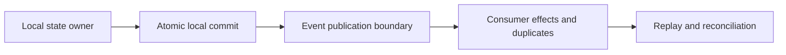

# Distributed coordination and event integration

**Status:** initial researched content only; other planned chapters remain unresearched. The proposed volume owner is V04; this landing is a navigable record, not a complete volume.

## Purpose and mission

Explain what coordination, ownership, ordering, transactions, event delivery, retries and failure actually guarantee **at their declared boundaries**. Technical readers and AI agents should not confuse local database atomicity, message delivery and externally observed business effects.

## Research route

Text alternative: understand local committed state, event publication, the consumer's idempotency responsibility and the recovery/reconciliation obligations. This is a topic-navigation map, not an implemented system.

## Completed bounded research

- [Local transaction, outbox publication and duplicate side effects](transactional-outbox-and-idempotency.md): original synthetic request/event timelines, exact public evidence, alternative approaches, retries, recovery and insufficient-evidence limits.

## Planned rather than researched

Causality and ordering, consensus, delivery guarantee matrices, Kafka and stateful stream processing, sagas and durable workflow implementations all require independent bounded source investigations. The [proposed structure](../PROPOSED-STRUCTURE.md) identifies their intended owners. No content is assumed complete because a title appears there.
