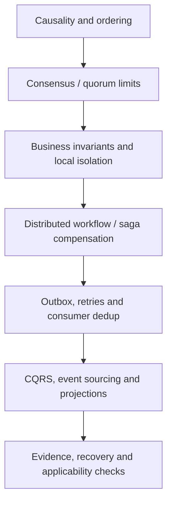

# Distributed coordination, transactions and events

**Status:** independently researched technical manuscript pages, with two distinct new V04/C04–C05 owner drafts; the distributed-systems volume is **not** complete. Source revision verification and independent domain review remain separate work. A manually curated knowledge graph is not part of Tycho infrastructure.

## Purpose and mission

Explain how causal relationships, replicated agreement, local transaction isolation, business workflows and event-based read projections work across boundaries. A client timeout, broker acknowledgement, local commit and consensus commit are different facts: the book must not imply one proves another.

## Reading route

Text alternative: understand ordering and consensus before applying transactional invariants; then investigate distributed compensations, external event delivery, duplicate effects and read-model replay. The route is for selective reading, not a universal system implementation order.

## Canonical researched pages

| Engineering question | Canonical content | Evidence state |
|---|---|---|
| What survives leader changes, minority partitions and quorum reconfiguration? | [Replication, quorum and leader change](replication-consensus-and-leader-change.md) | V04/C02; Raft/etcd public protocol scope and synthetic failure matrix; no cluster exercised |
| What is causality, and when does a replicated log need consensus? | [Causality, ordering and consensus](causality-ordering-and-consensus.md) | Lamport 1978 abstract/bibliographic record; extended Raft 2014 §§2,5. Full Lamport PDF not reviewed |
| Which invariants fit local transactions, and what does a saga compensate? | [Transaction isolation and sagas](transaction-isolation-and-sagas.md) | PostgreSQL 17 §§13.2,13.5; Richardson public saga patterns |
| How should request IDs, retries and lost acknowledgments avoid duplicate domain effects? | [Retries, idempotency and ambiguous effects](retries-idempotency-and-ambiguous-effects.md) | V04/C04; RFC 9110 and scoped idempotent-consumer reference; no tests executed |
| What can local outbox/inbox transactions and durable saga steps guarantee? | [Outbox, inbox, sagas and durable workflows](outbox-inbox-sagas-and-durable-workflows.md) | V04/C05; Debezium 3.6 and independent transactional-outbox/saga sources; not executed |
| What was the combined earlier outbox/idempotency research? | [Earlier publication and retry research](transactional-outbox-and-idempotency.md) | Preserved supporting evidence for editorial claim reconciliation; not the primary owner of either V04/C04 or C05 |
| When is an event the authority, and what does CQRS introduce? | [CQRS, event sourcing and projections](cqrs-event-sourcing-and-projections.md) | Fowler 2005/2011/2017, Richardson CQRS pattern |

All examples and Mermaid sequences are original **fictional models**; no public primary source is copied into the book. Claims are bounded by each page's explicit evidence ledger. There is no verified production system or independent expert review.

## Adjacent and unfinished coverage

Detailed Kafka partition/replication/consumer-group semantics, RabbitMQ/Pulsar/NATS delivery patterns, Flink/Streams, gRPC and durable workflow products belong to [#81](https://github.com/rouslanbaranov/tycho/issues/81) and must be researched independently. Cross-service performance is connected to [queueing](../performance/queueing-littles-law.md); service decomposition to [application styles](../application/architecture-styles-and-module-boundaries.md); safe version migration to [rollout and recovery](../delivery/safe-rollout-and-recovery.md).

The proposal for all remaining topic ownership lives in [the book structure](../PROPOSED-STRUCTURE.md). No incomplete title is a live chapter.
