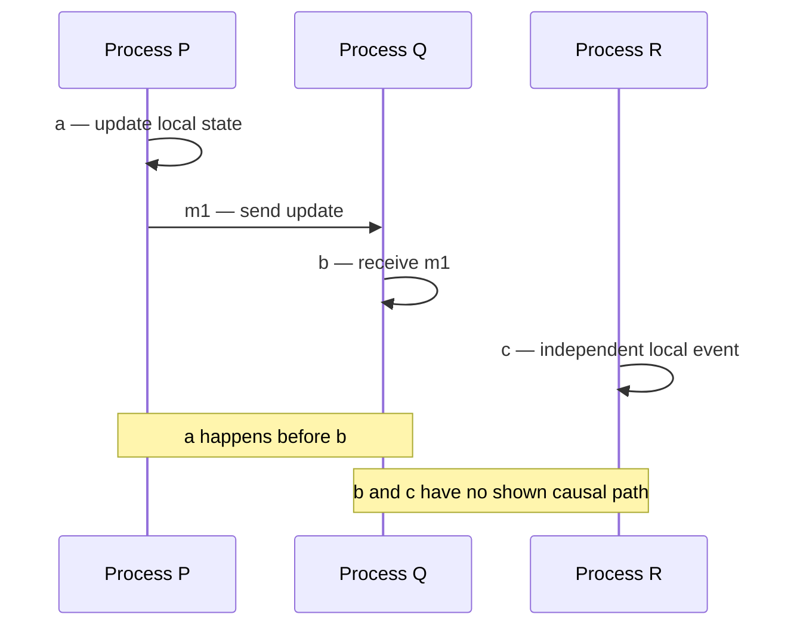
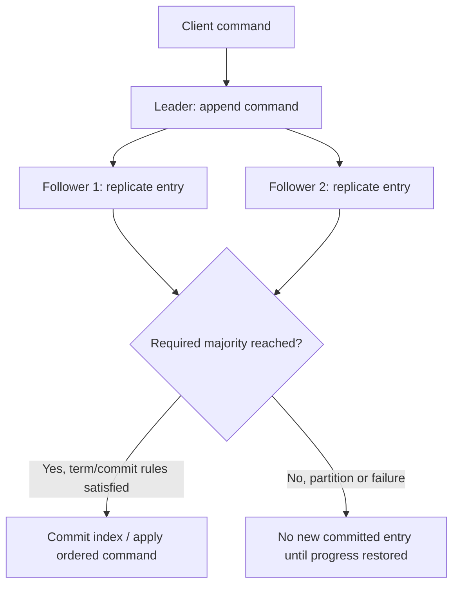
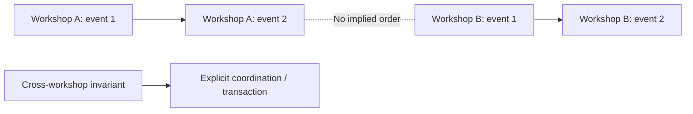

# Causality, ordering and consensus in distributed systems

> Tycho research page for [Issue #80](https://github.com/rouslanbaranov/tycho/issues/80), proposed V04/C01–C02. Source inspection: 2026-10-18. Original explanatory prose and **synthetic** diagrams; not a formal proof, operational consensus deployment or independently reviewed implementation.

## Purpose and mission

Several machines cannot generally infer a single complete history merely by comparing their wall clocks. Before choosing event ordering, a replicated state machine, a database read policy or a failure-recovery approach, specify **which observations must be ordered** and what must happen when communication fails.

**Primary question:** What do causal ordering, total log ordering and consensus actually establish, and which guarantees do they *not* provide for an application's end-to-end state?

## 1. The happens-before relation describes causal knowledge

Leslie Lamport's 1978 paper *Time, Clocks, and the Ordering of Events in a Distributed System* introduces an ordering relation on events that can represent a partial order; its published abstract specifically contrasts this causal relation with the total-order extensions possible through logical-clock schemes. The paper is listed in Lamport's publication bibliography and Microsoft Research's original-paper record. This page uses that *abstract and bibliographic scope*, rather than claiming a line-by-line review of its PDF. [E01]

For two events `a` and `b`, the commonly used happens-before definition has three generating rules:

- Events on a single sequential process are ordered by their process execution.
- Sending a specific message causally precedes its receiving event.
- The relation is transitive: if `a` precedes `b` and `b` precedes `c`, then `a` precedes `c`.

Events for which neither direction follows may be **concurrent** even if each machine records a clock time. Concurrency here denotes insufficient causal ordering, not necessarily simultaneous physical execution.

Text alternative: process P acts and sends a message to Q, so its event precedes Q's reception. R acts independently; the diagram contains no evidence that Q's event precedes or follows R's.

An integer **Lamport logical clock** can be incremented for a local event, attached to messages, and advanced on reception so that causal predecessors have smaller timestamps. However, the converse does **not** follow: two events with ordered clock numbers may still be causally unrelated. Adding a deterministic process-ID tie-breaker produces one reproducible total ordering; it does not create a real causal dependency. A vector-clock mechanism can represent additional causal distinctions at the cost of metadata associated with participating processes; a full algorithm comparison is outside this page's bounded evidence.

**Decision impact:** if the business only needs every item to preserve its own update order, requiring global total order can introduce unnecessary coordination. If conflicting updates of a shared invariant must be serialized, merely generating timestamps does not create atomic or correct resolution.

## 2. Agreement, linearizability and availability solve different problems

Agreement means replicas reach a consistent decision within a specified model. **Replicated state-machine consensus** usually sequences commands in an agreed log so deterministic replicas can apply compatible histories. **Linearizability** is a stronger client-visible condition about the apparent atomic placement of operations between invocation and response. Sequential ordering within a log does not automatically make every client-facing read linearizable unless the read path and leader/term checks enforce the required behavior.

The official 2014 extended Raft report (Ongaro and Ousterhout), §§2 and 5, explains replicated state machines and decomposes Raft into **leader election, log replication and safety**. Its published fault model assumes non-Byzantine failures, and write availability depends on a communicating majority. [E02]

Text alternative: the elected leader sequences a command and sends it to followers. A majority and the protocol's term/commit rules are required to regard an entry as committed. Without sufficient communication, progress can stop rather than allow contradictory committed logs. This is a simplified **synthetic three-replica sketch** of ideas described in Raft; not an executable trace.

For a five-member fixed voter configuration, majority is three. If only two members can communicate, that partition cannot form a majority to commit new log entries. This **does not prove the whole application becomes unavailable**: cached/possibly stale reads, local work and independent subsystems may behave differently. Nor does a majority imply all old readers see the same state immediately.

### What Raft safety requires beyond electing a leader

The 2014 Raft report §5.4 explains that a candidate must meet a log up-to-date restriction, preventing a newly elected leader from discarding committed information. Its leader-completeness and log-matching properties need persistent term/vote/log state, not merely a label that says "leader". The paper distinguishes a current-term majority commit rule from blindly declaring older-term entries committed on majority presence alone. [E02]

```mermaid
stateDiagram-v2
    [*] --> Follower
    Follower --> Candidate: Election timeout
    Candidate --> Leader: Wins votes from a majority
    Candidate --> Follower: Recognizes established higher-term leader
    Candidate --> Candidate: Split election; new term
    Leader --> Follower: Observes higher term
    Leader --> Follower: Recovery / restart as follower
```

Text alternative: a node usually follows; loss of leader communication can trigger an election. A candidate that receives the required votes becomes leader, and a node seeing a higher term steps down. The model omits many message, storage and membership details and does not prove liveness under arbitrary timing.

### Safety versus progress under partitions

Consensus designs distinguish **safety** (no incompatible committed histories under the assumed failure model) from **liveness** (operations continue to make progress when required communication, timing and availability conditions hold). In a network partition, choosing safety may intentionally refuse writes from a minority. This is not the same as a generic claim that every read in the application must be unavailable or that every type of database offers the same guarantee.

Do **not** assume:
- all algorithms with leader election provide consensus;
- a replication factor of three means any one machine loss has no impact on latency;
- "eventually replicated" means linearizable reads;
- a consensus log protects arbitrary external database effects, HTTP retries or side effects outside its replicated state machine.

## 3. Ordering scopes: per-key versus global

In a **fictional** registration service, events for workshop A could need a consistent order independent of workshop B. If both operate under separate authoritative owners, a single global sequence may add coordination without improving correctness. But if one operation atomically transfers a limited shared resource between A and B, the owners must specify a coordination protocol for that invariant.

Text alternative: A's changes are ordered within A, and B's changes within B. The drawing does not establish an order between unrelated streams. A cross-stream invariant may still require a separate coordination mechanism.

Ordering must be defined by **where it is enforced**: a transaction log's commit order, a message partition's append order, one actor's sequential mailbox, or an API's linearizable key-value access are different contracts. The next integration research issue (#81) owns broker-specific partition ordering and consumer replay.

## 4. Failure and recovery questions

| Disturbance | Potential consequence | Required evidence |
|---|---|---|
| Leader crash before a write commits | Client may see timeout; entry may or may not survive depending on state | Durable log position, majority/term state, client's retry/idempotency outcome |
| Leader crash after a write commits, before reply | Caller cannot infer commit from response absence | Query/retry protocol and committed command identity |
| Minority network partition | No new majority-committed writes in that partition | Quorum membership, routing and read-consistency mode |
| Election storm or clock delay | Availability/latency may degrade while safety should remain intact under model | Election logs, message delays, election configuration and deterministic test |
| Membership reconfiguration | Wrong quorum transition may compromise safety | Version-specific joint/reconfiguration protocol and adversarial tests |
| Application database side effect outside consensus | Replicated log order cannot undo a downstream double effect | Explicit transaction and external effect contract |

## 5. Applicability, alternatives and insufficient evidence

Use replicated consensus when several fault-prone nodes must agree on an ordered configuration, leader lease/epoch, log, or authoritative state with explicit failure assumptions. Avoid introducing an application-level consensus cluster simply to publish a best-effort notification or to generate globally increasing business IDs if a simpler authoritative database transaction or single-writer contract meets the requirement.

A legitimate alternative can be one durable local database with a single authoritative writer, eventual replicated read models, per-aggregate ordered streams or conflict reconciliation. The decision is driven by invariants and failure objectives, not by "many users" as an unexplained proxy.

**Insufficient-evidence case:** "Our system has five replicas. Can we promise always-available strongly consistent writes during any data-center failure?" **No.** Need explicit voter placement, quorum reachability, regional failure domains, read/write semantics, client routing, persistence/recovery rules and failure tests. The number five alone proves no such service-level guarantee.

## Engineering walkthrough — Wall-clock order cannot prove causality or commit order

**Original synthetic distributed trace:** service A records command X at local clock `10:00:00.200`, sends event E, and service B receives E after applying a 400 ms backward clock adjustment. B writes `09:59:59.950` in a log. B's timestamp is earlier than A's, but E's send causally precedes its receipt. Sorting timestamps would invert that relationship.

Lamport's happened-before relation distinguishes program order and message edges. A Lamport-style logical counter can preserve those causal constraints but does **not** prove that two concurrent events are causally related merely because their counters differ. A total-order service or consensus can choose one sequence for a declared authority, but that adds coordination, availability and latency implications; it is not equivalent to clock synchronization.

| Question | Appropriate scope | Counterexample |
|---|---|---|
| What did B learn from A? | Message/causal relation | Clock offset reverses logged timestamps |
| Which write is legally first for one booking key? | Single authoritative serializing writer/consensus contract | Per-partition queue order across different keys is global order |
| Can a client observe a completed write on subsequent reads? | Linearizability/consistency contract | Lamport counter on logs proves read-after-write visibility |

**Proposed, unexecuted test:** reorder cross-service messages and skew clocks, then verify which statements remain true without any synchronized wall clocks. If the product requires a global order of conflicting writes, state an explicit ordering authority; if it needs only trace correlation, causal links and operation IDs may suffice without consensus. The original Lamport paper defines the causal abstraction, not any claim of a running global clock or order service.

## Exact public evidence

| ID | Source and bounded read scope | Supports and limitations |
|---|---|---|
| E01 | [Leslie Lamport, *Time, Clocks, and the Ordering of Events in a Distributed System*](https://www.microsoft.com/en-us/research/publication/time-clocks-ordering-events-distributed-system/), CACM 21(7), 1978, **official abstract and bibliographic record**, accessed 2026-10-18 | Establishes partial-order logical-time problem and total-order extension; **full PDF not inspected for this issue**, so detailed formal lemmas are explanations to be independently verified before formal-methods use |
| E02 | [Ongaro/Ousterhout, *In Search of an Understandable Consensus Algorithm*, extended version](https://ying-zhang.cn/dist/2014-raft.html), May 20 2014, **§2, §5.1–5.4**, cross-linked from [Raft's official publication portal](https://raft.github.io/) | Replicated state machines, leader/term election, majority log replication, commit and election restrictions; no Tycho production Raft implementation or proof of external read consistency |

**Review state:** original research draft, mechanical/readability checks only. No full Lamport PDF review, formal implementation verification, adversarial Raft simulation, consensus benchmark or independent domain reviewer has been claimed. Never treat an illustrative Mermaid diagram as a machine-checked proof.
