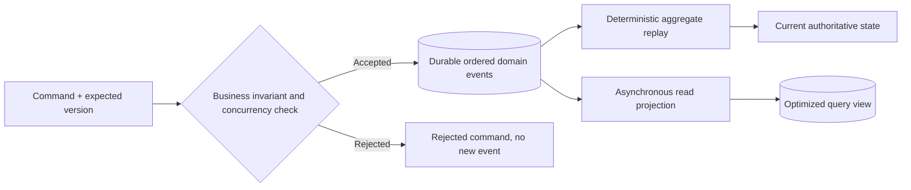
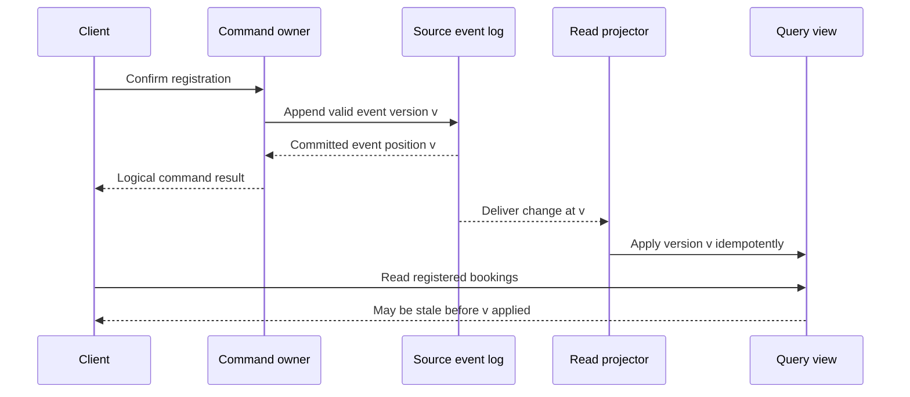

# CQRS, event sourcing and reliable read projections

> Tycho Issue [#80](https://github.com/rouslanbaranov/tycho/issues/80), proposed V04/C05–C06. Primary publicly accessible writing examined on 2026-10-18; author-created scenarios and Mermaid diagrams only. **Not** an implemented event store, tested projector or global delivery guarantee.

> **Pattern atlas:**
> [CQRS](../volumes/v11-pattern-atlas/c04-consistency-events/README.md#command-query-responsibility-segregation-cqrs) — decision conditions and contraindications.
> [Event Sourcing](../volumes/v11-pattern-atlas/c04-consistency-events/README.md#event-sourcing) — decision conditions and contraindications.
> [Domain Events](../volumes/v11-pattern-atlas/c04-consistency-events/README.md#domain-events) — decision conditions and contraindications.
> [Materialized View](../volumes/v11-pattern-atlas/c04-consistency-events/README.md#materialized-view) — decision conditions and contraindications.
> [Command-Side Replica](../volumes/v11-pattern-atlas/c04-consistency-events/README.md#command-side-replica) — decision conditions and contraindications.

> **Pattern atlas:**
> [CQRS Read Projections](../volumes/v11-pattern-atlas/c06-database-storage/README.md#cqrs-read-projections) — decision conditions and contraindications.

## Purpose and mission

"Event-driven" is not one architecture: publishing a notification after a CRUD update, capturing all authoritative state changes as durable events, and maintaining a separate read model are **different mechanisms**. Confusing them leads to inflated claims about auditability, reconstruction, ordering, scalability and correctness.

**Primary question:** When should an application record an event as its authoritative state transition, when does a separate read model add value, and what are the lifecycle obligations of replay and asynchronous projections?

## 1. Four patterns frequently mixed together

Martin Fowler's 2017 *What do you mean by "Event-Driven"?* distinguishes event notification, event-carried state transfer, event sourcing and CQRS and explicitly notes CQRS does not logically require events. His 2011 CQRS article cautions that read/write separation brings complexity and is not a default design for most systems. [E01, E02]

| Mechanism | What is stored or communicated | Not automatically guaranteed |
|---|---|---|
| Event notification | Announces that something has happened, often requiring consumers to query authority | Consumer already has sufficient payload or the event is an authoritative history |
| Event-carried state transfer | Sends some state so consumers can update a local view | Up-to-date ordering, atomic external effects or entire durable history |
| Event sourcing | Persists authoritative sequence of domain changes and derives current state by replay | Safe external replays, stable event schemas, arbitrary cheap queries |
| CQRS | Distinguishes command/write model from query/read model | Event sourcing, a separate service, asynchronous updates or immutable logs |

A team may implement only one. A simple service with complex command authorization but convenient read projections can adopt CQRS **without** event sourcing. An event-sourced aggregate can serve queries by reconstructing state without deploying an entirely separate read service. Architecture boundaries follow requirements.

## 2. Event sourcing: what becomes authoritative?

In event sourcing, a durable append-only record of domain facts becomes an authoritative input
to reconstruct the present state. The chapter source ledger records the origin material as
context; this section's technical boundary is the declared pattern source.

A **fictional** registration aggregate might have immutable facts such as `RegistrationRequested`, `SeatReserved`, `RegistrationConfirmed` and `RegistrationCancelled`. Commands are **requests to change state**; events assert that an accepted transition **already occurred** under an authoritative validation rule.

Text alternative: validate a command under the aggregate's version/invariant contract. A valid command appends an event; replay derives current state and an independent projector may build a query view. Rejected commands do not mutate the authoritative event stream in this example.

### A small original replay example

Start with no confirmed bookings. Apply, in the intended aggregate order:

| Sequence | Immutable business fact | Derived confirmed count |
|---:|---|---:|
| 1 | Booking A confirmed | 1 |
| 2 | Booking B confirmed | 2 |
| 3 | Booking A cancelled | 1 |

The projection `confirmed_count` is calculated as `+1, +1, -1`, yielding **1**. This is **synthetic arithmetic**, not a tested business database. Replaying a historical event sequence under different event semantics may not produce the same result; versioned event handlers and invariant rules must be specified.

**Invariant.** A command appends only when its expected stream version matches the current
version; a racing command is rejected and the caller re-reads before deciding. Retrying an
already-appended command needs the same operation identity, or a write-side retry can
double-append the event.

A snapshot can accelerate replay by recording a state at a known stream offset/version, followed by applying later events. However, a snapshot is a **derivative cache** unless declared and validated as the authority. Rebuilds must check offset continuity and event schema compatibility. "Append-only" alone is not a security-compliant audit log: deletion policies, integrity protection, identity, corruption, retention and privileged access still matter.

**Alternative.** State-stored CRUD with an audit log, CDC/outbox or event notification may
be preferable when full replay is unnecessary, event-schema ownership is absent or external
side effects cannot be isolated. Reverse the event-sourcing choice when audit/replay value
exceeds schema-evolution and rebuild cost.

## 3. CQRS and asynchronous projection freshness

The CQRS design separates update and read representations so each can optimize for different needs. The service may use separate objects, tables or storage engines; physical isolation is a choice, not an inherent definition. Fowler's CQRS description and Chris Richardson's public CQRS pattern both show a separate query view that can follow events from the owning service. [E02, E04]

Text alternative: an authoritative command appends event v and responds. A projector later consumes v into a read-oriented store. Before catch-up, a client querying the projection may not see its own accepted change. The depicted event delivery is a proposed local design with **no claim** about a specific broker guarantee.

### Stale view is a contract, not a free property

Some user journeys tolerate short projection lag; others require "read your writes" or an immediate authoritative confirmation. A well-defined design can:
- return the accepted command result and source version, even if the projection lags;
- expose an authority read endpoint for high-integrity decisions;
- wait for a projection to reach a specified version within a bounded timeout (with explicit failure);
- show pending/potentially stale state, instead of falsely saying an operation never completed.

Measure actual **projection age**, offset gap, end-to-end good-event SLI and failure amplification. Avoid claiming a numeric freshness threshold without an approved requirement and representative tests.

**Materialized-view invariant.** A materialized view must record its source version or
offset, refresh trigger and freshness contract. A stale view is a derived read, not
authority; a query that requires current state must use an authority path.

**Failure and recovery.** Projector crash, cursor gaps, schema drift and partial rebuilds
are common. Resume from a recorded cursor, rebuild with external side effects disabled, and
represent an unknown or lagging view explicitly rather than serving it as current.

**Alternative.** Direct authority reads, cache-aside or a synchronous read may be preferable
when the required freshness exceeds the projection benefit. Reverse the view choice when
rebuild and freshness coordination cost more than the read-latency gain.

**CQRS failure and alternative.** Projection lag, duplicate apply, cursor gaps and schema
drift are common; make the apply idempotent, commit view and cursor atomically, and rebuild
with side effects disabled. A single model/CRUD service, a synchronous authority read or an
event-sourced reconstruction may be preferable when read/write separation complexity exceeds
the measured benefit.

## 4. Replay, duplication, ordering and external side effects

If a projector crashes after applying an event but before recording its cursor, it may consume the **same event again**. The read-side update must be idempotent or use an atomic record of event/stream version with the state change. In an event-sourced business application, replaying old authoritative events must **not** resend real money, email or notifications unless that is an explicitly isolated new business workflow. Fowler's *External Updates* discussion highlights this hazard. [E03]

```mermaid
stateDiagram-v2
    [*] --> Loading
    Loading --> Applying: Event version available
    Applying --> Committed: Projection + cursor committed atomically
    Applying --> Loading: Crash before commit; retry same version
    Committed --> Loading: Continue with next offset
    Committed --> Rebuild: Operator requests full replay
    Rebuild --> Loading: Restore checkpoint / replay with side effects disabled
```

Text alternative: a projection resumes from a recorded cursor, applies a version and commits cursor plus new view together. Failure before commit can lead to retry. Rebuild should isolate external side effects and use an explicit checkpoint. This is a synthetic state machine, not a tested projection engine.

### Distinguish source log from integration event

A domain event log can be the source of truth while a broker's integration stream is a **separate transport**. The operation that publishes integration messages may need an outbox/connector, change capture or durable cursor; it does not inherit global exactly-once execution simply because event sourcing is present. Conversely, a CRUD store plus transactional outbox **is not automatically event sourcing**: its history need not be sufficient to reconstruct all business state. See [outbox and duplicate effects](transactional-outbox-and-idempotency.md).

**Domain-event contract.** A domain event records a business fact that already occurred,
named in past tense, with aggregate/event identity, version and causation where needed. It
is not a command and not permission: a consumer must not treat receipt as authorization to
repeat the effect. The same event may feed an internal projection and an integration
transport, but those are different contracts with different retry and schema rules.

**Failure and recovery.** Duplicate delivery, lost publication, ordering and schema
evolution are common. Deduplicate by event identity, preserve per-aggregate order, version
event schemas and keep an explicit unknown/repair state when publication is not atomic with
state. If consumers need the current authoritative value, query authority instead of
inferring it from an event.

**Alternative.** A synchronous call or command message may be preferable when the caller
needs an immediate answer and fan-out is unnecessary. Polling, CDC or event-carried state
transfer may fit when consumers only need current state and no durable history is
authoritative. Reverse the domain-event choice when event volume and schema coupling exceed
the decoupling benefit.

## 5. Version changes and failure table

| Condition | Expected risk | Minimal evidence before release |
|---|---|---|
| New event field added | Old projector might reject unknown schema | Compatibility test with historical events |
| Event semantics redefined in code | Replay may derive a different historical state | Versioned interpretation, golden fixtures and migration policy |
| Consumer crash after effect | Replayed duplicate may corrupt view | Atomic cursor/effect + dedup test |
| Query view rebuilt | User reads lag or missing temporary data | Snapshot/replay plan, lag SLI and fallback |
| Source event omitted/corrupted | Reconstructed aggregate diverges | Integrity/continuity audit, backups and restore drill |
| Personal-data deletion request | Immutable history may conflict with retention/deletion obligations | Data classification, crypto-shredding or legally approved retention design, expert privacy review |
| External side effect fired on replay | Duplicate real-world action | Replay-mode gate and explicit external-effect reconciliation |

Neither CQRS nor event sourcing **eliminates** consistency, schema governance, security, lifecycle or operational burden. For a simple system whose state is easy to query and does not require temporal reconstruction, a transactional CRUD design with narrowly scoped audit logging may be simpler.

## 6. Sufficient evidence and pattern contraindications

Choose event sourcing deliberately where history is itself business authority, temporal queries or reconstruction are required, deterministic transitions can be modeled, and the organization can govern event versions/replay. Choose CQRS where read and write workloads or models diverge enough to justify separate projections and their lifecycle. Choose both only when their combined benefits overcome additional failure points and synchronization cost.

**Insufficient-evidence scenario:** "Our app has 99% reads, so CQRS and event sourcing will reduce costs." This does not follow. Need query profile, cache/freshness tolerance, write complexity, storage/egress and projector costs, operational burden, restore rules and compared prototypes. High read ratio alone neither requires immutable event authority nor guarantees lower cost.

## Public evidence and status

| ID | Source, precise inspected sections | What the source actually supports |
|---|---|---|
| E01 | [Fowler, *What do you mean by Event-Driven?*](https://martinfowler.com/articles/201701-event-driven.html), 2017, **Event Notification, Event-Carried State Transfer, Event Sourcing and CQRS** | Separates distinct event-related patterns; not a universal system recommendation |
| E02 | [Fowler, *CQRS*](https://martinfowler.com/bliki/CQRS.html), 14 July 2011, entire short article including warnings | Read/write separation and added complexity; no claim that every implementation is async or needs messaging |
| E03 | [Fowler, *Event Sourcing*](https://martinfowler.com/eaaDev/EventSourcing.html), 12 Dec 2005 draft, **How it Works; Application State Storage; External Updates; External Queries; Code Changes; When to Use It** | Stored history/replay, snapshots, external effects and logic-evolution caveats; not code executed for Tycho |
| E04 | [Richardson, *CQRS pattern*](https://microservices.io/patterns/data/cqrs.html), **Context, Solution, Resulting context** | Query projection pattern and eventual-consistency cost in multi-owner designs |

**Quality state:** bounded research draft, original fictitious case and diagrams; no empirical event replay, independently reviewed privacy claims, schema migration test, deployed system or independent subject expert approval. Numerical examples are not production observations.

## Bounded pattern ownership notes

These notes define the decision boundary for atlas cards whose mechanism is not the main subject of
this page. They are synthetic design guidance, not measured evidence, and they do not create a new
source claim.

### Command-Side Replica

A command-side replica serves reads that must observe the latest accepted command state while the
read projections still lag. The query is routed to a replica of the command-side store, and the
reply reports the applied position it observed. The replica must apply a committed command before it
answers a query that claims to include that command; otherwise the result is stale.

Replication delay or failover can serve an older position, so the client must check the reported
position or wait for the required one before treating a read as current. Serve the same read from
the authoritative command store or block until the projection catches up; reverse the choice when
replica lag is bounded and read load would otherwise overload the authority.

**Remote facts.** When a command needs facts owned by another service, a local replica is a
cache of that owner's state, not a second authority. Give it an owner, a source version,
refresh/invalidation and reconciliation when the owner changes; the local copy must never
become the decision-time writer.

**Decision safety.** A replica may inform a decision only while its staleness bound is
acceptable for that operation. If the decision needs linearizable remote state, read the
authority or a lease-confirmed value. Enforce single-writer with fencing or a version check,
and test the divergent-replica case: a stale copy must reject the command, not overwrite the
owner.

### Domain Events

A domain event publishes a committed business fact to other owners. It is not a command in
disguise and not a substitute for a shared transaction; if consumers need either, keep the
interaction synchronous or local. The event is not permission to repeat an effect.

Use it when the fact has identity, version and causation, consumers own their reactions, and
publication reliability and ordering are explicit. The producer owns the event contract; each
consumer owns interpretation and deduplication.

Duplicate, late, out-of-order and schema-evolved events are normal. Deduplicate by identity,
preserve aggregate order and keep an unknown/repair state when publication is not atomic with the
state change. A synchronous call or command message is preferable when event fan-out and eventual
consistency exceed the decoupling benefit.
### Materialized View

A materialized view stores the result of a query so repeated reads avoid recomputing it. It is
derived data, not the base table: the stored rows can be stale until a refresh replaces them.

Refresh is a separate write operation with an owner and a mode. An on-demand refresh can block reads
while it rebuilds; a concurrent refresh needs a unique key and still consumes I/O; a refresh on every
write turns the view into a cache. Define the freshness contract, the refresh trigger, the lock or
blocking behavior and a rebuild path. A view that cannot be rebuilt from the authority is a second
database without an owner.

A native query, cache-aside or a synchronous read may be preferable when the required freshness
exceeds the view benefit. A materialized view is a fit when repeated read shapes justify the refresh
cost and stale rows are acceptable between refreshes.

### Command Query Responsibility Segregation (CQRS)

The CQRS design separates update and read representations so each can optimize for different needs.
The service may use separate objects, tables or storage engines; physical isolation is a choice, not
an inherent definition.

Before catch-up, a client querying the projection may not see its own accepted change. Projection
lag, duplicate apply, cursor gaps and schema drift are common; make the apply idempotent, expose the
applied position and define the read-after-write contract. A single model/CRUD service, a synchronous
authority read or an event-sourced reconstruction may be preferable when read/write separation
complexity exceeds the measured benefit.

CQRS is a fit when the read and write shapes genuinely differ and the team can operate the
projection; it is not a synonym for event sourcing or microservices.

### CQRS Read Projections

Fowler's CQRS description and Chris Richardson's public CQRS pattern both show a separate query view
that can follow events from the owning service. The projection is a derived read model, not the
command authority.

Before catch-up, a client querying the projection may not see its own accepted change. A stale
projection can return an old status after a commit, and a rebuild can serve mixed revisions. Record
the applied position, bound the wait for a required version and fail explicitly when it is not
reached; make apply idempotent and test a cursor gap.

A synchronous authority read or a cache-aside view may be preferable when the read must see the
latest commit. CQRS read projections are a fit when read scale and query shape justify a derived
store and the client can tolerate the declared freshness.
