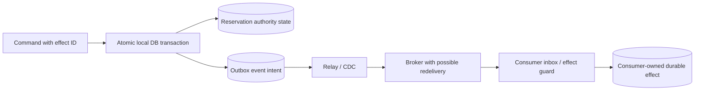
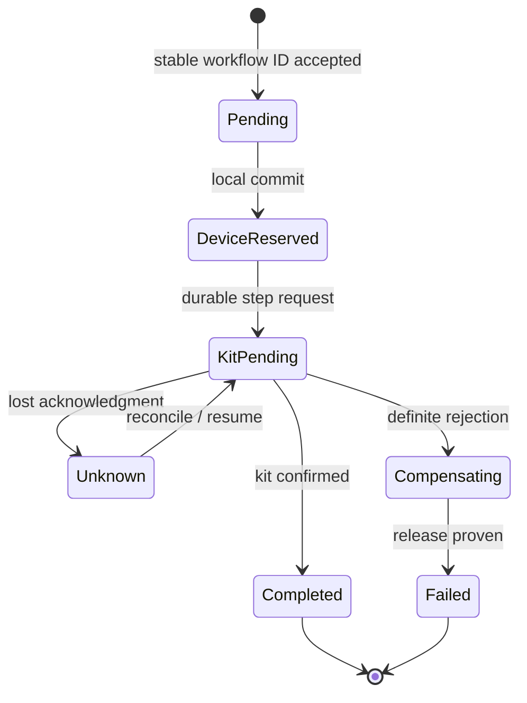

# Outbox, inbox, sagas and durable workflow coordination

> **Tycho manuscript — proposed V04/C05**, 2026-10-19. Primary public references: transactional-outbox and saga/consumer patterns, plus Debezium 3.6 configuration. Original synthetic sequence and state diagram. No broker, CDC process, workflow runner or actual database was deployed, exercised or independently reviewed. Earlier combined [outbox/idempotency research](transactional-outbox-and-idempotency.md) remains preserved for line-level source comparison.

## Purpose and decision question

A relational database can commit an authoritative state change inside one local transaction. An unrelated message broker or external service is usually *not part of the same atomic commit*. A long-running workflow crossing several independent owners therefore needs explicit persistent state, publication and failure contracts. A distributed event architecture is not made reliable by drawing an arrow from a transaction to a queue.

Four patterns address different questions:
- **Transactional outbox:** how can the local state change and a durable intent to publish one event be committed atomically?
- **Inbox/idempotent consumer:** how can a downstream owner apply a redelivered event without duplicating its local business effect?
- **Saga:** how can several owners coordinate business steps and appropriate compensating actions without claiming one global transaction?
- **Durable workflow:** how can a coordinator record its progress, resume after failure and surface unknown outcomes?

The exact retry/operation identity contract is owned by [V04/C04](retries-idempotency-and-ambiguous-effects.md); this chapter owns multi-boundary state coordination.

## 1. Two unsafe dual-write orders

Consider an original invented device-reservation system: it records an accepted reservation and notifies another component. Naive sequence **DB then broker** can commit the reservation and crash before publishing. Naive sequence **broker then DB** can publish a purported acceptance and later roll back the reservation.

[Richardson's Transactional Outbox pattern](https://microservices.io/patterns/data/transactional-outbox) records publication intent together with the business state in a **single local** transaction, then uses a relay. It explicitly notes that a relay may send a message more than once.

**Text alternative:** one local transaction commits both reservation truth and a publication-intent record. A relay sends from that record. Downstream consumers must handle duplicates and record their effects under their own transactional authority. There is **no atomic transaction spanning all illustrated components**.

### Publication truth table

| Failure point | What can be durable | Recovery requirement |
|---|---|---|
| Before local commit | Neither business state nor outbox intent | Retry command with stable business identity |
| After local commit, before relay | Business state and outbox intent | Relay resumes from durable source |
| Broker receives event, relay loses acknowledgment | Broker may store event; relay still sees unsent | Duplicate publication must be tolerated |
| Consumer commits, then loses broker acknowledgment | Consumer-owned effect may already exist | Inbox or effect identity prevents duplicate state |
| Consumer must call another external system | Local DB cannot atomically cover that call | External effect identity or reconciliation |
| Event arrives after newer entity state | Stale event may be replayed | Defined version/order conflict and quarantine |

The source's event-intent guarantee is conditional on **actual atomic insertion**. Writing a so-called outbox record after a completed business transaction still leaves a failure window.

## 2. Publication schema and ordering boundaries

[Debezium Outbox Event Router 3.6](https://debezium.io/documentation/reference/3.6/transformations/outbox-event-router.html) documents an example event ID, aggregate type, aggregate ID, event type and payload. The aggregate ID can become the Kafka message key and help preserve per-partition order. These are *product configuration semantics*, not a guarantee of global ordering or arbitrary exactly-once effects.

Distinguish:
- transaction commit order;
- an aggregate's version or domain sequence;
- connector capture and relay time;
- broker partition offset;
- consumer application time;
- business effect completion.

If event E6 reaches a consumer after newer version E7, a blind last-writer-wins projection may revert correct state. Require a version rule, permissible out-of-order merge, replay repair or rejection that corresponds to the actual domain invariant. An event timestamp alone does not grant a total order across independent producers.

## 3. Inbox and consumer-local atomicity

An inbox can persist a consumer's processed-event identity and business effect together in **one local transaction**. The [Idempotent Consumer pattern](https://microservices.io/patterns/communication-style/idempotent-consumer.html) describes deduplication using a processed-message table or the business aggregate itself.

The identity must include the correct subscriber and event/effect scope; two different consumers legitimately process the same event into different local states. An in-memory set is not sufficient when the contract requires restart-safe deduplication.

**Fictional failure:** a notification consumer writes a processed marker then crashes before making an external non-idempotent send. On redelivery it may falsely skip the missing send. Reversing the order may send twice. Correctness may require a *second* durable send-intent record and cooperation or reconciliation with the downstream delivery provider. A transactional inbox does **not** guarantee exactly-once side effects outside its local authority.

## 4. A saga is a business protocol, not an automatic rollback

[Richardson's Saga pattern](https://microservices.io/patterns/data/saga.html) coordinates a sequence of **local transactions**, with compensating actions when a business step cannot complete. Choreography propagates progress through events; orchestration explicitly coordinates steps.

Original invented workflow: reserve a device, allocate a supporting kit, confirm a booking, then optionally notify its requester. The business might allow the device reservation to be released if kit allocation definitively fails. But a release itself can fail; a delivered message cannot be un-delivered; the kit may already have been handed to a participant. The domain must determine which actions are reversible and which require manual reconciliation.

| Step | Durable state needed | False assumption |
|---|---|---|
| Admit command | Stable workflow/operation identity | In-memory queue acceptance is durable |
| Reserve device | Identity, commit result and cancellation contract | Every accepted step is instantly reversible |
| Request kit | Request identity and uncertain outcome policy | Timeout means rejected |
| Compensate device | Confirmed release or repair state | A compensation call always succeeds |
| Confirm final booking | Evidence required by user contract | Earlier partial success means final completion |
| Notify requester | Separate optional delivery effect identity | Exactly-once notification follows from a broker |

**Text alternative:** the workflow progresses through recorded states. Losing an acknowledgment creates an explicit unknown state requiring reconciliation; compensations can themselves remain incomplete. The diagram is a conceptual state machine, **not** an executed durable workflow.

## 5. Durable workflow selection is conditional

One service and one database transaction are often simpler than a saga. Move to orchestration only when a business operation genuinely spans multiple independently owned effects with different failure and recovery boundaries. A durable coordinator may help with long waits, retries and auditability, but its actual guarantees depend on versioned workflow state persistence, activity semantics, timer reliability and recovery configuration.

**Choreography risks:** difficult-to-discover implicit coupling, unbounded event chains, conflicting compensations, and tracing that describes correlation but not durable business truth.

**Orchestration risks:** central coordinator as an added operational dependency; poor command/event boundaries; storing critical progress only in a volatile scheduler; failed compensation hidden behind an automatically “completed” state.

Neither is universally superior. Measure the number of participating owners, duration, idempotency requirements, recoverability, operations burden and business acceptance conditions.

## 6. Test failures rather than just the happy path

A bounded design verification should inject: crash just before/after local state+outbox commit; relay crash after broker acknowledgment; duplicate deliveries processed concurrently; out-of-order events; restart of an orchestration instance mid-step; definitive failure and compensation failure; old/new event schema coexistence; lost external acknowledgment after irreversible effect.

Acceptance requires the same **correct authoritative business result** under permitted failures, plus bounded unknown/repair states and observable lag. Checking that all generated messages reached a topic is insufficient. **No executable fixture was run** for this manuscript.

## 7. Source-to-claim ledger

| Independently reviewed source | Narrow documented fact | Not proven |
|---|---|---|
| [Transactional Outbox pattern](https://microservices.io/patterns/data/transactional-outbox) | Local commit of state+publication intent and duplicate-relay risk | Cross-resource atomicity |
| [Debezium 3.6 Outbox Event Router](https://debezium.io/documentation/reference/3.6/transformations/outbox-event-router.html) | Version-scoped outbox event identity/key/payload mapping | Correctness of any deployed CDC pipeline |
| [Idempotent Consumer pattern](https://microservices.io/patterns/communication-style/idempotent-consumer.html) | Receiver-local processed-message and state effects | Exactly-once arbitrary external side effects |
| [Saga pattern](https://microservices.io/patterns/data/saga.html) | Coordinated local transactions and compensating actions | Automatic reversibility or distributed ACID |

All examples and state descriptions here are original independent educational material. No service, database, broker, workflow, failure injection, compliance finding or independent review is claimed.

## Navigation

Proposed **V04/C05** in the [10-volume outline](../PROPOSED-STRUCTURE.md). Via [distributed landing](README.md), read [V04/C04 retries](retries-idempotency-and-ambiguous-effects.md), [transaction isolation](transaction-isolation-and-sagas.md), [Kafka partition behavior](../integration/kafka-partitions-replication-and-contracts.md), and [safe rollout](../delivery/safe-rollout-and-recovery.md).
