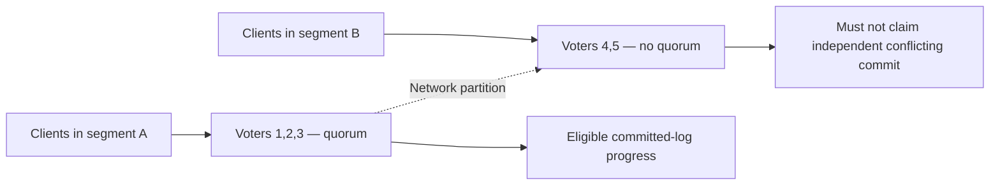

# Replication, consensus and leader change: safety and progress under failures

> **Tycho independent V04/C02 manuscript draft (2026-10-19).** Source scope: the public Raft project/paper entry and etcd 3.6 quorum/membership documentation, plus original synthetic figures. No distributed cluster, fault injection, model checker or independently reviewed proof was executed.

## Purpose and mission

Replication makes copies of state available, but copies can disagree after a crash, network delay or concurrent writes. Consensus protocols coordinate a sequence of state-machine decisions under stated fault assumptions. The key distinction is between **safety**—forbidden outcomes never occur—and **liveness/availability**—the cluster eventually makes progress under supported conditions.

Having several replicas does not mean a system can accept any write while partitioned, restore all committed effects after every failure, or survive loss of a majority without explicit recovery.

The [Raft project and extended paper](https://raft.github.io/) describe a leader-based replicated-log algorithm; [etcd 3.6 FAQ](https://etcd.io/docs/v3.6/faq/) documents its quorum and membership change considerations. These are examples of *consensus under defined fault models*, not universal guarantees for all replicated services.

## 1. Separate replica types and required properties

| Mechanism | Can provide | What it does not automatically give |
|---|---|---|
| Independent read replica | More read capacity and recovery options | Strong current reads or no lag |
| Asynchronous replication | Durable-copy pipeline with bounded/observed lag under policy | Zero loss at primary failure |
| Leader-based consensus replication | Shared committed-log decisions while quorum and assumptions hold | Client progress without sufficient voters |
| Multi-writer replication | Concurrent writes in different locations | Globally serializable conflict-free outcomes |
| Historical backup and PITR | Recovery to a supported prior state if chain intact | Immediate failover or no acknowledged data loss |

For each architecture specify write acknowledgment, eligible reader, membership configuration, failure domain, consistency, reconfiguration and restore model. “Replicated” alone is not an acceptance criterion.

## 2. Majority quorum arithmetic and the failure envelope

In a simplified majority-voting cluster of N eligible voters, a quorum is floor(N/2)+1. A **3-voter** cluster requires 2 votes, and can normally make progress with one unavailable voter if remaining voters can communicate and have necessary log state. A **5-voter** cluster requires 3. Adding an extra voting member can actually increase the quorum without increasing tolerated failures—for example 3 voters → 4 voters raises required votes from 2 to 3.

This arithmetic assumes the quorum protocol and membership-change rules are correct. It is **not a proof that any arbitrary implementation guarantees safety**.

The [etcd v3.6 FAQ](https://etcd.io/docs/v3.6/faq/) discusses why a dangerous membership addition can remove progress when the new member cannot join. A non-voting learner can receive state before safe promotion under implementation-specific rules. Changes to membership are themselves state-machine decisions that need supported joint/overlapping quorum safeguards, not a simple count update in a config file.

## 3. Original synthetic network-partition scenario

A fictional five-voter metadata service is divided by a network failure into groups of three and two. The majority side can retain quorum; the minority side cannot legitimately independently commit a conflicting entry under the assumed Raft-style safety rules. Users attached only to the minority may experience unavailable writes even though local processes remain healthy.

**Text alternative:** a five-voter group splits 3/2; the connected three-voter majority can potentially elect a valid leader and commit, while the two-voter minority cannot independently make quorum. No actual network test or guarantee for a different replication protocol is implied.

Safety can mean refusing an operation rather than answering from potentially stale state. The business-facing API must distinguish a successful authoritative write, a rejection/unavailable result, and an **unknown outcome** after client timeout. A timed-out write may have committed before the reply disappeared, so blind retry of an external effect is unsafe without stable idempotency and readback.

## 4. Leader elections, logs and client observations

Under a Raft-style model:
1. At a time, a node believes itself a leader for a given term, but other nodes can still be unaware because messages are delayed.
2. The quorum/term/log rules govern which log entries can be committed without violating safety.
3. A newly elected leader may reconcile followers with divergent **uncommitted** suffixes.
4. An acknowledged committed log entry has a protocol-specific durability/leader-completeness guarantee, contingent on correct stable storage and membership behavior.
5. Reads require a separately defined policy: local follower reads can be stale; linearizable reads require valid confirmation/lease/read-index semantics as implemented.
6. Client retries need stable effect identity because a network error alone cannot tell whether the previous attempt committed.

A leader process's health endpoint or elected status is not the same as the cluster having quorum and serving correct reads. [Tycho causality/consensus](causality-ordering-and-consensus.md) explains order/time relationships; [transaction/idempotency](transactional-outbox-and-idempotency.md) explains state effects across service boundaries.

## 5. Reconfiguration and restoration are different actions

Replacing an unhealthy voter changes cluster membership; restoring lost business state from backup changes persisted data. Those are not interchangeable. A safe reconfiguration accounts for current voters, reachable quorum, catch-up state, target network identity, eligible leader placement, and whether the reconfiguration itself can commit.

A backup restore may have to be performed as a **separately authorized disaster-recovery procedure** after irrevocable quorum loss. Restarting replicas from inconsistent snapshots without respecting implementation-specific cluster identity and membership can create divergence. Avoid prescribing manual member steps for an unspecified product.

## 6. Failure and negative experiment matrix

| Fault | Question | Failure to reject |
|---|---|---|
| Current leader crashes | Can a connected quorum elect, resume and preserve committed state? | Old leader makes a conflicting commit |
| Network 3/2 split | Does minority refuse unsafe writes/linearizable reads? | Two sides both claim incompatible authority |
| Delayed follower | Can it catch up without treating uncommitted suffix as truth? | Duplicate/incorrect applied business effect |
| Membership addition while degraded | Does quorum remain recoverable if newcomer never starts? | Unsafe quorum requirement increase |
| Client acknowledgment lost | Does replay resolve one stable effect? | Duplicate committed business command |
| Stale follower read | Is staleness explicit or forbidden by contract? | Client treats an outdated value as linearizable |
| Permanent quorum loss | Is recovery documented and data-loss bound understood? | Claim automatic normal operation without quorum |

These are proposed test cases, not results. Safety proofs require precise protocol assumptions, implementation/version checks and independent review.

## Engineering walkthrough — New leader, old client and a lost acknowledgment

**Original three-node quorum illustration:** nodes A, B and C replicate one state machine. A was leader. A's network connection to B and C fails; B and C may form a quorum and eventually select a new leader. A can remain reachable to some clients, but must not be allowed to commit new authoritative writes without a valid quorum/term contract. A client whose response was lost before the partition cannot decide whether its operation committed.

| Failure point | Safety claim requiring proof | Liveness limitation |
|---|---|---|
| A isolated from B,C | Quorum/term enforcement prevents conflicting committed log entries | Some clients of A cannot complete writes |
| B/C elect successor | New leader reconciles log according to protocol | Election delay may exceed request deadline |
| Old A reappears with stale state | Reject stale leader commands, catch up log | Cannot blindly serve fresh reads before state catches up |
| Membership changes | Respect the protocol's configuration transition safety | Removing too many voters can lose progress |

An acknowledged write's durability depends on the actual replication/commit acknowledgment boundary; a client timeout is ambiguous and requires stable operation identity on retry. Read consistency depends on the concrete algorithm and read path, not simply on "three replicas". Raft's public paper and the etcd versioned FAQ support protocol discussion, but do not certify an invented deployment's failover timings.

**Proposed, not run:** partition old leader, issue reads/writes on both sides, restore connectivity and change membership while checking committed-history invariants, stale-term rejection, duplicate effects and correct client error classification. For read-mostly telemetry where temporary staleness is acceptable, simpler asynchronous replicas may avoid quorum overhead; if single-key linearizable authority is mandatory, that alternative may fail the requirement.

## 7. Source ledger and limitations

| Public source reviewed | Narrow support | Not established |
|---|---|---|
| [Raft project — Ongaro/Ousterhout extended consensus paper](https://raft.github.io/) | Leader-based log replication, terms, elections and safety principles | Correctness of an invented or third-party service implementation |
| [etcd 3.6 FAQ, membership and quorum](https://etcd.io/docs/v3.6/faq/) | Majority calculations and reconfiguration hazards | Resilience of an untested specific cluster |
| [Tycho causality/consensus page](causality-ordering-and-consensus.md) | Existing source-grounded related consensus concepts | A checked formal proof or live fault test |

Every failure, cluster layout, client result and diagram above is an original illustrative proposal. No environment, network, snapshot or node was touched. Actual versioned replication behavior and chapter-level technical review remain outstanding.

**Navigation:** proposed **V04/C02** in [outline](../PROPOSED-STRUCTURE.md), current [Distributed coordination landing](README.md). Background: [Causal ordering and consensus](causality-ordering-and-consensus.md), [Isolation and sagas](transaction-isolation-and-sagas.md), [Safe recovery](../deployment/multi-region-disaster-recovery-contracts.md).
