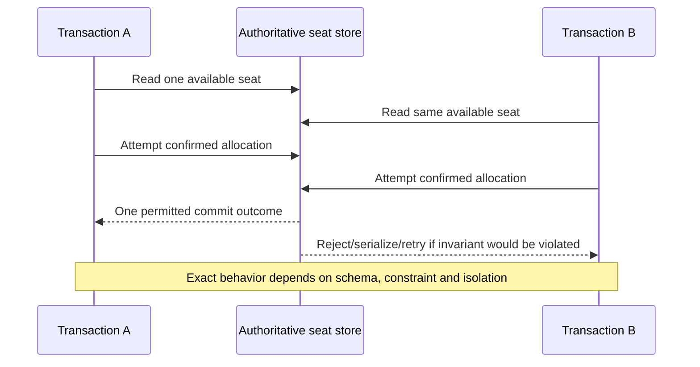
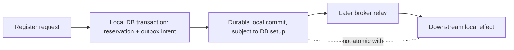
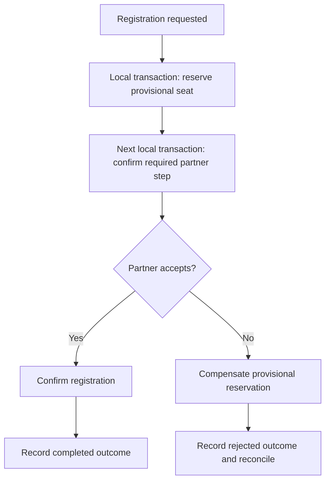

# Consistency, transaction isolation and sagas across service boundaries

> Tycho Issue [#80](https://github.com/rouslanbaranov/tycho/issues/80), proposed V04/C03/C05. Research: 2026-10-18. Public-source-grounded explanation and entirely fictional registration workflow. **Not** a tested transaction framework or guarantee of exactly-once operation.

## Purpose and mission

Business invariants survive only when the enforcing mechanism covers **every concurrent operation that can violate them**. A local transaction, serializable isolation, an event publication and a compensating action solve different problems. This page describes their boundaries before recommending any distributed transaction strategy.

**Primary question:** Which consistency requirements can be enforced within one authoritative local transaction, and what changes when a business operation must coordinate multiple separately committed owners?

## 1. Define the invariant before naming consistency

Imagine a wholly synthetic booking system with one workshop of ten seats. The invariant is not "use ACID"; it is **number of confirmed allocations must not exceed configured capacity**, under concurrency, retry and failure. Other requirements may permit an availability projection to lag or a confirmation notification to arrive later. The critical question is who can commit the authoritative allocation and what happens after ambiguous client outcomes.

| Concern | Required definition | Common category error |
|---|---|---|
| Local transaction isolation | Which concurrent reads/writes can affect the invariant? | "No dirty reads" means full serializability |
| Durability | What acknowledged state survives which failure and storage setup? | COMMIT response implies every backup or region has latest data |
| Data consistency | What stale/incomplete state can clients observe, and for how long? | Replication delay has no user or business effect |
| Cross-service workflow | Can committed steps be undone or compensated after another service fails? | Saga compensation is an automatic ACID rollback |
| Idempotence | Which repeated request represents the same logical intent? | Two identical HTTP requests cannot cause duplicates |
| Atomic publication | Which state changes must commit together? | Publishing to a broker within an application callback creates a global transaction |

## 2. PostgreSQL transaction isolation as a concrete bounded example

PostgreSQL **17** documentation §13.2 describes its implemented isolation levels, including **READ COMMITTED**, **REPEATABLE READ** and **SERIALIZABLE**, their visibility and anomalies; PostgreSQL treats the SQL `READ UNCOMMITTED` request as `READ COMMITTED`. Under `SERIALIZABLE`, transactions can be aborted with a serialization failure rather than allowing a history that could not occur under some serial ordering. PostgreSQL §13.5 requires complete transaction retry handling for some serialization errors. [E01, E02]

**Serializable does not mean wait forever until all transactions succeed.** A transaction's business decision must be safe when reexecuted from the beginning, and external irreversible side effects must not leak out during a transaction that may abort or retry.

Text alternative: two concurrent transactions may see the same apparent capacity. A correct schema/transaction protocol must enforce the seat invariant, potentially rejecting/retrying a transaction. This illustrative timeline **does not claim PostgreSQL automatically detects overbooking in arbitrary application schemas**.

An explicit uniqueness or capacity condition can make a conflict observable. For example, a well-defined seat identifier with an appropriate database uniqueness constraint may prevent **two bookings of the same seat**, but it does not automatically prove all business-level capacity rules across changing allocations. Match the invariant to the actual enforcement.

### Local atomic commit does not include the outside world

Text alternative: a local database transaction can group registration and outbox records, but downstream event transport and the consumer's state have their own failure/atomicity boundaries. The canonical [outbox and idempotency chapter](transactional-outbox-and-idempotency.md) owns the detailed retry and deduplication protocol.

The outbox does not prevent an invalid business allocation if **the source transaction itself** is incorrectly specified. An idempotency key does not replace isolation. Both concerns may be required.

## 3. Distributed transactions are a protocol choice, not an automatic extension

A global two-phase commit protocol coordinates prepare/commit decisions across participants capable of supporting that exact protocol. It may simplify some cross-resource atomicity requirements, but participants and the coordinator need documented recovery behavior; coordinator/participant failure and locks may affect progress. Do not assume an arbitrary SaaS API, queue and database support a shared atomic transaction merely because an application uses the word "transaction".

When independent services own separate stores and cross-service 2PC is unavailable or unsuitable, a **saga** can model a business process as an explicit sequence of local transactions with recovery/compensation. Chris Richardson's [Saga pattern](https://microservices.io/patterns/data/saga.html) distinguishes choreography (participants react to events) and orchestration (one coordinator issues commands). It also explicitly notes missing automatic rollback and isolation, and warns about anomalous concurrent saga interactions. [E03]

Text alternative: a workflow reserves provisional capacity, seeks confirmation from a partner and either finalizes or invokes a domain-specific compensating action. Both paths must be recorded and recoverable after process or network failure. This **fictional** story is not a reproduction of the cited author's commerce examples.

A compensating transaction is **not time travel**. If a notification was already delivered to a human, a later "cancel" event cannot erase knowledge; if a payment settled externally, refund may require a new separately audited transaction and can fail independently. Make compensation idempotent where needed and specify which effects are fundamentally irreversible.

## 4. Choreography, orchestration and the concurrency trap

| Dimension | Choreography | Orchestration |
|---|---|---|
| Coordination | Distributed reaction to published business events | Central workflow state issues commands to participants |
| Simplicity benefit | Fewer explicit central coordinator concepts for short flows | Easier to inspect one explicit end-to-end state machine |
| Primary cost | Harder to infer complete flow, loops and recovery from many handlers | Coordinator persistence, availability, versioning and lifecycle ownership |
| Failure recovery | Participants must retain enough state to resume/reconcile | Orchestrator must retain decisions, retries, timeouts and compensations |
| Concurrency | Event reordering and overlapping saga steps may violate invariants | Orchestration still **does not** automatically provide global isolation |
| Applicability | Stable, bounded, independently owned event reactions | Complex business steps with explicit timeouts and compensation policy |

The correct design may keep a single local transaction for the strongest invariant while using a saga **only** for legitimately distributed secondary effects. Do not fragment the registration allocation merely to demonstrate a sophisticated pattern.

### Anomaly: cancel overlaps a pending registration

```mermaid
stateDiagram-v2
    [*] --> Pending
    Pending --> Confirmed: All required steps complete
    Pending --> Rejected: Business check fails; compensate
    Pending --> NeedsRepair: Timeout or unknown step outcome
    NeedsRepair --> Confirmed: Reconciled successful result
    NeedsRepair --> Rejected: Verified compensation
    Confirmed --> Cancelled: Explicit later cancellation workflow
    Rejected --> [*]
    Cancelled --> [*]
```

Text alternative: provisional registration can be confirmed, rejected or require reconciliation after an uncertain remote outcome. A later cancellation of a confirmed registration is a new business transition, not an implicit way to erase an earlier committed step.

In Richardson's separate [saga design discussion](https://microservices.io/post/microservices/2019/07/09/developing-sagas-part-1.html), the semantic-lock technique illustrates why states such as `PENDING` can guard against overlapping commands. Its example is guidance, not a universal guarantee; the invented registration machine above requires explicit storage, concurrency and valid-transition enforcement. [E04]

## 5. Failure matrix and an experiment contract

| Failure injected | Expected question | Required validation |
|---|---|---|
| Crash before local commit | Can either source record partially persist? | Atomic source transaction and rollback test |
| Crash after commit but before reply | Can retry recover the same outcome? | Client key + stored result; concurrent duplicate attempts |
| Remote service times out | Is its effect committed, rejected or unknown? | Query/reconciliation contract; no blind secondary effect |
| Compensation action fails | Does the process preserve pending repair state? | Durable workflow state, eventual retry, alarm and deadline |
| Two sagas race for same resource | Can both violate global capacity? | Isolation/invariant protocol with adversarial overlap tests |
| Broker delivers twice | Does consumer apply a second logical effect? | Stable event identity, consumer atomic dedup and retention |
| Domain rule changes during rollout | Can old and new steps interpret pending states? | Versioned workflow, old/new compatibility and forward repair |

**SLOs cannot substitute for invariants.** A 99.9% workflow-success objective permits bad events under its definition; it is not proof that acknowledged money or bookings are never double-applied.

## 6. Alternatives, boundaries and unanswered questions

Prefer one authoritative **local** transaction when the high-value invariant fits one owner and operating limits are acceptable. Introduce a saga when a business process must span multiple independent owners, the participating steps can be modeled and recovered, and the team can support reconciliation and failure handling. Consider synchronous composition when no durable state transition is required; choose orchestration only after observing that workflow complexity warrants it.

Insufficient-evidence question: "Three independent services all use PostgreSQL SERIALIZABLE. Are our cross-service registrations globally serializable?" **No.** Local isolation is not a global cross-database protocol. Need a single authoritative allocation model, participating transaction mechanism or application-level invariant protocol, retry/compensation policy and actual overlapping-failure tests.

## Engineering walkthrough — The cancel-versus-accept invariant crosses a transaction boundary

**Original fictional reservation:** Booking accepts one seat and Payment authorizes a deposit in separate databases. Cancellation can race with payment confirmation. Two transactions may each be locally ACID yet produce a globally invalid result: booking CANCELLED while the external payment is captured as if the booking remained ACTIVE.

A local PostgreSQL serializable transaction can protect a booking-state transition inside one data authority, subject to retries. It cannot atomically roll back a committed capture in an unrelated payment provider. A saga must define valid durable states and compensating actions, including cases where payment capture cannot be reversed instantaneously.

| Event race | Business protocol response | Incorrect shortcut |
|---|---|---|
| Cancel before payment authorized | Mark cancellation intent; prevent new capture through fenced operation/state | Assume last message received always wins |
| Payment captured, cancel then arrives | Transition to refund-pending and reconcile actual refund effect | Rewrite captured to never-happened |
| Deposit reply lost | Query provider by stable payment intent | Blindly capture a second payment |
| Compensation fails | Durable retry/manual repair state with accountable owner | Declare saga complete while money remains captured |

**Choice:** if all required state can remain in one local database, prefer its transaction/invariant over a saga for that operation; when independent business authorities are non-negotiable, accept explicit intermediate states and compensation contracts. A message order alone cannot substitute for versioned business transitions. The saga pattern and PostgreSQL isolation documents support bounded mechanisms, not guaranteed reversibility.

**Proposed, not executed:** synchronize cancel and accept operations, lose payment acknowledgments, crash during compensation and replay messages out of order. The test oracle is one legal booking outcome plus independently reconciled payment status, not a globally atomic transaction claim.

## Bounded public evidence and review state

| ID | Public source, exact inspected section | Supports / limits |
|---|---|---|
| E01 | [PostgreSQL 17, §13.2 Transaction Isolation](https://www.postgresql.org/docs/17/transaction-iso.html), isolation-level table and serializable behavior, accessed 2026-10-18 | Local isolation semantics only; no assurance of a correct arbitrary domain schema or external transaction |
| E02 | [PostgreSQL 17, §13.5 Serialization Failure Handling](https://www.postgresql.org/docs/17/mvcc-serialization-failure-handling.html), retry requirements | Source transaction may need complete retry, not just repeating a single query |
| E03 | [Chris Richardson, Saga pattern](https://microservices.io/patterns/data/saga.html), Context/Solution/Resulting context: choreography/orchestration, isolation and compensation | Public pattern description, no production guarantee or measured fit |
| E04 | [Richardson, *Managing data consistency ... using Sagas — part 1*](https://microservices.io/post/microservices/2019/07/09/developing-sagas-part-1.html), compensating transactions and semantic-lock example (2019) | Identifies a design hazard and countermeasure; not a proof of the fictional workflow |

All diagram states, examples and numerical parameters here are **original synthetic descriptions**, not source-reproduced experiments. Independent human review, formal concurrency verification, distributed 2PC implementation and system deployment are **not** claimed.
